# Scriba — Manual contextual de diagramas

<!-- scriba-reference:diagram-manual version=1 -->

**Edição 1.2.0 · 19 de outubro de 2026.** Uma biblioteca de exemplos para escolher uma representação, adaptar seu código e comparar o resultado no Scriba. O arquivo é versionado com o produto e aparece como nota fixada junto ao guia.

## Como usar este manual

1. Comece pela pergunta que precisa responder. Cada exemplo apresenta uma pergunta, uma forma de ler o desenho e uma orientação de adaptação.
2. Os blocos `mermaid` e `zenuml` aparecem como desenho em **Ler**, **Visão** e na prévia de **Escrever**. Use o **lápis sobre o desenho** para revelar o Markdown. **Fonte** mostra o arquivo completo; copie apenas o exemplo que precisa para sua própria nota.
3. Compare **Mermaid 12.2.0**, **Pele 1.6.0** e **Beautiful Mermaid 1.1.3** pelo seletor de cada desenho. A escolha não altera o código. A cobertura dos exemplos está na matriz abaixo.
4. Ative a **lupa 2×** para inspecionar detalhes; passe o mouse ou arraste o dedo. **Esc** desativa. No teclado, use Tab até o desenho e as setas para explorar.
5. Use a **roda do mouse** ou **− / +** para ampliar o desenho. Arraste para navegar e clique no percentual para voltar a 100%. **Ver código** mostra a sintaxe destacada; **Copiar** leva somente o código do diagrama. **Baixar diagrama** oferece SVG vetorial e PNG com fundo transparente, sempre com o desenho inteiro.
6. Para **ZenUML 4.7.2**, vá à seção dedicada no fim deste mesmo manual. Os blocos usam uma linguagem própria de sequência e o Scriba identifica seu motor automaticamente.
7. Preserve a pergunta e uma explicação textual ao reutilizar o código. Pessoas que não veem o gráfico também precisam entender a decisão ou o dado.

Todos os nomes de acervos, números, datas e cenários deste manual são **ilustrativos**. “Acervo Aurora” é um sistema fictício usado para conversar sobre pesquisa, curadoria e trabalho com evidências. As arquiteturas, automações e modelos de dados são propostas de domínio; não descrevem funcionalidades já implementadas no Scriba nem anunciam um compromisso de roadmap.

## Escolha rápida

| Pergunta | Comece por |
| --- | --- |
| O que acontece em seguida e onde há decisão? | Fluxograma |
| Quem faz cada etapa? | Raias ou casos de uso |
| Quem envia o quê, em qual ordem? | Sequência Mermaid ou ZenUML |
| Em que condição um objeto pode estar? | Estados |
| Quais entidades existem e como se relacionam? | ER ou classes |
| Qual requisito será comprovado por qual teste? | Requisitos |
| Qual é a fronteira de um sistema e seus níveis internos? | C4 ou arquitetura |
| Quando algo acontece e do que depende? | Gantt ou linha do tempo |
| Qual é a composição, comparação ou distribuição? | Pizza, XY, Sankey, treemap ou radar |
| Quais critérios se sobrepõem? | Venn |
| Que hipóteses ou abordagens precisam ser discutidas? | Ishikawa, Wardley ou Cynefin |
| Quais entradas uma linguagem permite? | Railroad, EBNF, ABNF ou PEG |

## Compatibilidade observada

<!-- compatibility:start -->
Verificado no próprio Scriba em **19/10/2026**: **58 exemplos**, agrupados em **33 famílias**, incluindo o diagnóstico `info`. Mermaid 12.2.0: **58/58**; Pele 1.6.0: **58/58**; Beautiful Mermaid 1.1.3: **21/58**.

| Família / variação | Exemplos | Mermaid | Pele | Beautiful Mermaid |
| --- | ---: | --- | --- | --- |
| Fluxogramas e formas | 7 | Sim (7/7) | Sim (7/7) | Sim (7/7) |
| Raias | 1 | Sim (1/1) | Sim (1/1) | Não |
| Casos de uso | 1 | Sim (1/1) | Sim (1/1) | Não |
| Jornada | 1 | Sim (1/1) | Sim (1/1) | Não |
| Sequência | 4 | Sim (4/4) | Sim (4/4) | Sim (4/4) |
| Estados | 3 | Sim (3/3) | Sim (3/3) | Sim (3/3) |
| Entidade e relacionamento | 2 | Sim (2/2) | Sim (2/2) | Sim (2/2) |
| Classes | 2 | Sim (2/2) | Sim (2/2) | Sim (2/2) |
| Requisitos | 1 | Sim (1/1) | Sim (1/1) | Não |
| Mapa mental | 1 | Sim (1/1) | Sim (1/1) | Não |
| Árvore | 1 | Sim (1/1) | Sim (1/1) | Não |
| Railroad, EBNF, ABNF e PEG | 4 | Sim (4/4) | Sim (4/4) | Não |
| Blocos | 1 | Sim (1/1) | Sim (1/1) | Não |
| Arquitetura | 1 | Sim (1/1) | Sim (1/1) | Não |
| C4: contexto a implantação | 5 | Sim (5/5) | Sim (5/5) | Não |
| Pacotes | 1 | Sim (1/1) | Sim (1/1) | Não |
| Fluxo de agentes | 1 | Sim (1/1) | Sim (1/1) | Não |
| Gantt | 2 | Sim (2/2) | Sim (2/2) | Não |
| Linha do tempo | 1 | Sim (1/1) | Sim (1/1) | Não |
| Kanban | 1 | Sim (1/1) | Sim (1/1) | Não |
| Histórico Git | 2 | Sim (2/2) | Sim (2/2) | Não |
| Pizza | 1 | Sim (1/1) | Sim (1/1) | Não |
| Quadrantes | 1 | Sim (1/1) | Sim (1/1) | Não |
| XY: barras, linha e combinado | 3 | Sim (3/3) | Sim (3/3) | Sim (3/3) |
| Radar | 1 | Sim (1/1) | Sim (1/1) | Não |
| Sankey | 1 | Sim (1/1) | Sim (1/1) | Não |
| Treemap | 1 | Sim (1/1) | Sim (1/1) | Não |
| Venn | 1 | Sim (1/1) | Sim (1/1) | Não |
| Modelagem de eventos | 2 | Sim (2/2) | Sim (2/2) | Não |
| Ishikawa | 1 | Sim (1/1) | Sim (1/1) | Não |
| Wardley | 1 | Sim (1/1) | Sim (1/1) | Não |
| Cynefin | 1 | Sim (1/1) | Sim (1/1) | Não |
| Diagnóstico (info) | 1 | Sim (1/1) | Sim (1/1) | Não |

“Sim” significa que os exemplos renderizaram como SVG no aplicativo. Não garante equivalência de formas, posicionamento ou tipografia entre motores, nem todas as combinações de uma gramática. Os testes mantêm o código original e verificam que a troca de motor não grava alterações na nota.
<!-- compatibility:end -->

Os sufixos `-beta` fazem parte da sintaxe de algumas famílias experimentais. Eles não são uma instrução de execução. O conjunto inclui as famílias nativas do Mermaid instalado, suas principais variações de estrutura e o diagnóstico `info`; não enumera todas as combinações possíveis de opções.

## Índice por contexto

- [Processos e responsabilidades](#processos-e-responsabilidades)
- [Interações e ciclos de vida](#interações-e-ciclos-de-vida)
- [Estruturas e contratos](#estruturas-e-contratos)
- [Arquitetura e integração](#arquitetura-e-integração)
- [Planejamento e evolução](#planejamento-e-evolução)
- [Métricas e conjuntos](#métricas-e-conjuntos)
- [Decisões e aprendizado](#decisões-e-aprendizado)
- [Diagnóstico](#diagnóstico)
- [ZenUML — interações descritas como código](#zenuml-interações-descritas-como-código)
- [Excalidraw — raciocinar com desenhos editáveis](#excalidraw-raciocinar-com-desenhos-editáveis)

## Convenções para construir e revisar

- **Identificador e rótulo são coisas diferentes.** `Review[Revisar evidência]` usa `Review` como identificador e apresenta a expressão entre colchetes para quem lê.
- **O primeiro comando escolhe a família.** `erDiagram` descreve entidades; `edDiagram` não é uma variante válida. `graph` é um alias de fluxograma.
- **Direção é uma escolha narrativa.** TD/TB desce, LR segue à direita, RL segue à esquerda e BT sobe. Prefira o percurso que acompanha a pergunta.
- **Uma seta precisa de significado.** Ela pode indicar sequência, chamada, dependência ou quantidade. Diga qual desses sentidos está usando.
- **Números precisam de unidade e base.** Registre período, denominador e regra de agregação. As amostras deste arquivo não são resultados de avaliação do produto.
- **Um desenho pequeno é mais fácil de revisar.** Divida processos grandes por pergunta ou fronteira. Mantenha o contexto no texto que acompanha cada recorte.
- **Compare no leitor de destino.** Layout, quebra de texto, formas modernas e famílias experimentais podem diferir entre motores.
- **Conteúdo continua sendo Markdown.** O desenho não executa código, não cria serviços, não faz operações Git e não instala extensões.
- **O Scriba limita cada bloco a 50 mil caracteres.** Links e imagens externas do SVG são removidos. Os exemplos deste arquivo usam texto e recursos locais, com as cores do aplicativo.

## Processos e responsabilidades

### Revisão de evidências com decisão

**Pergunta:** Como uma observação vira uma evidência revisada?

<!-- diagram-example: flow-review family=flowchart -->
<!-- example-compatibility: flow-review -->
**Motores verificados:** Mermaid · Pele · Beautiful Mermaid.

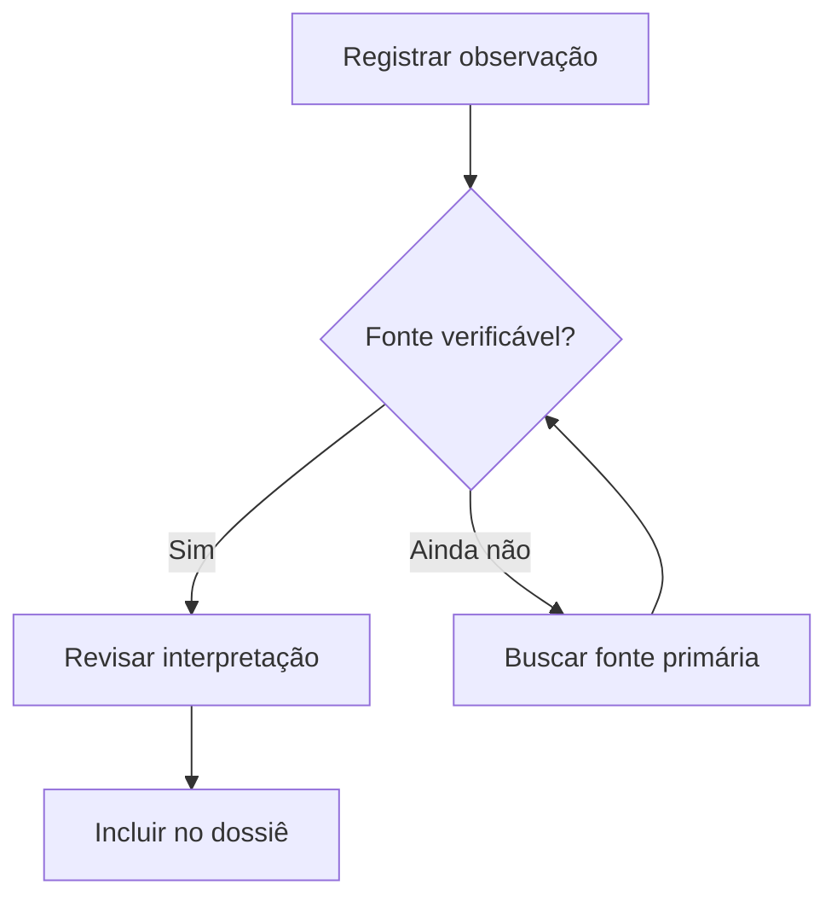

**Leia assim:** O losango separa o caminho sustentado por fonte da coleta complementar. A volta para a pesquisa representa retrabalho explícito.

**Adapte:** Troque os critérios do losango e dê nome às saídas. Um rótulo como “Fonte verificável?” é mais acionável que “OK?”.

### Relações, dependências e caminhos alternativos

**Pergunta:** Quais ligações representam execução, dependência ou consulta?

<!-- diagram-example: flow-edges family=flowchart -->
<!-- example-compatibility: flow-edges -->
**Motores verificados:** Mermaid · Pele · Beautiful Mermaid.

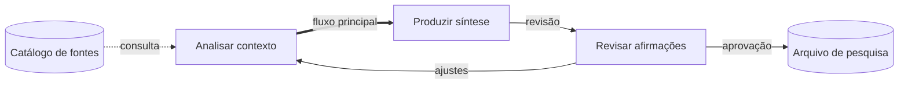

**Leia assim:** A linha tracejada representa consulta; a seta grossa destaca o percurso principal. O texto da ligação preserva o significado mesmo sem cores.

**Adapte:** Mantenha uma legenda textual e use o mesmo tipo de ligação para o mesmo significado em todo o documento.

### Formas como vocabulário visual

**Pergunta:** Como distinguir entrada, tarefa, decisão, armazenamento e encerramento?

<!-- diagram-example: flow-shapes family=flowchart -->
<!-- example-compatibility: flow-shapes -->
**Motores verificados:** Mermaid · Pele · Beautiful Mermaid.


**Leia assim:** Cada forma recebe uma função: entrada em paralelogramo, tarefa em retângulo, decisão em losango e arquivo em cilindro.

**Adapte:** Escolha poucas formas e explique seu papel. A mesma forma deve manter a mesma função nos outros diagramas.

### Direção BT para explicar dependências de baixo para cima

**Pergunta:** De quais insumos depende uma recomendação?

<!-- diagram-example: flow-bt family=flowchart -->
<!-- example-compatibility: flow-bt -->
**Motores verificados:** Mermaid · Pele · Beautiful Mermaid.

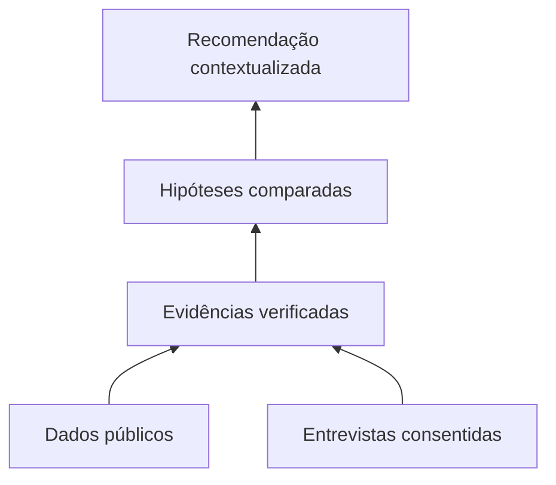

**Leia assim:** BT posiciona as fontes na base e a recomendação no topo. A seta mantém o sentido de dependência descrito no texto.

**Adapte:** Use esta orientação para sustentação e linhagem. Para sequência cronológica, prefira um fluxo temporal consistente.

### Direção RL para rastrear uma conclusão até a origem

**Pergunta:** Como auditar uma conclusão a partir de suas referências?

<!-- diagram-example: flow-rl family=flowchart -->
<!-- example-compatibility: flow-rl -->
**Motores verificados:** Mermaid · Pele · Beautiful Mermaid.

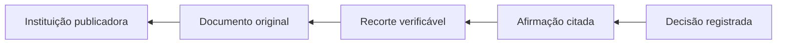

**Leia assim:** A leitura começa à direita na decisão e segue para evidência e documento original. O desenho explicita o trajeto de auditoria.

**Adapte:** Mude a direção para LR quando a explicação partir da coleta. A orientação deve seguir a pergunta de quem lê.

### Subgrupos para separar responsabilidades

**Pergunta:** Onde termina a coleta e começa a curadoria?

<!-- diagram-example: flow-boundaries family=flowchart -->
<!-- example-compatibility: flow-boundaries -->
**Motores verificados:** Mermaid · Pele · Beautiful Mermaid.

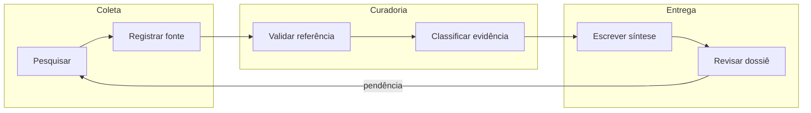

**Leia assim:** Os subgrupos representam responsabilidades. O caminho “pendência” volta à coleta, sem esconder a necessidade de revisão.

**Adapte:** Substitua os grupos por equipes, sistemas ou etapas. As fronteiras organizam o desenho, mas não comprovam uma política de acesso.

### Sintaxe moderna de formas

**Pergunta:** Como representar documento, banco e operação manual com formas nomeadas?

<!-- diagram-example: flow-modern-shapes family=flowchart -->
<!-- example-compatibility: flow-modern-shapes -->
**Motores verificados:** Mermaid · Pele · Beautiful Mermaid.

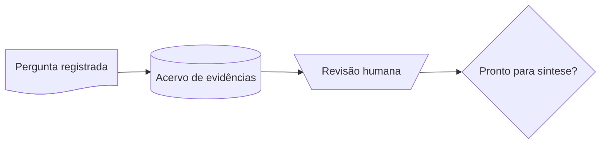

**Leia assim:** A notação @{ shape: ... } escolhe formas por identificador. Este é um exemplo de sintaxe cuja cobertura deve ser comparada entre motores.

**Adapte:** Comece por formas simples em materiais que circularão em leitores diferentes. Compare a matriz de compatibilidade antes de depender de uma forma específica.

### Raias para mostrar passagem entre papéis

**Pergunta:** Quem faz cada etapa e em qual momento o trabalho muda de responsável?

<!-- diagram-example: swim-review family=swimlane -->
<!-- example-compatibility: swim-review -->
**Motores verificados:** Mermaid · Pele. Beautiful Mermaid não renderiza este exemplo.

```mermaid
swimlane-beta LR
  subgraph Research[Pesquisa]
    Find[Encontrar fonte] --> Submit[Enviar evidência]
  end
  subgraph Review[Revisão]
    Verify[Verificar citação] --> Accept[Aceitar referência]
  end
  subgraph Editorial[Editorial]
    Draft[Escrever síntese] --> Deliver[Entregar dossiê]
  end
  Submit --> Verify
  Accept --> Draft
```

**Leia assim:** As raias agrupam ações por papel. A passagem de coleta para revisão mostra um ponto de entrega, que pode exigir informação mínima.

**Adapte:** Dê às raias nomes de papéis estáveis. Use swimlane-beta como sintaxe experimental e confira o resultado no motor escolhido.

### Casos de uso e fronteira de produto

**Pergunta:** Quais objetivos uma pessoa busca ao usar um acervo de pesquisa?

<!-- diagram-example: usecase-roles family=usecase -->
<!-- example-compatibility: usecase-roles -->
**Motores verificados:** Mermaid · Pele. Beautiful Mermaid não renderiza este exemplo.

```mermaid
usecase-beta
direction LR
actor Researcher("Pesquisadora")
actor Reviewer("Revisora")
systemBoundary Workspace["Acervo Aurora"]
  Capture("Registrar evidência")
  Organize("Organizar dossiê")
  Verify("Verificar referência")
  Review("Revisar síntese")
end
Researcher --> Capture
Researcher --> Organize
Reviewer --> Review
Capture ..> : include Verify
```

**Leia assim:** Os atores se ligam a objetivos; a fronteira reúne capacidades de um produto hipotético. A inclusão registra uma etapa compartilhada.

**Adapte:** Use verbos orientados a objetivos. Este modelo é uma proposta de domínio, não uma lista de funcionalidades já entregues pelo Scriba.

### Jornada para localizar fricção no trabalho

**Pergunta:** Em quais etapas a experiência de produzir um dossiê piora?

<!-- diagram-example: journey-evidence family=journey -->
<!-- example-compatibility: journey-evidence -->
**Motores verificados:** Mermaid · Pele. Beautiful Mermaid não renderiza este exemplo.

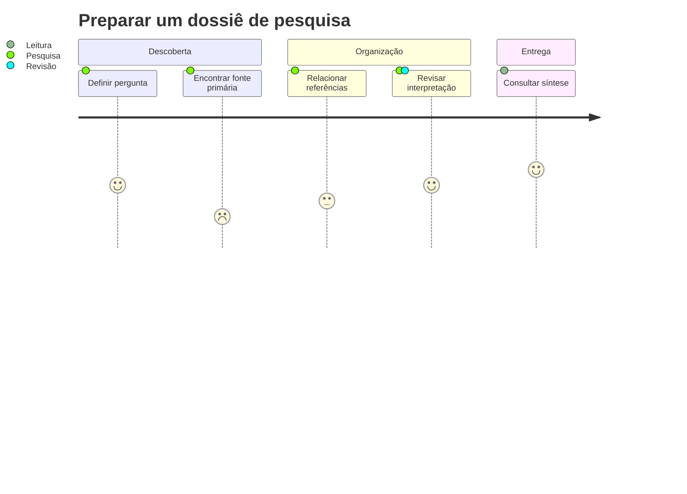

**Leia assim:** As notas de 1 a 5 são avaliações fictícias de experiência. Uma etapa com nota baixa indica uma hipótese de fricção a investigar.

**Adapte:** Troque as notas por observações de entrevistas ou testes e registre amostra, data e critério. A nota não mede produtividade automaticamente.

## Interações e ciclos de vida

### Sequência de salvamento e confirmação

**Pergunta:** Qual participante confirma cada etapa de um salvamento?

<!-- diagram-example: sequence-save family=sequence -->
<!-- example-compatibility: sequence-save -->
**Motores verificados:** Mermaid · Pele · Beautiful Mermaid.

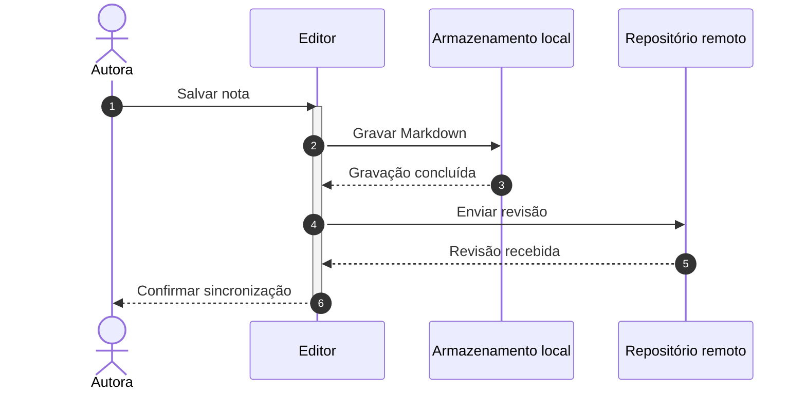

**Leia assim:** A linha do tempo desce na página. As mensagens de retorno distinguem gravação local de confirmação remota.

**Adapte:** Nomeie cada confirmação pelo que ela garante. Um retorno de gravação local não garante que o envio remoto terminou.

### Alternativas, repetição e retentativa limitada

**Pergunta:** O que acontece se o serviço de fontes estiver indisponível?

<!-- diagram-example: sequence-retry family=sequence -->
<!-- example-compatibility: sequence-retry -->
**Motores verificados:** Mermaid · Pele · Beautiful Mermaid.

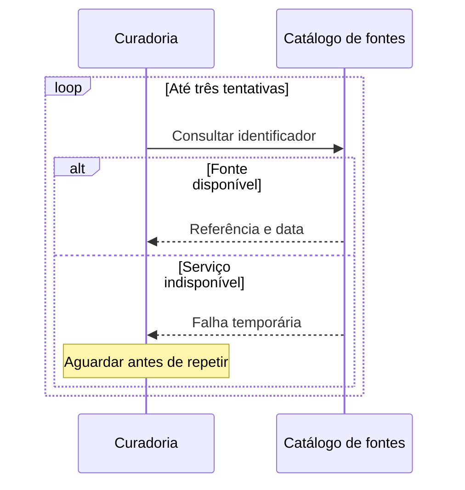

**Leia assim:** O bloco alt separa sucesso e indisponibilidade. O loop estabelece um limite explícito para novas tentativas.

**Adapte:** Registre a política real de retentativa e a decisão após o limite. O desenho não implementa timeout nem tratamento de erro.

### Consulta paralela e etapa opcional

**Pergunta:** Quais consultas podem ocorrer independentemente antes da síntese?

<!-- diagram-example: sequence-parallel family=sequence -->
<!-- example-compatibility: sequence-parallel -->
**Motores verificados:** Mermaid · Pele · Beautiful Mermaid.

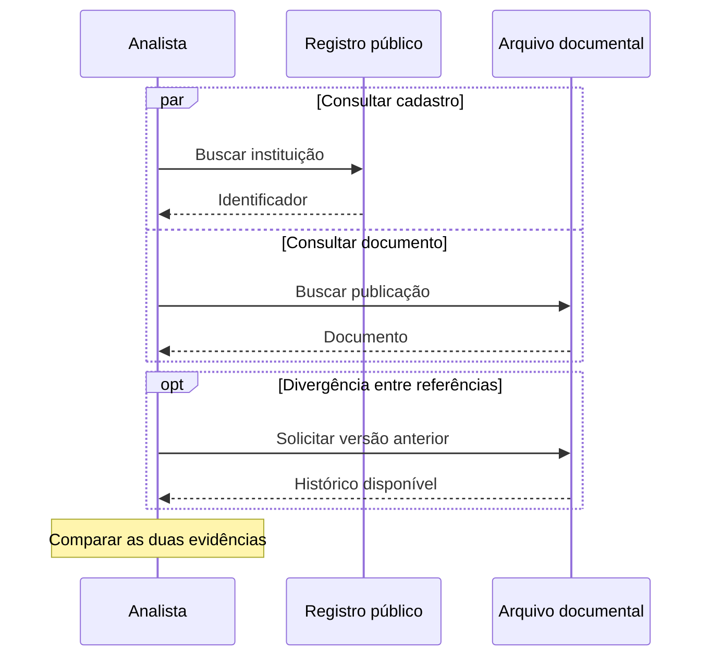

**Leia assim:** par apresenta dois caminhos paralelos. opt representa uma checagem adicional feita somente quando há uma dúvida.

**Adapte:** Só declare paralelismo quando as operações forem independentes. Use as mensagens finais para indicar a necessidade de reunir os resultados.

### Mensagem assíncrona e participação temporária

**Pergunta:** Como documentar o envio de uma tarefa sem esperar pela execução completa?

<!-- diagram-example: sequence-async family=sequence -->
<!-- example-compatibility: sequence-async -->
**Motores verificados:** Mermaid · Pele · Beautiful Mermaid.

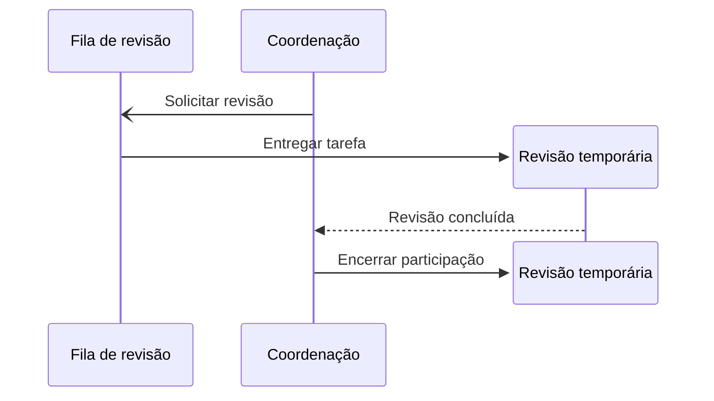

**Leia assim:** A seta aberta representa uma notificação assíncrona. O participante temporário é criado para a tarefa e encerrado depois do resultado.

**Adapte:** Separe aceitação da tarefa e conclusão do trabalho. Confirme a sintaxe de criação/destruição quando exportar para outro leitor.

### Ciclo de vida de uma nota

**Pergunta:** Quais estados de uma nota precisam ser distinguidos?

<!-- diagram-example: state-note family=state -->
<!-- example-compatibility: state-note -->
**Motores verificados:** Mermaid · Pele · Beautiful Mermaid.

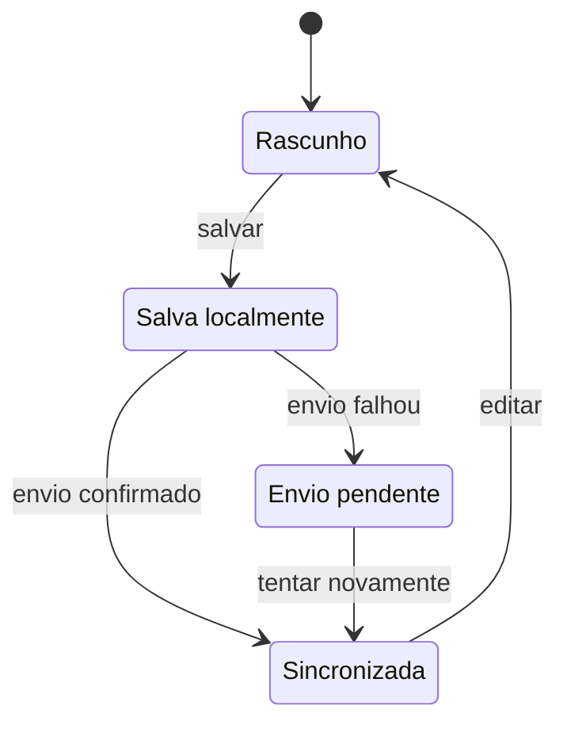

**Leia assim:** Os estados diferenciam rascunho, gravação e sincronização. Um erro de envio conserva o estado local e permite nova tentativa.

**Adapte:** Use estados observáveis, com eventos nas transições. Um estado deve expressar uma condição, não apenas o nome de um botão.

### Estado composto para revisão interna

**Pergunta:** Como detalhar uma revisão sem espalhar todos os seus passos pelo ciclo externo?

<!-- diagram-example: state-composite family=state -->
<!-- example-compatibility: state-composite -->
**Motores verificados:** Mermaid · Pele · Beautiful Mermaid.

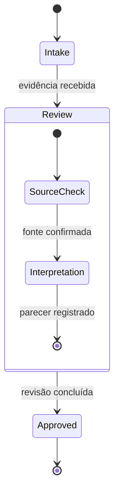

**Leia assim:** Review contém suas próprias etapas. A transição para Approved acontece depois da conclusão interna.

**Adapte:** Expanda apenas os estados que precisam de detalhe. Mantenha nomes exclusivos para os identificadores, mesmo quando os rótulos forem semelhantes.

### Escolha e divisão em verificações paralelas

**Pergunta:** Uma evidência precisa de decisão condicional ou de verificações simultâneas?

<!-- diagram-example: state-choice family=state -->
<!-- example-compatibility: state-choice -->
**Motores verificados:** Mermaid · Pele · Beautiful Mermaid.

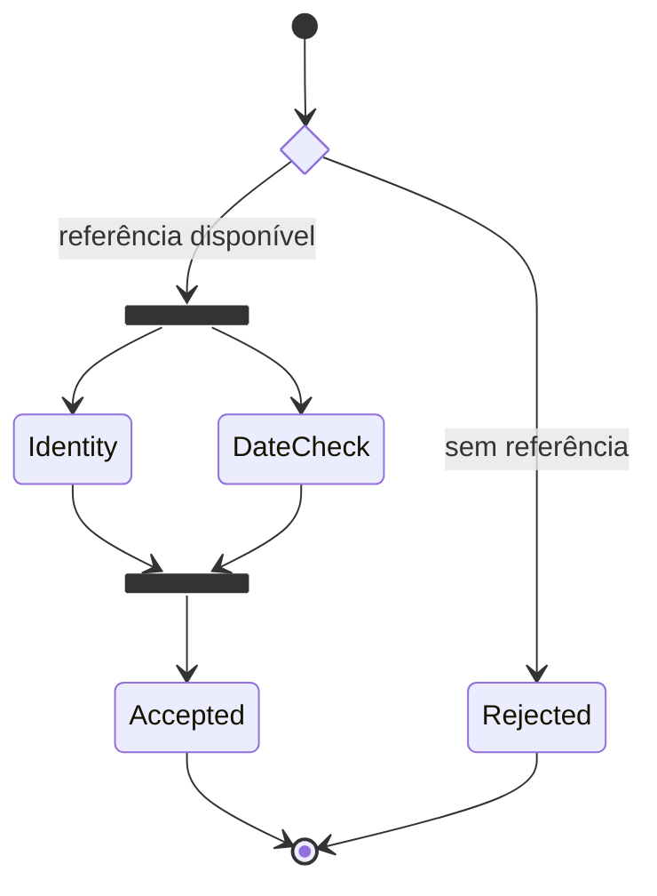

**Leia assim:** choice decide o caminho; fork separa verificações; join exige que elas se encontrem antes da aceitação.

**Adapte:** Declare as condições na escolha e o critério de conclusão no encontro. Paralelismo em estados não define concorrência de software.

## Estruturas e contratos

### Entidades de um acervo de notas

**Pergunta:** Quais entidades precisam de identidade e quais relações conectam as notas?

<!-- diagram-example: er-notes family=er -->
<!-- example-compatibility: er-notes -->
**Motores verificados:** Mermaid · Pele · Beautiful Mermaid.

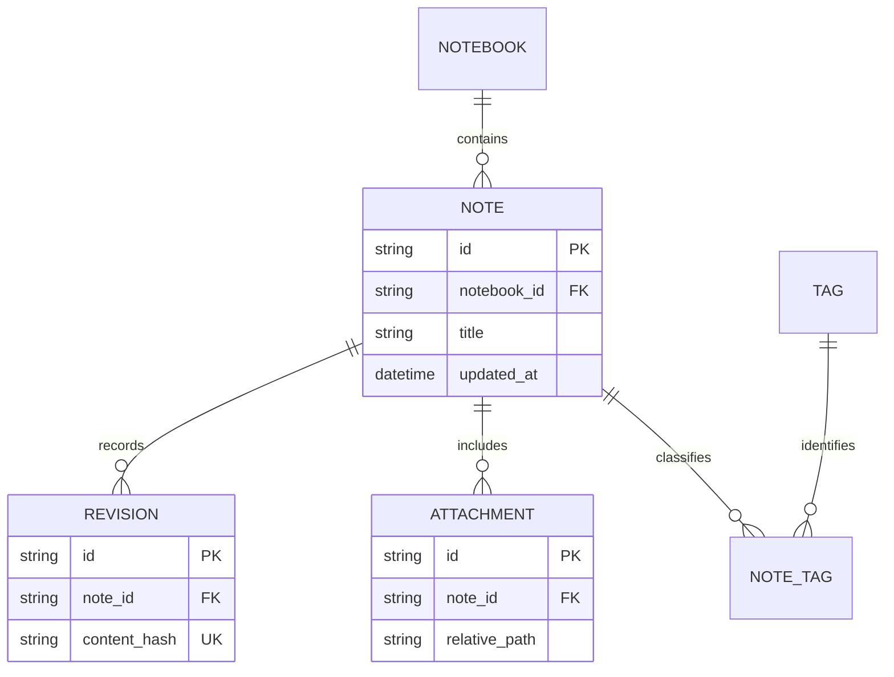

**Leia assim:** Uma pasta contém notas; uma nota possui revisões e anexos. NOTE_TAG resolve a associação entre notas e tags.

**Adapte:** Separe o modelo conceitual da implementação física. Os atributos e relacionamentos não criam tabelas nem migrações.

### Cardinalidades, opcionalidade e tipos de vínculo

**Pergunta:** O que pode faltar, o que é obrigatório e quando o vínculo participa da identidade?

<!-- diagram-example: er-cardinality family=er -->
<!-- example-compatibility: er-cardinality -->
**Motores verificados:** Mermaid · Pele · Beautiful Mermaid.

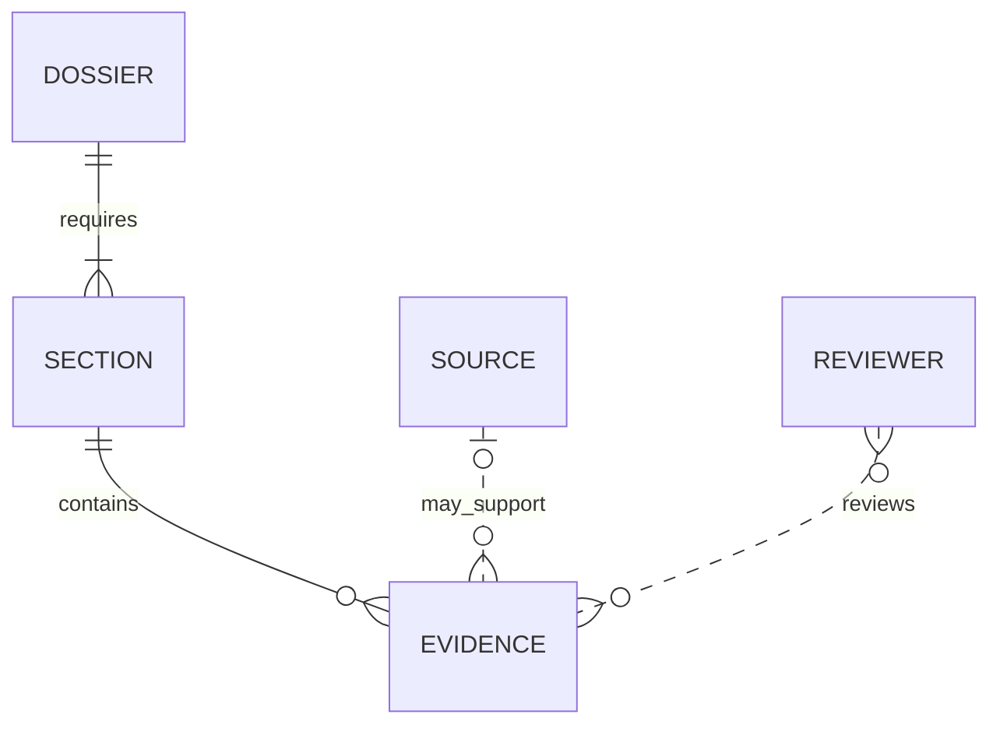

**Leia assim:** Os símbolos nas extremidades indicam mínimo e máximo. A linha contínua e a tracejada distinguem vínculos identificadores e não identificadores.

**Adapte:** Valide a regra com o domínio. “Pode não ter” e “ainda não foi cadastrado” podem exigir decisões diferentes no produto.

### Classes, operações e composição

**Pergunta:** Que responsabilidades pertencem ao documento e quais pertencem ao armazenamento?

<!-- diagram-example: class-domain family=class -->
<!-- example-compatibility: class-domain -->
**Motores verificados:** Mermaid · Pele · Beautiful Mermaid.

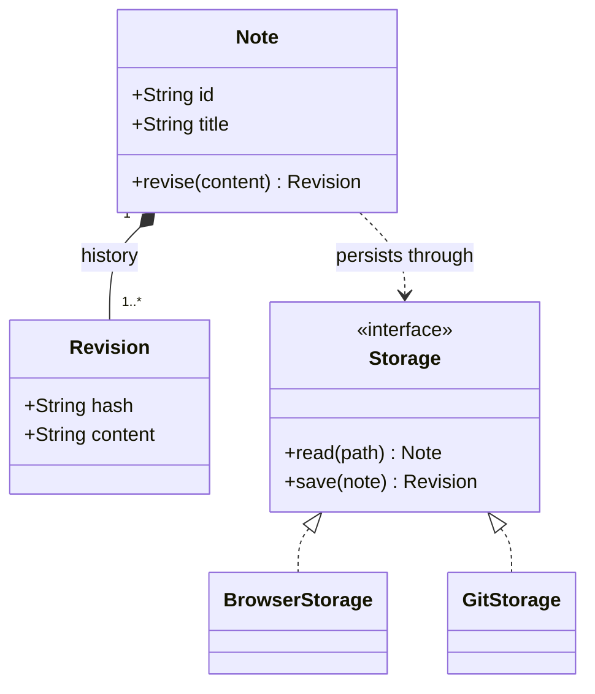

**Leia assim:** A composição liga Note a Revision. Storage é um contrato; os adaptadores realizam esse contrato sem mudar a responsabilidade da nota.

**Adapte:** Mantenha métodos pequenos e relevantes para a conversa. Este modelo orienta o design e não pretende espelhar cada classe do código atual.

### Herança, agregação, associação e dependência

**Pergunta:** Quando uma relação significa especialização e quando significa apenas uso?

<!-- diagram-example: class-relations family=class -->
<!-- example-compatibility: class-relations -->
**Motores verificados:** Mermaid · Pele · Beautiful Mermaid.

```mermaid
classDiagram
  Document <|-- Report : specializes
  Collection "1" o-- "0..*" Document : groups
  Reviewer "1" --> "0..*" Document : reviews
  ExportService ..> Document : reads
  class Document {
    <<abstract>>
    +String title
    +render() String
  }
```

**Leia assim:** Report especializa Document. Collection agrega documentos; Reviewer se associa a eles; ExportService depende do contrato de documento.

**Adapte:** Escolha a relação pela semântica, não pela aparência da seta. Composição sugere um vínculo de ciclo de vida mais forte que agregação.

### Requisitos rastreáveis até sua verificação

**Pergunta:** Como relacionar uma promessa de produto a um teste verificável?

<!-- diagram-example: requirements-evidence family=requirement -->
<!-- example-compatibility: requirements-evidence -->
**Motores verificados:** Mermaid · Pele. Beautiful Mermaid não renderiza este exemplo.

```mermaid
requirementDiagram
  requirement PreserveDraft {
    id: REQ_01
    text: Preserve unsaved note after reload
    risk: high
    verifymethod: test
  }
  element DraftStore {
    type: component
  }
  element ReloadTest {
    type: browser_test
  }
  DraftStore - satisfies -> PreserveDraft
  ReloadTest - verifies -> PreserveDraft
```

**Leia assim:** Um elemento de teste verifica o requisito; um componente o satisfaz. Os identificadores permitem ligar a conversa ao backlog.

**Adapte:** Substitua a descrição por um critério observável e indique o teste real. A ligação “satisfies” é uma afirmação a comprovar.

### Mapa mental para decompor uma pergunta

**Pergunta:** Quais dimensões uma investigação precisa considerar antes da coleta?

<!-- diagram-example: mindmap-context family=mindmap -->
<!-- example-compatibility: mindmap-context -->
**Motores verificados:** Mermaid · Pele. Beautiful Mermaid não renderiza este exemplo.

```mermaid
mindmap
  root((Contexto de pesquisa))
    Pergunta
      Escopo territorial
      Horizonte temporal
    Atores
      Instituições
      Pessoas afetadas
    Evidências
      Fontes primárias
      Contrapontos
    Entregas
      Síntese
      Lacunas abertas
```

**Leia assim:** Os ramos organizam dimensões, atores, evidências e entregas. A proximidade visual representa hierarquia de ideias, sem quantificar causalidade.

**Adapte:** Use expressões curtas e mova relações entre ramos para um fluxograma ou grafo de entidades quando a hierarquia deixar de explicar o problema.

### Árvore de arquivos e convenções de organização

**Pergunta:** Como explicar a estrutura de um acervo que será compartilhado?

<!-- diagram-example: tree-files family=treeView -->
<!-- example-compatibility: tree-files -->
**Motores verificados:** Mermaid · Pele. Beautiful Mermaid não renderiza este exemplo.

```mermaid
treeView-beta
├── notes/
│   ├── context.md
│   ├── evidence.md
│   └── decisions.md
├── assets/
│   ├── source-table.png
│   └── field-photo.jpg
└── exports/
    └── research-package.zip
```

**Leia assim:** A árvore separa notas, anexos e exportações. Os caminhos são exemplos de organização, não instruções para criar arquivos automaticamente.

**Adapte:** Troque os nomes pelos caminhos reais do projeto. Esta variação evita ícones externos para continuar autocontida.

### Railroad com combinadores de gramática

**Pergunta:** Como mostrar os componentes permitidos em uma referência para outra nota?

<!-- diagram-example: railroad-combinators family=railroad -->
<!-- example-compatibility: railroad-combinators -->
**Motores verificados:** Mermaid · Pele. Beautiful Mermaid não renderiza este exemplo.

```mermaid
railroad-beta
title Referência para uma seção
reference = sequence(nonterminal("note"), optional(sequence(terminal("#"), nonterminal("heading")))) ;
note = oneOrMore(nonterminal("letter")) ;
heading = oneOrMore(nonterminal("letter")) ;
letter = choice(terminal("a"), terminal("b"), terminal("c")) ;
```

**Leia assim:** A sequência contém um nome de nota e um fragmento opcional. O desvio do desenho representa a opcionalidade, não uma falha.

**Adapte:** Descreva primeiro a gramática como texto e teste entradas válidas e inválidas. Este exemplo é um contrato hipotético.

### A mesma ideia em EBNF

**Pergunta:** Como representar uma gramática descrita com alternativas e repetição EBNF?

<!-- diagram-example: railroad-ebnf family=railroad -->
<!-- example-compatibility: railroad-ebnf -->
**Motores verificados:** Mermaid · Pele. Beautiful Mermaid não renderiza este exemplo.

```mermaid
railroad-ebnf-beta
title Referência em EBNF
reference = name, [ "#", name ] ;
name = letter, { letter } ;
letter = "a" | "b" | "c" ;
```

**Leia assim:** Colchetes indicam parte opcional; chaves indicam repetição. A regra reference mantém o fragmento opcional.

**Adapte:** Amplie o alfabeto para o domínio real e documente escapes e Unicode. Os três caracteres servem somente para manter o exemplo legível.

### ABNF para um contrato textual

**Pergunta:** Como documentar uma referência usando uma notação comum em protocolos?

<!-- diagram-example: railroad-abnf family=railroad -->
<!-- example-compatibility: railroad-abnf -->
**Motores verificados:** Mermaid · Pele. Beautiful Mermaid não renderiza este exemplo.

```mermaid
railroad-abnf-beta
title Referência em ABNF
reference = name [ "#" name ] ;
name = 1*ALPHA ;
```

**Leia assim:** 1*ALPHA exige uma ou mais letras. A parte entre colchetes mantém o destino de seção opcional.

**Adapte:** ABNF e EBNF têm convenções diferentes. Preserve a notação do contrato original ao gerar o desenho.

### PEG para alternativas ordenadas

**Pergunta:** Como representar um parser cuja escolha depende da ordem das alternativas?

<!-- diagram-example: railroad-peg family=railroad -->
<!-- example-compatibility: railroad-peg -->
**Motores verificados:** Mermaid · Pele. Beautiful Mermaid não renderiza este exemplo.

```mermaid
railroad-peg-beta
title Referência em PEG
Reference <- Name ("#" Name)? ;
Name <- Letter+ ;
Letter <- "a" / "b" / "c" ;
```

**Leia assim:** A regra Name aceita uma ou mais letras; Reference permite o fragmento opcional. PEG usa escolha ordenada, diferente de uma simples lista de opções.

**Adapte:** Quando as alternativas compartilham prefixos, revise a ordem. Um diagrama ajuda a conversar sobre o contrato, mas não substitui testes do parser.

## Arquitetura e integração

### Blocos para uma composição espacial

**Pergunta:** Quais áreas uma tela de consulta precisa reservar?

<!-- diagram-example: block-layout family=block -->
<!-- example-compatibility: block-layout -->
**Motores verificados:** Mermaid · Pele. Beautiful Mermaid não renderiza este exemplo.

```mermaid
block-beta
  columns 3
  Header["Busca e ações"]:3
  Navigation["Notas"] Reading["Documento"]:2
  Footer["Estado e estatísticas"]:3
```

**Leia assim:** A grade posiciona navegação, documento e contexto. A largura de dois blocos para a leitura comunica prioridade espacial.

**Adapte:** Use blocos para discutir proporções e adjacências. Para a interface final, valide o layout com conteúdo e tamanhos de tela reais.

### Arquitetura de serviços e dependências

**Pergunta:** Quais componentes sustentam um acervo de pesquisa conectado?

<!-- diagram-example: architecture-services family=architecture -->
<!-- example-compatibility: architecture-services -->
**Motores verificados:** Mermaid · Pele. Beautiful Mermaid não renderiza este exemplo.

```mermaid
architecture-beta
  group workspace(cloud)[Acervo Aurora]
  service api(server)[Consulta] in workspace
  service metadata(database)[Metadados] in workspace
  service files(disk)[Documentos] in workspace
  api:R -- L:metadata
  api:B -- T:files
```

**Leia assim:** Os serviços estão dentro de uma fronteira e se ligam por portas do desenho. Banco e arquivos representam responsabilidades diferentes.

**Adapte:** Use os ícones locais conhecidos pelo Mermaid. Este sistema é hipotético e não descreve onde o Scriba público guarda as notas.

### C4 contexto: pessoas e sistemas vizinhos

**Pergunta:** Qual é a fronteira do sistema e quem interage com ele?

<!-- diagram-example: c4-context family=c4 -->
<!-- example-compatibility: c4-context -->
**Motores verificados:** Mermaid · Pele. Beautiful Mermaid não renderiza este exemplo.

```mermaid
C4Context
  title Contexto do Acervo Aurora
  Person(analyst, "Analista", "Investiga uma pergunta")
  System(workspace, "Acervo Aurora", "Organiza evidências e sínteses")
  System_Ext(sources, "Fontes primárias", "Publicam documentos verificáveis")
  Rel(analyst, workspace, "Consulta e organiza")
  Rel(workspace, sources, "Referencia")
```

**Leia assim:** O foco é o acervo como um sistema único. Os vizinhos são fontes e usuários, sem entrar nos detalhes de implantação.

**Adapte:** Comece pelo contexto antes de desenhar componentes. A implementação C4 do Mermaid tem sintaxe e layout próprios, com cobertura a verificar.

### C4 containers: responsabilidades executáveis

**Pergunta:** Quais partes executáveis compõem o sistema hipotético?

<!-- diagram-example: c4-container family=c4 -->
<!-- example-compatibility: c4-container -->
**Motores verificados:** Mermaid · Pele. Beautiful Mermaid não renderiza este exemplo.

```mermaid
C4Container
  title Containers do Acervo Aurora
  Person(analyst, "Analista")
  System_Boundary(workspace, "Acervo Aurora") {
    Container(web, "Consulta web", "Navegador", "Apresenta dossiês")
    Container(api, "API de consulta", "HTTP", "Resolve consultas")
    ContainerDb(store, "Acervo", "Armazenamento", "Mantém referências")
  }
  Rel(analyst, web, "Consulta")
  Rel(web, api, "Solicita referências", "HTTPS")
  Rel(api, store, "Lê metadados")
```

**Leia assim:** Containers representam unidades de aplicação e dados, não obrigatoriamente containers Docker. O navegador usa uma API que consulta o acervo.

**Adapte:** Nomeie tecnologia e responsabilidade de cada unidade. Evite transformar este nível em uma lista de bibliotecas.

### C4 componentes: dividir uma responsabilidade interna

**Pergunta:** Como uma API hipotética separa validação e consulta?

<!-- diagram-example: c4-component family=c4 -->
<!-- example-compatibility: c4-component -->
**Motores verificados:** Mermaid · Pele. Beautiful Mermaid não renderiza este exemplo.

```mermaid
C4Component
  title Componentes de consulta
  Container_Boundary(api, "API de consulta") {
    Component(entry, "Entrada HTTP", "Handler", "Recebe consultas")
    Component(check, "Validação", "Contrato", "Verifica parâmetros")
    Component(search, "Busca", "Serviço", "Localiza referências")
  }
  Rel(entry, check, "Valida")
  Rel(check, search, "Encaminha consulta válida")
```

**Leia assim:** Os componentes estão dentro da fronteira da API. A sequência de ligações aponta a responsabilidade de cada parte.

**Adapte:** Detalhe um container por vez. Mantenha estável o significado dos nomes usados no diagrama de containers.

### C4 dinâmico: uma interação numerada

**Pergunta:** Como os participantes colaboram em uma consulta específica?

<!-- diagram-example: c4-dynamic family=c4 -->
<!-- example-compatibility: c4-dynamic -->
**Motores verificados:** Mermaid · Pele. Beautiful Mermaid não renderiza este exemplo.

```mermaid
C4Dynamic
  title Abrir um dossiê no sistema hipotético
  Person(analyst, "Analista")
  Container(web, "Consulta web", "Navegador")
  Container(api, "API", "HTTP")
  Rel(analyst, web, "Abre dossiê")
  Rel(web, api, "Solicita metadados")
  Rel(api, web, "Entrega referências")
```

**Leia assim:** Este recorte é de uma interação concreta, não um mapa de todas as dependências possíveis.

**Adapte:** Use a mesma identificação dos outros níveis C4 e concentre o desenho em um único cenário.

### C4 implantação: onde cada parte executa

**Pergunta:** Em quais ambientes estão navegador e serviço de consulta?

<!-- diagram-example: c4-deployment family=c4 -->
<!-- example-compatibility: c4-deployment -->
**Motores verificados:** Mermaid · Pele. Beautiful Mermaid não renderiza este exemplo.

```mermaid
C4Deployment
  title Implantação hipotética do Acervo Aurora
  Deployment_Node(device, "Dispositivo da analista", "Computador") {
    Container(web, "Consulta web", "Navegador", "Apresenta o dossiê")
  }
  Deployment_Node(cloud, "Ambiente de consulta", "Serviço remoto") {
    Container(api, "API", "HTTP", "Responde consultas públicas")
  }
  Rel(web, api, "Consulta metadados", "HTTPS")
```

**Leia assim:** Os nós representam ambientes de execução. A existência de um nó de nuvem neste exemplo não implica que o Scriba envie notas ao servidor.

**Adapte:** Acrescente região, rede e responsabilidade somente quando forem informações confirmadas da implantação que você está documentando.

### Pacote binário: campos e intervalos de bits

**Pergunta:** Como explicar o cabeçalho de um protocolo experimental?

<!-- diagram-example: packet-envelope family=packet -->
<!-- example-compatibility: packet-envelope -->
**Motores verificados:** Mermaid · Pele. Beautiful Mermaid não renderiza este exemplo.

```mermaid
packet-beta
  0-7: "Versão"
  8-15: "Tipo de mensagem"
  16-31: "Tamanho do conteúdo"
  32-63: "Identificador de revisão"
```

**Leia assim:** Os intervalos incluem as duas extremidades: 0–7 contém oito bits. Os campos ocupam posições explícitas.

**Adapte:** Declare unidade, ordem de bytes e tamanho total no contrato. Este cabeçalho é fictício e não é o protocolo do Scriba.

### Fluxo de agentes com referência e revisão humana

**Pergunta:** Como representar uma automação que consulta fontes e mantém uma etapa de revisão?

<!-- diagram-example: agentflow-review family=agentflow -->
<!-- example-compatibility: agentflow-review -->
**Motores verificados:** Mermaid · Pele. Beautiful Mermaid não renderiza este exemplo.

```mermaid
agentflow-beta LR
  question["Pergunta"]@{ shape: input }
  flow research["Pesquisa assistida"]
    gather["Reunir evidências"]@{ shape: task }
    catalog["Consultar catálogo"]@{ shape: tool }
    protocol["Protocolo de fontes"]@{ shape: refdoc }
    gather --> catalog
    gather -.- protocol
  end
  human["Revisão humana"]@{ shape: decision }
  deliver["Registrar síntese aprovada"]@{ shape: action }
  question --> research --> human
  human --> deliver
```

**Leia assim:** task, tool e refdoc distinguem trabalho, ferramenta e material de consulta. A saída chega à revisão humana antes da entrega.

**Adapte:** Trate metadados de ferramentas como documentação. O diagrama não executa agentes, não conecta serviços e não concede permissões.

## Planejamento e evolução

### Gantt com dependência, responsável e marco

**Pergunta:** Como planejar uma rodada de pesquisa com dependências explícitas?

<!-- diagram-example: gantt-research family=gantt -->
<!-- example-compatibility: gantt-research -->
**Motores verificados:** Mermaid · Pele. Beautiful Mermaid não renderiza este exemplo.

```mermaid
gantt
  title Rodada ilustrativa de pesquisa
  dateFormat YYYY-MM-DD
  excludes weekends
  section Preparação
    Definir pergunta :done, scope, 2027-02-01, 2d
  section Evidências
    Coletar fontes :active, collect, after scope, 4d
    Revisar referências :crit, review, after collect, 2d
  section Entrega
    Publicar dossiê :milestone, delivery, after review, 0d
```

**Leia assim:** A revisão começa após a coleta; a entrega é um marco de duração zero. As datas são fictícias.

**Adapte:** Troque datas, duração e calendário pelos dados do projeto. Uma barra não demonstra avanço real sem um processo de atualização.

### Gantt com frentes paralelas

**Pergunta:** Quais trilhas podem avançar em paralelo antes da validação conjunta?

<!-- diagram-example: gantt-parallel family=gantt -->
<!-- example-compatibility: gantt-parallel -->
**Motores verificados:** Mermaid · Pele. Beautiful Mermaid não renderiza este exemplo.

```mermaid
gantt
  title Trilhas paralelas de preparação
  dateFormat YYYY-MM-DD
  section Conteúdo
    Revisar corpus :content, 2027-03-01, 3d
  section Experiência
    Observar uso :experience, 2027-03-01, 3d
  section Integração
    Comparar achados :merge, 2027-03-04, 2d
    Fechar rodada :milestone, after merge, 0d
```

**Leia assim:** As duas trilhas começam na mesma data. O marco final depende de uma tarefa de integração, que deve refletir a dependência real.

**Adapte:** Explicite no texto quem decide o encerramento de cada trilha. O exemplo usa uma integração com início fixo para manter o recorte curto.

### Linha do tempo de decisões e aprendizados

**Pergunta:** Qual foi a sequência de descobertas que mudou a direção do trabalho?

<!-- diagram-example: timeline-learning family=timeline -->
<!-- example-compatibility: timeline-learning -->
**Motores verificados:** Mermaid · Pele. Beautiful Mermaid não renderiza este exemplo.

```mermaid
timeline
  title Evolução ilustrativa de uma investigação
  section Exploração
    Semana 1 : Definição do problema : Primeiras referências
    Semana 2 : Lacuna de dados identificada
  section Consolidação
    Semana 3 : Hipóteses revisadas : Contrapontos incorporados
    Semana 4 : Síntese entregue : Perguntas abertas registradas
```

**Leia assim:** Cada período agrupa acontecimentos. A linha do tempo organiza cronologia sem representar duração de tarefas.

**Adapte:** Use datas verificadas e cite os registros correspondentes. Para dependências e duração, prefira Gantt.

### Kanban para um backlog de conhecimento

**Pergunta:** Quais perguntas estão aguardando coleta, revisão ou conclusão?

<!-- diagram-example: kanban-backlog family=kanban -->
<!-- example-compatibility: kanban-backlog -->
**Motores verificados:** Mermaid · Pele. Beautiful Mermaid não renderiza este exemplo.

```mermaid
kanban
  planned[Planejado]
    scope[Delimitar a pergunta]
  collecting[Coletando]
    sources[Localizar fonte primária]@{ priority: 'High' }
  reviewing[Em revisão]
    claims[Conferir duas afirmações]
  complete[Concluído]
    glossary[Registrar glossário]
```

**Leia assim:** As colunas são estados de trabalho; os cartões são perguntas ou entregas. A movimentação pertence ao processo de trabalho, não ao diagrama estático.

**Adapte:** Defina o critério de entrada e saída de cada coluna. Os metadados são ilustrativos e não criam tickets em outro sistema.

### Histórico de uma contribuição revisada

**Pergunta:** Como uma proposta é desenvolvida em uma branch e incorporada à linha principal?

<!-- diagram-example: git-review family=gitGraph -->
<!-- example-compatibility: git-review -->
**Motores verificados:** Mermaid · Pele. Beautiful Mermaid não renderiza este exemplo.

```mermaid
gitGraph
  commit id: "escopo"
  branch research
  checkout research
  commit id: "fontes"
  commit id: "revisao"
  checkout main
  merge research
  commit id: "entrega" tag: "dossie-v1"
```

**Leia assim:** Os commits pertencem às suas branches; merge reúne o trabalho. O desenho é uma narrativa de histórico, não uma operação Git.

**Adapte:** Use identificadores curtos e uma legenda que explique marcos. O exemplo não executa checkout, merge nem push.

### Branches de manutenção e evolução

**Pergunta:** Como distinguir uma correção pontual de uma frente de evolução?

<!-- diagram-example: git-maintenance family=gitGraph -->
<!-- example-compatibility: git-maintenance -->
**Motores verificados:** Mermaid · Pele. Beautiful Mermaid não renderiza este exemplo.

```mermaid
gitGraph
  commit id: "base" tag: "v1"
  branch correction
  commit id: "corrigir-citacao" type: HIGHLIGHT
  checkout main
  branch evolution
  commit id: "nova-secao"
  checkout main
  merge correction
  merge evolution
  commit id: "consolidar" tag: "v2"
```

**Leia assim:** Cada branch apresenta uma intenção diferente. As fusões registram os dois percursos sem simular comandos reais.

**Adapte:** Use tags para marcos publicados e nomes de commits que expliquem o efeito. Compare o desenho ao log real antes de usá-lo como evidência.

## Métricas e conjuntos

### Composição de um corpus com categorias exclusivas

**Pergunta:** Qual fração dos cem documentos pertence a cada categoria principal?

<!-- diagram-example: pie-corpus family=pie -->
<!-- example-compatibility: pie-corpus -->
**Motores verificados:** Mermaid · Pele. Beautiful Mermaid não renderiza este exemplo.

```mermaid
pie showData
  title Corpus ilustrativo de 100 documentos
  "Relatórios públicos" : 45
  "Normas" : 30
  "Estudos acadêmicos" : 25
```

**Leia assim:** Os valores somam cem documentos e as categorias são exclusivas neste recorte fictício. A pizza comunica composição de um total.

**Adapte:** Declare denominador, unidade e período. Se um documento puder pertencer a mais de uma categoria, uma pizza simples pode duplicar o total.

### Quadrantes para discutir prioridade

**Pergunta:** Quais melhorias combinam impacto esperado e esforço relativo?

<!-- diagram-example: quadrant-priority family=quadrantChart -->
<!-- example-compatibility: quadrant-priority -->
**Motores verificados:** Mermaid · Pele. Beautiful Mermaid não renderiza este exemplo.

```mermaid
quadrantChart
  title Hipóteses de prioridade
  x-axis Menor esforço --> Maior esforço
  y-axis Menor impacto --> Maior impacto
  quadrant-1 Planejar investimento
  quadrant-2 Experimentar primeiro
  quadrant-3 Manter simples
  quadrant-4 Revisar hipótese
  Busca contextual: [0.35, 0.80]
  Novo conector: [0.85, 0.75]
  Ajuste de rótulos: [0.15, 0.25]
```

**Leia assim:** Cada ponto tem coordenadas entre zero e um. As avaliações são hipóteses da equipe e precisam ser calibradas com evidências.

**Adapte:** Defina as duas escalas antes de pontuar. Um quadrante ajuda a deliberar; não determina a decisão sozinho.

### Barras para comparar contagens

**Pergunta:** Quantas evidências foram revisadas em cada rodada?

<!-- diagram-example: xy-bars family=xychart -->
<!-- example-compatibility: xy-bars -->
**Motores verificados:** Mermaid · Pele · Beautiful Mermaid.

```mermaid
xychart-beta
  title "Evidências revisadas por rodada"
  x-axis [R1, R2, R3, R4]
  y-axis "Documentos" 0 --> 80
  bar [25, 40, 60, 72]
```

**Leia assim:** As barras comparam contagens discretas. O eixo vertical começa em zero, evitando ampliar artificialmente diferenças pequenas.

**Adapte:** Troque os valores pelo dado medido e mantenha a unidade no eixo. As quatro rodadas são um conjunto ilustrativo.

### Linha para acompanhar uma evolução

**Pergunta:** Como a cobertura de fontes mudou ao longo de quatro semanas?

<!-- diagram-example: xy-line family=xychart -->
<!-- example-compatibility: xy-line -->
**Motores verificados:** Mermaid · Pele · Beautiful Mermaid.

```mermaid
xychart-beta
  title "Cobertura ilustrativa de fontes"
  x-axis [S1, S2, S3, S4]
  y-axis "Cobertura percentual" 0 --> 100
  line [20, 45, 70, 85]
```

**Leia assim:** A linha liga observações temporais da mesma métrica. A escala é percentual, de zero a cem.

**Adapte:** Informe como a cobertura é calculada e conserve o mesmo denominador entre os períodos. A linha não comprova causalidade.

### Barras e linha na mesma unidade

**Pergunta:** Como comparar recebimento e revisão usando a mesma escala?

<!-- diagram-example: xy-combined family=xychart -->
<!-- example-compatibility: xy-combined -->
**Motores verificados:** Mermaid · Pele · Beautiful Mermaid.

```mermaid
xychart-beta
  title "Entrada e revisão de documentos"
  x-axis [R1, R2, R3, R4]
  y-axis "Documentos" 0 --> 80
  bar [50, 65, 70, 75]
  line [25, 40, 60, 72]
```

**Leia assim:** As barras são recebimentos e a linha é revisão. Ambos medem documentos por rodada e usam a mesma unidade.

**Adapte:** Explique a legenda no texto, pois a apresentação varia entre motores. Para unidades distintas, separe os gráficos em vez de sugerir equivalência.

### Radar para um perfil de critérios

**Pergunta:** Como duas propostas se distribuem nos mesmos critérios de avaliação?

<!-- diagram-example: radar-quality family=radar -->
<!-- example-compatibility: radar-quality -->
**Motores verificados:** Mermaid · Pele. Beautiful Mermaid não renderiza este exemplo.

```mermaid
radar-beta
  title Comparação ilustrativa de propostas
  axis clarity["Clareza"], evidence["Evidência"], access["Acesso"], maintenance["Manutenção"]
  curve first["Proposta A"]{4, 5, 3, 4}
  curve second["Proposta B"]{3, 4, 5, 3}
  min 0
  max 5
  graticule polygon
```

**Leia assim:** Cada eixo usa a mesma escala de zero a cinco. As curvas mostram perfis fictícios; sua área não deve ser tratada como uma nota composta.

**Adapte:** Documente a rubrica de cada eixo. A ordem dos critérios influencia o polígono e deve ser mantida nas comparações.

### Sankey para fluxos quantitativos conservados

**Pergunta:** Para onde foram os 120 documentos recebidos na triagem?

<!-- diagram-example: sankey-triage family=sankey -->
<!-- example-compatibility: sankey-triage -->
**Motores verificados:** Mermaid · Pele. Beautiful Mermaid não renderiza este exemplo.

```mermaid
sankey-beta
"Recebidos","Elegiveis",80
"Recebidos","Descartados",25
"Recebidos","Pendentes",15
"Elegiveis","Revisados",60
"Elegiveis","Aguardando revisao",20
```

**Leia assim:** A entrada se divide em 80 elegíveis, 25 descartados e 15 pendentes. Os 80 elegíveis se dividem em 60 revisados e 20 aguardando revisão.

**Adapte:** Confira a conservação das quantidades nos pontos de divisão. Use a mesma unidade em todas as ligações.

### Treemap para composição hierárquica

**Pergunta:** Como o tamanho de um acervo se distribui por tema e subtema?

<!-- diagram-example: treemap-acervo family=treemap -->
<!-- example-compatibility: treemap-acervo -->
**Motores verificados:** Mermaid · Pele. Beautiful Mermaid não renderiza este exemplo.

```mermaid
treemap-beta
"Acervo ilustrativo"
  "Instituições"
    "Regulação": 30
    "Financiamento": 20
  "Território"
    "Infraestrutura": 25
    "População": 15
  "Método"
    "Referências": 10
```

**Leia assim:** As áreas representam quantidades nas folhas. Os níveis agrupam temas, sem acrescentar outro total independente aos pais.

**Adapte:** Use valores positivos da mesma unidade e explique o período. Rótulos curtos ajudam quando algumas áreas ficam pequenas.

### Venn para interseções qualitativas

**Pergunta:** Quais evidências são relevantes, verificáveis e atuais ao mesmo tempo?

<!-- diagram-example: venn-evidence family=venn -->
<!-- example-compatibility: venn-evidence -->
**Motores verificados:** Mermaid · Pele. Beautiful Mermaid não renderiza este exemplo.

```mermaid
venn-beta
  title Critérios de inclusão no dossiê
  set Relevante
  set Verificavel["Verificável"]
  set Atual
  union Relevante,Verificavel["Sustentada"]
  union Relevante,Atual["Oportuna"]
  union Verificavel,Atual["Atualizada"]
  union Relevante,Verificavel,Atual["Priorizar revisão"]
```

**Leia assim:** As interseções recebem rótulos para explicitar o que a combinação de critérios significa. A área do desenho não representa cardinalidade.

**Adapte:** Use a interseção para discutir critérios de inclusão. Para contar itens, acompanhe o desenho com uma tabela e uma regra de classificação.

## Decisões e aprendizado

### Comando, evento e interface ao longo do tempo

**Pergunta:** O que alguém solicita e qual fato de domínio é registrado depois?

<!-- diagram-example: events-command family=eventmodeling -->
<!-- example-compatibility: events-command -->
**Motores verificados:** Mermaid · Pele. Beautiful Mermaid não renderiza este exemplo.

```mermaid
eventmodeling
  tf 01 ui EvidenceForm
  tf 02 cmd RegisterEvidence { sourceId: string }
  tf 03 evt EvidenceRegistered { evidenceId: string }
```

**Leia assim:** cmd representa a intenção; evt representa um fato ocorrido. ui situa a interação em que a solicitação aparece.

**Adapte:** Nomeie eventos no passado e comandos como ações. Este recorte não implementa event sourcing no produto.

### Evento, modelo de leitura e consulta

**Pergunta:** Como um fato registrado sustenta uma visão consultável?

<!-- diagram-example: events-projection family=eventmodeling -->
<!-- example-compatibility: events-projection -->
**Motores verificados:** Mermaid · Pele. Beautiful Mermaid não renderiza este exemplo.

```mermaid
eventmodeling
  tf 01 evt EvidenceReviewed
  tf 02 rmo ReviewedEvidenceIndex
  tf 03 ui ResearchDashboard
```

**Leia assim:** rmo é um modelo de leitura. O desenho separa o evento ocorrido da projeção usada para consulta.

**Adapte:** Documente atraso aceitável e regras de reconstrução se o sistema real usar projeções. O exemplo mostra uma linguagem de design.

### Ishikawa para explorar causas possíveis

**Pergunta:** Quais hipóteses podem explicar o atraso na revisão de um dossiê?

<!-- diagram-example: ishikawa-delay family=ishikawa -->
<!-- example-compatibility: ishikawa-delay -->
**Motores verificados:** Mermaid · Pele. Beautiful Mermaid não renderiza este exemplo.

```mermaid
ishikawa-beta
  Revisão do dossiê atrasada
  Processo
    Critério de aceite pouco claro
    Muitas devoluções
  Informação
    Fonte sem identificação
    Data da evidência ausente
  Pessoas
    Capacidade de revisão limitada
  Ferramentas
    Busca pouco precisa
    Duplicatas difíceis de localizar
```

**Leia assim:** As espinhas agrupam hipóteses por processo, informação, pessoas e ferramentas. Cada item ainda precisa de verificação.

**Adapte:** Transforme as causas propostas em perguntas investigáveis. O desenho organiza hipóteses e não estabelece causalidade por si só.

### Wardley para discutir capacidades e evolução

**Pergunta:** Quais capacidades sustentam a experiência de leitura e como podem evoluir?

<!-- diagram-example: wardley-capabilities family=wardley -->
<!-- example-compatibility: wardley-capabilities -->
**Motores verificados:** Mermaid · Pele. Beautiful Mermaid não renderiza este exemplo.

```mermaid
wardley-beta
title Capacidades de um acervo de pesquisa
anchor "Leitura confiável" [0.95, 0.60]
component "Síntese contextual" [0.78, 0.35]
component "Evidências curadas" [0.58, 0.50]
component "Armazenamento" [0.22, 0.85]
"Leitura confiável" -> "Síntese contextual"
"Síntese contextual" -> "Evidências curadas"
"Evidências curadas" -> "Armazenamento"
evolve "Síntese contextual" 0.55
note "Padronizar critérios antes de automatizar" [0.42, 0.25]
```

**Leia assim:** As dependências partem da necessidade da pessoa. As posições são hipóteses de visibilidade e maturidade, não medições automáticas.

**Adapte:** Valide os eixos com a equipe e justifique as posições. O mapa orienta uma conversa estratégica, sem determinar uma solução técnica.

### Cynefin para escolher uma abordagem de investigação

**Pergunta:** A situação pede procedimento conhecido, análise especializada, experimento ou contenção?

<!-- diagram-example: cynefin-decisions family=cynefin -->
<!-- example-compatibility: cynefin-decisions -->
**Motores verificados:** Mermaid · Pele. Beautiful Mermaid não renderiza este exemplo.

```mermaid
cynefin-beta
  title Abordagens para problemas de pesquisa
  clear
    "Aplicar checklist de referência"
  complicated
    "Revisar uma metodologia especializada"
  complex
    "Experimentar uma nova forma de curadoria"
  chaotic
    "Conter exposição de um dado sensível"
  confusion
    "Delimitar um incidente ainda desconhecido"
```

**Leia assim:** Os domínios organizam situações com graus diferentes de entendimento. As classificações são propostas para discussão.

**Adapte:** Revise o enquadramento quando surgirem evidências. Complexo não é sinônimo de complicado, e o desenho não substitui julgamento contextual.

## Diagnóstico

### Identificar o renderizador

**Pergunta:** Qual motor está desenhando este bloco?

<!-- diagram-example: renderer-info family=info -->
<!-- example-compatibility: renderer-info -->
**Motores verificados:** Mermaid · Pele. Beautiful Mermaid não renderiza este exemplo.

```mermaid
info
```

**Leia assim:** info é um diagnóstico do renderizador e pode apresentar informações diferentes conforme o motor selecionado.

**Adapte:** Use este bloco ao relatar diferenças de comportamento, junto da versão do aplicativo e de um exemplo mínimo reproduzível.

## Limites e portabilidade

**ZenUML** é uma extensão própria e não está registrada nesta distribuição do Scriba. Para representar uma interação aqui, use os exemplos `sequenceDiagram`. A referência oficial explica a instalação separada: [ZenUML](https://mermaid.js.org/syntax/zenuml.html).

Um bloco com o nome de outra linguagem, como DOT/Graphviz, PlantUML ou D2, permanece como código: estes renderizadores não estão integrados à plataforma. A presença de um nome no texto não instala sua implementação.

Se um exemplo não for aceito pelo motor alternativo, mantenha o seletor disponível e escolha Mermaid. Um erro de sintaxe pertence ao bloco e não deve impedir a leitura do restante da nota. Para relatar um problema, copie o bloco mínimo, a versão do Scriba, o motor escolhido e a mensagem apresentada.

Este arquivo é uma nota normal: você pode copiar, exportar, editar ou desafixar sua cópia. A distribuição adiciona a referência uma vez; reabrir o aplicativo não deve apagar suas alterações nem recriar uma cópia que você decidiu remover.

## Fontes e manutenção

Sintaxe consultada na documentação oficial da versão `mermaid@12.2.0`, acompanhada de verificação dos exemplos no renderizador do próprio Scriba. Conteúdo e cenários são originais desta referência. A matriz registra o resultado observado nas versões fixadas, sem generalizar cobertura total de uma família.

- [Catálogo e sintaxe do Mermaid](https://mermaid.js.org/intro/syntax-reference.html)
- [Documentação versionada do Mermaid 12.2.0](https://github.com/mermaid-js/mermaid/tree/mermaid%4012.2.0/packages/mermaid/src/docs/syntax)
- [Pele: documentação e implementação](https://github.com/obsidianmd/pele)
- [Beautiful Mermaid: famílias e configuração](https://github.com/lukilabs/beautiful-mermaid)

A próxima revisão deve preservar os identificadores dos exemplos, testar novamente os blocos e atualizar a matriz quando mudar uma dependência. Os exemplos servem como corpus de regressão do produto para sintaxe, legibilidade, seleção de motor, tema, lupa e navegação.

Powered by **Aeon Bridge Co.** — offered to community.

<!-- scriba-extension:zenuml-v1:start -->

## ZenUML — interações descritas como código

**Seção 1.0 · @zenuml/core 4.7.2 · 19/10/2026.** ZenUML descreve **diagramas de sequência**: participantes, mensagens, ativações e fragmentos de controle. As variações abaixo são formas de representar interações; não são novos motores de ER, classes, fluxogramas ou gráficos estatísticos. Para essas outras famílias, use as seções Mermaid deste mesmo manual.

No Scriba, use uma cerca **`zenuml`**. Também é aceita a cerca `mermaid` cujo primeiro comando é `zenuml`, como na integração oficial do Mermaid. O motor é identificado automaticamente como **ZenUML**. `sequenceDiagram` continua usando o seletor Mermaid / Pele / Beautiful Mermaid: trocar a sintaxe exige adaptar o código, e não apenas escolher outro motor.

**Controles disponíveis:** roda do mouse, − / +, arrastar, lupa 2×, código com cores de sintaxe, copiar, SVG vetorial e PNG transparente. O código permanece no Markdown. O desenho usa SVG nativo, fonte local e ícones vetoriais distribuídos com a biblioteca; não precisa enviar a nota a um serviço de diagramas. Depois de o aplicativo concluir seu cache offline, os recursos continuam disponíveis sem rede.

**Referências primárias:** [repositório e licença MIT](https://github.com/mermaid-js/zenuml-core), [referência da linguagem](https://github.com/mermaid-js/zenuml-core/blob/main/docs/DSL_SYNTAX.md), [API SVG e fontes](https://github.com/mermaid-js/zenuml-core/blob/main/types/index.d.ts) e [ZenUML no Mermaid](https://mermaid.js.org/syntax/zenuml.html). Os exemplos usam o Acervo Aurora fictício já apresentado neste arquivo.

### Roteiro de consulta ZenUML

| Preciso representar… | Exemplo desta seção |
| --- | --- |
| Uma primeira interação, sem declarar tudo | [Começo mínimo](#zenuml-começo-mínimo) |
| Pessoas, fronteiras, controle e armazenamento | [Papéis de participantes](#zenuml-papéis-de-participantes) |
| Fronteiras entre equipes e nomes legíveis | [Grupos e aliases](#zenuml-grupos-aliases-e-estereótipos) |
| Parâmetros, resultados e modificadores | [Assinaturas e atribuições](#zenuml-assinaturas-e-atribuições) |
| Pilha de chamadas, recursão e retorno | [Ativações](#zenuml-ativações-autochamadas-e-retornos) |
| Eventos e respostas assíncronas | [Eventos](#zenuml-eventos-e-respostas-assíncronas) e [aliases de retorno](#zenuml-anotações-de-retorno) |
| Nascimento de uma instância | [Criação de objetos](#zenuml-criação-de-objetos) |
| Alternativas e expressões de guarda | [Condições](#zenuml-condições-alternativas) e [expressões](#zenuml-expressões-e-valores) |
| Uma etapa opcional | [Opt](#zenuml-etapa-opcional) |
| Repetição | [Laços](#zenuml-laços-e-seus-aliases) |
| Trabalho concorrente e exclusão mútua | [Par](#zenuml-trabalho-em-paralelo) e [Critical](#zenuml-região-crítica) |
| Fases, exceções ou outro diagrama | [Frames](#zenuml-seções-frames-e-blocos), [exceções](#zenuml-exceções-e-limpeza) e [Ref](#zenuml-referências-a-outras-interações) |
| Explicações, divisões e idioma | [Notas](#zenuml-divisores-e-comentários), [iniciador](#zenuml-iniciador-explícito) e [Unicode](#zenuml-identificadores-unicode) |
| Serviços cloud ou componentes de infraestrutura | [AWS](#zenuml-serviços-aws), [Azure e Google Cloud](#zenuml-azure-e-google-cloud), [infraestrutura](#zenuml-componentes-de-infraestrutura) e [catálogo](#zenuml-catálogo-de-anotações-vetoriais) |
| Um arquivo com delimitadores de outro editor | [Delimitadores](#zenuml-delimitadores-de-arquivos-importados) |
| Um caso completo para adaptar | [Publicação resiliente](#zenuml-caso-completo-publicação-resiliente) |

<!-- zenuml-verification:start -->
A cobertura dos exemplos desta seção é verificada no teste de navegador `tests/zenuml.smoke.mjs`. Cada bloco precisa passar pelo parser e produzir um SVG visível no Scriba; os testes também exercitam leitura, edição, código, zoom, lupa e exportação. A verificação não promete todas as combinações possíveis da linguagem.
<!-- zenuml-verification:end -->

### ZenUML: começo mínimo

**Pergunta:** Quem consulta o catálogo e recebe a resposta?

<!-- zenuml-example: zen-minimal capability=implicit -->
```zenuml
title Consulta ao Acervo Aurora
Catalogo.buscar("história urbana")
```

**Leia assim:** O participante `Catalogo` é inferido da chamada. A origem sem nome representa um chamador externo. Não confunda essa origem implícita com uma pessoa já identificada.

**Adapte:** Comece assim para rascunhar uma conversa. Declare o iniciador e os participantes quando a identidade de quem chama fizer parte da pergunta.

### ZenUML: papéis de participantes

**Pergunta:** Quais papéis colaboram na entrada de uma evidência?

<!-- zenuml-example: zen-roles capability=participants -->
```zenuml
title Papéis na curadoria
@Actor Pesquisadora
@Boundary Portal
@Control Curadoria
@Entity Evidencia
@Database Catalogo
@Collections Colecao
@Queue Eventos
@Starter(Pesquisadora)
Pesquisadora -> Portal.enviar(fonte) {
  Curadoria.validar(fonte) {
    Evidencia.criar()
    Catalogo.gravar()
    Colecao.listar()
    Eventos: evidenciaRecebida
  }
}
```

**Leia assim:** `@Actor`, `@Boundary`, `@Control`, `@Entity`, `@Database` e `@Queue` distinguem responsabilidades com vetores locais. `@Collections` é aceito pela linguagem, mas o SVG desta versão usa o rótulo sem um pictograma próprio para essa anotação.

**Adapte:** Escolha o papel pela responsabilidade, não pelo fornecedor do software. Uma anotação desconhecida continua sendo um participante textual; não implica que exista um ícone para ela.

### ZenUML: grupos, aliases e estereótipos

**Pergunta:** Onde termina a experiência da pesquisadora e começa o processamento interno?

<!-- zenuml-example: zen-groups capability=groups -->
```zenuml
title Fronteiras da consulta
group "Experiência" {
  @Actor Pessoa as "Pesquisadora"
  @Boundary Portal 150 as "Portal do acervo"
}
group "Curadoria" {
  @Control <<API>> Servico as "Serviço de busca"
  @Database Base as "Catálogo"
}
@Starter(Pessoa)
Pessoa -> Portal.consultar(termo) {
  Servico.buscar(termo) {
    Base.ler(termo)
    return resultados
  }
}
```

**Leia assim:** `group` envolve colunas; `as` troca somente o nome exibido, mantendo um identificador curto no código. `<<API>>` é um estereótipo textual. `150` pede largura mínima para o participante.

**Adapte:** Use nomes estáveis no código e rótulos que façam sentido para a equipe. A largura explícita aumenta o tamanho total do desenho e pode exigir zoom no celular.

### ZenUML: assinaturas e atribuições

**Pergunta:** Qual informação entra em cada chamada e qual resultado é usado depois?

<!-- zenuml-example: zen-signatures capability=signatures -->
```zenuml
title Contrato da consulta
@Actor Analista
@Control Busca
@Database Catalogo
@Starter(Analista)
Analista -> Busca.consultar(String termo, int limite) {
  String consulta = Busca.normalizar(termo)
  const resultados = Catalogo.buscar(termo=consulta, limite=20)
  readonly politica = Busca.configuracao()
  static versao = Busca.versao()
  await indice = Busca.carregarIndice()
  Busca.filtros.aplicar(resultados)
  return resultados
}
```

**Leia assim:** Há parâmetros posicionais, nomeados, declarações tipadas e captura do retorno com `=`. Chamadas encadeadas podem descrever o método de um subsistema. `const`, `readonly`, `static` e `await` são elementos de notação: o diagrama não executa essas instruções nem garante semântica de concorrência por usá-las.

**Adapte:** Prefira a mensagem que explica a colaboração. Tipar todos os parâmetros só ajuda quando o contrato é a questão em análise. Um `;` no final de uma chamada é opcional.

### ZenUML: ativações, autochamadas e retornos

**Pergunta:** Qual chamada mantém outra em andamento e em que ponto devolve o controle?

<!-- zenuml-example: zen-activation capability=activation -->
```zenuml
title Pilha de revisão
@Actor Revisora
@Control Curadoria
@Database Catalogo
@Starter(Revisora)
Revisora -> Curadoria.revisar(id) {
  Curadoria.checarConsistencia() {
    Curadoria.normalizar()
    return
  }
  Catalogo.buscarFonte(id) {
    return fonte
  }
  return parecer
}
```

**Leia assim:** Chaves após uma mensagem representam sua ativação e as chamadas que ela contém. Uma chamada do participante para ele mesmo gera uma autochamada. `return`, com ou sem valor, encerra a colaboração atual.

**Adapte:** Uma ativação representa controle e contexto; não é uma escala de tempo medida. Evite sugerir duração pelo tamanho visual de uma barra.

### ZenUML: eventos e respostas assíncronas

**Pergunta:** Quem publica uma alteração sem esperar todo o processamento?

<!-- zenuml-example: zen-async capability=async -->
```zenuml
title Publicar evento de curadoria
@Boundary Portal
@Control Curadoria
@Queue Eventos
@Control Indexador
Portal -> Curadoria: solicitar revisão de EV-42
Curadoria -> Eventos: evidência revisada EV-42
Eventos -> Indexador: atualizar índice
Indexador --> Eventos: índice atualizado
Curadoria --> Portal: revisão recebida
```

**Leia assim:** `-> Participante: texto` envia uma mensagem assíncrona com texto até o fim da linha. `-->` descreve a resposta. Os dois pontos distinguem esse texto livre da chamada de método `Participante.metodo()`.

**Adapte:** Coloque o identificador de correlação no texto quando eventos de várias operações puderem se misturar. O desenho não implementa fila, entrega ou retentativa.

### ZenUML: anotações de retorno

**Pergunta:** Como deixar explícito que uma mensagem responde a outra?

<!-- zenuml-example: zen-return-annotations capability=reply -->
```zenuml
title Respostas explícitas
@Boundary Portal
@Control Curadoria
Portal -> Curadoria: revisar EV-42
@Return Curadoria -> Portal: recebida
Portal -> Curadoria: consultar andamento
@Reply Curadoria -> Portal: em revisão
Portal -> Curadoria: consultar resultado
@return Curadoria -> Portal: aprovada
@reply Curadoria -> Portal: operação concluída
```

**Leia assim:** `@Return` e `@Reply`, inclusive os aliases minúsculos mostrados, marcam uma mensagem assíncrona de retorno. Para uma chamada com ativação, o comando `return valor` costuma ser mais direto.

**Adapte:** Use uma convenção consistente. Uma anotação de retorno não transforma uma operação de rede real em chamada síncrona.

### ZenUML: criação de objetos

**Pergunta:** Em qual etapa passa a existir uma sessão ou tarefa de revisão?

<!-- zenuml-example: zen-creation capability=creation -->
```zenuml
title Objetos criados durante a revisão
@Control Curadoria
Curadoria.iniciar(id) {
  new Sessao()
  tarefa = new Tarefa(id)
  Registro registro = new Registro(id, "aberto") {
    Registro.validar()
    return registro
  }
  return tarefa
}
```

**Leia assim:** `new` faz a instância aparecer na altura de sua criação. A sintaxe permite criação simples, atribuída, tipada, com argumentos e com um bloco de inicialização.

**Adapte:** Dê a cada instância um nome compreensível. A linguagem documenta criação; não há aqui uma promessa de destruição de objetos ou de suporte a todas as extensões UML.

### ZenUML: condições alternativas

**Pergunta:** Como o estado da fonte determina o encaminhamento da revisão?

<!-- zenuml-example: zen-alternatives capability=conditional -->
```zenuml
title Decidir o próximo passo
@Control Curadoria
@Control Pesquisa
@Control Publicacao
if (fonte.verificada()) {
  Publicacao.preparar()
} else if (fonte.recuperavel()) {
  Pesquisa.complementar()
} else {
  Curadoria.devolver("fonte ausente")
}
```

**Leia assim:** `if`, `else if` e `else` criam alternativas dentro de um fragmento. As condições são descrições do caminho, e não código executado pelo leitor.

**Adapte:** Torne as saídas distinguíveis. Quando só existe um caminho condicional adicional, prefira `opt`.

### ZenUML: expressões e valores

**Pergunta:** Quais guardas documentam a liberação de um lote?

<!-- zenuml-example: zen-expressions capability=expressions -->
```zenuml
title Guardas da publicação
@Control Curadoria
@Control Publicacao
if (pronto && !cancelado && total >= 1) {
  if (origem in fontes) {
    Curadoria.registrar(contagem=42, proporcao=3.14)
  }
  opt (tentativas * atraso < timeout) {
    Curadoria.configurar(espera=500ms, limite=2GB)
  }
  if (custo <= $99.99 || patrocinado == true) {
    Publicacao.agendar(data=null, motivo="amostra")
  }
}
```

**Leia assim:** São aceitas comparações (`==`, `!=`, `<`, `>`, `<=`, `>=`), operadores booleanos e aritméticos, chamadas em expressões, `in`, strings, números, unidades, valores monetários, `true`, `false`, `null` e `nil`. Texto livre também pode descrever uma guarda, como no exemplo de laços.

**Adapte:** Uma expressão descreve um contrato; não valida moeda, unidade ou tipos. Preserve a regra de negócio no texto que acompanha o diagrama.

### ZenUML: etapa opcional

**Pergunta:** Quando uma revisão precisa de uma segunda leitura?

<!-- zenuml-example: zen-optional capability=optional -->
```zenuml
title Revisão complementar
@Control Curadoria
@Actor Especialista
Curadoria.revisar() {
  opt (tema sensível) {
    Especialista.avaliar()
  }
  Curadoria.concluir()
}
```

**Leia assim:** `opt` envolve somente o trabalho que pode ser omitido. O restante da interação continua fora do fragmento.

**Adapte:** Dê nome ao motivo da opcionalidade. Evite usar `opt` para esconder uma alternativa que precisa de tratamento explícito.

### ZenUML: laços e seus aliases

**Pergunta:** Como repetir tarefas de coleta, validação e atualização?

<!-- zenuml-example: zen-loops capability=loops -->
```zenuml
title Repetições na coleta
@Control Coleta
@Control Curadoria
while (fila.temItens()) {
  Coleta.lerProximo()
}
for (fonte in fontes) {
  Curadoria.validar(fonte)
}
foreach (evidencia in lote) {
  Curadoria.anotar(evidencia)
}
forEach (revisora in equipe) {
  Curadoria.notificar(revisora)
}
loop (até concluir a revisão) {
  Curadoria.verificarPendencias()
}
```

**Leia assim:** `while`, `for`, `foreach`, `forEach` e `loop` são representações de repetição. A condição entre parênteses pode ser omitida quando não é relevante, por exemplo `loop { Coleta.poll() }`.

**Adapte:** Documente uma condição de término. **Limitação medida:** o pacote 4.7.2 rejeita o `for (i = 0; i < 10; i++)` com ponto e vírgula mostrado na documentação upstream; use `for (item in itens)` ou uma condição textual validada como acima.

### ZenUML: trabalho em paralelo

**Pergunta:** Quais consultas podem ocorrer independentemente?

<!-- zenuml-example: zen-parallel capability=parallel -->
```zenuml
title Complementar o contexto
@Control Pesquisa
@Database Arquivo
@Control Territorio
@Control Referencias
Pesquisa.complementar() {
  par {
    Arquivo.buscarDocumentos()
    Territorio.buscarIndicadores()
    Referencias.buscarCitacoes()
  }
  Pesquisa.consolidar()
}
```

**Leia assim:** `par` reúne colaborações concorrentes. A consolidação está fora do fragmento para indicar a etapa posterior.

**Adapte:** Registre no texto se o processo espera todas as respostas, a primeira resposta ou um prazo. O fragmento não implementa essa política.

### ZenUML: região crítica

**Pergunta:** Qual mudança exige acesso exclusivo ao catálogo?

<!-- zenuml-example: zen-critical capability=critical -->
```zenuml
title Publicar uma revisão por vez
@Control Curadoria
@Database Catalogo
critical (bloqueio da evidência) {
  Catalogo.lerVersao()
  Catalogo.gravarRevisao()
}
Curadoria.notificarConclusao()
```

**Leia assim:** `critical` comunica uma região que precisa de exclusão mútua ou de garantias equivalentes.

**Adapte:** Explique qual recurso é protegido e por qual mecanismo. Um retângulo no diagrama não equivale a uma transação, um mutex ou controle de versão implementado.

### ZenUML: seções, frames e blocos

**Pergunta:** Como separar a coleta da avaliação mantendo a mesma interação?

<!-- zenuml-example: zen-sections capability=section -->
```zenuml
title Etapas da curadoria
@Control Coleta
@Control Curadoria
section(Coleta) {
  Coleta.obterFonte()
}
frame(Avaliacao) {
  Curadoria.verificar()
}
{
  Curadoria.registrarHistorico()
}
```

**Leia assim:** `section` e `frame` agrupam mensagens sob um rótulo. Um bloco apenas com chaves é uma seção anônima.

**Adapte:** Use fases que ajudam a revisão. Para referenciar uma interação mantida em outro diagrama, prefira `ref`.

### ZenUML: exceções e limpeza

**Pergunta:** Como tratar falhas diferentes e liberar recursos em qualquer resultado?

<!-- zenuml-example: zen-exceptions capability=exceptions -->
```zenuml
title Recuperar a coleta
@Control Coleta
@Database Origem
@Control Auditoria
@Control Sessao
try {
  Origem.baixar()
} catch (Timeout e) {
  Coleta.reagendar(e)
} catch (FormatoInvalido e) {
  Auditoria.registrar(e)
} finally {
  Sessao.liberar()
}
try {
  Auditoria.enviarResumo()
} catch {
  Auditoria.guardarLocal()
}
```

**Leia assim:** `try`, vários `catch` e `finally` tornam visíveis as consequências de uma falha. O parâmetro de `catch` é opcional.

**Adapte:** Separe retentativa de descarte. Registre limites e idempotência fora do desenho; uma chamada de recuperação também pode falhar.

### ZenUML: referências a outras interações

**Pergunta:** Como reutilizar um fluxo conhecido sem repetir cada mensagem?

<!-- zenuml-example: zen-reference capability=reference -->
```zenuml
title Publicação com dependências
@Control Publicacao
@Control Identidade
ref(Autenticacao)
Publicacao.preparar()
ref(ValidacaoDeFontes, RevisaoPorPares)
Publicacao.concluir()
```

**Leia assim:** `ref` dá nome a outra interação ou a mais de uma. O nome é uma referência de leitura; o Scriba não busca, executa nem incorpora automaticamente outro arquivo por causa dele.

**Adapte:** Acrescente um link Markdown para a especificação correspondente no texto da nota.

### ZenUML: divisores e comentários

**Pergunta:** Que observações e mudanças de fase ajudam a interpretar a coleta?

<!-- zenuml-example: zen-notes capability=notes -->
```zenuml
title Fases com observações
@Control Coleta
@Control Curadoria
== Preparação ==
// A autorização da fonte é verificada antes da coleta.
Coleta.verificarAutorizacao()
== Revisão ==
// O comentário pertence à próxima mensagem.
Curadoria.revisar() // A anotação não executa uma política.
Curadoria.registrarParecer()
```

**Leia assim:** O divisor começa com `==` na **coluna zero**. Comentários `//` são associados à próxima instrução e podem aparecer como observação no desenho.

**Adapte:** Use comentários para explicar decisões, não para guardar segredos. Eles continuam presentes na nota e podem aparecer no SVG exportado.

### ZenUML: iniciador explícito

**Pergunta:** Quem inicia a interação quando a ordem visual das colunas é diferente?

<!-- zenuml-example: zen-starter capability=starter -->
```zenuml
title Revisora como iniciadora
@Database Catalogo
@Control Curadoria
@Actor Revisora
@starter(Revisora)
Curadoria.reabrir("EV-42") {
  Catalogo.lerHistorico()
  return historico
}
```

**Leia assim:** `@Starter` e `@starter` definem o chamador externo pelo identificador. Declarar primeiro o banco não significa que ele iniciou a revisão.

**Adapte:** Evite colocar esse iniciador também como destino inicial sem intenção: isso pode criar uma autochamada.

### ZenUML: serviços AWS

**Pergunta:** Como um evento de revisão atravessa computação, fila e armazenamento?

<!-- zenuml-example: zen-aws capability=aws -->
```zenuml
title Evento de revisão na AWS
@Lambda Funcao as "Validar revisão"
@SQS Fila as "Fila de indexação"
@S3 Arquivo as "Fontes originais"
@RDS Catalogo as "Metadados"
Funcao.validar() {
  Arquivo.ler()
  Catalogo.gravar()
  Fila: revisaoConcluida EV-42
}
```

**Leia assim:** As anotações escolhem ícones locais de participantes. A interação continua sendo um diagrama de sequência; não é um mapa de rede, uma implantação automática nem uma medição de latência.

**Adapte:** Troque o fornecedor somente quando isso importar para o contrato. Os ícones preservam a identidade visual fornecida pela biblioteca.

### ZenUML: Azure e Google Cloud

**Pergunta:** Como mostrar uma integração entre serviços de fornecedores distintos?

<!-- zenuml-example: zen-cloud capability=cloud -->
```zenuml
title Integração entre serviços cloud
@AzureFunction Entrada as "Função de entrada"
@AzureSQL Registro as "Registro de operações"
@PubSub Eventos as "Eventos de pesquisa"
@CloudStorage Objetos as "Documentos"
Entrada.receber() {
  Registro.gravar()
  Objetos.armazenar()
  Eventos: documentoRecebido
}
```

**Leia assim:** O catálogo inclui vetores Azure e Google Cloud, além dos AWS. Os nomes de anotações são consultados sem diferenciar maiúsculas de minúsculas.

**Adapte:** Explique no texto as fronteiras de confiança, credenciais e dados compartilhados. Um ícone não comprova configuração ou interoperabilidade.

### ZenUML: componentes de infraestrutura

**Pergunta:** Que componentes genéricos participam da publicação do catálogo?

<!-- zenuml-example: zen-infrastructure capability=infrastructure -->
```zenuml
title Publicar o catálogo
@Browser Portal
@API Servico
@PostgreSQL Banco
@Redis Cache
@ApacheKafka Eventos
Portal -> Servico.publicar() {
  Banco.gravar()
  Cache.invalidar()
  Eventos: catalogoPublicado
  return publicado
}
```

**Leia assim:** O pacote também inclui componentes de aplicação e infraestrutura, como navegador, API, bancos e broker. Não é necessário usar exclusivamente símbolos UML ou cloud.

**Adapte:** Separe o papel de um componente de seu produto específico. Use `@Database` quando o fornecedor não for relevante.

### ZenUML: identificadores Unicode

**Pergunta:** Como manter nomes compreensíveis para uma equipe que documenta em português?

<!-- zenuml-example: zen-unicode capability=unicode -->
```zenuml
title Revisão em português
@Actor Pesquisadora as "Pesquisadora responsável"
@Control Curadoria as "Curadoria do acervo"
@Database Catálogo
@Starter(Pesquisadora)
Pesquisadora -> Curadoria.revisarEvidência("EV-42") {
  Catálogo.buscarReferências("memória urbana")
  return "parecer disponível"
}
```

**Leia assim:** Nomes, métodos e rótulos podem conter letras Unicode. Aspas delimitam rótulos com espaços. O título é uma diretiva do começo do bloco; `title.metodo()` é uma chamada, não um título.

**Adapte:** Use identificadores curtos e aliases para rótulos extensos. A linguagem também aceita emoji Unicode e shortcodes `[nome]`; este manual prefere rótulos e ícones vetoriais para manter leitura e exportação consistentes. A cobertura de glifos varia conforme a fonte disponível.

### ZenUML: delimitadores de arquivos importados

**Pergunta:** Como aproveitar uma interação recebida com delimitadores de outro editor?

<!-- zenuml-example: zen-wrappers capability=wrappers -->
```zenuml
@startzenuml
!theme plain
title Interação importada
@Actor Revisora
@Control Curadoria
Revisora -> Curadoria.revisar("EV-42")
@endzenuml
```

**Leia assim:** `@startzenuml` / `@endzenuml` e os aliases `@startuml` / `@enduml` são delimitadores tolerados e ignorados pelo parser. Uma linha `!theme ...` na coluna zero também é ignorada; o Scriba continua acompanhando seu próprio tema.

**Adapte:** Os delimitadores não traduzem a linguagem PlantUML. O conteúdo entre eles ainda precisa ser ZenUML. Uma sequência PlantUML completa com comandos diferentes deve ser adaptada antes de renderizar.

### ZenUML: caso completo — publicação resiliente

**Pergunta:** Como publicar uma revisão com alternativas, validação concorrente e recuperação?

<!-- zenuml-example: zen-complete capability=complete -->
```zenuml
title Publicação resiliente no Acervo Aurora
group "Experiência" {
  @Actor Revisora
  @Boundary Portal
}
group "Curadoria" {
  @Control Servico as "Serviço de curadoria"
  @Database Catalogo as "Catálogo"
  @Queue Eventos
}
@Starter(Revisora)
Revisora -> Portal.publicar("EV-42") {
  Servico.preparar("EV-42") {
    par {
      Catalogo.verificarFonte()
      Catalogo.verificarPermissoes()
    }
    if (revisao.aprovada()) {
      try {
        critical (versão da evidência) {
          Catalogo.gravarRevisao()
        }
        Eventos: revisaoPublicada EV-42
        return "publicada"
      } catch (VersaoDivergente e) {
        return "revisar alterações concorrentes"
      } finally {
        Servico.registrarTentativa()
      }
    } else {
      return "aguardando revisão"
    }
  }
}
```

**Leia assim:** Grupos delimitam responsabilidades; `par` reúne verificações; `if` decide o caminho; `critical` marca a escrita exclusiva; `try/catch/finally` explicita recuperação e registro. A numeração hierárquica do motor ajuda a acompanhar chamadas aninhadas, mas não é uma linha do tempo medida.

**Adapte:** Recorte o diagrama se a equipe precisar discutir somente a autorização, o conflito de versão ou o evento. Preserve a pergunta, os resultados possíveis e uma explicação em texto.

### ZenUML: catálogo de anotações vetoriais

`@Nome Identificador as "Rótulo"` escolhe um tipo de participante. O pacote 4.7.2 distribui os vetores listados abaixo; o Scriba os inclui no aplicativo, inclusive o catálogo cloud carregado sob demanda. O cache offline inclui esse catálogo. Uma anotação fora da lista mantém seu rótulo textual. `@Collections` é reconhecida pela sintaxe, mas não tem vetor próprio nesta saída SVG.

**Papéis UML e atalhos locais:** `@Actor`, `@Boundary`, `@Control`, `@Entity`, `@Database`, `@Queue`, `@EC2`, `@IAM`, `@Lambda`, `@SNS`, `@SQS`, `@AzureFunction`, `@Cognito`, `@ElasticBeanstalk`, `@Kinesis`, `@Lightsail` e `@SageMaker`.

<!-- zenuml-icon-catalog:start -->

| Grupo | Anotações do pacote |
| --- | --- |
| AWS · IoT | `@awsiotlora`, `@awsiotgreengrasscomponent`, `@awsiotthingcoffeepot`, `@awsiotlambda`, `@awsiotthingwindfarm`, `@awsiotthingvibrationsensor`, `@awsiotdevicedefenderjobs`, `@awsiotdevicemanagementfleethub`, `@awsiottopic`, `@awsiotcertificate`, `@awsiotthingrelay`, `@awsiotanalyticschannel` |
| AWS · IoT (continuação) | `@awsiotthingcamera`, `@awsiotthingdoorlock`, `@awsiotpolicy`, `@awsiotthingfreertos`, `@awsiotsitewiseassetproperties`, `@awsiotthingtempvibrationsensor`, `@awsiotthingplc`, `@awsiotaction`, `@awsiotalexavoice`, `@awsiotalexaenabled`, `@awsiotthingutility`, `@awsiotactuator` |
| AWS · IoT (continuação) | `@awsiotthingtempsensor`, `@awsiothttpprotocol`, `@awsiotcoredevicelocation`, `@awsiotalexaskill`, `@awsiotanalyticsnotebook`, `@awsiothardwareboard`, `@awsiotthingcar`, `@awsiotthinglightbulb`, `@awsiotsitewiseasset`, `@awsiotsitewisedatastreams`, `@awsiotgreengrasscomponentnucleus`, `@awsiotthinghouse` |
| AWS · IoT (continuação) | `@awsiotoverairupdate`, `@awsiotthingbank`, `@awsiotsensor`, `@awsiotsitewiseassethierarchy`, `@awsiotgreengrassartifact`, `@awsiotthingtravel`, `@awsiotmqttprotocol`, `@awsiotshadow`, `@awsiotfiretv`, `@awsiotgreengrassconnector`, `@awsiotgreengrassipc`, `@awsiothttp2protocol` |
| AWS · IoT (continuação) | `@awsiotfiretvstick`, `@awsiotcoredeviceadvisor`, `@awsiotthingindustrialpc`, `@awsiotdesiredstate`, `@awsiotecho`, `@awsiotgreengrassrecipe`, `@awsiotgreengrasscomponentprivate`, `@awsiotgreengrassstreammanager`, `@awsiotthingmedicalemergency`, `@awsiotthingthermostat`, `@awsiotsitewiseassetmodel`, `@awsiotthingstacklight` |
| AWS · IoT (continuação) | `@awsiotthingtemphumiditysensor`, `@awsiotgreengrasscomponentpublic`, `@awsiotsailboat`, `@awsiotrule`, `@awsiotthingbicycle`, `@awsiotreportedstate`, `@awsiotsimulator`, `@awsiotthingpoliceemergency`, `@awsiotanalyticsdatastore`, `@awsiotdevicetester`, `@awsiotanalyticspipeline`, `@awsiotthingfactory` |
| AWS · IoT (continuação) | `@awsiotthinghumiditysensor`, `@awsiotgreengrassprotocol`, `@awsiotservo`, `@awsiotanalyticsdataset`, `@awsiotgreengrassmachinelearning`, `@awsiotthinggeneric`, `@awsiotdevicegateway`, `@awsiotthingcart` |
| AWS · Machine Learning | `@amazonrekognitionvideo`, `@amazonsagemakermodel`, `@amazonsagemakeranalyzelending`, `@amazonsagemakershadowtesting`, `@amazondevopsguruinsights`, `@amazonsagemakernotebook`, `@amazonsagemakercanvas`, `@amazonsagemakertrain`, `@amazonsagemakergeospatialml`, `@amazonrekognitionimage` |
| AWS · Quantum Technologies | `@amazonbraketsimulator`, `@amazonbraketnoisesimulator`, `@amazonbraketchip`, `@amazonbraketsimulator1`, `@amazonbraketmanagedsimulator`, `@amazonbraketsimulator3`, `@amazonbraketchandelier`, `@amazonbrakettensornetwork`, `@amazonbraketsimulator4`, `@amazonbraketqpu`, `@amazonbraketstatevector`, `@amazonbraketsimulator2` |
| AWS · Analytics | `@amazonopensearchobservability`, `@amazonredshiftra3`, `@amazonredshiftstreaming`, `@amazonemrengine`, `@amazonredshiftqueryeditor`, `@redshift`, `@amazonehrhdfscluster`, `@amazonmskconnect`, `@awsgluedatacatalog`, `@amazondatzonedataportal`, `@amazondatzonebusinessdatacatalog`, `@amazondatzonedataprojects` |
| AWS · Analytics (continuação) | `@amazonredshiftdensestorage`, `@awsgluedataquality`, `@awsgluecrawler`, `@amazonquicksightreports`, `@awslakeformationdatalake`, `@amazonopensearchultrawarm`, `@amazoncloudsearchsearchdocuments`, `@amazonopensearchingestion`, `@amazonathenadatasource`, `@amazonopensearchadminnode`, `@amazonopensearchdashboards`, `@amazonopensearchindex` |
| AWS · Analytics (continuação) | `@awsglueray`, `@amazonredshiftdatasharing`, `@amazonredshiftautocopy`, `@amazonredshiftdensecompute`, `@amazonredshiftml`, `@amazonopensearchtraces`, `@amazonemrcluster`, `@amazonopensearchdatanode`, `@awsdataexchangeapi` |
| AWS · End User Computing | `@amazonworkspaces`, `@amazonworkspacescore`, `@amazonworkspacesweb` |
| AWS · Security Identity Compliance | `@awsdirservicesimplead`, `@awswafbadbot`, `@awsidentityaccesssts`, `@awsidentityaccessaddon`, `@amazoninspectoragent`, `@awsidentityaccessdataencryption`, `@awsidentityaccessmfatoken`, `@awsdirserviceadconnector`, `@awsidentityaccesspermissions`, `@awswaflabels`, `@awscertmgrca`, `@awsidentityaccessstsalt` |
| AWS · Security Identity Compliance (continuação) | `@awsdirservicemanagedmsad`, `@awssecurityhubfinding`, `@awswafrule`, `@awsidentityaccessrole`, `@awsidentityaccesslongtermcredential`, `@awsidentityaccesstempcredential`, `@awswaffilteringrule`, `@awswafbot`, `@awsshieldadvanced`, `@awsidentityaccessanalyzer`, `@iam`, `@awswafbotcontrol` |
| AWS · Security Identity Compliance (continuação) | `@awsidentityaccessrolesanywhere`, `@awsidentityaccessdataencryptionkey`, `@awsnetworkfirewallendpoints`, `@awswafmanagedrule`, `@awskeymanagementexternalkeystore` |
| AWS · Blockchain | `@amazonblockchain` |
| AWS · Application Integration | `@amazoneventbridgesaas`, `@amazoneventbridgeschema`, `@amazonmqbroker`, `@amazoneventbridgeschemaregistry`, `@amazoneventbridgedefaultbus`, `@amazonsnsnotification`, `@amazoneventbridgeevent`, `@amazonnshttpnotification`, `@amazoneventbridgepipes`, `@amazoneventbridgerule`, `@amazonapigatewayendpoint`, `@amazoneventbridgescheduler` |
| AWS · Application Integration (continuação) | `@amazonsqsqueue`, `@sqs`, `@amazonsqsmessage`, `@amazoneventbridgecustomeventbus`, `@amazonsnstopic`, `@sns` |
| AWS · Management Governance | `@awsssmpatchmanager`, `@awscloudformationtemplate`, `@awsopsworkslayers`, `@amazoncloudwatchmetricsinsights`, `@amazoncloudwatchdataprotection`, `@amazoncloudwatchalarm`, `@awstrustedadvisorchecksecurity`, `@awstrustedadvisorcheckperformance`, `@amazoncloudwatchrule`, `@awsopsworksresources`, `@amazoncloudwatcheventtime`, `@awsorgsmanagementaccount` |
| AWS · Management Governance (continuação) | `@awslicensemanagerlicenseblending`, `@amazoncloudwatcheventevent`, `@amazoncloudwatchsynthetics`, `@awsssmstatemanager`, `@awscloudformationstack`, `@awsopsworksinstances`, `@awsssmruncommand`, `@awsopsworksdeployments`, `@awsssmautomation`, `@awsssmchangecalendar`, `@awsorgsorganizationalunit`, `@awsssmsessionmanager` |
| AWS · Management Governance (continuação) | `@awstrustedadvisorcheckcost`, `@awsopsworksstack2`, `@awslicensemanagerapplicationdiscovery`, `@awsssmopscenter`, `@awsssminventory`, `@awsopsworkspermissions`, `@awsopsworksapps`, `@awscloudformationchangeset`, `@awsssmdocuments`, `@awsssmapplicationmanager`, `@awsorgsaccount`, `@awscloudtrailcloudtraillake` |
| AWS · Management Governance (continuação) | `@awsssmmaintenancewindows`, `@awssmmincidentmanager`, `@amazoncloudwatchevidently`, `@amazoncloudwatchrum`, `@awsssmparameterstore`, `@amazoncloudwatchlogs`, `@cloudwatch`, `@awsssmchangemanager`, `@awsopsworksmonitoring`, `@awsssmcompliance`, `@awsssmdistributor`, `@amazoncloudwatchobservability` |
| AWS · Management Governance (continuação) | `@awstrustedadvisorcheckfault`, `@awstrustedadvisorchecklist` |
| AWS · Networking Content Delivery | `@amazonroute53routetable`, `@amazoncloudfrontdistribution`, `@amazonroute53routingcontrols`, `@amazonroute53arc`, `@amazonvpctrafficmirroring`, `@amazonvpcreachabilityanalyzer`, `@awscloudmapnamespace`, `@awstransitgatewayattachment`, `@amazonvpcigw`, `@amazoncloudfrontedgelocation`, `@awscloudwansegmentnetwork`, `@awscloudmapservice` |
| AWS · Networking Content Delivery (continuação) | `@awsappmeshvirtualrouter`, `@amazonvpcendpoints`, `@amazonvpcvpnconnection`, `@amazoncloudfrontstreaming`, `@amazonvpcpeering`, `@amazonroute53resolverdnsfirewall`, `@amazonroute53hostedzone`, `@amazonvpcvpngateway`, `@amazoncloudfrontfunctions`, `@cloudfront`, `@amazoneaelasticnetworkadapter`, `@awsappmeshvirtualgateway` |
| AWS · Networking Content Delivery (continuação) | `@amazonroute53resolverlogging`, `@elasticlbclassic`, `@amazonroute53resolver`, `@awscloudwancorenetworkedge`, `@awsappmeshvirtualservice`, `@amazonvpcflowlogs`, `@awscloudmapresource`, `@awsdirectconnectgateway`, `@amazonvpcnetworkaccessanalyzer`, `@elasticlbapp`, `@amazonvpcvpc`, `@vpc` |
| AWS · Networking Content Delivery (continuação) | `@amazonvpccarriergateway`, `@amazoneaelasticnetworkinterface`, `@awscloudwanrouteattachment`, `@amazonroute53readiness`, `@awsappmeshvirtualnode`, `@elasticlbgateway`, `@amazonvpcrouter`, `@awsappmeshmesh`, `@amazonvpcnatgateway`, `@amazonvpcnetworkacl`, `@amazonvpccustomer`, `@elasticlbnetwork` |
| AWS · Storage | `@amazons3replication`, `@amazons3onezone`, `@awsbackuplegalhold`, `@awsstoragegateaway`, `@amazonefsstandard`, `@efs`, `@elasticfilesystem`, `@amazons3bucket`, `@s3`, `@awsstoragegateawayfile`, `@awsfsxfile`, `@amazons3glacierinstant` |
| AWS · Storage (continuação) | `@amazonfilecache`, `@amazons3standardia`, `@amazons3generalaccess`, `@amazons3lambda`, `@amazons3objectlock`, `@awsbackupvirtualmachine`, `@amazonec2gp3`, `@amazonefsfilesys`, `@awssnowballimportexport`, `@amazons3object`, `@awsbackupcache`, `@amazons3lambdaobject` |
| AWS · Storage (continuação) | `@awsbackupgateway`, `@awsbackuprto`, `@awsbackupvaultlock`, `@awsbackupvirtualtape`, `@amazonebsdatalifecycle`, `@awsbackupplan`, `@amazonfilecaches3`, `@awsbackupcloudformation`, `@awsbackuptapegateway`, `@awsbackupvmware`, `@amazonefsonezoneia`, `@amazons3replicationtime` |
| AWS · Storage (continuação) | `@awsbackupstorage`, `@amazonefsintelligenttiering`, `@amazons3glacierdeep`, `@amazons3select`, `@amazons3outposts`, `@awsfilegateway`, `@amazons3glacier`, `@awsbackupvmmonitor`, `@amazons3multiregion`, `@awsbackupvault`, `@awsbackupauditmanager`, `@amazonfilecachehybridnfs` |
| AWS · Storage (continuação) | `@amazonefselasticthroughput`, `@awsbackupawsbackupfors3`, `@amazons3standard`, `@amazonefsonezone`, `@awsstoragegateawayvolume`, `@awsbackuprestore`, `@amazonebsvolumes`, `@amazons3lens`, `@awsbackupcompute`, `@amazonvpclogs`, `@amazons3batch`, `@amazonefsinfrequent` |
| AWS · Storage (continuação) | `@amazons3tiering`, `@awsbackuprpo`, `@awsbackupcompliance`, `@amazonebssnapshot`, `@awsbackupdatabase`, `@awsbackupfsx`, `@amazons3glacierflex`, `@glacier`, `@s3glacier`, `@amazons3bucketobject`, `@amazonebsvolume`, `@ebs` |
| AWS · Storage (continuação) | `@amazons3vault` |
| AWS · Containers | `@amazoneksoutposts`, `@amazonecscontainer2`, `@amazonecrimage`, `@amazonecstask`, `@amazonecsservice`, `@amazonecscontainer1`, `@amazonecrregistry`, `@amazonecscontainer3`, `@ecs`, `@amazonecscopilotcli`, `@amazonecsserviceconnect` |
| AWS · Compute | `@amazonec2extractor`, `@amazonec2ami`, `@awselasticbeanstalkdeployment`, `@awslambdafunction`, `@lambda`, `@amazonec2instance`, `@ec2`, `@amazonec2autoscaling`, `@amazonec2spotinstance`, `@awselasticbeanstalkapp`, `@amazonec2instancecloudwatch`, `@amazonec2rescue` |
| AWS · Compute (continuação) | `@amazonec2instances`, `@amazonec2dbinstance`, `@amazonec2elasticip` |
| AWS · Database | `@amazonrdsoptimizedwrites`, `@amazondynamodbtblclass`, `@amazonrdsinstancealternate`, `@amazondynamodbattributes`, `@amazonrdsauroramysqlalternative`, `@amazondynamodbitem`, `@amazonrdsaurorapgsqlalt`, `@amazondynamodbitems`, `@amazonrdsauroraalternate`, `@amazonrdsaurorasqlalt`, `@amazonrdsinstance`, `@rds` |
| AWS · Database (continuação) | `@amazonrdsmultiaz`, `@amazondocdbelasticclusters`, `@amazonrdstrustedextpgsql`, `@amazonrdsaurorasql`, `@amazondynamodbglobal`, `@amazonrdsoracle`, `@amazonrdsoraclealternate`, `@amazondynamodbstream`, `@amazonrdstrustedpgsql`, `@amazondax`, `@amazonelasticache4redis`, `@elasticache` |
| AWS · Database (continuação) | `@amazonrdsproxy`, `@amazondynamodbaccesstable`, `@amazonrdsauroramysql`, `@amazonrdspiops`, `@awsdbmigrationserviceworkflow`, `@amazondynamodbattribute`, `@amazonrdsbluegreendeploy`, `@amazondynamodbtable`, `@dynamodb`, `@amazonrdsaurorainstance`, `@amazonrdsauroradbinstance`, `@amazonelasticache4memcached` |
| AWS · Database (continuação) | `@amazonrdsproxyalternate`, `@amazonrdsaurorapgsql`, `@amazonrdsauroradbinstancealternate`, `@amazonelasticachecachenode`, `@amazonrdsmultiazcluster` |
| AWS · Migration Transfer | `@awstransferfamilyftps`, `@awstransferfamilysftp`, `@awsmainframemodruntime`, `@awstransferfamilyftp`, `@awsmigrationhubrefactor`, `@awsmainframemoddeveloper`, `@awsdiscoveryagent`, `@awsmainframemodcompiler`, `@awsmigrationhubrefactorapp`, `@awsdiscoveryagentlesscollector`, `@awsmainframemodanalyzer`, `@awsdatasyndiscovery` |
| AWS · Migration Transfer (continuação) | `@awsmigrationhubrefactorservice`, `@awsdatasyngagent`, `@awsmainframemodconverter`, `@awstransferfamilyas2`, `@awsdiscoverymigrationevaluator` |
| AWS · Media Services | `@awscloudinterface`, `@awsmediaconnectgateway` |
| AWS · Robotics | `@awsrobomakercloudextensions`, `@awsrobomakersimulation`, `@awsrobomakerfleetmanagement`, `@awsrobomakerdevenv` |
| AWS · Front End Web Mobile | `@awsamplifystudio`, `@amazonlocationmap`, `@amazonlocationplace`, `@amazonlocationtrack`, `@amazonlocationgeofence`, `@amazonlocationroutes` |
| AWS · Developer Tools | `@awscloud9` |
| AWS · Business Applications | `@amazonemailservice`, `@amazonpinpointjourney` |
| Azure | `@azureactivedirectory`, `@azurebackup`, `@azurecdn`, `@azuredatafactory`, `@azuredevops`, `@azurefunction`, `@azuresql`, `@cosmosdb`, `@logicapps`, `@virtualmachine` |
| Google Cloud | `@bigtable`, `@bigquery`, `@cloudcdn`, `@clouddns`, `@cloudinterconnect`, `@cloudloadbalancing`, `@cloudsql`, `@cloudstorage`, `@datalab`, `@dataproc`, `@googleiam`, `@googlesecurity` |
| Google Cloud (continuação) | `@googlevpc`, `@pubsub`, `@securityscanner`, `@stackdriver`, `@visionapi` |
| Aplicação e infraestrutura | `@client`, `@server`, `@browser`, `@service`, `@controller`, `@api`, `@ui`, `@mobile`, `@externalsystem`, `@application`, `@loadbalancer`, `@network` |
| Aplicação e infraestrutura (continuação) | `@cache`, `@webserver`, `@messagequeue`, `@scheduler`, `@gateway`, `@authenticationservice`, `@mailserver`, `@github`, `@docker`, `@gitlab`, `@jenkins`, `@postgresql` |
| Aplicação e infraestrutura (continuação) | `@mongodb`, `@kubernetes`, `@apachekafka`, `@elasticsearch`, `@auth0`, `@redis` |

<!-- zenuml-icon-catalog:end -->

### ZenUML: limites e portabilidade

- **Gramática própria:** `A.metodo()` e `A -> B: evento` são ZenUML. `A->>B: evento`, `alt`, `end`, `activate` e `deactivate` pertencem à sintaxe `sequenceDiagram` do Mermaid e não são intercambiáveis.
- **Leitura em outro produto:** um leitor Markdown sem integração ZenUML exibe a cerca como código. Para compartilhar somente o desenho, use SVG ou PNG.
- **Retornos e ativações:** use chaves e `return` para documentar a pilha de chamadas. Não há neste adaptador comandos de duração medida, animação, simulação, destruição de instância ou execução do pseudocódigo.
- **Temas:** o Scriba acompanha seus temas claro e escuro usando tokens do aplicativo; os temas próprios `default`, `mermaid`, `clean-light`, `clean-dark` e `neon` da biblioteca não são opções extras na interface. O fundo externo da exportação é transparente; caixas e fragmentos mantêm seus preenchimentos.
- **Cores autorais:** a linguagem aceita hexadecimal ao fim de uma declaração de participante. Use com cuidado: uma cor escolhida para o tema claro pode perder contraste no escuro. Os exemplos preferem os tokens do Scriba.
- **Segurança e recursos:** não há HTML bruto, scripts, imagens remotas ou links executáveis no SVG. O Scriba aplica o mesmo sanitizador dos outros motores e mantém o limite de 50 mil caracteres por bloco. Ícones e a fonte IBM Plex Sans são recursos locais distribuídos com o pacote.
- **Fonte nos arquivos exportados:** o SVG e a rasterização PNG incorporam a fonte local do motor para preservar suas medidas fora do aplicativo. IBM Plex Sans usa licença SIL OFL 1.1; o pacote ZenUML usa MIT. O catálogo mantém a identidade visual dos ícones de seus fornecedores.
- **Erros de sintaxe:** o Scriba mostra a linha e coluna informadas pelo parser e mantém o botão Código disponível. O parser upstream tolera algumas entradas incompletas; isso não torna todo pseudocódigo válido.
- **Cobertura:** estes exemplos cobrem as famílias de construções documentadas, seus principais aliases e três grupos de ícones. O catálogo enumera as anotações; não promete todas as combinações de posicionamento, texto e símbolos. O `for` com três expressões separadas por `;` é a incompatibilidade medida descrita acima.

<!-- scriba-extension:zenuml-v1:end -->

<!-- scriba-extension:excalidraw-v1:start -->

## Excalidraw — raciocinar com desenhos editáveis

**Referência Excalidraw 0.18.1 · edição 1.2.0 · 19/10/2026.** O Scriba integra a prancheta oficial, com prévia vetorial e edição visual dentro da nota. Os 29 cenários abaixo exploram formas, texto, setas vinculadas, caminhos, traço livre, estilos, grupos, frames, camadas, bibliotecas, imagens locais, links e composição. Todos os dados e cenários são fictícios.

### Comece por aqui

1. Para criar, abra **Formatação** e escolha **Inserir desenho Excalidraw**. Para alterar um exemplo, use seu **lápis** ou dê dois cliques no desenho. A prancheta ocupa a tela inteira.
2. Selecione a ferramenta e desenhe; dê dois cliques no texto para editar. **Aplicar à nota** grava a cena num bloco `excalidraw`, mantendo o restante do Markdown. Depois salve a nota normalmente no navegador, pasta ou GitHub escolhido. **Cancelar/fechar** permite descartar alterações.
3. O conteúdo é JSON do formato aberto Excalidraw. **Importar** abre um arquivo `.excalidraw`; **Baixar** leva a cena editável com imagens embutidas. No cartão, **Código** mostra JSON destacado e permite copiar; **Baixar desenho** oferece SVG e PNG transparente, além do arquivo editável.
4. A prévia possui zoom por roda, botões −/+, pan e lupa 2×. Na prancheta, use a mão, barra de espaço + arrastar, zoom e gestos de toque do Excalidraw. Leitura e edição acompanham o tema do Scriba.
5. Alterações em andamento têm rascunho privado neste dispositivo. Ao reabrir o mesmo desenho, um rascunho recuperável é indicado na prancheta. Não há envio para Excalidraw.com: o desenho segue as mesmas regras de armazenamento da nota.

### Ferramentas e gestos para explorar

| Necessidade | Experimente na prancheta | Contexto adequado |
| --- | --- | --- |
| Formas e texto | Retângulo, elipse, losango, linha, seta, texto e desenho livre | Descobrir relações e vocabulário |
| Conexões que acompanham formas | Setas vinculadas, rótulos, curvas e cotovelos | Reorganizar fluxos ou arquitetura |
| Ajustar a composição | Seleção múltipla, agrupar/desagrupar, duplicar, alinhar e distribuir | Quadros consistentes e símbolos reutilizáveis |
| Hierarquia e camadas | Trazer à frente, enviar para trás, bloquear e desbloquear | Fundos, anotações e limites |
| Aparência | Cor, preenchimento, espessura, tracejado, opacidade, arredondamento e aspecto do traço | Legenda visual e distinções redundantes |
| Texto | Famílias de fontes, tamanho, alinhamento e texto contido | Títulos, explicações e identificadores |
| Organizar um quadro grande | Frames, grade, encaixe, mão, zoom e modo zen | Storyboards e investigação por etapas |
| Reutilizar símbolos | Biblioteca, adicionar seleção, importar/exportar bibliotecas | Padrões recorrentes; biblioteca privada deste navegador |
| Revisar | Desfazer/refazer, apagador, busca e paleta de comandos | Ajustes incrementais e cenas extensas |
| Inspecionar uma fonte visual | Inserir imagem local e anotar por cima | Capturas previamente revisadas e anonimizadas |
| Referências | Link por elemento e metadados no JSON | Manter a origem de um conceito explícita |
| Trocar de ferramenta | Arquivo .excalidraw, SVG vetorial e PNG transparente | Edição posterior ou publicação |

Atalhos de aplicação: **⌘S/Ctrl+S** aplica o desenho à nota; **⌘O/Ctrl+O** importa um arquivo Excalidraw dentro da prancheta; **Esc** ou **⌘W/Ctrl+W** fecha com confirmação quando houver alterações. Na nota, os atalhos habituais continuam valendo. Para os atalhos de cada ferramenta, veja a ajuda do Excalidraw e a indicação junto aos controles.

### Escolha um cenário

- [Vocabulário visual: processo, decisão e resultado](#vocabulário-visual-processo-decisão-e-resultado)
- [Setas conectadas: o fluxo acompanha as formas](#setas-conectadas-o-fluxo-acompanha-as-formas)
- [Traços e preenchimentos: diferenciar sem depender só da cor](#traços-e-preenchimentos-diferenciar-sem-depender-só-da-cor)
- [Texto livre, contido e tipografia](#texto-livre-contido-e-tipografia)
- [Desenho livre e marcação de revisão](#desenho-livre-e-marcação-de-revisão)
- [Arquitetura em camadas com grupos](#arquitetura-em-camadas-com-grupos)
- [Frames: um cenário, três momentos](#frames-um-cenário-três-momentos)
- [Raias: responsabilidade antes da automação](#raias-responsabilidade-antes-da-automação)
- [Wireframe de uma busca no acervo](#wireframe-de-uma-busca-no-acervo)
- [Wireframe móvel: prioridade numa tela estreita](#wireframe-móvel-prioridade-numa-tela-estreita)
- [Jornada: ação, dificuldade e oportunidade](#jornada-ação-dificuldade-e-oportunidade)
- [Kanban de curadoria](#kanban-de-curadoria)
- [Linha do tempo para conversar sobre dependências](#linha-do-tempo-para-conversar-sobre-dependências)
- [Quadrantes: priorizar a investigação](#quadrantes-priorizar-a-investigação)
- [Causas de uma evidência difícil de verificar](#causas-de-uma-evidência-difícil-de-verificar)
- [Mapa de atores e proximidade](#mapa-de-atores-e-proximidade)
- [Workshop de eventos e regras](#workshop-de-eventos-e-regras)
- [Matriz de decisão visual](#matriz-de-decisão-visual)
- [Modelo de dados exploratório](#modelo-de-dados-exploratório)
- [Fronteiras e portas de comunicação](#fronteiras-e-portas-de-comunicação)
- [Sequência desenhada: pedidos e respostas](#sequência-desenhada-pedidos-e-respostas)
- [Imagem local: evidência visual com anotações](#imagem-local-evidência-visual-com-anotações)
- [Caminhos com vários pontos e curvas](#caminhos-com-vários-pontos-e-curvas)
- [Camadas, transparência e bloqueio](#camadas-transparência-e-bloqueio)
- [Biblioteca: repetir símbolos com intenção](#biblioteca-repetir-símbolos-com-intenção)
- [Workshop: divergência, agrupamento e convergência](#workshop-divergência-agrupamento-e-convergência)
- [Links e metadados: navegar com contexto](#links-e-metadados-navegar-com-contexto)
- [Grade e encaixe: regularidade sem desperdício](#grade-e-encaixe-regularidade-sem-desperdício)
- [Pontas de setas e direção explícita](#pontas-de-setas-e-direção-explícita)

### Vocabulário visual: processo, decisão e resultado

**Pergunta:** Como comunicar a triagem de uma evidência antes de escolher uma notação formal?

<!-- excalidraw-example: vocabulary capabilities=shapes,labels,arrows -->
```excalidraw
{
  "type": "excalidraw",
  "version": 2,
  "source": "Scriba",
  "elements": [
    {
      "id": "vocabulary-1",
      "type": "rectangle",
      "x": 0,
      "y": 100,
      "width": 180,
      "height": 90,
      "angle": 0,
      "strokeColor": "#1e293b",
      "backgroundColor": "#e0f2fe",
      "fillStyle": "solid",
      "strokeWidth": 2,
      "strokeStyle": "solid",
      "roughness": 1,
      "opacity": 100,
      "groupIds": [],
      "frameId": null,
      "index": "a0",
      "roundness": {
        "type": 3
      },
      "seed": 100,
      "version": 1,
      "versionNonce": 1,
      "isDeleted": false,
      "boundElements": [
        {
          "type": "text",
          "id": "vocabulary-7"
        }
      ],
      "updated": 1,
      "link": null,
      "locked": false
    },
    {
      "id": "vocabulary-2",
      "type": "diamond",
      "x": 270,
      "y": 70,
      "width": 200,
      "height": 150,
      "angle": 0,
      "strokeColor": "#1e293b",
      "backgroundColor": "#fef3c7",
      "fillStyle": "solid",
      "strokeWidth": 2,
      "strokeStyle": "solid",
      "roughness": 1,
      "opacity": 100,
      "groupIds": [],
      "frameId": null,
      "index": "a1",
      "roundness": {
        "type": 3
      },
      "seed": 8019,
      "version": 1,
      "versionNonce": 2,
      "isDeleted": false,
      "boundElements": [
        {
          "type": "text",
          "id": "vocabulary-8"
        }
      ],
      "updated": 1,
      "link": null,
      "locked": false
    },
    {
      "id": "vocabulary-3",
      "type": "ellipse",
      "x": 560,
      "y": 100,
      "width": 180,
      "height": 90,
      "angle": 0,
      "strokeColor": "#1e293b",
      "backgroundColor": "#dcfce7",
      "fillStyle": "solid",
      "strokeWidth": 2,
      "strokeStyle": "solid",
      "roughness": 1,
      "opacity": 100,
      "groupIds": [],
      "frameId": null,
      "index": "a2",
      "roundness": {
        "type": 3
      },
      "seed": 15938,
      "version": 1,
      "versionNonce": 3,
      "isDeleted": false,
      "boundElements": [
        {
          "type": "text",
          "id": "vocabulary-9"
        }
      ],
      "updated": 1,
      "link": null,
      "locked": false
    },
    {
      "id": "vocabulary-4",
      "type": "arrow",
      "x": 190,
      "y": 145,
      "width": 70,
      "height": 0,
      "angle": 0,
      "strokeColor": "#1e293b",
      "backgroundColor": "transparent",
      "fillStyle": "solid",
      "strokeWidth": 2,
      "strokeStyle": "solid",
      "roughness": 1,
      "opacity": 100,
      "groupIds": [],
      "frameId": null,
      "index": "a3",
      "roundness": null,
      "seed": 23857,
      "version": 1,
      "versionNonce": 4,
      "isDeleted": false,
      "boundElements": null,
      "updated": 1,
      "link": null,
      "locked": false,
      "points": [
        [
          0.5,
          0
        ],
        [
          69.5,
          0
        ]
      ],
      "lastCommittedPoint": null,
      "startBinding": null,
      "endBinding": null,
      "startArrowhead": null,
      "endArrowhead": "arrow",
      "elbowed": false
    },
    {
      "id": "vocabulary-5",
      "type": "arrow",
      "x": 480,
      "y": 145,
      "width": 70,
      "height": 0,
      "angle": 0,
      "strokeColor": "#1e293b",
      "backgroundColor": "transparent",
      "fillStyle": "solid",
      "strokeWidth": 2,
      "strokeStyle": "solid",
      "roughness": 1,
      "opacity": 100,
      "groupIds": [],
      "frameId": null,
      "index": "a4",
      "roundness": null,
      "seed": 31776,
      "version": 1,
      "versionNonce": 5,
      "isDeleted": false,
      "boundElements": [
        {
          "type": "text",
          "id": "vocabulary-10"
        }
      ],
      "updated": 1,
      "link": null,
      "locked": false,
      "points": [
        [
          0.5,
          0
        ],
        [
          69.5,
          0
        ]
      ],
      "lastCommittedPoint": null,
      "startBinding": null,
      "endBinding": null,
      "startArrowhead": null,
      "endArrowhead": "arrow",
      "elbowed": false
    },
    {
      "id": "vocabulary-6",
      "type": "text",
      "x": 15,
      "y": 290,
      "width": 506.1056213378906,
      "height": 24.3,
      "angle": 0,
      "strokeColor": "#1e293b",
      "backgroundColor": "transparent",
      "fillStyle": "solid",
      "strokeWidth": 2,
      "strokeStyle": "solid",
      "roughness": 1,
      "opacity": 100,
      "groupIds": [],
      "frameId": null,
      "index": "a5",
      "roundness": null,
      "seed": 39695,
      "version": 1,
      "versionNonce": 6,
      "isDeleted": false,
      "boundElements": null,
      "updated": 1,
      "link": null,
      "locked": false,
      "text": "Retângulo: atividade   ·   Losango: decisão   ·   Elipse: resultado",
      "fontSize": 18,
      "fontFamily": 6,
      "textAlign": "left",
      "verticalAlign": "top",
      "containerId": null,
      "originalText": "Retângulo: atividade   ·   Losango: decisão   ·   Elipse: resultado",
      "autoResize": true,
      "lineHeight": 1.35
    },
    {
      "id": "vocabulary-7",
      "type": "text",
      "x": 54.414024353027344,
      "y": 120.7,
      "width": 71.17195129394531,
      "height": 48.6,
      "angle": 0,
      "strokeColor": "#1e293b",
      "backgroundColor": "transparent",
      "fillStyle": "solid",
      "strokeWidth": 2,
      "strokeStyle": "solid",
      "roughness": 1,
      "opacity": 100,
      "groupIds": [],
      "frameId": null,
      "index": "a6",
      "roundness": null,
      "seed": 47614,
      "version": 1,
      "versionNonce": 7,
      "isDeleted": false,
      "boundElements": null,
      "updated": 1,
      "link": null,
      "locked": false,
      "text": "Capturar\nfonte",
      "fontSize": 18,
      "fontFamily": 6,
      "textAlign": "center",
      "verticalAlign": "middle",
      "containerId": "vocabulary-1",
      "originalText": "Capturar\nfonte",
      "autoResize": true,
      "lineHeight": 1.35
    },
    {
      "id": "vocabulary-8",
      "type": "text",
      "x": 325.09002685546875,
      "y": 120.7,
      "width": 89.8199462890625,
      "height": 48.6,
      "angle": 0,
      "strokeColor": "#1e293b",
      "backgroundColor": "transparent",
      "fillStyle": "solid",
      "strokeWidth": 2,
      "strokeStyle": "solid",
      "roughness": 1,
      "opacity": 100,
      "groupIds": [],
      "frameId": null,
      "index": "a7",
      "roundness": null,
      "seed": 55533,
      "version": 1,
      "versionNonce": 8,
      "isDeleted": false,
      "boundElements": null,
      "updated": 1,
      "link": null,
      "locked": false,
      "text": "Fonte\nverificável?",
      "fontSize": 18,
      "fontFamily": 6,
      "textAlign": "center",
      "verticalAlign": "middle",
      "containerId": "vocabulary-2",
      "originalText": "Fonte\nverificável?",
      "autoResize": true,
      "lineHeight": 1.35
    },
    {
      "id": "vocabulary-9",
      "type": "text",
      "x": 611.9704208211404,
      "y": 120.88019484660536,
      "width": 75.77993774414062,
      "height": 48.6,
      "angle": 0,
      "strokeColor": "#1e293b",
      "backgroundColor": "transparent",
      "fillStyle": "solid",
      "strokeWidth": 2,
      "strokeStyle": "solid",
      "roughness": 1,
      "opacity": 100,
      "groupIds": [],
      "frameId": null,
      "index": "a8",
      "roundness": null,
      "seed": 63452,
      "version": 1,
      "versionNonce": 9,
      "isDeleted": false,
      "boundElements": null,
      "updated": 1,
      "link": null,
      "locked": false,
      "text": "Publicar\nevidência",
      "fontSize": 18,
      "fontFamily": 6,
      "textAlign": "center",
      "verticalAlign": "middle",
      "containerId": "vocabulary-3",
      "originalText": "Publicar\nevidência",
      "autoResize": true,
      "lineHeight": 1.35
    },
    {
      "id": "vocabulary-10",
      "type": "text",
      "x": 502.7680130004883,
      "y": 135,
      "width": 24.463973999023438,
      "height": 20,
      "angle": 0,
      "strokeColor": "#1e293b",
      "backgroundColor": "transparent",
      "fillStyle": "solid",
      "strokeWidth": 2,
      "strokeStyle": "solid",
      "roughness": 1,
      "opacity": 100,
      "groupIds": [],
      "frameId": null,
      "index": "a9",
      "roundness": null,
      "seed": 71371,
      "version": 1,
      "versionNonce": 10,
      "isDeleted": false,
      "boundElements": null,
      "updated": 1,
      "link": null,
      "locked": false,
      "text": "Sim",
      "fontSize": 16,
      "fontFamily": 5,
      "textAlign": "center",
      "verticalAlign": "middle",
      "containerId": "vocabulary-5",
      "originalText": "Sim",
      "autoResize": true,
      "lineHeight": 1.25
    }
  ],
  "appState": {
    "viewBackgroundColor": "#ffffff"
  },
  "files": {}
}
```

**Leia assim:** A forma comunica o papel de cada item; o texto descreve a ação. A seta torna a ordem explícita.

**Experimente:** Abra o lápis, dê dois cliques em “Capturar fonte” e renomeie. Arraste o resultado e observe a composição.

**Adapte:** Use um verbo por atividade e perguntas curtas nas decisões. Acrescente a explicação textual na nota.

### Setas conectadas: o fluxo acompanha as formas

**Pergunta:** Como reorganizar um processo sem reconstruir cada conexão?

<!-- excalidraw-example: bindings capabilities=binding,elbow,arrow-labels -->
```excalidraw
{
  "type": "excalidraw",
  "version": 2,
  "source": "Scriba",
  "elements": [
    {
      "id": "bindings-1",
      "type": "rectangle",
      "x": 0,
      "y": 0,
      "width": 180,
      "height": 90,
      "angle": 0,
      "strokeColor": "#1e293b",
      "backgroundColor": "#e0f2fe",
      "fillStyle": "solid",
      "strokeWidth": 2,
      "strokeStyle": "solid",
      "roughness": 1,
      "opacity": 100,
      "groupIds": [],
      "frameId": null,
      "index": "a0",
      "roundness": {
        "type": 3
      },
      "seed": 100,
      "version": 1,
      "versionNonce": 1,
      "isDeleted": false,
      "boundElements": [
        {
          "type": "text",
          "id": "bindings-6"
        },
        {
          "id": "bindings-4",
          "type": "arrow"
        }
      ],
      "updated": 1,
      "link": null,
      "locked": false
    },
    {
      "id": "bindings-2",
      "type": "rectangle",
      "x": 300,
      "y": 0,
      "width": 180,
      "height": 90,
      "angle": 0,
      "strokeColor": "#1e293b",
      "backgroundColor": "#fef3c7",
      "fillStyle": "solid",
      "strokeWidth": 2,
      "strokeStyle": "solid",
      "roughness": 1,
      "opacity": 100,
      "groupIds": [],
      "frameId": null,
      "index": "a1",
      "roundness": {
        "type": 3
      },
      "seed": 8019,
      "version": 1,
      "versionNonce": 2,
      "isDeleted": false,
      "boundElements": [
        {
          "type": "text",
          "id": "bindings-7"
        },
        {
          "id": "bindings-4",
          "type": "arrow"
        },
        {
          "id": "bindings-5",
          "type": "arrow"
        }
      ],
      "updated": 1,
      "link": null,
      "locked": false
    },
    {
      "id": "bindings-3",
      "type": "rectangle",
      "x": 300,
      "y": 220,
      "width": 180,
      "height": 90,
      "angle": 0,
      "strokeColor": "#1e293b",
      "backgroundColor": "#dcfce7",
      "fillStyle": "solid",
      "strokeWidth": 2,
      "strokeStyle": "solid",
      "roughness": 1,
      "opacity": 100,
      "groupIds": [],
      "frameId": null,
      "index": "a2",
      "roundness": {
        "type": 3
      },
      "seed": 15938,
      "version": 1,
      "versionNonce": 3,
      "isDeleted": false,
      "boundElements": [
        {
          "type": "text",
          "id": "bindings-8"
        },
        {
          "id": "bindings-5",
          "type": "arrow"
        }
      ],
      "updated": 1,
      "link": null,
      "locked": false
    },
    {
      "id": "bindings-4",
      "type": "arrow",
      "x": 180,
      "y": 45,
      "width": 120,
      "height": 0,
      "angle": 0,
      "strokeColor": "#1e293b",
      "backgroundColor": "transparent",
      "fillStyle": "solid",
      "strokeWidth": 2,
      "strokeStyle": "solid",
      "roughness": 1,
      "opacity": 100,
      "groupIds": [],
      "frameId": null,
      "index": "a3",
      "roundness": null,
      "seed": 23857,
      "version": 1,
      "versionNonce": 4,
      "isDeleted": false,
      "boundElements": [
        {
          "type": "text",
          "id": "bindings-9"
        }
      ],
      "updated": 1,
      "link": null,
      "locked": false,
      "points": [
        [
          0.5,
          0
        ],
        [
          119.5,
          0
        ]
      ],
      "lastCommittedPoint": null,
      "startBinding": {
        "elementId": "bindings-1",
        "focus": 0,
        "gap": 1
      },
      "endBinding": {
        "elementId": "bindings-2",
        "focus": 0,
        "gap": 1
      },
      "startArrowhead": null,
      "endArrowhead": "arrow",
      "elbowed": false
    },
    {
      "id": "bindings-5",
      "type": "arrow",
      "x": 390,
      "y": 90,
      "width": 0,
      "height": 130,
      "angle": 0,
      "strokeColor": "#1e293b",
      "backgroundColor": "transparent",
      "fillStyle": "solid",
      "strokeWidth": 2,
      "strokeStyle": "solid",
      "roughness": 1,
      "opacity": 100,
      "groupIds": [],
      "frameId": null,
      "index": "a4",
      "roundness": null,
      "seed": 31776,
      "version": 1,
      "versionNonce": 5,
      "isDeleted": false,
      "boundElements": null,
      "updated": 1,
      "link": null,
      "locked": false,
      "points": [
        [
          0,
          0.5
        ],
        [
          0,
          129.5
        ]
      ],
      "lastCommittedPoint": null,
      "startBinding": {
        "elementId": "bindings-2",
        "fixedPoint": [
          0.5001,
          1
        ],
        "focus": 0,
        "gap": 0
      },
      "endBinding": {
        "elementId": "bindings-3",
        "fixedPoint": [
          0.5001,
          0
        ],
        "focus": 0,
        "gap": 0
      },
      "startArrowhead": null,
      "endArrowhead": "arrow",
      "elbowed": true,
      "fixedSegments": null,
      "startIsSpecial": false,
      "endIsSpecial": false
    },
    {
      "id": "bindings-6",
      "type": "text",
      "x": 56.547027587890625,
      "y": 20.7,
      "width": 66.90594482421875,
      "height": 48.6,
      "angle": 0,
      "strokeColor": "#1e293b",
      "backgroundColor": "transparent",
      "fillStyle": "solid",
      "strokeWidth": 2,
      "strokeStyle": "solid",
      "roughness": 1,
      "opacity": 100,
      "groupIds": [],
      "frameId": null,
      "index": "a5",
      "roundness": null,
      "seed": 39695,
      "version": 1,
      "versionNonce": 6,
      "isDeleted": false,
      "boundElements": null,
      "updated": 1,
      "link": null,
      "locked": false,
      "text": "Receber\nmaterial",
      "fontSize": 18,
      "fontFamily": 6,
      "textAlign": "center",
      "verticalAlign": "middle",
      "containerId": "bindings-1",
      "originalText": "Receber\nmaterial",
      "autoResize": true,
      "lineHeight": 1.35
    },
    {
      "id": "bindings-7",
      "type": "text",
      "x": 360.08402252197266,
      "y": 20.7,
      "width": 59.83195495605469,
      "height": 48.6,
      "angle": 0,
      "strokeColor": "#1e293b",
      "backgroundColor": "transparent",
      "fillStyle": "solid",
      "strokeWidth": 2,
      "strokeStyle": "solid",
      "roughness": 1,
      "opacity": 100,
      "groupIds": [],
      "frameId": null,
      "index": "a6",
      "roundness": null,
      "seed": 47614,
      "version": 1,
      "versionNonce": 7,
      "isDeleted": false,
      "boundElements": null,
      "updated": 1,
      "link": null,
      "locked": false,
      "text": "Revisar\norigem",
      "fontSize": 18,
      "fontFamily": 6,
      "textAlign": "center",
      "verticalAlign": "middle",
      "containerId": "bindings-2",
      "originalText": "Revisar\norigem",
      "autoResize": true,
      "lineHeight": 1.35
    },
    {
      "id": "bindings-8",
      "type": "text",
      "x": 350.5800323486328,
      "y": 240.7,
      "width": 78.83993530273438,
      "height": 48.6,
      "angle": 0,
      "strokeColor": "#1e293b",
      "backgroundColor": "transparent",
      "fillStyle": "solid",
      "strokeWidth": 2,
      "strokeStyle": "solid",
      "roughness": 1,
      "opacity": 100,
      "groupIds": [],
      "frameId": null,
      "index": "a7",
      "roundness": null,
      "seed": 55533,
      "version": 1,
      "versionNonce": 8,
      "isDeleted": false,
      "boundElements": null,
      "updated": 1,
      "link": null,
      "locked": false,
      "text": "Incluir\nno acervo",
      "fontSize": 18,
      "fontFamily": 6,
      "textAlign": "center",
      "verticalAlign": "middle",
      "containerId": "bindings-3",
      "originalText": "Incluir\nno acervo",
      "autoResize": true,
      "lineHeight": 1.35
    },
    {
      "id": "bindings-9",
      "type": "text",
      "x": 222.13601684570312,
      "y": 35,
      "width": 35.72796630859375,
      "height": 20,
      "angle": 0,
      "strokeColor": "#1e293b",
      "backgroundColor": "transparent",
      "fillStyle": "solid",
      "strokeWidth": 2,
      "strokeStyle": "solid",
      "roughness": 1,
      "opacity": 100,
      "groupIds": [],
      "frameId": null,
      "index": "a8",
      "roundness": null,
      "seed": 63452,
      "version": 1,
      "versionNonce": 9,
      "isDeleted": false,
      "boundElements": null,
      "updated": 1,
      "link": null,
      "locked": false,
      "text": "Lote",
      "fontSize": 16,
      "fontFamily": 5,
      "textAlign": "center",
      "verticalAlign": "middle",
      "containerId": "bindings-4",
      "originalText": "Lote",
      "autoResize": true,
      "lineHeight": 1.25
    }
  ],
  "appState": {
    "viewBackgroundColor": "#ffffff"
  },
  "files": {}
}
```

**Leia assim:** As conexões estão vinculadas às formas. Uma seta cotovelada mantém a rota ortogonal.

**Experimente:** Arraste “Revisar origem”, altere o texto da seta e compare a seta comum com o estilo cotovelado nas propriedades.

**Adapte:** Vincule antes de polir a posição. Rotas ortogonais ajudam em diagramas de serviços; curvas podem servir a mapas conceituais.

### Traços e preenchimentos: diferenciar sem depender só da cor

**Pergunta:** Como separar confirmado, hipótese e bloqueio durante uma revisão?

<!-- excalidraw-example: styles capabilities=fill,hachure,cross-hatch,zigzag,stroke,roughness -->
```excalidraw
{
  "type": "excalidraw",
  "version": 2,
  "source": "Scriba",
  "elements": [
    {
      "id": "styles-1",
      "type": "rectangle",
      "x": 0,
      "y": 0,
      "width": 180,
      "height": 90,
      "angle": 0,
      "strokeColor": "#1e293b",
      "backgroundColor": "#dcfce7",
      "fillStyle": "solid",
      "strokeWidth": 2,
      "strokeStyle": "solid",
      "roughness": 0,
      "opacity": 100,
      "groupIds": [],
      "frameId": null,
      "index": "a0",
      "roundness": {
        "type": 3
      },
      "seed": 100,
      "version": 1,
      "versionNonce": 1,
      "isDeleted": false,
      "boundElements": [
        {
          "type": "text",
          "id": "styles-6"
        }
      ],
      "updated": 1,
      "link": null,
      "locked": false
    },
    {
      "id": "styles-2",
      "type": "rectangle",
      "x": 240,
      "y": 0,
      "width": 180,
      "height": 90,
      "angle": 0,
      "strokeColor": "#1e293b",
      "backgroundColor": "#fef3c7",
      "fillStyle": "hachure",
      "strokeWidth": 2,
      "strokeStyle": "dashed",
      "roughness": 2,
      "opacity": 100,
      "groupIds": [],
      "frameId": null,
      "index": "a1",
      "roundness": {
        "type": 3
      },
      "seed": 8019,
      "version": 1,
      "versionNonce": 2,
      "isDeleted": false,
      "boundElements": [
        {
          "type": "text",
          "id": "styles-7"
        }
      ],
      "updated": 1,
      "link": null,
      "locked": false
    },
    {
      "id": "styles-3",
      "type": "rectangle",
      "x": 480,
      "y": 0,
      "width": 180,
      "height": 90,
      "angle": 0,
      "strokeColor": "#1e293b",
      "backgroundColor": "#ffe4e6",
      "fillStyle": "cross-hatch",
      "strokeWidth": 3,
      "strokeStyle": "dotted",
      "roughness": 1,
      "opacity": 100,
      "groupIds": [],
      "frameId": null,
      "index": "a2",
      "roundness": {
        "type": 3
      },
      "seed": 15938,
      "version": 1,
      "versionNonce": 3,
      "isDeleted": false,
      "boundElements": [
        {
          "type": "text",
          "id": "styles-8"
        }
      ],
      "updated": 1,
      "link": null,
      "locked": false
    },
    {
      "id": "styles-4",
      "type": "rectangle",
      "x": 240,
      "y": 160,
      "width": 180,
      "height": 90,
      "angle": 0,
      "strokeColor": "#1e293b",
      "backgroundColor": "#e0f2fe",
      "fillStyle": "zigzag",
      "strokeWidth": 2,
      "strokeStyle": "solid",
      "roughness": 2,
      "opacity": 100,
      "groupIds": [],
      "frameId": null,
      "index": "a3",
      "roundness": {
        "type": 3
      },
      "seed": 23857,
      "version": 1,
      "versionNonce": 4,
      "isDeleted": false,
      "boundElements": [
        {
          "type": "text",
          "id": "styles-9"
        }
      ],
      "updated": 1,
      "link": null,
      "locked": false
    },
    {
      "id": "styles-5",
      "type": "text",
      "x": 0,
      "y": 320,
      "width": 479.8975830078125,
      "height": 24.3,
      "angle": 0,
      "strokeColor": "#1e293b",
      "backgroundColor": "transparent",
      "fillStyle": "solid",
      "strokeWidth": 2,
      "strokeStyle": "solid",
      "roughness": 1,
      "opacity": 100,
      "groupIds": [],
      "frameId": null,
      "index": "a4",
      "roundness": null,
      "seed": 31776,
      "version": 1,
      "versionNonce": 5,
      "isDeleted": false,
      "boundElements": null,
      "updated": 1,
      "link": null,
      "locked": false,
      "text": "Cor + rótulo + padrão de traço reforçam a mesma distinção.",
      "fontSize": 18,
      "fontFamily": 6,
      "textAlign": "left",
      "verticalAlign": "top",
      "containerId": null,
      "originalText": "Cor + rótulo + padrão de traço reforçam a mesma distinção.",
      "autoResize": true,
      "lineHeight": 1.35
    },
    {
      "id": "styles-6",
      "type": "text",
      "x": 29.160018920898438,
      "y": 20.7,
      "width": 121.67996215820312,
      "height": 48.6,
      "angle": 0,
      "strokeColor": "#1e293b",
      "backgroundColor": "transparent",
      "fillStyle": "solid",
      "strokeWidth": 2,
      "strokeStyle": "solid",
      "roughness": 1,
      "opacity": 100,
      "groupIds": [],
      "frameId": null,
      "index": "a5",
      "roundness": null,
      "seed": 39695,
      "version": 1,
      "versionNonce": 6,
      "isDeleted": false,
      "boundElements": null,
      "updated": 1,
      "link": null,
      "locked": false,
      "text": "CONFIRMADO\nFonte primária",
      "fontSize": 18,
      "fontFamily": 6,
      "textAlign": "center",
      "verticalAlign": "middle",
      "containerId": "styles-1",
      "originalText": "CONFIRMADO\nFonte primária",
      "autoResize": true,
      "lineHeight": 1.35
    },
    {
      "id": "styles-7",
      "type": "text",
      "x": 270.6000518798828,
      "y": 20.7,
      "width": 118.79989624023438,
      "height": 48.6,
      "angle": 0,
      "strokeColor": "#1e293b",
      "backgroundColor": "transparent",
      "fillStyle": "solid",
      "strokeWidth": 2,
      "strokeStyle": "solid",
      "roughness": 1,
      "opacity": 100,
      "groupIds": [],
      "frameId": null,
      "index": "a6",
      "roundness": null,
      "seed": 47614,
      "version": 1,
      "versionNonce": 7,
      "isDeleted": false,
      "boundElements": null,
      "updated": 1,
      "link": null,
      "locked": false,
      "text": "HIPÓTESE\nValidar origem",
      "fontSize": 18,
      "fontFamily": 6,
      "textAlign": "center",
      "verticalAlign": "middle",
      "containerId": "styles-2",
      "originalText": "HIPÓTESE\nValidar origem",
      "autoResize": true,
      "lineHeight": 1.35
    },
    {
      "id": "styles-8",
      "type": "text",
      "x": 500.0070266723633,
      "y": 20.7,
      "width": 139.98594665527344,
      "height": 48.6,
      "angle": 0,
      "strokeColor": "#1e293b",
      "backgroundColor": "transparent",
      "fillStyle": "solid",
      "strokeWidth": 2,
      "strokeStyle": "solid",
      "roughness": 1,
      "opacity": 100,
      "groupIds": [],
      "frameId": null,
      "index": "a7",
      "roundness": null,
      "seed": 55533,
      "version": 1,
      "versionNonce": 8,
      "isDeleted": false,
      "boundElements": null,
      "updated": 1,
      "link": null,
      "locked": false,
      "text": "BLOQUEADO\nAcesso pendente",
      "fontSize": 18,
      "fontFamily": 6,
      "textAlign": "center",
      "verticalAlign": "middle",
      "containerId": "styles-3",
      "originalText": "BLOQUEADO\nAcesso pendente",
      "autoResize": true,
      "lineHeight": 1.35
    },
    {
      "id": "styles-9",
      "type": "text",
      "x": 262.41004943847656,
      "y": 168.55,
      "width": 135.17990112304688,
      "height": 72.9,
      "angle": 0,
      "strokeColor": "#1e293b",
      "backgroundColor": "transparent",
      "fillStyle": "solid",
      "strokeWidth": 2,
      "strokeStyle": "solid",
      "roughness": 1,
      "opacity": 100,
      "groupIds": [],
      "frameId": null,
      "index": "a8",
      "roundness": null,
      "seed": 63452,
      "version": 1,
      "versionNonce": 9,
      "isDeleted": false,
      "boundElements": null,
      "updated": 1,
      "link": null,
      "locked": false,
      "text": "EXPLORATÓRIO\nRevisar com a\nequipe",
      "fontSize": 18,
      "fontFamily": 6,
      "textAlign": "center",
      "verticalAlign": "middle",
      "containerId": "styles-4",
      "originalText": "EXPLORATÓRIO\nRevisar com a equipe",
      "autoResize": true,
      "lineHeight": 1.35
    }
  ],
  "appState": {
    "viewBackgroundColor": "#ffffff"
  },
  "files": {}
}
```

**Leia assim:** Rótulos e padrões preservam o significado mesmo quando as cores são difíceis de distinguir.

**Experimente:** Selecione cada cartão. Compare preenchimento sólido, hachura, hachura cruzada e zigue-zague; espessura, tracejado e aspecto do traço. O JSON preserva opções que variam de disponibilidade na interface do SDK.

**Adapte:** Defina uma legenda consistente. Evite usar opacidade baixa para esconder texto essencial.

### Texto livre, contido e tipografia

**Pergunta:** Qual texto é título, explicação ou identificador técnico?

<!-- excalidraw-example: typography capabilities=fonts,text,alignment,multiline -->
```excalidraw
{
  "type": "excalidraw",
  "version": 2,
  "source": "Scriba",
  "elements": [
    {
      "id": "typography-1",
      "type": "text",
      "x": 0,
      "y": 0,
      "width": 318.579833984375,
      "height": 42.5,
      "angle": 0,
      "strokeColor": "#1e293b",
      "backgroundColor": "transparent",
      "fillStyle": "solid",
      "strokeWidth": 2,
      "strokeStyle": "solid",
      "roughness": 1,
      "opacity": 100,
      "groupIds": [],
      "frameId": null,
      "index": "a0",
      "roundness": null,
      "seed": 100,
      "version": 1,
      "versionNonce": 1,
      "isDeleted": false,
      "boundElements": null,
      "updated": 1,
      "link": null,
      "locked": false,
      "text": "Atlas de evidências",
      "fontSize": 34,
      "fontFamily": 5,
      "textAlign": "left",
      "verticalAlign": "top",
      "containerId": null,
      "originalText": "Atlas de evidências",
      "autoResize": true,
      "lineHeight": 1.25
    },
    {
      "id": "typography-2",
      "type": "text",
      "x": 0,
      "y": 80,
      "width": 263.5818176269531,
      "height": 59.400000000000006,
      "angle": 0,
      "strokeColor": "#1e293b",
      "backgroundColor": "transparent",
      "fillStyle": "solid",
      "strokeWidth": 2,
      "strokeStyle": "solid",
      "roughness": 1,
      "opacity": 100,
      "groupIds": [],
      "frameId": null,
      "index": "a1",
      "roundness": null,
      "seed": 8019,
      "version": 1,
      "versionNonce": 2,
      "isDeleted": false,
      "boundElements": null,
      "updated": 1,
      "link": null,
      "locked": false,
      "text": "Uma fonte por afirmação.\nUma revisão por mudança.",
      "fontSize": 22,
      "fontFamily": 6,
      "textAlign": "left",
      "verticalAlign": "top",
      "containerId": null,
      "originalText": "Uma fonte por afirmação.\nUma revisão por mudança.",
      "autoResize": true,
      "lineHeight": 1.35
    },
    {
      "id": "typography-3",
      "type": "text",
      "x": 0,
      "y": 165,
      "width": 234.375,
      "height": 48,
      "angle": 0,
      "strokeColor": "#1e293b",
      "backgroundColor": "transparent",
      "fillStyle": "solid",
      "strokeWidth": 2,
      "strokeStyle": "solid",
      "roughness": 1,
      "opacity": 100,
      "groupIds": [],
      "frameId": null,
      "index": "a2",
      "roundness": null,
      "seed": 15938,
      "version": 1,
      "versionNonce": 3,
      "isDeleted": false,
      "boundElements": null,
      "updated": 1,
      "link": null,
      "locked": false,
      "text": "evidence_id: AUR-042\nstatus: reviewed",
      "fontSize": 20,
      "fontFamily": 3,
      "textAlign": "left",
      "verticalAlign": "top",
      "containerId": null,
      "originalText": "evidence_id: AUR-042\nstatus: reviewed",
      "autoResize": true,
      "lineHeight": 1.2
    },
    {
      "id": "typography-4",
      "type": "rectangle",
      "x": 430,
      "y": 75,
      "width": 230,
      "height": 145,
      "angle": 0,
      "strokeColor": "#1e293b",
      "backgroundColor": "#e0f2fe",
      "fillStyle": "solid",
      "strokeWidth": 2,
      "strokeStyle": "solid",
      "roughness": 1,
      "opacity": 100,
      "groupIds": [],
      "frameId": null,
      "index": "a3",
      "roundness": {
        "type": 3
      },
      "seed": 23857,
      "version": 1,
      "versionNonce": 4,
      "isDeleted": false,
      "boundElements": [
        {
          "type": "text",
          "id": "typography-7"
        }
      ],
      "updated": 1,
      "link": null,
      "locked": false
    },
    {
      "id": "typography-5",
      "type": "text",
      "x": 0,
      "y": 280,
      "width": 225.7798614501953,
      "height": 34.5,
      "angle": 0,
      "strokeColor": "#1e293b",
      "backgroundColor": "transparent",
      "fillStyle": "solid",
      "strokeWidth": 2,
      "strokeStyle": "solid",
      "roughness": 1,
      "opacity": 100,
      "groupIds": [],
      "frameId": null,
      "index": "a4",
      "roundness": null,
      "seed": 31776,
      "version": 1,
      "versionNonce": 5,
      "isDeleted": false,
      "boundElements": null,
      "updated": 1,
      "link": null,
      "locked": false,
      "text": "Lilita One · títulos",
      "fontSize": 30,
      "fontFamily": 7,
      "textAlign": "left",
      "verticalAlign": "top",
      "containerId": null,
      "originalText": "Lilita One · títulos",
      "autoResize": true,
      "lineHeight": 1.15
    },
    {
      "id": "typography-6",
      "type": "text",
      "x": 0,
      "y": 350,
      "width": 356.39971923828125,
      "height": 27.5,
      "angle": 0,
      "strokeColor": "#1e293b",
      "backgroundColor": "transparent",
      "fillStyle": "solid",
      "strokeWidth": 2,
      "strokeStyle": "solid",
      "roughness": 1,
      "opacity": 100,
      "groupIds": [],
      "frameId": null,
      "index": "a5",
      "roundness": null,
      "seed": 39695,
      "version": 1,
      "versionNonce": 6,
      "isDeleted": false,
      "boundElements": null,
      "updated": 1,
      "link": null,
      "locked": false,
      "text": "Comic Shanns · identificadores",
      "fontSize": 22,
      "fontFamily": 8,
      "textAlign": "left",
      "verticalAlign": "top",
      "containerId": null,
      "originalText": "Comic Shanns · identificadores",
      "autoResize": true,
      "lineHeight": 1.25
    },
    {
      "id": "typography-7",
      "type": "text",
      "x": 483.99005126953125,
      "y": 120.5,
      "width": 122.0198974609375,
      "height": 54,
      "angle": 0,
      "strokeColor": "#1e293b",
      "backgroundColor": "transparent",
      "fillStyle": "solid",
      "strokeWidth": 2,
      "strokeStyle": "solid",
      "roughness": 1,
      "opacity": 100,
      "groupIds": [],
      "frameId": null,
      "index": "a6",
      "roundness": null,
      "seed": 47614,
      "version": 1,
      "versionNonce": 7,
      "isDeleted": false,
      "boundElements": null,
      "updated": 1,
      "link": null,
      "locked": false,
      "text": "Texto contido\ncentralizado",
      "fontSize": 20,
      "fontFamily": 6,
      "textAlign": "center",
      "verticalAlign": "middle",
      "containerId": "typography-4",
      "originalText": "Texto contido\ncentralizado",
      "autoResize": true,
      "lineHeight": 1.35
    }
  ],
  "appState": {
    "viewBackgroundColor": "#ffffff"
  },
  "files": {}
}
```

**Leia assim:** Excalifont, Nunito, Cascadia, Lilita One e Comic Shanns ilustram manuscrito, corpo, código e título. O texto contido acompanha sua forma.

**Experimente:** Use T para inserir texto, Enter para editar o texto de uma forma e as propriedades para tamanho, família e alinhamento. Compare as famílias disponíveis no seletor.

**Adapte:** Limite o número de famílias por desenho. Texto visual no canvas não substitui os títulos Markdown do outline.

### Desenho livre e marcação de revisão

**Pergunta:** Como chamar atenção para uma dúvida sem apresentar um traço informal como dado?

<!-- excalidraw-example: freehand capabilities=freedraw,pressure,annotation -->
```excalidraw
{
  "type": "excalidraw",
  "version": 2,
  "source": "Scriba",
  "elements": [
    {
      "id": "freehand-1",
      "type": "rectangle",
      "x": 30,
      "y": 60,
      "width": 250,
      "height": 120,
      "angle": 0,
      "strokeColor": "#1e293b",
      "backgroundColor": "#fef3c7",
      "fillStyle": "solid",
      "strokeWidth": 2,
      "strokeStyle": "solid",
      "roughness": 1,
      "opacity": 100,
      "groupIds": [],
      "frameId": null,
      "index": "a0",
      "roundness": {
        "type": 3
      },
      "seed": 100,
      "version": 1,
      "versionNonce": 1,
      "isDeleted": false,
      "boundElements": [
        {
          "type": "text",
          "id": "freehand-5"
        }
      ],
      "updated": 1,
      "link": null,
      "locked": false
    },
    {
      "id": "freehand-2",
      "type": "freedraw",
      "x": 10,
      "y": 30,
      "width": 310,
      "height": 185,
      "points": [
        [
          0,
          80
        ],
        [
          15,
          30
        ],
        [
          80,
          0
        ],
        [
          190,
          0
        ],
        [
          280,
          25
        ],
        [
          310,
          90
        ],
        [
          280,
          160
        ],
        [
          180,
          185
        ],
        [
          70,
          170
        ],
        [
          0,
          100
        ],
        [
          0,
          80
        ]
      ],
      "pressures": [
        0.3,
        0.5,
        0.7,
        0.8,
        0.8,
        0.7,
        0.6,
        0.5,
        0.5,
        0.4,
        0.3
      ],
      "simulatePressure": false,
      "strokeColor": "#b91c1c",
      "strokeWidth": 3,
      "index": "a1",
      "version": 1,
      "versionNonce": 2,
      "updated": 1,
      "seed": 8019
    },
    {
      "id": "freehand-3",
      "type": "arrow",
      "x": 420,
      "y": 90,
      "width": 100,
      "height": 20,
      "angle": 0,
      "strokeColor": "#1e293b",
      "backgroundColor": "transparent",
      "fillStyle": "solid",
      "strokeWidth": 2,
      "strokeStyle": "solid",
      "roughness": 1,
      "opacity": 100,
      "groupIds": [],
      "frameId": null,
      "index": "a2",
      "roundness": null,
      "seed": 15938,
      "version": 1,
      "versionNonce": 3,
      "isDeleted": false,
      "boundElements": null,
      "updated": 1,
      "link": null,
      "locked": false,
      "points": [
        [
          -0.5,
          0.5
        ],
        [
          -99.5,
          19.5
        ]
      ],
      "lastCommittedPoint": null,
      "startBinding": null,
      "endBinding": null,
      "startArrowhead": null,
      "endArrowhead": "arrow",
      "elbowed": false
    },
    {
      "id": "freehand-4",
      "type": "text",
      "x": 425,
      "y": 60,
      "width": 126.2698974609375,
      "height": 48.6,
      "angle": 0,
      "strokeColor": "#1e293b",
      "backgroundColor": "transparent",
      "fillStyle": "solid",
      "strokeWidth": 2,
      "strokeStyle": "solid",
      "roughness": 1,
      "opacity": 100,
      "groupIds": [],
      "frameId": null,
      "index": "a3",
      "roundness": null,
      "seed": 23857,
      "version": 1,
      "versionNonce": 4,
      "isDeleted": false,
      "boundElements": null,
      "updated": 1,
      "link": null,
      "locked": false,
      "text": "Revisar período\nda coleta",
      "fontSize": 18,
      "fontFamily": 6,
      "textAlign": "left",
      "verticalAlign": "top",
      "containerId": null,
      "originalText": "Revisar período\nda coleta",
      "autoResize": true,
      "lineHeight": 1.35
    },
    {
      "id": "freehand-5",
      "type": "text",
      "x": 113.49202728271484,
      "y": 95.7,
      "width": 83.01594543457031,
      "height": 48.6,
      "angle": 0,
      "strokeColor": "#1e293b",
      "backgroundColor": "transparent",
      "fillStyle": "solid",
      "strokeWidth": 2,
      "strokeStyle": "solid",
      "roughness": 1,
      "opacity": 100,
      "groupIds": [],
      "frameId": null,
      "index": "a4",
      "roundness": null,
      "seed": 31776,
      "version": 1,
      "versionNonce": 5,
      "isDeleted": false,
      "boundElements": null,
      "updated": 1,
      "link": null,
      "locked": false,
      "text": "Afirmação\nsem data",
      "fontSize": 18,
      "fontFamily": 6,
      "textAlign": "center",
      "verticalAlign": "middle",
      "containerId": "freehand-1",
      "originalText": "Afirmação\nsem data",
      "autoResize": true,
      "lineHeight": 1.35
    }
  ],
  "appState": {
    "viewBackgroundColor": "#ffffff"
  },
  "files": {}
}
```

**Leia assim:** A anotação acompanha a dúvida e não altera o conteúdo da afirmação.

**Experimente:** Use o lápis para circular, o apagador para remover o traço e Desfazer para recuperar. Com caneta compatível, experimente pressão.

**Adapte:** Mantenha o problema também escrito. Use traço livre para revisão e setas/caixas para relações estruturais.

### Arquitetura em camadas com grupos

**Pergunta:** O que pertence à interface, à aplicação e ao acervo?

<!-- excalidraw-example: architecture capabilities=groups,layers,architecture -->
```excalidraw
{
  "type": "excalidraw",
  "version": 2,
  "source": "Scriba",
  "elements": [
    {
      "id": "architecture-1",
      "type": "rectangle",
      "x": 0,
      "y": 40,
      "width": 180,
      "height": 90,
      "angle": 0,
      "strokeColor": "#1e293b",
      "backgroundColor": "#e0f2fe",
      "fillStyle": "solid",
      "strokeWidth": 2,
      "strokeStyle": "solid",
      "roughness": 1,
      "opacity": 100,
      "groupIds": [
        "presentation"
      ],
      "frameId": null,
      "index": "a0",
      "roundness": {
        "type": 3
      },
      "seed": 100,
      "version": 1,
      "versionNonce": 1,
      "isDeleted": false,
      "boundElements": [
        {
          "type": "text",
          "id": "architecture-9"
        }
      ],
      "updated": 1,
      "link": null,
      "locked": false
    },
    {
      "id": "architecture-2",
      "type": "rectangle",
      "x": 0,
      "y": 200,
      "width": 180,
      "height": 90,
      "angle": 0,
      "strokeColor": "#1e293b",
      "backgroundColor": "#e0f2fe",
      "fillStyle": "solid",
      "strokeWidth": 2,
      "strokeStyle": "solid",
      "roughness": 1,
      "opacity": 100,
      "groupIds": [
        "presentation"
      ],
      "frameId": null,
      "index": "a1",
      "roundness": {
        "type": 3
      },
      "seed": 8019,
      "version": 1,
      "versionNonce": 2,
      "isDeleted": false,
      "boundElements": [
        {
          "type": "text",
          "id": "architecture-10"
        }
      ],
      "updated": 1,
      "link": null,
      "locked": false
    },
    {
      "id": "architecture-3",
      "type": "rectangle",
      "x": 300,
      "y": 100,
      "width": 180,
      "height": 180,
      "angle": 0,
      "strokeColor": "#1e293b",
      "backgroundColor": "#dcfce7",
      "fillStyle": "solid",
      "strokeWidth": 2,
      "strokeStyle": "solid",
      "roughness": 1,
      "opacity": 100,
      "groupIds": [
        "application"
      ],
      "frameId": null,
      "index": "a2",
      "roundness": {
        "type": 3
      },
      "seed": 15938,
      "version": 1,
      "versionNonce": 3,
      "isDeleted": false,
      "boundElements": [
        {
          "type": "text",
          "id": "architecture-11"
        }
      ],
      "updated": 1,
      "link": null,
      "locked": false
    },
    {
      "id": "architecture-4",
      "type": "ellipse",
      "x": 600,
      "y": 100,
      "width": 180,
      "height": 180,
      "angle": 0,
      "strokeColor": "#1e293b",
      "backgroundColor": "#fef3c7",
      "fillStyle": "solid",
      "strokeWidth": 2,
      "strokeStyle": "solid",
      "roughness": 1,
      "opacity": 100,
      "groupIds": [
        "storage"
      ],
      "frameId": null,
      "index": "a3",
      "roundness": {
        "type": 3
      },
      "seed": 23857,
      "version": 1,
      "versionNonce": 4,
      "isDeleted": false,
      "boundElements": [
        {
          "type": "text",
          "id": "architecture-12"
        }
      ],
      "updated": 1,
      "link": null,
      "locked": false
    },
    {
      "id": "architecture-5",
      "type": "arrow",
      "x": 190,
      "y": 85,
      "width": 100,
      "height": 50,
      "angle": 0,
      "strokeColor": "#1e293b",
      "backgroundColor": "transparent",
      "fillStyle": "solid",
      "strokeWidth": 2,
      "strokeStyle": "solid",
      "roughness": 1,
      "opacity": 100,
      "groupIds": [],
      "frameId": null,
      "index": "a4",
      "roundness": null,
      "seed": 31776,
      "version": 1,
      "versionNonce": 5,
      "isDeleted": false,
      "boundElements": null,
      "updated": 1,
      "link": null,
      "locked": false,
      "points": [
        [
          0.5,
          0.5
        ],
        [
          99.5,
          49.5
        ]
      ],
      "lastCommittedPoint": null,
      "startBinding": null,
      "endBinding": null,
      "startArrowhead": null,
      "endArrowhead": "arrow",
      "elbowed": false
    },
    {
      "id": "architecture-6",
      "type": "arrow",
      "x": 190,
      "y": 245,
      "width": 100,
      "height": 35,
      "angle": 0,
      "strokeColor": "#1e293b",
      "backgroundColor": "transparent",
      "fillStyle": "solid",
      "strokeWidth": 2,
      "strokeStyle": "solid",
      "roughness": 1,
      "opacity": 100,
      "groupIds": [],
      "frameId": null,
      "index": "a5",
      "roundness": null,
      "seed": 39695,
      "version": 1,
      "versionNonce": 6,
      "isDeleted": false,
      "boundElements": null,
      "updated": 1,
      "link": null,
      "locked": false,
      "points": [
        [
          0.5,
          -0.5
        ],
        [
          99.5,
          -34.5
        ]
      ],
      "lastCommittedPoint": null,
      "startBinding": null,
      "endBinding": null,
      "startArrowhead": null,
      "endArrowhead": "arrow",
      "elbowed": false
    },
    {
      "id": "architecture-7",
      "type": "arrow",
      "x": 490,
      "y": 190,
      "width": 100,
      "height": 0,
      "angle": 0,
      "strokeColor": "#1e293b",
      "backgroundColor": "transparent",
      "fillStyle": "solid",
      "strokeWidth": 2,
      "strokeStyle": "solid",
      "roughness": 1,
      "opacity": 100,
      "groupIds": [],
      "frameId": null,
      "index": "a6",
      "roundness": null,
      "seed": 47614,
      "version": 1,
      "versionNonce": 7,
      "isDeleted": false,
      "boundElements": null,
      "updated": 1,
      "link": null,
      "locked": false,
      "points": [
        [
          0.5,
          0
        ],
        [
          99.5,
          0
        ]
      ],
      "lastCommittedPoint": null,
      "startBinding": null,
      "endBinding": null,
      "startArrowhead": null,
      "endArrowhead": "arrow",
      "elbowed": false
    },
    {
      "id": "architecture-8",
      "type": "text",
      "x": 0,
      "y": 0,
      "width": 511.51873779296875,
      "height": 27,
      "angle": 0,
      "strokeColor": "#1e293b",
      "backgroundColor": "transparent",
      "fillStyle": "solid",
      "strokeWidth": 2,
      "strokeStyle": "solid",
      "roughness": 1,
      "opacity": 100,
      "groupIds": [],
      "frameId": null,
      "index": "a7",
      "roundness": null,
      "seed": 55533,
      "version": 1,
      "versionNonce": 8,
      "isDeleted": false,
      "boundElements": null,
      "updated": 1,
      "link": null,
      "locked": false,
      "text": "Apresentação                     Aplicação                         Dados",
      "fontSize": 20,
      "fontFamily": 6,
      "textAlign": "left",
      "verticalAlign": "top",
      "containerId": null,
      "originalText": "Apresentação                     Aplicação                         Dados",
      "autoResize": true,
      "lineHeight": 1.35
    },
    {
      "id": "architecture-9",
      "type": "text",
      "x": 34.02003479003906,
      "y": 72.85,
      "width": 111.95993041992188,
      "height": 24.3,
      "angle": 0,
      "strokeColor": "#1e293b",
      "backgroundColor": "transparent",
      "fillStyle": "solid",
      "strokeWidth": 2,
      "strokeStyle": "solid",
      "roughness": 1,
      "opacity": 100,
      "groupIds": [],
      "frameId": null,
      "index": "a8",
      "roundness": null,
      "seed": 63452,
      "version": 1,
      "versionNonce": 9,
      "isDeleted": false,
      "boundElements": null,
      "updated": 1,
      "link": null,
      "locked": false,
      "text": "Consulta web",
      "fontSize": 18,
      "fontFamily": 6,
      "textAlign": "center",
      "verticalAlign": "middle",
      "containerId": "architecture-1",
      "originalText": "Consulta web",
      "autoResize": true,
      "lineHeight": 1.35
    },
    {
      "id": "architecture-10",
      "type": "text",
      "x": 26.81104278564453,
      "y": 232.85,
      "width": 126.37791442871094,
      "height": 24.3,
      "angle": 0,
      "strokeColor": "#1e293b",
      "backgroundColor": "transparent",
      "fillStyle": "solid",
      "strokeWidth": 2,
      "strokeStyle": "solid",
      "roughness": 1,
      "opacity": 100,
      "groupIds": [],
      "frameId": null,
      "index": "a9",
      "roundness": null,
      "seed": 71371,
      "version": 1,
      "versionNonce": 10,
      "isDeleted": false,
      "boundElements": null,
      "updated": 1,
      "link": null,
      "locked": false,
      "text": "Consulta móvel",
      "fontSize": 18,
      "fontFamily": 6,
      "textAlign": "center",
      "verticalAlign": "middle",
      "containerId": "architecture-2",
      "originalText": "Consulta móvel",
      "autoResize": true,
      "lineHeight": 1.35
    },
    {
      "id": "architecture-11",
      "type": "text",
      "x": 347.7630310058594,
      "y": 165.7,
      "width": 84.47393798828125,
      "height": 48.6,
      "angle": 0,
      "strokeColor": "#1e293b",
      "backgroundColor": "transparent",
      "fillStyle": "solid",
      "strokeWidth": 2,
      "strokeStyle": "solid",
      "roughness": 1,
      "opacity": 100,
      "groupIds": [],
      "frameId": null,
      "index": "aA",
      "roundness": null,
      "seed": 79290,
      "version": 1,
      "versionNonce": 11,
      "isDeleted": false,
      "boundElements": null,
      "updated": 1,
      "link": null,
      "locked": false,
      "text": "API de\nevidências",
      "fontSize": 18,
      "fontFamily": 6,
      "textAlign": "center",
      "verticalAlign": "middle",
      "containerId": "architecture-3",
      "originalText": "API de\nevidências",
      "autoResize": true,
      "lineHeight": 1.35
    },
    {
      "id": "architecture-12",
      "type": "text",
      "x": 645.4364242391091,
      "y": 165.5603896932107,
      "width": 88.84793090820312,
      "height": 48.6,
      "angle": 0,
      "strokeColor": "#1e293b",
      "backgroundColor": "transparent",
      "fillStyle": "solid",
      "strokeWidth": 2,
      "strokeStyle": "solid",
      "roughness": 1,
      "opacity": 100,
      "groupIds": [],
      "frameId": null,
      "index": "aB",
      "roundness": null,
      "seed": 87209,
      "version": 1,
      "versionNonce": 12,
      "isDeleted": false,
      "boundElements": null,
      "updated": 1,
      "link": null,
      "locked": false,
      "text": "Acervo\nversionado",
      "fontSize": 18,
      "fontFamily": 6,
      "textAlign": "center",
      "verticalAlign": "middle",
      "containerId": "architecture-4",
      "originalText": "Acervo\nversionado",
      "autoResize": true,
      "lineHeight": 1.35
    }
  ],
  "appState": {
    "viewBackgroundColor": "#ffffff"
  },
  "files": {}
}
```

**Leia assim:** Camadas distribuem responsabilidades; grupos permitem mover os elementos relacionados como uma unidade.

**Experimente:** Selecione caixas e rótulos com Shift ou arrastando uma seleção. Agrupe com ⌘G/Ctrl+G, mova e desagrupe para ajustar.

**Adapte:** Este rascunho comunica responsabilidade. Use o exemplo C4 do manual quando precisar explicitar a notação formal.

### Frames: um cenário, três momentos

**Pergunta:** Como discutir a experiência de uma pesquisadora em etapas?

<!-- excalidraw-example: frames capabilities=frames,clipping,storyboard -->
```excalidraw
{
  "type": "excalidraw",
  "version": 2,
  "source": "Scriba",
  "elements": [
    {
      "id": "frames-1",
      "type": "frame",
      "x": 15,
      "y": 60,
      "width": 235,
      "height": 250,
      "angle": 0,
      "strokeColor": "#1e1e1e",
      "backgroundColor": "transparent",
      "fillStyle": "solid",
      "strokeWidth": 2,
      "strokeStyle": "solid",
      "roughness": 1,
      "opacity": 100,
      "groupIds": [],
      "frameId": null,
      "index": "a0",
      "roundness": null,
      "seed": 100,
      "version": 1,
      "versionNonce": 1,
      "isDeleted": false,
      "boundElements": null,
      "updated": 1,
      "link": null,
      "locked": false,
      "name": "1 · Formular"
    },
    {
      "id": "frames-2",
      "type": "frame",
      "x": 285,
      "y": 60,
      "width": 235,
      "height": 250,
      "angle": 0,
      "strokeColor": "#1e1e1e",
      "backgroundColor": "transparent",
      "fillStyle": "solid",
      "strokeWidth": 2,
      "strokeStyle": "solid",
      "roughness": 1,
      "opacity": 100,
      "groupIds": [],
      "frameId": null,
      "index": "a1",
      "roundness": null,
      "seed": 8019,
      "version": 1,
      "versionNonce": 2,
      "isDeleted": false,
      "boundElements": null,
      "updated": 1,
      "link": null,
      "locked": false,
      "name": "2 · Verificar"
    },
    {
      "id": "frames-3",
      "type": "frame",
      "x": 570,
      "y": 60,
      "width": 235,
      "height": 250,
      "angle": 0,
      "strokeColor": "#1e1e1e",
      "backgroundColor": "transparent",
      "fillStyle": "solid",
      "strokeWidth": 2,
      "strokeStyle": "solid",
      "roughness": 1,
      "opacity": 100,
      "groupIds": [],
      "frameId": null,
      "index": "a2",
      "roundness": null,
      "seed": 15938,
      "version": 1,
      "versionNonce": 3,
      "isDeleted": false,
      "boundElements": null,
      "updated": 1,
      "link": null,
      "locked": false,
      "name": "3 · Sintetizar"
    },
    {
      "id": "frames-4",
      "type": "rectangle",
      "x": 25,
      "y": 70,
      "width": 185,
      "height": 120,
      "angle": 0,
      "strokeColor": "#1e293b",
      "backgroundColor": "#e0f2fe",
      "fillStyle": "solid",
      "strokeWidth": 2,
      "strokeStyle": "solid",
      "roughness": 1,
      "opacity": 100,
      "groupIds": [],
      "frameId": "frames-1",
      "index": "a3",
      "roundness": {
        "type": 3
      },
      "seed": 23857,
      "version": 1,
      "versionNonce": 4,
      "isDeleted": false,
      "boundElements": [
        {
          "type": "text",
          "id": "frames-7"
        }
      ],
      "updated": 1,
      "link": null,
      "locked": false
    },
    {
      "id": "frames-5",
      "type": "rectangle",
      "x": 310,
      "y": 70,
      "width": 185,
      "height": 120,
      "angle": 0,
      "strokeColor": "#1e293b",
      "backgroundColor": "#fef3c7",
      "fillStyle": "solid",
      "strokeWidth": 2,
      "strokeStyle": "solid",
      "roughness": 1,
      "opacity": 100,
      "groupIds": [],
      "frameId": "frames-2",
      "index": "a4",
      "roundness": {
        "type": 3
      },
      "seed": 31776,
      "version": 1,
      "versionNonce": 5,
      "isDeleted": false,
      "boundElements": [
        {
          "type": "text",
          "id": "frames-8"
        }
      ],
      "updated": 1,
      "link": null,
      "locked": false
    },
    {
      "id": "frames-6",
      "type": "rectangle",
      "x": 595,
      "y": 70,
      "width": 185,
      "height": 120,
      "angle": 0,
      "strokeColor": "#1e293b",
      "backgroundColor": "#dcfce7",
      "fillStyle": "solid",
      "strokeWidth": 2,
      "strokeStyle": "solid",
      "roughness": 1,
      "opacity": 100,
      "groupIds": [],
      "frameId": "frames-3",
      "index": "a5",
      "roundness": {
        "type": 3
      },
      "seed": 39695,
      "version": 1,
      "versionNonce": 6,
      "isDeleted": false,
      "boundElements": [
        {
          "type": "text",
          "id": "frames-9"
        }
      ],
      "updated": 1,
      "link": null,
      "locked": false
    },
    {
      "id": "frames-7",
      "type": "text",
      "x": 51.99805450439453,
      "y": 105.7,
      "width": 131.00389099121094,
      "height": 48.6,
      "angle": 0,
      "strokeColor": "#1e293b",
      "backgroundColor": "transparent",
      "fillStyle": "solid",
      "strokeWidth": 2,
      "strokeStyle": "solid",
      "roughness": 1,
      "opacity": 100,
      "groupIds": [],
      "frameId": "frames-1",
      "index": "a6",
      "roundness": null,
      "seed": 47614,
      "version": 1,
      "versionNonce": 7,
      "isDeleted": false,
      "boundElements": null,
      "updated": 1,
      "link": null,
      "locked": false,
      "text": "Qual pergunta\norienta a busca?",
      "fontSize": 18,
      "fontFamily": 6,
      "textAlign": "center",
      "verticalAlign": "middle",
      "containerId": "frames-4",
      "originalText": "Qual pergunta\norienta a busca?",
      "autoResize": true,
      "lineHeight": 1.35
    },
    {
      "id": "frames-8",
      "type": "text",
      "x": 351.39803314208984,
      "y": 93.55,
      "width": 102.20393371582031,
      "height": 72.9,
      "angle": 0,
      "strokeColor": "#1e293b",
      "backgroundColor": "transparent",
      "fillStyle": "solid",
      "strokeWidth": 2,
      "strokeStyle": "solid",
      "roughness": 1,
      "opacity": 100,
      "groupIds": [],
      "frameId": "frames-2",
      "index": "a7",
      "roundness": null,
      "seed": 55533,
      "version": 1,
      "versionNonce": 8,
      "isDeleted": false,
      "boundElements": null,
      "updated": 1,
      "link": null,
      "locked": false,
      "text": "Quais fontes\nsustentam a\nresposta?",
      "fontSize": 18,
      "fontFamily": 6,
      "textAlign": "center",
      "verticalAlign": "middle",
      "containerId": "frames-5",
      "originalText": "Quais fontes\nsustentam a resposta?",
      "autoResize": true,
      "lineHeight": 1.35
    },
    {
      "id": "frames-9",
      "type": "text",
      "x": 624.3200302124023,
      "y": 105.7,
      "width": 126.35993957519531,
      "height": 48.6,
      "angle": 0,
      "strokeColor": "#1e293b",
      "backgroundColor": "transparent",
      "fillStyle": "solid",
      "strokeWidth": 2,
      "strokeStyle": "solid",
      "roughness": 1,
      "opacity": 100,
      "groupIds": [],
      "frameId": "frames-3",
      "index": "a8",
      "roundness": null,
      "seed": 63452,
      "version": 1,
      "versionNonce": 9,
      "isDeleted": false,
      "boundElements": null,
      "updated": 1,
      "link": null,
      "locked": false,
      "text": "O que sabemos\ne o que falta?",
      "fontSize": 18,
      "fontFamily": 6,
      "textAlign": "center",
      "verticalAlign": "middle",
      "containerId": "frames-6",
      "originalText": "O que sabemos\ne o que falta?",
      "autoResize": true,
      "lineHeight": 1.35
    }
  ],
  "appState": {
    "viewBackgroundColor": "#ffffff"
  },
  "files": {}
}
```

**Leia assim:** Cada frame nomeia uma unidade do raciocínio e contém seus elementos.

**Experimente:** Na ferramenta de frame, desenhe um novo quadro e arraste formas para dentro e para fora dele. Renomeie o frame e teste recorte no menu do Excalidraw.

**Adapte:** Organize uma jornada, alternativas de tela ou estados de uma investigação. A exportação do Scriba leva a cena inteira.

### Raias: responsabilidade antes da automação

**Pergunta:** Quem recebe, valida e aprova o material?

<!-- excalidraw-example: swimlanes capabilities=lanes,alignment,distribution -->
```excalidraw
{
  "type": "excalidraw",
  "version": 2,
  "source": "Scriba",
  "elements": [
    {
      "id": "swimlanes-1",
      "type": "rectangle",
      "x": 0,
      "y": 0,
      "width": 770,
      "height": 100,
      "angle": 0,
      "strokeColor": "#1e293b",
      "backgroundColor": "#e0f2fe",
      "fillStyle": "solid",
      "strokeWidth": 2,
      "strokeStyle": "solid",
      "roughness": 0,
      "opacity": 100,
      "groupIds": [],
      "frameId": null,
      "index": "a0",
      "roundness": {
        "type": 3
      },
      "seed": 100,
      "version": 1,
      "versionNonce": 1,
      "isDeleted": false,
      "boundElements": null,
      "updated": 1,
      "link": null,
      "locked": true
    },
    {
      "id": "swimlanes-2",
      "type": "rectangle",
      "x": 0,
      "y": 110,
      "width": 770,
      "height": 100,
      "angle": 0,
      "strokeColor": "#1e293b",
      "backgroundColor": "#dcfce7",
      "fillStyle": "solid",
      "strokeWidth": 2,
      "strokeStyle": "solid",
      "roughness": 0,
      "opacity": 100,
      "groupIds": [],
      "frameId": null,
      "index": "a1",
      "roundness": {
        "type": 3
      },
      "seed": 8019,
      "version": 1,
      "versionNonce": 2,
      "isDeleted": false,
      "boundElements": null,
      "updated": 1,
      "link": null,
      "locked": true
    },
    {
      "id": "swimlanes-3",
      "type": "rectangle",
      "x": 0,
      "y": 220,
      "width": 770,
      "height": 100,
      "angle": 0,
      "strokeColor": "#1e293b",
      "backgroundColor": "#fef3c7",
      "fillStyle": "solid",
      "strokeWidth": 2,
      "strokeStyle": "solid",
      "roughness": 0,
      "opacity": 100,
      "groupIds": [],
      "frameId": null,
      "index": "a2",
      "roundness": {
        "type": 3
      },
      "seed": 15938,
      "version": 1,
      "versionNonce": 3,
      "isDeleted": false,
      "boundElements": null,
      "updated": 1,
      "link": null,
      "locked": true
    },
    {
      "id": "swimlanes-4",
      "type": "text",
      "x": 15,
      "y": 35,
      "width": 72.64796447753906,
      "height": 24.3,
      "angle": 0,
      "strokeColor": "#1e293b",
      "backgroundColor": "transparent",
      "fillStyle": "solid",
      "strokeWidth": 2,
      "strokeStyle": "solid",
      "roughness": 1,
      "opacity": 100,
      "groupIds": [],
      "frameId": null,
      "index": "a3",
      "roundness": null,
      "seed": 23857,
      "version": 1,
      "versionNonce": 4,
      "isDeleted": false,
      "boundElements": null,
      "updated": 1,
      "link": null,
      "locked": false,
      "text": "Pesquisa",
      "fontSize": 18,
      "fontFamily": 6,
      "textAlign": "left",
      "verticalAlign": "top",
      "containerId": null,
      "originalText": "Pesquisa",
      "autoResize": true,
      "lineHeight": 1.35
    },
    {
      "id": "swimlanes-5",
      "type": "text",
      "x": 15,
      "y": 145,
      "width": 79.25393676757812,
      "height": 24.3,
      "angle": 0,
      "strokeColor": "#1e293b",
      "backgroundColor": "transparent",
      "fillStyle": "solid",
      "strokeWidth": 2,
      "strokeStyle": "solid",
      "roughness": 1,
      "opacity": 100,
      "groupIds": [],
      "frameId": null,
      "index": "a4",
      "roundness": null,
      "seed": 31776,
      "version": 1,
      "versionNonce": 5,
      "isDeleted": false,
      "boundElements": null,
      "updated": 1,
      "link": null,
      "locked": false,
      "text": "Curadoria",
      "fontSize": 18,
      "fontFamily": 6,
      "textAlign": "left",
      "verticalAlign": "top",
      "containerId": null,
      "originalText": "Curadoria",
      "autoResize": true,
      "lineHeight": 1.35
    },
    {
      "id": "swimlanes-6",
      "type": "text",
      "x": 15,
      "y": 255,
      "width": 63.341949462890625,
      "height": 24.3,
      "angle": 0,
      "strokeColor": "#1e293b",
      "backgroundColor": "transparent",
      "fillStyle": "solid",
      "strokeWidth": 2,
      "strokeStyle": "solid",
      "roughness": 1,
      "opacity": 100,
      "groupIds": [],
      "frameId": null,
      "index": "a5",
      "roundness": null,
      "seed": 39695,
      "version": 1,
      "versionNonce": 6,
      "isDeleted": false,
      "boundElements": null,
      "updated": 1,
      "link": null,
      "locked": false,
      "text": "Revisão",
      "fontSize": 18,
      "fontFamily": 6,
      "textAlign": "left",
      "verticalAlign": "top",
      "containerId": null,
      "originalText": "Revisão",
      "autoResize": true,
      "lineHeight": 1.35
    },
    {
      "id": "swimlanes-7",
      "type": "rectangle",
      "x": 180,
      "y": 15,
      "width": 150,
      "height": 70,
      "angle": 0,
      "strokeColor": "#1e293b",
      "backgroundColor": "#e0f2fe",
      "fillStyle": "solid",
      "strokeWidth": 2,
      "strokeStyle": "solid",
      "roughness": 1,
      "opacity": 100,
      "groupIds": [],
      "frameId": null,
      "index": "a6",
      "roundness": {
        "type": 3
      },
      "seed": 47614,
      "version": 1,
      "versionNonce": 7,
      "isDeleted": false,
      "boundElements": [
        {
          "type": "text",
          "id": "swimlanes-12"
        }
      ],
      "updated": 1,
      "link": null,
      "locked": false
    },
    {
      "id": "swimlanes-8",
      "type": "rectangle",
      "x": 390,
      "y": 125,
      "width": 150,
      "height": 70,
      "angle": 0,
      "strokeColor": "#1e293b",
      "backgroundColor": "#dcfce7",
      "fillStyle": "solid",
      "strokeWidth": 2,
      "strokeStyle": "solid",
      "roughness": 1,
      "opacity": 100,
      "groupIds": [],
      "frameId": null,
      "index": "a7",
      "roundness": {
        "type": 3
      },
      "seed": 55533,
      "version": 1,
      "versionNonce": 8,
      "isDeleted": false,
      "boundElements": [
        {
          "type": "text",
          "id": "swimlanes-13"
        }
      ],
      "updated": 1,
      "link": null,
      "locked": false
    },
    {
      "id": "swimlanes-9",
      "type": "rectangle",
      "x": 600,
      "y": 235,
      "width": 150,
      "height": 70,
      "angle": 0,
      "strokeColor": "#1e293b",
      "backgroundColor": "#fef3c7",
      "fillStyle": "solid",
      "strokeWidth": 2,
      "strokeStyle": "solid",
      "roughness": 1,
      "opacity": 100,
      "groupIds": [],
      "frameId": null,
      "index": "a8",
      "roundness": {
        "type": 3
      },
      "seed": 63452,
      "version": 1,
      "versionNonce": 9,
      "isDeleted": false,
      "boundElements": [
        {
          "type": "text",
          "id": "swimlanes-14"
        }
      ],
      "updated": 1,
      "link": null,
      "locked": false
    },
    {
      "id": "swimlanes-10",
      "type": "arrow",
      "x": 340,
      "y": 50,
      "width": 45,
      "height": 110,
      "angle": 0,
      "strokeColor": "#1e293b",
      "backgroundColor": "transparent",
      "fillStyle": "solid",
      "strokeWidth": 2,
      "strokeStyle": "solid",
      "roughness": 1,
      "opacity": 100,
      "groupIds": [],
      "frameId": null,
      "index": "a9",
      "roundness": null,
      "seed": 71371,
      "version": 1,
      "versionNonce": 10,
      "isDeleted": false,
      "boundElements": null,
      "updated": 1,
      "link": null,
      "locked": false,
      "points": [
        [
          0.5,
          0.5
        ],
        [
          44.5,
          109.5
        ]
      ],
      "lastCommittedPoint": null,
      "startBinding": null,
      "endBinding": null,
      "startArrowhead": null,
      "endArrowhead": "arrow",
      "elbowed": false
    },
    {
      "id": "swimlanes-11",
      "type": "arrow",
      "x": 550,
      "y": 160,
      "width": 45,
      "height": 110,
      "angle": 0,
      "strokeColor": "#1e293b",
      "backgroundColor": "transparent",
      "fillStyle": "solid",
      "strokeWidth": 2,
      "strokeStyle": "solid",
      "roughness": 1,
      "opacity": 100,
      "groupIds": [],
      "frameId": null,
      "index": "aA",
      "roundness": null,
      "seed": 79290,
      "version": 1,
      "versionNonce": 11,
      "isDeleted": false,
      "boundElements": null,
      "updated": 1,
      "link": null,
      "locked": false,
      "points": [
        [
          0.5,
          0.5
        ],
        [
          44.5,
          109.5
        ]
      ],
      "lastCommittedPoint": null,
      "startBinding": null,
      "endBinding": null,
      "startArrowhead": null,
      "endArrowhead": "arrow",
      "elbowed": false
    },
    {
      "id": "swimlanes-12",
      "type": "text",
      "x": 221.97000885009766,
      "y": 37.85,
      "width": 66.05998229980469,
      "height": 24.3,
      "angle": 0,
      "strokeColor": "#1e293b",
      "backgroundColor": "transparent",
      "fillStyle": "solid",
      "strokeWidth": 2,
      "strokeStyle": "solid",
      "roughness": 1,
      "opacity": 100,
      "groupIds": [],
      "frameId": null,
      "index": "aB",
      "roundness": null,
      "seed": 87209,
      "version": 1,
      "versionNonce": 12,
      "isDeleted": false,
      "boundElements": null,
      "updated": 1,
      "link": null,
      "locked": false,
      "text": "Receber",
      "fontSize": 18,
      "fontFamily": 6,
      "textAlign": "center",
      "verticalAlign": "middle",
      "containerId": "swimlanes-7",
      "originalText": "Receber",
      "autoResize": true,
      "lineHeight": 1.35
    },
    {
      "id": "swimlanes-13",
      "type": "text",
      "x": 436.2720260620117,
      "y": 147.85,
      "width": 57.45594787597656,
      "height": 24.3,
      "angle": 0,
      "strokeColor": "#1e293b",
      "backgroundColor": "transparent",
      "fillStyle": "solid",
      "strokeWidth": 2,
      "strokeStyle": "solid",
      "roughness": 1,
      "opacity": 100,
      "groupIds": [],
      "frameId": null,
      "index": "aC",
      "roundness": null,
      "seed": 95128,
      "version": 1,
      "versionNonce": 13,
      "isDeleted": false,
      "boundElements": null,
      "updated": 1,
      "link": null,
      "locked": false,
      "text": "Validar",
      "fontSize": 18,
      "fontFamily": 6,
      "textAlign": "center",
      "verticalAlign": "middle",
      "containerId": "swimlanes-8",
      "originalText": "Validar",
      "autoResize": true,
      "lineHeight": 1.35
    },
    {
      "id": "swimlanes-14",
      "type": "text",
      "x": 642.2760238647461,
      "y": 257.85,
      "width": 65.44795227050781,
      "height": 24.3,
      "angle": 0,
      "strokeColor": "#1e293b",
      "backgroundColor": "transparent",
      "fillStyle": "solid",
      "strokeWidth": 2,
      "strokeStyle": "solid",
      "roughness": 1,
      "opacity": 100,
      "groupIds": [],
      "frameId": null,
      "index": "aD",
      "roundness": null,
      "seed": 103047,
      "version": 1,
      "versionNonce": 14,
      "isDeleted": false,
      "boundElements": null,
      "updated": 1,
      "link": null,
      "locked": false,
      "text": "Aprovar",
      "fontSize": 18,
      "fontFamily": 6,
      "textAlign": "center",
      "verticalAlign": "middle",
      "containerId": "swimlanes-9",
      "originalText": "Aprovar",
      "autoResize": true,
      "lineHeight": 1.35
    }
  ],
  "appState": {
    "viewBackgroundColor": "#ffffff"
  },
  "files": {}
}
```

**Leia assim:** As faixas mostram a responsabilidade. O fundo está bloqueado para não ser arrastado por engano.

**Experimente:** Mova uma atividade para outra raia. Desbloqueie um fundo no menu contextual se precisar ampliá-lo; alinhe e distribua as atividades selecionadas.

**Adapte:** Escreva os nomes dos responsáveis e a condição de passagem entre raias. Cor não resolve um contrato indefinido.

### Wireframe de uma busca no acervo

**Pergunta:** O que precisa caber numa tela antes de desenhar a interface final?

<!-- excalidraw-example: wireframe-web capabilities=wireframe,roundness,layout -->
```excalidraw
{
  "type": "excalidraw",
  "version": 2,
  "source": "Scriba",
  "elements": [
    {
      "id": "wireframe-web-1",
      "type": "rectangle",
      "x": 0,
      "y": 0,
      "width": 760,
      "height": 430,
      "angle": 0,
      "strokeColor": "#1e293b",
      "backgroundColor": "#ffffff",
      "fillStyle": "solid",
      "strokeWidth": 2,
      "strokeStyle": "solid",
      "roughness": 0,
      "opacity": 100,
      "groupIds": [],
      "frameId": null,
      "index": "a0",
      "roundness": {
        "type": 3
      },
      "seed": 100,
      "version": 1,
      "versionNonce": 1,
      "isDeleted": false,
      "boundElements": null,
      "updated": 1,
      "link": null,
      "locked": false
    },
    {
      "id": "wireframe-web-2",
      "type": "text",
      "x": 25,
      "y": 20,
      "width": 207.43194580078125,
      "height": 32.400000000000006,
      "angle": 0,
      "strokeColor": "#1e293b",
      "backgroundColor": "transparent",
      "fillStyle": "solid",
      "strokeWidth": 2,
      "strokeStyle": "solid",
      "roughness": 1,
      "opacity": 100,
      "groupIds": [],
      "frameId": null,
      "index": "a1",
      "roundness": null,
      "seed": 8019,
      "version": 1,
      "versionNonce": 2,
      "isDeleted": false,
      "boundElements": null,
      "updated": 1,
      "link": null,
      "locked": false,
      "text": "ACERVO AURORA",
      "fontSize": 24,
      "fontFamily": 6,
      "textAlign": "left",
      "verticalAlign": "top",
      "containerId": null,
      "originalText": "ACERVO AURORA",
      "autoResize": true,
      "lineHeight": 1.35
    },
    {
      "id": "wireframe-web-3",
      "type": "rectangle",
      "x": 25,
      "y": 70,
      "width": 710,
      "height": 55,
      "angle": 0,
      "strokeColor": "#1e293b",
      "backgroundColor": "#e0f2fe",
      "fillStyle": "solid",
      "strokeWidth": 2,
      "strokeStyle": "solid",
      "roughness": 1,
      "opacity": 100,
      "groupIds": [],
      "frameId": null,
      "index": "a2",
      "roundness": {
        "type": 3
      },
      "seed": 15938,
      "version": 1,
      "versionNonce": 3,
      "isDeleted": false,
      "boundElements": [
        {
          "type": "text",
          "id": "wireframe-web-7"
        }
      ],
      "updated": 1,
      "link": null,
      "locked": false
    },
    {
      "id": "wireframe-web-4",
      "type": "rectangle",
      "x": 25,
      "y": 155,
      "width": 170,
      "height": 240,
      "angle": 0,
      "strokeColor": "#1e293b",
      "backgroundColor": "#fef3c7",
      "fillStyle": "solid",
      "strokeWidth": 2,
      "strokeStyle": "solid",
      "roughness": 1,
      "opacity": 100,
      "groupIds": [],
      "frameId": null,
      "index": "a3",
      "roundness": {
        "type": 3
      },
      "seed": 23857,
      "version": 1,
      "versionNonce": 4,
      "isDeleted": false,
      "boundElements": [
        {
          "type": "text",
          "id": "wireframe-web-8"
        }
      ],
      "updated": 1,
      "link": null,
      "locked": false
    },
    {
      "id": "wireframe-web-5",
      "type": "rectangle",
      "x": 220,
      "y": 155,
      "width": 515,
      "height": 105,
      "angle": 0,
      "strokeColor": "#1e293b",
      "backgroundColor": "#dcfce7",
      "fillStyle": "solid",
      "strokeWidth": 2,
      "strokeStyle": "solid",
      "roughness": 1,
      "opacity": 100,
      "groupIds": [],
      "frameId": null,
      "index": "a4",
      "roundness": {
        "type": 3
      },
      "seed": 31776,
      "version": 1,
      "versionNonce": 5,
      "isDeleted": false,
      "boundElements": [
        {
          "type": "text",
          "id": "wireframe-web-9"
        }
      ],
      "updated": 1,
      "link": null,
      "locked": false
    },
    {
      "id": "wireframe-web-6",
      "type": "rectangle",
      "x": 220,
      "y": 285,
      "width": 515,
      "height": 105,
      "angle": 0,
      "strokeColor": "#1e293b",
      "backgroundColor": "#e0f2fe",
      "fillStyle": "solid",
      "strokeWidth": 2,
      "strokeStyle": "solid",
      "roughness": 1,
      "opacity": 100,
      "groupIds": [],
      "frameId": null,
      "index": "a5",
      "roundness": {
        "type": 3
      },
      "seed": 39695,
      "version": 1,
      "versionNonce": 6,
      "isDeleted": false,
      "boundElements": [
        {
          "type": "text",
          "id": "wireframe-web-10"
        }
      ],
      "updated": 1,
      "link": null,
      "locked": false
    },
    {
      "id": "wireframe-web-7",
      "type": "text",
      "x": 301.38504791259766,
      "y": 85.35,
      "width": 157.2299041748047,
      "height": 24.3,
      "angle": 0,
      "strokeColor": "#1e293b",
      "backgroundColor": "transparent",
      "fillStyle": "solid",
      "strokeWidth": 2,
      "strokeStyle": "solid",
      "roughness": 1,
      "opacity": 100,
      "groupIds": [],
      "frameId": null,
      "index": "a6",
      "roundness": null,
      "seed": 47614,
      "version": 1,
      "versionNonce": 7,
      "isDeleted": false,
      "boundElements": null,
      "updated": 1,
      "link": null,
      "locked": false,
      "text": "Buscar evidências…",
      "fontSize": 18,
      "fontFamily": 6,
      "textAlign": "center",
      "verticalAlign": "middle",
      "containerId": "wireframe-web-3",
      "originalText": "Buscar evidências…",
      "autoResize": true,
      "lineHeight": 1.35
    },
    {
      "id": "wireframe-web-8",
      "type": "text",
      "x": 78.88703155517578,
      "y": 214.25,
      "width": 62.22593688964844,
      "height": 121.5,
      "angle": 0,
      "strokeColor": "#1e293b",
      "backgroundColor": "transparent",
      "fillStyle": "solid",
      "strokeWidth": 2,
      "strokeStyle": "solid",
      "roughness": 1,
      "opacity": 100,
      "groupIds": [],
      "frameId": null,
      "index": "a7",
      "roundness": null,
      "seed": 55533,
      "version": 1,
      "versionNonce": 8,
      "isDeleted": false,
      "boundElements": null,
      "updated": 1,
      "link": null,
      "locked": false,
      "text": "Filtros\n\nTema\nPeríodo\nOrigem",
      "fontSize": 18,
      "fontFamily": 6,
      "textAlign": "center",
      "verticalAlign": "middle",
      "containerId": "wireframe-web-4",
      "originalText": "Filtros\n\nTema\nPeríodo\nOrigem",
      "autoResize": true,
      "lineHeight": 1.35
    },
    {
      "id": "wireframe-web-9",
      "type": "text",
      "x": 408.8840560913086,
      "y": 171.05,
      "width": 137.2318878173828,
      "height": 72.9,
      "angle": 0,
      "strokeColor": "#1e293b",
      "backgroundColor": "transparent",
      "fillStyle": "solid",
      "strokeWidth": 2,
      "strokeStyle": "solid",
      "roughness": 1,
      "opacity": 100,
      "groupIds": [],
      "frameId": null,
      "index": "a8",
      "roundness": null,
      "seed": 63452,
      "version": 1,
      "versionNonce": 9,
      "isDeleted": false,
      "boundElements": null,
      "updated": 1,
      "link": null,
      "locked": false,
      "text": "Fonte primária\nTítulo e contexto\nRevisada · abrir",
      "fontSize": 18,
      "fontFamily": 6,
      "textAlign": "center",
      "verticalAlign": "middle",
      "containerId": "wireframe-web-5",
      "originalText": "Fonte primária\nTítulo e contexto\nRevisada · abrir",
      "autoResize": true,
      "lineHeight": 1.35
    },
    {
      "id": "wireframe-web-10",
      "type": "text",
      "x": 407.60607147216797,
      "y": 301.05,
      "width": 139.78785705566406,
      "height": 72.9,
      "angle": 0,
      "strokeColor": "#1e293b",
      "backgroundColor": "transparent",
      "fillStyle": "solid",
      "strokeWidth": 2,
      "strokeStyle": "solid",
      "roughness": 1,
      "opacity": 100,
      "groupIds": [],
      "frameId": null,
      "index": "a9",
      "roundness": null,
      "seed": 71371,
      "version": 1,
      "versionNonce": 10,
      "isDeleted": false,
      "boundElements": null,
      "updated": 1,
      "link": null,
      "locked": false,
      "text": "Fonte secundária\nTítulo e contexto\nEm revisão · abrir",
      "fontSize": 18,
      "fontFamily": 6,
      "textAlign": "center",
      "verticalAlign": "middle",
      "containerId": "wireframe-web-6",
      "originalText": "Fonte secundária\nTítulo e contexto\nEm revisão · abrir",
      "autoResize": true,
      "lineHeight": 1.35
    }
  ],
  "appState": {
    "viewBackgroundColor": "#ffffff"
  },
  "files": {}
}
```

**Leia assim:** O wireframe negocia hierarquia, espaço e tarefas. Os nomes das áreas são conteúdo de exemplo.

**Experimente:** Duplique um cartão, ajuste as dimensões pelos cantos e experimente outra posição para os filtros. Use alinhamento e distribuição na seleção múltipla.

**Adapte:** Registre a decisão ao lado: qual tarefa a mudança facilita? O Excalidraw desenha a tela; não transforma essas formas em uma interface funcional.

### Wireframe móvel: prioridade numa tela estreita

**Pergunta:** O que a pesquisadora deve encontrar primeiro no celular?

<!-- excalidraw-example: wireframe-mobile capabilities=mobile,touch,wireframe -->
```excalidraw
{
  "type": "excalidraw",
  "version": 2,
  "source": "Scriba",
  "elements": [
    {
      "id": "wireframe-mobile-1",
      "type": "rectangle",
      "x": 0,
      "y": 0,
      "width": 285,
      "height": 500,
      "angle": 0,
      "strokeColor": "#1e293b",
      "backgroundColor": "#ffffff",
      "fillStyle": "solid",
      "strokeWidth": 2,
      "strokeStyle": "solid",
      "roughness": 1,
      "opacity": 100,
      "groupIds": [],
      "frameId": null,
      "index": "a0",
      "roundness": {
        "type": 3
      },
      "seed": 100,
      "version": 1,
      "versionNonce": 1,
      "isDeleted": false,
      "boundElements": null,
      "updated": 1,
      "link": null,
      "locked": false
    },
    {
      "id": "wireframe-mobile-2",
      "type": "text",
      "x": 25,
      "y": 30,
      "width": 145.73992919921875,
      "height": 37.800000000000004,
      "angle": 0,
      "strokeColor": "#1e293b",
      "backgroundColor": "transparent",
      "fillStyle": "solid",
      "strokeWidth": 2,
      "strokeStyle": "solid",
      "roughness": 1,
      "opacity": 100,
      "groupIds": [],
      "frameId": null,
      "index": "a1",
      "roundness": null,
      "seed": 8019,
      "version": 1,
      "versionNonce": 2,
      "isDeleted": false,
      "boundElements": null,
      "updated": 1,
      "link": null,
      "locked": false,
      "text": "Meu acervo",
      "fontSize": 28,
      "fontFamily": 6,
      "textAlign": "left",
      "verticalAlign": "top",
      "containerId": null,
      "originalText": "Meu acervo",
      "autoResize": true,
      "lineHeight": 1.35
    },
    {
      "id": "wireframe-mobile-3",
      "type": "rectangle",
      "x": 20,
      "y": 85,
      "width": 245,
      "height": 55,
      "angle": 0,
      "strokeColor": "#1e293b",
      "backgroundColor": "#e0f2fe",
      "fillStyle": "solid",
      "strokeWidth": 2,
      "strokeStyle": "solid",
      "roughness": 1,
      "opacity": 100,
      "groupIds": [],
      "frameId": null,
      "index": "a2",
      "roundness": {
        "type": 3
      },
      "seed": 15938,
      "version": 1,
      "versionNonce": 3,
      "isDeleted": false,
      "boundElements": [
        {
          "type": "text",
          "id": "wireframe-mobile-7"
        }
      ],
      "updated": 1,
      "link": null,
      "locked": false
    },
    {
      "id": "wireframe-mobile-4",
      "type": "rectangle",
      "x": 20,
      "y": 165,
      "width": 245,
      "height": 110,
      "angle": 0,
      "strokeColor": "#1e293b",
      "backgroundColor": "#fef3c7",
      "fillStyle": "solid",
      "strokeWidth": 2,
      "strokeStyle": "solid",
      "roughness": 1,
      "opacity": 100,
      "groupIds": [],
      "frameId": null,
      "index": "a3",
      "roundness": {
        "type": 3
      },
      "seed": 23857,
      "version": 1,
      "versionNonce": 4,
      "isDeleted": false,
      "boundElements": [
        {
          "type": "text",
          "id": "wireframe-mobile-8"
        }
      ],
      "updated": 1,
      "link": null,
      "locked": false
    },
    {
      "id": "wireframe-mobile-5",
      "type": "rectangle",
      "x": 20,
      "y": 300,
      "width": 245,
      "height": 110,
      "angle": 0,
      "strokeColor": "#1e293b",
      "backgroundColor": "#dcfce7",
      "fillStyle": "solid",
      "strokeWidth": 2,
      "strokeStyle": "solid",
      "roughness": 1,
      "opacity": 100,
      "groupIds": [],
      "frameId": null,
      "index": "a4",
      "roundness": {
        "type": 3
      },
      "seed": 31776,
      "version": 1,
      "versionNonce": 5,
      "isDeleted": false,
      "boundElements": [
        {
          "type": "text",
          "id": "wireframe-mobile-9"
        }
      ],
      "updated": 1,
      "link": null,
      "locked": false
    },
    {
      "id": "wireframe-mobile-6",
      "type": "text",
      "x": 340,
      "y": 110,
      "width": 226.84182739257812,
      "height": 148.5,
      "angle": 0,
      "strokeColor": "#1e293b",
      "backgroundColor": "transparent",
      "fillStyle": "solid",
      "strokeWidth": 2,
      "strokeStyle": "solid",
      "roughness": 1,
      "opacity": 100,
      "groupIds": [],
      "frameId": null,
      "index": "a5",
      "roundness": null,
      "seed": 39695,
      "version": 1,
      "versionNonce": 6,
      "isDeleted": false,
      "boundElements": null,
      "updated": 1,
      "link": null,
      "locked": false,
      "text": "Uma ação principal\nLeitura confortável\nAlvos de toque claros\n\nFaça o teste no celular.",
      "fontSize": 22,
      "fontFamily": 6,
      "textAlign": "left",
      "verticalAlign": "top",
      "containerId": null,
      "originalText": "Uma ação principal\nLeitura confortável\nAlvos de toque claros\n\nFaça o teste no celular.",
      "autoResize": true,
      "lineHeight": 1.35
    },
    {
      "id": "wireframe-mobile-7",
      "type": "text",
      "x": 108.62401580810547,
      "y": 100.35,
      "width": 67.75196838378906,
      "height": 24.3,
      "angle": 0,
      "strokeColor": "#1e293b",
      "backgroundColor": "transparent",
      "fillStyle": "solid",
      "strokeWidth": 2,
      "strokeStyle": "solid",
      "roughness": 1,
      "opacity": 100,
      "groupIds": [],
      "frameId": null,
      "index": "a6",
      "roundness": null,
      "seed": 47614,
      "version": 1,
      "versionNonce": 7,
      "isDeleted": false,
      "boundElements": null,
      "updated": 1,
      "link": null,
      "locked": false,
      "text": "Buscar…",
      "fontSize": 18,
      "fontFamily": 6,
      "textAlign": "center",
      "verticalAlign": "middle",
      "containerId": "wireframe-mobile-3",
      "originalText": "Buscar…",
      "autoResize": true,
      "lineHeight": 1.35
    },
    {
      "id": "wireframe-mobile-8",
      "type": "text",
      "x": 57.96307373046875,
      "y": 195.7,
      "width": 169.0738525390625,
      "height": 48.6,
      "angle": 0,
      "strokeColor": "#1e293b",
      "backgroundColor": "transparent",
      "fillStyle": "solid",
      "strokeWidth": 2,
      "strokeStyle": "solid",
      "roughness": 1,
      "opacity": 100,
      "groupIds": [],
      "frameId": null,
      "index": "a7",
      "roundness": null,
      "seed": 55533,
      "version": 1,
      "versionNonce": 8,
      "isDeleted": false,
      "boundElements": null,
      "updated": 1,
      "link": null,
      "locked": false,
      "text": "Evidência em revisão\nAtualizada hoje",
      "fontSize": 18,
      "fontFamily": 6,
      "textAlign": "center",
      "verticalAlign": "middle",
      "containerId": "wireframe-mobile-4",
      "originalText": "Evidência em revisão\nAtualizada hoje",
      "autoResize": true,
      "lineHeight": 1.35
    },
    {
      "id": "wireframe-mobile-9",
      "type": "text",
      "x": 63.174049377441406,
      "y": 330.7,
      "width": 158.6519012451172,
      "height": 48.6,
      "angle": 0,
      "strokeColor": "#1e293b",
      "backgroundColor": "transparent",
      "fillStyle": "solid",
      "strokeWidth": 2,
      "strokeStyle": "solid",
      "roughness": 1,
      "opacity": 100,
      "groupIds": [],
      "frameId": null,
      "index": "a8",
      "roundness": null,
      "seed": 63452,
      "version": 1,
      "versionNonce": 9,
      "isDeleted": false,
      "boundElements": null,
      "updated": 1,
      "link": null,
      "locked": false,
      "text": "Fontes confirmadas\n12 registros",
      "fontSize": 18,
      "fontFamily": 6,
      "textAlign": "center",
      "verticalAlign": "middle",
      "containerId": "wireframe-mobile-5",
      "originalText": "Fontes confirmadas\n12 registros",
      "autoResize": true,
      "lineHeight": 1.35
    }
  ],
  "appState": {
    "viewBackgroundColor": "#ffffff"
  },
  "files": {}
}
```

**Leia assim:** A tela prioriza busca e continuação do trabalho; o comentário documenta os critérios de revisão.

**Experimente:** No celular ou tablet, abra o desenho com o lápis. Use a ferramenta de mão para navegar e o gesto de pinça para ampliar dentro da prancheta.

**Adapte:** Avalie a interface desenhada em tamanho real e anote o que ficou pequeno; um wireframe não substitui o teste de uma interface implementada.

### Jornada: ação, dificuldade e oportunidade

**Pergunta:** Onde a busca por uma evidência perde continuidade?

<!-- excalidraw-example: journey capabilities=journey,cards,connectors -->
```excalidraw
{
  "type": "excalidraw",
  "version": 2,
  "source": "Scriba",
  "elements": [
    {
      "id": "journey-1",
      "type": "text",
      "x": 0,
      "y": 0,
      "width": 50.17597961425781,
      "height": 21.6,
      "angle": 0,
      "strokeColor": "#1e293b",
      "backgroundColor": "transparent",
      "fillStyle": "solid",
      "strokeWidth": 2,
      "strokeStyle": "solid",
      "roughness": 1,
      "opacity": 100,
      "groupIds": [],
      "frameId": null,
      "index": "a0",
      "roundness": null,
      "seed": 100,
      "version": 1,
      "versionNonce": 1,
      "isDeleted": false,
      "boundElements": null,
      "updated": 1,
      "link": null,
      "locked": false,
      "text": "ETAPA",
      "fontSize": 16,
      "fontFamily": 6,
      "textAlign": "left",
      "verticalAlign": "top",
      "containerId": null,
      "originalText": "ETAPA",
      "autoResize": true,
      "lineHeight": 1.35
    },
    {
      "id": "journey-2",
      "type": "text",
      "x": 0,
      "y": 145,
      "width": 105.21592712402344,
      "height": 21.6,
      "angle": 0,
      "strokeColor": "#1e293b",
      "backgroundColor": "transparent",
      "fillStyle": "solid",
      "strokeWidth": 2,
      "strokeStyle": "solid",
      "roughness": 1,
      "opacity": 100,
      "groupIds": [],
      "frameId": null,
      "index": "a1",
      "roundness": null,
      "seed": 8019,
      "version": 1,
      "versionNonce": 2,
      "isDeleted": false,
      "boundElements": null,
      "updated": 1,
      "link": null,
      "locked": false,
      "text": "DIFICULDADE",
      "fontSize": 16,
      "fontFamily": 6,
      "textAlign": "left",
      "verticalAlign": "top",
      "containerId": null,
      "originalText": "DIFICULDADE",
      "autoResize": true,
      "lineHeight": 1.35
    },
    {
      "id": "journey-3",
      "type": "text",
      "x": 0,
      "y": 290,
      "width": 127.45591735839844,
      "height": 21.6,
      "angle": 0,
      "strokeColor": "#1e293b",
      "backgroundColor": "transparent",
      "fillStyle": "solid",
      "strokeWidth": 2,
      "strokeStyle": "solid",
      "roughness": 1,
      "opacity": 100,
      "groupIds": [],
      "frameId": null,
      "index": "a2",
      "roundness": null,
      "seed": 15938,
      "version": 1,
      "versionNonce": 3,
      "isDeleted": false,
      "boundElements": null,
      "updated": 1,
      "link": null,
      "locked": false,
      "text": "OPORTUNIDADE",
      "fontSize": 16,
      "fontFamily": 6,
      "textAlign": "left",
      "verticalAlign": "top",
      "containerId": null,
      "originalText": "OPORTUNIDADE",
      "autoResize": true,
      "lineHeight": 1.35
    },
    {
      "id": "journey-4",
      "type": "rectangle",
      "x": 170,
      "y": 0,
      "width": 200,
      "height": 95,
      "angle": 0,
      "strokeColor": "#1e293b",
      "backgroundColor": "#e0f2fe",
      "fillStyle": "solid",
      "strokeWidth": 2,
      "strokeStyle": "solid",
      "roughness": 1,
      "opacity": 100,
      "groupIds": [],
      "frameId": null,
      "index": "a3",
      "roundness": {
        "type": 3
      },
      "seed": 23857,
      "version": 1,
      "versionNonce": 4,
      "isDeleted": false,
      "boundElements": [
        {
          "type": "text",
          "id": "journey-13"
        }
      ],
      "updated": 1,
      "link": null,
      "locked": false
    },
    {
      "id": "journey-5",
      "type": "rectangle",
      "x": 170,
      "y": 145,
      "width": 200,
      "height": 95,
      "angle": 0,
      "strokeColor": "#1e293b",
      "backgroundColor": "#ffe4e6",
      "fillStyle": "solid",
      "strokeWidth": 2,
      "strokeStyle": "solid",
      "roughness": 1,
      "opacity": 100,
      "groupIds": [],
      "frameId": null,
      "index": "a4",
      "roundness": {
        "type": 3
      },
      "seed": 31776,
      "version": 1,
      "versionNonce": 5,
      "isDeleted": false,
      "boundElements": [
        {
          "type": "text",
          "id": "journey-14"
        }
      ],
      "updated": 1,
      "link": null,
      "locked": false
    },
    {
      "id": "journey-6",
      "type": "rectangle",
      "x": 170,
      "y": 290,
      "width": 200,
      "height": 95,
      "angle": 0,
      "strokeColor": "#1e293b",
      "backgroundColor": "#dcfce7",
      "fillStyle": "solid",
      "strokeWidth": 2,
      "strokeStyle": "solid",
      "roughness": 1,
      "opacity": 100,
      "groupIds": [],
      "frameId": null,
      "index": "a5",
      "roundness": {
        "type": 3
      },
      "seed": 39695,
      "version": 1,
      "versionNonce": 6,
      "isDeleted": false,
      "boundElements": [
        {
          "type": "text",
          "id": "journey-15"
        }
      ],
      "updated": 1,
      "link": null,
      "locked": false
    },
    {
      "id": "journey-7",
      "type": "rectangle",
      "x": 400,
      "y": 0,
      "width": 200,
      "height": 95,
      "angle": 0,
      "strokeColor": "#1e293b",
      "backgroundColor": "#e0f2fe",
      "fillStyle": "solid",
      "strokeWidth": 2,
      "strokeStyle": "solid",
      "roughness": 1,
      "opacity": 100,
      "groupIds": [],
      "frameId": null,
      "index": "a6",
      "roundness": {
        "type": 3
      },
      "seed": 47614,
      "version": 1,
      "versionNonce": 7,
      "isDeleted": false,
      "boundElements": [
        {
          "type": "text",
          "id": "journey-16"
        }
      ],
      "updated": 1,
      "link": null,
      "locked": false
    },
    {
      "id": "journey-8",
      "type": "rectangle",
      "x": 400,
      "y": 145,
      "width": 200,
      "height": 95,
      "angle": 0,
      "strokeColor": "#1e293b",
      "backgroundColor": "#ffe4e6",
      "fillStyle": "solid",
      "strokeWidth": 2,
      "strokeStyle": "solid",
      "roughness": 1,
      "opacity": 100,
      "groupIds": [],
      "frameId": null,
      "index": "a7",
      "roundness": {
        "type": 3
      },
      "seed": 55533,
      "version": 1,
      "versionNonce": 8,
      "isDeleted": false,
      "boundElements": [
        {
          "type": "text",
          "id": "journey-17"
        }
      ],
      "updated": 1,
      "link": null,
      "locked": false
    },
    {
      "id": "journey-9",
      "type": "rectangle",
      "x": 400,
      "y": 290,
      "width": 200,
      "height": 95,
      "angle": 0,
      "strokeColor": "#1e293b",
      "backgroundColor": "#dcfce7",
      "fillStyle": "solid",
      "strokeWidth": 2,
      "strokeStyle": "solid",
      "roughness": 1,
      "opacity": 100,
      "groupIds": [],
      "frameId": null,
      "index": "a8",
      "roundness": {
        "type": 3
      },
      "seed": 63452,
      "version": 1,
      "versionNonce": 9,
      "isDeleted": false,
      "boundElements": [
        {
          "type": "text",
          "id": "journey-18"
        }
      ],
      "updated": 1,
      "link": null,
      "locked": false
    },
    {
      "id": "journey-10",
      "type": "rectangle",
      "x": 630,
      "y": 0,
      "width": 200,
      "height": 95,
      "angle": 0,
      "strokeColor": "#1e293b",
      "backgroundColor": "#e0f2fe",
      "fillStyle": "solid",
      "strokeWidth": 2,
      "strokeStyle": "solid",
      "roughness": 1,
      "opacity": 100,
      "groupIds": [],
      "frameId": null,
      "index": "a9",
      "roundness": {
        "type": 3
      },
      "seed": 71371,
      "version": 1,
      "versionNonce": 10,
      "isDeleted": false,
      "boundElements": [
        {
          "type": "text",
          "id": "journey-19"
        }
      ],
      "updated": 1,
      "link": null,
      "locked": false
    },
    {
      "id": "journey-11",
      "type": "rectangle",
      "x": 630,
      "y": 145,
      "width": 200,
      "height": 95,
      "angle": 0,
      "strokeColor": "#1e293b",
      "backgroundColor": "#ffe4e6",
      "fillStyle": "solid",
      "strokeWidth": 2,
      "strokeStyle": "solid",
      "roughness": 1,
      "opacity": 100,
      "groupIds": [],
      "frameId": null,
      "index": "aA",
      "roundness": {
        "type": 3
      },
      "seed": 79290,
      "version": 1,
      "versionNonce": 11,
      "isDeleted": false,
      "boundElements": [
        {
          "type": "text",
          "id": "journey-20"
        }
      ],
      "updated": 1,
      "link": null,
      "locked": false
    },
    {
      "id": "journey-12",
      "type": "rectangle",
      "x": 630,
      "y": 290,
      "width": 200,
      "height": 95,
      "angle": 0,
      "strokeColor": "#1e293b",
      "backgroundColor": "#dcfce7",
      "fillStyle": "solid",
      "strokeWidth": 2,
      "strokeStyle": "solid",
      "roughness": 1,
      "opacity": 100,
      "groupIds": [],
      "frameId": null,
      "index": "aB",
      "roundness": {
        "type": 3
      },
      "seed": 87209,
      "version": 1,
      "versionNonce": 12,
      "isDeleted": false,
      "boundElements": [
        {
          "type": "text",
          "id": "journey-21"
        }
      ],
      "updated": 1,
      "link": null,
      "locked": false
    },
    {
      "id": "journey-13",
      "type": "text",
      "x": 242.22601318359375,
      "y": 35.35,
      "width": 55.5479736328125,
      "height": 24.3,
      "angle": 0,
      "strokeColor": "#1e293b",
      "backgroundColor": "transparent",
      "fillStyle": "solid",
      "strokeWidth": 2,
      "strokeStyle": "solid",
      "roughness": 1,
      "opacity": 100,
      "groupIds": [],
      "frameId": null,
      "index": "aC",
      "roundness": null,
      "seed": 95128,
      "version": 1,
      "versionNonce": 13,
      "isDeleted": false,
      "boundElements": null,
      "updated": 1,
      "link": null,
      "locked": false,
      "text": "Buscar",
      "fontSize": 18,
      "fontFamily": 6,
      "textAlign": "center",
      "verticalAlign": "middle",
      "containerId": "journey-4",
      "originalText": "Buscar",
      "autoResize": true,
      "lineHeight": 1.35
    },
    {
      "id": "journey-14",
      "type": "text",
      "x": 213.5880355834961,
      "y": 180.35,
      "width": 112.82392883300781,
      "height": 24.3,
      "angle": 0,
      "strokeColor": "#1e293b",
      "backgroundColor": "transparent",
      "fillStyle": "solid",
      "strokeWidth": 2,
      "strokeStyle": "solid",
      "roughness": 1,
      "opacity": 100,
      "groupIds": [],
      "frameId": null,
      "index": "aD",
      "roundness": null,
      "seed": 103047,
      "version": 1,
      "versionNonce": 14,
      "isDeleted": false,
      "boundElements": null,
      "updated": 1,
      "link": null,
      "locked": false,
      "text": "Termos vagos",
      "fontSize": 18,
      "fontFamily": 6,
      "textAlign": "center",
      "verticalAlign": "middle",
      "containerId": "journey-5",
      "originalText": "Termos vagos",
      "autoResize": true,
      "lineHeight": 1.35
    },
    {
      "id": "journey-15",
      "type": "text",
      "x": 196.53306579589844,
      "y": 325.35,
      "width": 146.93386840820312,
      "height": 24.3,
      "angle": 0,
      "strokeColor": "#1e293b",
      "backgroundColor": "transparent",
      "fillStyle": "solid",
      "strokeWidth": 2,
      "strokeStyle": "solid",
      "roughness": 1,
      "opacity": 100,
      "groupIds": [],
      "frameId": null,
      "index": "aE",
      "roundness": null,
      "seed": 110966,
      "version": 1,
      "versionNonce": 15,
      "isDeleted": false,
      "boundElements": null,
      "updated": 1,
      "link": null,
      "locked": false,
      "text": "Pergunta explícita",
      "fontSize": 18,
      "fontFamily": 6,
      "textAlign": "center",
      "verticalAlign": "middle",
      "containerId": "journey-6",
      "originalText": "Pergunta explícita",
      "autoResize": true,
      "lineHeight": 1.35
    },
    {
      "id": "journey-16",
      "type": "text",
      "x": 460.04903411865234,
      "y": 35.35,
      "width": 79.90193176269531,
      "height": 24.3,
      "angle": 0,
      "strokeColor": "#1e293b",
      "backgroundColor": "transparent",
      "fillStyle": "solid",
      "strokeWidth": 2,
      "strokeStyle": "solid",
      "roughness": 1,
      "opacity": 100,
      "groupIds": [],
      "frameId": null,
      "index": "aF",
      "roundness": null,
      "seed": 118885,
      "version": 1,
      "versionNonce": 16,
      "isDeleted": false,
      "boundElements": null,
      "updated": 1,
      "link": null,
      "locked": false,
      "text": "Comparar",
      "fontSize": 18,
      "fontFamily": 6,
      "textAlign": "center",
      "verticalAlign": "middle",
      "containerId": "journey-7",
      "originalText": "Comparar",
      "autoResize": true,
      "lineHeight": 1.35
    },
    {
      "id": "journey-17",
      "type": "text",
      "x": 427.10003662109375,
      "y": 180.35,
      "width": 145.7999267578125,
      "height": 24.3,
      "angle": 0,
      "strokeColor": "#1e293b",
      "backgroundColor": "transparent",
      "fillStyle": "solid",
      "strokeWidth": 2,
      "strokeStyle": "solid",
      "roughness": 1,
      "opacity": 100,
      "groupIds": [],
      "frameId": null,
      "index": "aG",
      "roundness": null,
      "seed": 126804,
      "version": 1,
      "versionNonce": 17,
      "isDeleted": false,
      "boundElements": null,
      "updated": 1,
      "link": null,
      "locked": false,
      "text": "Origens dispersas",
      "fontSize": 18,
      "fontFamily": 6,
      "textAlign": "center",
      "verticalAlign": "middle",
      "containerId": "journey-8",
      "originalText": "Origens dispersas",
      "autoResize": true,
      "lineHeight": 1.35
    },
    {
      "id": "journey-18",
      "type": "text",
      "x": 429.3950500488281,
      "y": 325.35,
      "width": 141.20989990234375,
      "height": 24.3,
      "angle": 0,
      "strokeColor": "#1e293b",
      "backgroundColor": "transparent",
      "fillStyle": "solid",
      "strokeWidth": 2,
      "strokeStyle": "solid",
      "roughness": 1,
      "opacity": 100,
      "groupIds": [],
      "frameId": null,
      "index": "aH",
      "roundness": null,
      "seed": 134723,
      "version": 1,
      "versionNonce": 18,
      "isDeleted": false,
      "boundElements": null,
      "updated": 1,
      "link": null,
      "locked": false,
      "text": "Quadro de fontes",
      "fontSize": 18,
      "fontFamily": 6,
      "textAlign": "center",
      "verticalAlign": "middle",
      "containerId": "journey-9",
      "originalText": "Quadro de fontes",
      "autoResize": true,
      "lineHeight": 1.35
    },
    {
      "id": "journey-19",
      "type": "text",
      "x": 710.4880218505859,
      "y": 35.35,
      "width": 39.023956298828125,
      "height": 24.3,
      "angle": 0,
      "strokeColor": "#1e293b",
      "backgroundColor": "transparent",
      "fillStyle": "solid",
      "strokeWidth": 2,
      "strokeStyle": "solid",
      "roughness": 1,
      "opacity": 100,
      "groupIds": [],
      "frameId": null,
      "index": "aI",
      "roundness": null,
      "seed": 142642,
      "version": 1,
      "versionNonce": 19,
      "isDeleted": false,
      "boundElements": null,
      "updated": 1,
      "link": null,
      "locked": false,
      "text": "Citar",
      "fontSize": 18,
      "fontFamily": 6,
      "textAlign": "center",
      "verticalAlign": "middle",
      "containerId": "journey-10",
      "originalText": "Citar",
      "autoResize": true,
      "lineHeight": 1.35
    },
    {
      "id": "journey-20",
      "type": "text",
      "x": 675.9460296630859,
      "y": 180.35,
      "width": 108.10794067382812,
      "height": 24.3,
      "angle": 0,
      "strokeColor": "#1e293b",
      "backgroundColor": "transparent",
      "fillStyle": "solid",
      "strokeWidth": 2,
      "strokeStyle": "solid",
      "roughness": 1,
      "opacity": 100,
      "groupIds": [],
      "frameId": null,
      "index": "aJ",
      "roundness": null,
      "seed": 150561,
      "version": 1,
      "versionNonce": 20,
      "isDeleted": false,
      "boundElements": null,
      "updated": 1,
      "link": null,
      "locked": false,
      "text": "Data ausente",
      "fontSize": 18,
      "fontFamily": 6,
      "textAlign": "center",
      "verticalAlign": "middle",
      "containerId": "journey-11",
      "originalText": "Data ausente",
      "autoResize": true,
      "lineHeight": 1.35
    },
    {
      "id": "journey-21",
      "type": "text",
      "x": 656.2990493774414,
      "y": 325.35,
      "width": 147.4019012451172,
      "height": 24.3,
      "angle": 0,
      "strokeColor": "#1e293b",
      "backgroundColor": "transparent",
      "fillStyle": "solid",
      "strokeWidth": 2,
      "strokeStyle": "solid",
      "roughness": 1,
      "opacity": 100,
      "groupIds": [],
      "frameId": null,
      "index": "aK",
      "roundness": null,
      "seed": 158480,
      "version": 1,
      "versionNonce": 21,
      "isDeleted": false,
      "boundElements": null,
      "updated": 1,
      "link": null,
      "locked": false,
      "text": "Modelo de citação",
      "fontSize": 18,
      "fontFamily": 6,
      "textAlign": "center",
      "verticalAlign": "middle",
      "containerId": "journey-12",
      "originalText": "Modelo de citação",
      "autoResize": true,
      "lineHeight": 1.35
    }
  ],
  "appState": {
    "viewBackgroundColor": "#ffffff"
  },
  "files": {}
}
```

**Leia assim:** Cada coluna conecta uma etapa a uma dificuldade e a uma oportunidade concreta.

**Experimente:** Agrupe cada coluna e mova a etapa inteira. Acrescente uma observação de pesquisa, distinguindo evidência de hipótese.

**Adapte:** Valide as dificuldades com pessoas e dados reais. Os cartões deste exemplo são hipóteses ilustrativas.

### Kanban de curadoria

**Pergunta:** Como visualizar o trabalho em curso sem transformar um quadro em uma lista infinita?

<!-- excalidraw-example: kanban capabilities=kanban,duplication,groups -->
```excalidraw
{
  "type": "excalidraw",
  "version": 2,
  "source": "Scriba",
  "elements": [
    {
      "id": "kanban-1",
      "type": "text",
      "x": 0,
      "y": 0,
      "width": 77.63796997070312,
      "height": 29.700000000000003,
      "angle": 0,
      "strokeColor": "#1e293b",
      "backgroundColor": "transparent",
      "fillStyle": "solid",
      "strokeWidth": 2,
      "strokeStyle": "solid",
      "roughness": 1,
      "opacity": 100,
      "groupIds": [],
      "frameId": null,
      "index": "a0",
      "roundness": null,
      "seed": 100,
      "version": 1,
      "versionNonce": 1,
      "isDeleted": false,
      "boundElements": null,
      "updated": 1,
      "link": null,
      "locked": false,
      "text": "Entrada",
      "fontSize": 22,
      "fontFamily": 6,
      "textAlign": "left",
      "verticalAlign": "top",
      "containerId": null,
      "originalText": "Entrada",
      "autoResize": true,
      "lineHeight": 1.35
    },
    {
      "id": "kanban-2",
      "type": "rectangle",
      "x": 0,
      "y": 65,
      "width": 225,
      "height": 140,
      "angle": 0,
      "strokeColor": "#1e293b",
      "backgroundColor": "#e0f2fe",
      "fillStyle": "solid",
      "strokeWidth": 2,
      "strokeStyle": "solid",
      "roughness": 1,
      "opacity": 100,
      "groupIds": [
        "card0"
      ],
      "frameId": null,
      "index": "a1",
      "roundness": {
        "type": 3
      },
      "seed": 8019,
      "version": 1,
      "versionNonce": 2,
      "isDeleted": false,
      "boundElements": [
        {
          "type": "text",
          "id": "kanban-7"
        }
      ],
      "updated": 1,
      "link": null,
      "locked": false
    },
    {
      "id": "kanban-3",
      "type": "text",
      "x": 260,
      "y": 0,
      "width": 199.38580322265625,
      "height": 29.700000000000003,
      "angle": 0,
      "strokeColor": "#1e293b",
      "backgroundColor": "transparent",
      "fillStyle": "solid",
      "strokeWidth": 2,
      "strokeStyle": "solid",
      "roughness": 1,
      "opacity": 100,
      "groupIds": [],
      "frameId": null,
      "index": "a2",
      "roundness": null,
      "seed": 15938,
      "version": 1,
      "versionNonce": 3,
      "isDeleted": false,
      "boundElements": null,
      "updated": 1,
      "link": null,
      "locked": false,
      "text": "Em revisão · limite 2",
      "fontSize": 22,
      "fontFamily": 6,
      "textAlign": "left",
      "verticalAlign": "top",
      "containerId": null,
      "originalText": "Em revisão · limite 2",
      "autoResize": true,
      "lineHeight": 1.35
    },
    {
      "id": "kanban-4",
      "type": "rectangle",
      "x": 260,
      "y": 65,
      "width": 225,
      "height": 140,
      "angle": 0,
      "strokeColor": "#1e293b",
      "backgroundColor": "#fef3c7",
      "fillStyle": "solid",
      "strokeWidth": 2,
      "strokeStyle": "solid",
      "roughness": 1,
      "opacity": 100,
      "groupIds": [
        "card1"
      ],
      "frameId": null,
      "index": "a3",
      "roundness": {
        "type": 3
      },
      "seed": 23857,
      "version": 1,
      "versionNonce": 4,
      "isDeleted": false,
      "boundElements": [
        {
          "type": "text",
          "id": "kanban-8"
        }
      ],
      "updated": 1,
      "link": null,
      "locked": false
    },
    {
      "id": "kanban-5",
      "type": "text",
      "x": 520,
      "y": 0,
      "width": 98.58192443847656,
      "height": 29.700000000000003,
      "angle": 0,
      "strokeColor": "#1e293b",
      "backgroundColor": "transparent",
      "fillStyle": "solid",
      "strokeWidth": 2,
      "strokeStyle": "solid",
      "roughness": 1,
      "opacity": 100,
      "groupIds": [],
      "frameId": null,
      "index": "a4",
      "roundness": null,
      "seed": 31776,
      "version": 1,
      "versionNonce": 5,
      "isDeleted": false,
      "boundElements": null,
      "updated": 1,
      "link": null,
      "locked": false,
      "text": "Verificado",
      "fontSize": 22,
      "fontFamily": 6,
      "textAlign": "left",
      "verticalAlign": "top",
      "containerId": null,
      "originalText": "Verificado",
      "autoResize": true,
      "lineHeight": 1.35
    },
    {
      "id": "kanban-6",
      "type": "rectangle",
      "x": 520,
      "y": 65,
      "width": 225,
      "height": 140,
      "angle": 0,
      "strokeColor": "#1e293b",
      "backgroundColor": "#dcfce7",
      "fillStyle": "solid",
      "strokeWidth": 2,
      "strokeStyle": "solid",
      "roughness": 1,
      "opacity": 100,
      "groupIds": [
        "card2"
      ],
      "frameId": null,
      "index": "a5",
      "roundness": {
        "type": 3
      },
      "seed": 39695,
      "version": 1,
      "versionNonce": 6,
      "isDeleted": false,
      "boundElements": [
        {
          "type": "text",
          "id": "kanban-9"
        }
      ],
      "updated": 1,
      "link": null,
      "locked": false
    },
    {
      "id": "kanban-7",
      "type": "text",
      "x": 41.445068359375,
      "y": 110.7,
      "width": 142.10986328125,
      "height": 48.6,
      "angle": 0,
      "strokeColor": "#1e293b",
      "backgroundColor": "transparent",
      "fillStyle": "solid",
      "strokeWidth": 2,
      "strokeStyle": "solid",
      "roughness": 1,
      "opacity": 100,
      "groupIds": [],
      "frameId": null,
      "index": "a6",
      "roundness": null,
      "seed": 47614,
      "version": 1,
      "versionNonce": 7,
      "isDeleted": false,
      "boundElements": null,
      "updated": 1,
      "link": null,
      "locked": false,
      "text": "Identificar origem\nDono: pesquisa",
      "fontSize": 18,
      "fontFamily": 6,
      "textAlign": "center",
      "verticalAlign": "middle",
      "containerId": "kanban-2",
      "originalText": "Identificar origem\nDono: pesquisa",
      "autoResize": true,
      "lineHeight": 1.35
    },
    {
      "id": "kanban-8",
      "type": "text",
      "x": 306.8900604248047,
      "y": 110.7,
      "width": 131.21987915039062,
      "height": 48.6,
      "angle": 0,
      "strokeColor": "#1e293b",
      "backgroundColor": "transparent",
      "fillStyle": "solid",
      "strokeWidth": 2,
      "strokeStyle": "solid",
      "roughness": 1,
      "opacity": 100,
      "groupIds": [],
      "frameId": null,
      "index": "a7",
      "roundness": null,
      "seed": 55533,
      "version": 1,
      "versionNonce": 8,
      "isDeleted": false,
      "boundElements": null,
      "updated": 1,
      "link": null,
      "locked": false,
      "text": "Conferir período\nDono: curadoria",
      "fontSize": 18,
      "fontFamily": 6,
      "textAlign": "center",
      "verticalAlign": "middle",
      "containerId": "kanban-4",
      "originalText": "Conferir período\nDono: curadoria",
      "autoResize": true,
      "lineHeight": 1.35
    },
    {
      "id": "kanban-9",
      "type": "text",
      "x": 562.2550582885742,
      "y": 110.7,
      "width": 140.48988342285156,
      "height": 48.6,
      "angle": 0,
      "strokeColor": "#1e293b",
      "backgroundColor": "transparent",
      "fillStyle": "solid",
      "strokeWidth": 2,
      "strokeStyle": "solid",
      "roughness": 1,
      "opacity": 100,
      "groupIds": [],
      "frameId": null,
      "index": "a8",
      "roundness": null,
      "seed": 63452,
      "version": 1,
      "versionNonce": 9,
      "isDeleted": false,
      "boundElements": null,
      "updated": 1,
      "link": null,
      "locked": false,
      "text": "Citação completa\nDono: revisão",
      "fontSize": 18,
      "fontFamily": 6,
      "textAlign": "center",
      "verticalAlign": "middle",
      "containerId": "kanban-6",
      "originalText": "Citação completa\nDono: revisão",
      "autoResize": true,
      "lineHeight": 1.35
    }
  ],
  "appState": {
    "viewBackgroundColor": "#ffffff"
  },
  "files": {}
}
```

**Leia assim:** O quadro mostra estados, responsáveis e limite de trabalho em andamento.

**Experimente:** Duplique um cartão com ⌘D/Ctrl+D ou Alt + arrastar. Mova-o entre colunas e atualize o texto do estado.

**Adapte:** O desenho é um quadro manual. Para um diagrama gerado de dados, compare a família Kanban Mermaid deste manual.

### Linha do tempo para conversar sobre dependências

**Pergunta:** O que precisa estar concluído antes da síntese?

<!-- excalidraw-example: timeline capabilities=timeline,labels,milestones -->
```excalidraw
{
  "type": "excalidraw",
  "version": 2,
  "source": "Scriba",
  "elements": [
    {
      "id": "timeline-1",
      "type": "line",
      "x": 30,
      "y": 130,
      "width": 710,
      "height": 0,
      "angle": 0,
      "strokeColor": "#1e293b",
      "backgroundColor": "transparent",
      "fillStyle": "solid",
      "strokeWidth": 3,
      "strokeStyle": "solid",
      "roughness": 1,
      "opacity": 100,
      "groupIds": [],
      "frameId": null,
      "index": "a0",
      "roundness": null,
      "seed": 100,
      "version": 1,
      "versionNonce": 1,
      "isDeleted": false,
      "boundElements": null,
      "updated": 1,
      "link": null,
      "locked": false,
      "points": [
        [
          0,
          0
        ],
        [
          710,
          0
        ]
      ],
      "lastCommittedPoint": null,
      "startBinding": null,
      "endBinding": null,
      "startArrowhead": null,
      "endArrowhead": null
    },
    {
      "id": "timeline-2",
      "type": "rectangle",
      "x": 0,
      "y": 0,
      "width": 170,
      "height": 80,
      "angle": 0,
      "strokeColor": "#1e293b",
      "backgroundColor": "#e0f2fe",
      "fillStyle": "solid",
      "strokeWidth": 2,
      "strokeStyle": "solid",
      "roughness": 1,
      "opacity": 100,
      "groupIds": [],
      "frameId": null,
      "index": "a1",
      "roundness": {
        "type": 3
      },
      "seed": 8019,
      "version": 1,
      "versionNonce": 2,
      "isDeleted": false,
      "boundElements": [
        {
          "type": "text",
          "id": "timeline-14"
        }
      ],
      "updated": 1,
      "link": null,
      "locked": false
    },
    {
      "id": "timeline-3",
      "type": "diamond",
      "x": 70,
      "y": 115,
      "width": 30,
      "height": 30,
      "angle": 0,
      "strokeColor": "#1e293b",
      "backgroundColor": "#1e293b",
      "fillStyle": "solid",
      "strokeWidth": 2,
      "strokeStyle": "solid",
      "roughness": 1,
      "opacity": 100,
      "groupIds": [],
      "frameId": null,
      "index": "a2",
      "roundness": {
        "type": 3
      },
      "seed": 15938,
      "version": 1,
      "versionNonce": 3,
      "isDeleted": false,
      "boundElements": null,
      "updated": 1,
      "link": null,
      "locked": false
    },
    {
      "id": "timeline-4",
      "type": "text",
      "x": 25,
      "y": 175,
      "width": 81.2159423828125,
      "height": 24.3,
      "angle": 0,
      "strokeColor": "#1e293b",
      "backgroundColor": "transparent",
      "fillStyle": "solid",
      "strokeWidth": 2,
      "strokeStyle": "solid",
      "roughness": 1,
      "opacity": 100,
      "groupIds": [],
      "frameId": null,
      "index": "a3",
      "roundness": null,
      "seed": 23857,
      "version": 1,
      "versionNonce": 4,
      "isDeleted": false,
      "boundElements": null,
      "updated": 1,
      "link": null,
      "locked": false,
      "text": "Semana 1",
      "fontSize": 18,
      "fontFamily": 6,
      "textAlign": "left",
      "verticalAlign": "top",
      "containerId": null,
      "originalText": "Semana 1",
      "autoResize": true,
      "lineHeight": 1.35
    },
    {
      "id": "timeline-5",
      "type": "rectangle",
      "x": 205,
      "y": 0,
      "width": 170,
      "height": 80,
      "angle": 0,
      "strokeColor": "#1e293b",
      "backgroundColor": "#e0f2fe",
      "fillStyle": "solid",
      "strokeWidth": 2,
      "strokeStyle": "solid",
      "roughness": 1,
      "opacity": 100,
      "groupIds": [],
      "frameId": null,
      "index": "a4",
      "roundness": {
        "type": 3
      },
      "seed": 31776,
      "version": 1,
      "versionNonce": 5,
      "isDeleted": false,
      "boundElements": [
        {
          "type": "text",
          "id": "timeline-15"
        }
      ],
      "updated": 1,
      "link": null,
      "locked": false
    },
    {
      "id": "timeline-6",
      "type": "diamond",
      "x": 275,
      "y": 115,
      "width": 30,
      "height": 30,
      "angle": 0,
      "strokeColor": "#1e293b",
      "backgroundColor": "#1e293b",
      "fillStyle": "solid",
      "strokeWidth": 2,
      "strokeStyle": "solid",
      "roughness": 1,
      "opacity": 100,
      "groupIds": [],
      "frameId": null,
      "index": "a5",
      "roundness": {
        "type": 3
      },
      "seed": 39695,
      "version": 1,
      "versionNonce": 6,
      "isDeleted": false,
      "boundElements": null,
      "updated": 1,
      "link": null,
      "locked": false
    },
    {
      "id": "timeline-7",
      "type": "text",
      "x": 230,
      "y": 175,
      "width": 81.2159423828125,
      "height": 24.3,
      "angle": 0,
      "strokeColor": "#1e293b",
      "backgroundColor": "transparent",
      "fillStyle": "solid",
      "strokeWidth": 2,
      "strokeStyle": "solid",
      "roughness": 1,
      "opacity": 100,
      "groupIds": [],
      "frameId": null,
      "index": "a6",
      "roundness": null,
      "seed": 47614,
      "version": 1,
      "versionNonce": 7,
      "isDeleted": false,
      "boundElements": null,
      "updated": 1,
      "link": null,
      "locked": false,
      "text": "Semana 2",
      "fontSize": 18,
      "fontFamily": 6,
      "textAlign": "left",
      "verticalAlign": "top",
      "containerId": null,
      "originalText": "Semana 2",
      "autoResize": true,
      "lineHeight": 1.35
    },
    {
      "id": "timeline-8",
      "type": "rectangle",
      "x": 410,
      "y": 0,
      "width": 170,
      "height": 80,
      "angle": 0,
      "strokeColor": "#1e293b",
      "backgroundColor": "#e0f2fe",
      "fillStyle": "solid",
      "strokeWidth": 2,
      "strokeStyle": "solid",
      "roughness": 1,
      "opacity": 100,
      "groupIds": [],
      "frameId": null,
      "index": "a7",
      "roundness": {
        "type": 3
      },
      "seed": 55533,
      "version": 1,
      "versionNonce": 8,
      "isDeleted": false,
      "boundElements": [
        {
          "type": "text",
          "id": "timeline-16"
        }
      ],
      "updated": 1,
      "link": null,
      "locked": false
    },
    {
      "id": "timeline-9",
      "type": "diamond",
      "x": 480,
      "y": 115,
      "width": 30,
      "height": 30,
      "angle": 0,
      "strokeColor": "#1e293b",
      "backgroundColor": "#1e293b",
      "fillStyle": "solid",
      "strokeWidth": 2,
      "strokeStyle": "solid",
      "roughness": 1,
      "opacity": 100,
      "groupIds": [],
      "frameId": null,
      "index": "a8",
      "roundness": {
        "type": 3
      },
      "seed": 63452,
      "version": 1,
      "versionNonce": 9,
      "isDeleted": false,
      "boundElements": null,
      "updated": 1,
      "link": null,
      "locked": false
    },
    {
      "id": "timeline-10",
      "type": "text",
      "x": 435,
      "y": 175,
      "width": 81.2159423828125,
      "height": 24.3,
      "angle": 0,
      "strokeColor": "#1e293b",
      "backgroundColor": "transparent",
      "fillStyle": "solid",
      "strokeWidth": 2,
      "strokeStyle": "solid",
      "roughness": 1,
      "opacity": 100,
      "groupIds": [],
      "frameId": null,
      "index": "a9",
      "roundness": null,
      "seed": 71371,
      "version": 1,
      "versionNonce": 10,
      "isDeleted": false,
      "boundElements": null,
      "updated": 1,
      "link": null,
      "locked": false,
      "text": "Semana 3",
      "fontSize": 18,
      "fontFamily": 6,
      "textAlign": "left",
      "verticalAlign": "top",
      "containerId": null,
      "originalText": "Semana 3",
      "autoResize": true,
      "lineHeight": 1.35
    },
    {
      "id": "timeline-11",
      "type": "rectangle",
      "x": 615,
      "y": 0,
      "width": 170,
      "height": 80,
      "angle": 0,
      "strokeColor": "#1e293b",
      "backgroundColor": "#dcfce7",
      "fillStyle": "solid",
      "strokeWidth": 2,
      "strokeStyle": "solid",
      "roughness": 1,
      "opacity": 100,
      "groupIds": [],
      "frameId": null,
      "index": "aA",
      "roundness": {
        "type": 3
      },
      "seed": 79290,
      "version": 1,
      "versionNonce": 11,
      "isDeleted": false,
      "boundElements": [
        {
          "type": "text",
          "id": "timeline-17"
        }
      ],
      "updated": 1,
      "link": null,
      "locked": false
    },
    {
      "id": "timeline-12",
      "type": "diamond",
      "x": 685,
      "y": 115,
      "width": 30,
      "height": 30,
      "angle": 0,
      "strokeColor": "#1e293b",
      "backgroundColor": "#1e293b",
      "fillStyle": "solid",
      "strokeWidth": 2,
      "strokeStyle": "solid",
      "roughness": 1,
      "opacity": 100,
      "groupIds": [],
      "frameId": null,
      "index": "aB",
      "roundness": {
        "type": 3
      },
      "seed": 87209,
      "version": 1,
      "versionNonce": 12,
      "isDeleted": false,
      "boundElements": null,
      "updated": 1,
      "link": null,
      "locked": false
    },
    {
      "id": "timeline-13",
      "type": "text",
      "x": 640,
      "y": 175,
      "width": 81.2159423828125,
      "height": 24.3,
      "angle": 0,
      "strokeColor": "#1e293b",
      "backgroundColor": "transparent",
      "fillStyle": "solid",
      "strokeWidth": 2,
      "strokeStyle": "solid",
      "roughness": 1,
      "opacity": 100,
      "groupIds": [],
      "frameId": null,
      "index": "aC",
      "roundness": null,
      "seed": 95128,
      "version": 1,
      "versionNonce": 13,
      "isDeleted": false,
      "boundElements": null,
      "updated": 1,
      "link": null,
      "locked": false,
      "text": "Semana 4",
      "fontSize": 18,
      "fontFamily": 6,
      "textAlign": "left",
      "verticalAlign": "top",
      "containerId": null,
      "originalText": "Semana 4",
      "autoResize": true,
      "lineHeight": 1.35
    },
    {
      "id": "timeline-14",
      "type": "text",
      "x": 18.562049865722656,
      "y": 27.85,
      "width": 132.8759002685547,
      "height": 24.3,
      "angle": 0,
      "strokeColor": "#1e293b",
      "backgroundColor": "transparent",
      "fillStyle": "solid",
      "strokeWidth": 2,
      "strokeStyle": "solid",
      "roughness": 1,
      "opacity": 100,
      "groupIds": [],
      "frameId": null,
      "index": "aD",
      "roundness": null,
      "seed": 103047,
      "version": 1,
      "versionNonce": 14,
      "isDeleted": false,
      "boundElements": null,
      "updated": 1,
      "link": null,
      "locked": false,
      "text": "Definir pergunta",
      "fontSize": 18,
      "fontFamily": 6,
      "textAlign": "center",
      "verticalAlign": "middle",
      "containerId": "timeline-2",
      "originalText": "Definir pergunta",
      "autoResize": true,
      "lineHeight": 1.35
    },
    {
      "id": "timeline-15",
      "type": "text",
      "x": 232.63404846191406,
      "y": 27.85,
      "width": 114.73190307617188,
      "height": 24.3,
      "angle": 0,
      "strokeColor": "#1e293b",
      "backgroundColor": "transparent",
      "fillStyle": "solid",
      "strokeWidth": 2,
      "strokeStyle": "solid",
      "roughness": 1,
      "opacity": 100,
      "groupIds": [],
      "frameId": null,
      "index": "aE",
      "roundness": null,
      "seed": 110966,
      "version": 1,
      "versionNonce": 15,
      "isDeleted": false,
      "boundElements": null,
      "updated": 1,
      "link": null,
      "locked": false,
      "text": "Coletar fontes",
      "fontSize": 18,
      "fontFamily": 6,
      "textAlign": "center",
      "verticalAlign": "middle",
      "containerId": "timeline-5",
      "originalText": "Coletar fontes",
      "autoResize": true,
      "lineHeight": 1.35
    },
    {
      "id": "timeline-16",
      "type": "text",
      "x": 420.49805450439453,
      "y": 27.85,
      "width": 149.00389099121094,
      "height": 24.3,
      "angle": 0,
      "strokeColor": "#1e293b",
      "backgroundColor": "transparent",
      "fillStyle": "solid",
      "strokeWidth": 2,
      "strokeStyle": "solid",
      "roughness": 1,
      "opacity": 100,
      "groupIds": [],
      "frameId": null,
      "index": "aF",
      "roundness": null,
      "seed": 118885,
      "version": 1,
      "versionNonce": 16,
      "isDeleted": false,
      "boundElements": null,
      "updated": 1,
      "link": null,
      "locked": false,
      "text": "Revisar evidências",
      "fontSize": 18,
      "fontFamily": 6,
      "textAlign": "center",
      "verticalAlign": "middle",
      "containerId": "timeline-8",
      "originalText": "Revisar evidências",
      "autoResize": true,
      "lineHeight": 1.35
    },
    {
      "id": "timeline-17",
      "type": "text",
      "x": 661.5250473022461,
      "y": 27.85,
      "width": 76.94990539550781,
      "height": 24.3,
      "angle": 0,
      "strokeColor": "#1e293b",
      "backgroundColor": "transparent",
      "fillStyle": "solid",
      "strokeWidth": 2,
      "strokeStyle": "solid",
      "roughness": 1,
      "opacity": 100,
      "groupIds": [],
      "frameId": null,
      "index": "aG",
      "roundness": null,
      "seed": 126804,
      "version": 1,
      "versionNonce": 17,
      "isDeleted": false,
      "boundElements": null,
      "updated": 1,
      "link": null,
      "locked": false,
      "text": "Sintetizar",
      "fontSize": 18,
      "fontFamily": 6,
      "textAlign": "center",
      "verticalAlign": "middle",
      "containerId": "timeline-11",
      "originalText": "Sintetizar",
      "autoResize": true,
      "lineHeight": 1.35
    }
  ],
  "appState": {
    "viewBackgroundColor": "#ffffff"
  },
  "files": {}
}
```

**Leia assim:** Os marcos ordenam o trabalho; a distância desenhada não é uma duração medida.

**Experimente:** Mova um marco e sua legenda como grupo, acrescente uma dependência e documente qual etapa pode acontecer em paralelo.

**Adapte:** Use Gantt quando datas e durações precisarem de uma escala explícita. Aqui, a linha é um instrumento de conversa.

### Quadrantes: priorizar a investigação

**Pergunta:** Quais dúvidas combinam impacto alto com confiança baixa?

<!-- excalidraw-example: quadrants capabilities=axes,quadrants,labels -->
```excalidraw
{
  "type": "excalidraw",
  "version": 2,
  "source": "Scriba",
  "elements": [
    {
      "id": "quadrants-1",
      "type": "line",
      "x": 0,
      "y": 220,
      "width": 680,
      "height": 0,
      "angle": 0,
      "strokeColor": "#1e293b",
      "backgroundColor": "transparent",
      "fillStyle": "solid",
      "strokeWidth": 2,
      "strokeStyle": "solid",
      "roughness": 1,
      "opacity": 100,
      "groupIds": [],
      "frameId": null,
      "index": "a0",
      "roundness": null,
      "seed": 100,
      "version": 1,
      "versionNonce": 1,
      "isDeleted": false,
      "boundElements": null,
      "updated": 1,
      "link": null,
      "locked": false,
      "points": [
        [
          0,
          0
        ],
        [
          680,
          0
        ]
      ],
      "lastCommittedPoint": null,
      "startBinding": null,
      "endBinding": null,
      "startArrowhead": null,
      "endArrowhead": null
    },
    {
      "id": "quadrants-2",
      "type": "line",
      "x": 340,
      "y": 0,
      "width": 0,
      "height": 440,
      "angle": 0,
      "strokeColor": "#1e293b",
      "backgroundColor": "transparent",
      "fillStyle": "solid",
      "strokeWidth": 2,
      "strokeStyle": "solid",
      "roughness": 1,
      "opacity": 100,
      "groupIds": [],
      "frameId": null,
      "index": "a1",
      "roundness": null,
      "seed": 8019,
      "version": 1,
      "versionNonce": 2,
      "isDeleted": false,
      "boundElements": null,
      "updated": 1,
      "link": null,
      "locked": false,
      "points": [
        [
          0,
          0
        ],
        [
          0,
          440
        ]
      ],
      "lastCommittedPoint": null,
      "startBinding": null,
      "endBinding": null,
      "startArrowhead": null,
      "endArrowhead": null
    },
    {
      "id": "quadrants-3",
      "type": "text",
      "x": 350,
      "y": -45,
      "width": 101.159912109375,
      "height": 24.3,
      "angle": 0,
      "strokeColor": "#1e293b",
      "backgroundColor": "transparent",
      "fillStyle": "solid",
      "strokeWidth": 2,
      "strokeStyle": "solid",
      "roughness": 1,
      "opacity": 100,
      "groupIds": [],
      "frameId": null,
      "index": "a2",
      "roundness": null,
      "seed": 15938,
      "version": 1,
      "versionNonce": 3,
      "isDeleted": false,
      "boundElements": null,
      "updated": 1,
      "link": null,
      "locked": false,
      "text": "Impacto alto",
      "fontSize": 18,
      "fontFamily": 6,
      "textAlign": "left",
      "verticalAlign": "top",
      "containerId": null,
      "originalText": "Impacto alto",
      "autoResize": true,
      "lineHeight": 1.35
    },
    {
      "id": "quadrants-4",
      "type": "text",
      "x": 550,
      "y": 465,
      "width": 115.50590515136719,
      "height": 24.3,
      "angle": 0,
      "strokeColor": "#1e293b",
      "backgroundColor": "transparent",
      "fillStyle": "solid",
      "strokeWidth": 2,
      "strokeStyle": "solid",
      "roughness": 1,
      "opacity": 100,
      "groupIds": [],
      "frameId": null,
      "index": "a3",
      "roundness": null,
      "seed": 23857,
      "version": 1,
      "versionNonce": 4,
      "isDeleted": false,
      "boundElements": null,
      "updated": 1,
      "link": null,
      "locked": false,
      "text": "Confiança alta",
      "fontSize": 18,
      "fontFamily": 6,
      "textAlign": "left",
      "verticalAlign": "top",
      "containerId": null,
      "originalText": "Confiança alta",
      "autoResize": true,
      "lineHeight": 1.35
    },
    {
      "id": "quadrants-5",
      "type": "rectangle",
      "x": 40,
      "y": 55,
      "width": 240,
      "height": 110,
      "angle": 0,
      "strokeColor": "#1e293b",
      "backgroundColor": "#ffe4e6",
      "fillStyle": "solid",
      "strokeWidth": 2,
      "strokeStyle": "solid",
      "roughness": 1,
      "opacity": 100,
      "groupIds": [],
      "frameId": null,
      "index": "a4",
      "roundness": {
        "type": 3
      },
      "seed": 31776,
      "version": 1,
      "versionNonce": 5,
      "isDeleted": false,
      "boundElements": [
        {
          "type": "text",
          "id": "quadrants-9"
        }
      ],
      "updated": 1,
      "link": null,
      "locked": false
    },
    {
      "id": "quadrants-6",
      "type": "rectangle",
      "x": 400,
      "y": 55,
      "width": 240,
      "height": 110,
      "angle": 0,
      "strokeColor": "#1e293b",
      "backgroundColor": "#dcfce7",
      "fillStyle": "solid",
      "strokeWidth": 2,
      "strokeStyle": "solid",
      "roughness": 1,
      "opacity": 100,
      "groupIds": [],
      "frameId": null,
      "index": "a5",
      "roundness": {
        "type": 3
      },
      "seed": 39695,
      "version": 1,
      "versionNonce": 6,
      "isDeleted": false,
      "boundElements": [
        {
          "type": "text",
          "id": "quadrants-10"
        }
      ],
      "updated": 1,
      "link": null,
      "locked": false
    },
    {
      "id": "quadrants-7",
      "type": "rectangle",
      "x": 40,
      "y": 280,
      "width": 240,
      "height": 110,
      "angle": 0,
      "strokeColor": "#1e293b",
      "backgroundColor": "#fef3c7",
      "fillStyle": "solid",
      "strokeWidth": 2,
      "strokeStyle": "solid",
      "roughness": 1,
      "opacity": 100,
      "groupIds": [],
      "frameId": null,
      "index": "a6",
      "roundness": {
        "type": 3
      },
      "seed": 47614,
      "version": 1,
      "versionNonce": 7,
      "isDeleted": false,
      "boundElements": [
        {
          "type": "text",
          "id": "quadrants-11"
        }
      ],
      "updated": 1,
      "link": null,
      "locked": false
    },
    {
      "id": "quadrants-8",
      "type": "text",
      "x": 400,
      "y": 315,
      "width": 155.6998748779297,
      "height": 24.3,
      "angle": 0,
      "strokeColor": "#1e293b",
      "backgroundColor": "transparent",
      "fillStyle": "solid",
      "strokeWidth": 2,
      "strokeStyle": "solid",
      "roughness": 1,
      "opacity": 100,
      "groupIds": [],
      "frameId": null,
      "index": "a7",
      "roundness": null,
      "seed": 55533,
      "version": 1,
      "versionNonce": 8,
      "isDeleted": false,
      "boundElements": null,
      "updated": 1,
      "link": null,
      "locked": false,
      "text": "Manter como apoio",
      "fontSize": 18,
      "fontFamily": 6,
      "textAlign": "left",
      "verticalAlign": "top",
      "containerId": null,
      "originalText": "Manter como apoio",
      "autoResize": true,
      "lineHeight": 1.35
    },
    {
      "id": "quadrants-9",
      "type": "text",
      "x": 77.50607299804688,
      "y": 85.7,
      "width": 164.98785400390625,
      "height": 48.6,
      "angle": 0,
      "strokeColor": "#1e293b",
      "backgroundColor": "transparent",
      "fillStyle": "solid",
      "strokeWidth": 2,
      "strokeStyle": "solid",
      "roughness": 1,
      "opacity": 100,
      "groupIds": [],
      "frameId": null,
      "index": "a8",
      "roundness": null,
      "seed": 63452,
      "version": 1,
      "versionNonce": 9,
      "isDeleted": false,
      "boundElements": null,
      "updated": 1,
      "link": null,
      "locked": false,
      "text": "Investigar primeiro\nOrigem do indicador",
      "fontSize": 18,
      "fontFamily": 6,
      "textAlign": "center",
      "verticalAlign": "middle",
      "containerId": "quadrants-5",
      "originalText": "Investigar primeiro\nOrigem do indicador",
      "autoResize": true,
      "lineHeight": 1.35
    },
    {
      "id": "quadrants-10",
      "type": "text",
      "x": 429.64906311035156,
      "y": 85.7,
      "width": 180.70187377929688,
      "height": 48.6,
      "angle": 0,
      "strokeColor": "#1e293b",
      "backgroundColor": "transparent",
      "fillStyle": "solid",
      "strokeWidth": 2,
      "strokeStyle": "solid",
      "roughness": 1,
      "opacity": 100,
      "groupIds": [],
      "frameId": null,
      "index": "a9",
      "roundness": null,
      "seed": 71371,
      "version": 1,
      "versionNonce": 10,
      "isDeleted": false,
      "boundElements": null,
      "updated": 1,
      "link": null,
      "locked": false,
      "text": "Monitorar\nFonte primária estável",
      "fontSize": 18,
      "fontFamily": 6,
      "textAlign": "center",
      "verticalAlign": "middle",
      "containerId": "quadrants-6",
      "originalText": "Monitorar\nFonte primária estável",
      "autoResize": true,
      "lineHeight": 1.35
    },
    {
      "id": "quadrants-11",
      "type": "text",
      "x": 62.58406066894531,
      "y": 310.7,
      "width": 194.83187866210938,
      "height": 48.6,
      "angle": 0,
      "strokeColor": "#1e293b",
      "backgroundColor": "transparent",
      "fillStyle": "solid",
      "strokeWidth": 2,
      "strokeStyle": "solid",
      "roughness": 1,
      "opacity": 100,
      "groupIds": [],
      "frameId": null,
      "index": "aA",
      "roundness": null,
      "seed": 79290,
      "version": 1,
      "versionNonce": 11,
      "isDeleted": false,
      "boundElements": null,
      "updated": 1,
      "link": null,
      "locked": false,
      "text": "Explorar depois\nHipótese complementar",
      "fontSize": 18,
      "fontFamily": 6,
      "textAlign": "center",
      "verticalAlign": "middle",
      "containerId": "quadrants-7",
      "originalText": "Explorar depois\nHipótese complementar",
      "autoResize": true,
      "lineHeight": 1.35
    }
  ],
  "appState": {
    "viewBackgroundColor": "#ffffff"
  },
  "files": {}
}
```

**Leia assim:** A posição representa uma avaliação qualitativa, com rótulo e justificativa.

**Experimente:** Arraste uma dúvida para outro quadrante e acrescente a evidência que justificou a mudança. Alinhe os cartões sem insinuar uma precisão inexistente.

**Adapte:** Defina critérios antes da reunião. Os quadrantes não calculam pontuações ou probabilidades.

### Causas de uma evidência difícil de verificar

**Pergunta:** Por que a equipe não consegue reproduzir uma conclusão?

<!-- excalidraw-example: causes capabilities=fishbone,polylines,causes -->
```excalidraw
{
  "type": "excalidraw",
  "version": 2,
  "source": "Scriba",
  "elements": [
    {
      "id": "causes-1",
      "type": "arrow",
      "x": 0,
      "y": 200,
      "width": 700,
      "height": 0,
      "angle": 0,
      "strokeColor": "#1e293b",
      "backgroundColor": "transparent",
      "fillStyle": "solid",
      "strokeWidth": 2,
      "strokeStyle": "solid",
      "roughness": 1,
      "opacity": 100,
      "groupIds": [],
      "frameId": null,
      "index": "a0",
      "roundness": null,
      "seed": 100,
      "version": 1,
      "versionNonce": 1,
      "isDeleted": false,
      "boundElements": null,
      "updated": 1,
      "link": null,
      "locked": false,
      "points": [
        [
          0.5,
          0
        ],
        [
          699.5,
          0
        ]
      ],
      "lastCommittedPoint": null,
      "startBinding": null,
      "endBinding": null,
      "startArrowhead": null,
      "endArrowhead": "arrow",
      "elbowed": false
    },
    {
      "id": "causes-2",
      "type": "rectangle",
      "x": 715,
      "y": 150,
      "width": 205,
      "height": 100,
      "angle": 0,
      "strokeColor": "#1e293b",
      "backgroundColor": "#ffe4e6",
      "fillStyle": "solid",
      "strokeWidth": 2,
      "strokeStyle": "solid",
      "roughness": 1,
      "opacity": 100,
      "groupIds": [],
      "frameId": null,
      "index": "a1",
      "roundness": {
        "type": 3
      },
      "seed": 8019,
      "version": 1,
      "versionNonce": 2,
      "isDeleted": false,
      "boundElements": [
        {
          "type": "text",
          "id": "causes-15"
        }
      ],
      "updated": 1,
      "link": null,
      "locked": false
    },
    {
      "id": "causes-3",
      "type": "line",
      "x": 60,
      "y": 65,
      "width": 110,
      "height": 135,
      "angle": 0,
      "strokeColor": "#1e293b",
      "backgroundColor": "transparent",
      "fillStyle": "solid",
      "strokeWidth": 2,
      "strokeStyle": "solid",
      "roughness": 1,
      "opacity": 100,
      "groupIds": [],
      "frameId": null,
      "index": "a2",
      "roundness": null,
      "seed": 15938,
      "version": 1,
      "versionNonce": 3,
      "isDeleted": false,
      "boundElements": null,
      "updated": 1,
      "link": null,
      "locked": false,
      "points": [
        [
          0,
          0
        ],
        [
          110,
          135
        ]
      ],
      "lastCommittedPoint": null,
      "startBinding": null,
      "endBinding": null,
      "startArrowhead": null,
      "endArrowhead": null
    },
    {
      "id": "causes-4",
      "type": "text",
      "x": 40,
      "y": 0,
      "width": 56.12196350097656,
      "height": 29.700000000000003,
      "angle": 0,
      "strokeColor": "#1e293b",
      "backgroundColor": "transparent",
      "fillStyle": "solid",
      "strokeWidth": 2,
      "strokeStyle": "solid",
      "roughness": 1,
      "opacity": 100,
      "groupIds": [],
      "frameId": null,
      "index": "a3",
      "roundness": null,
      "seed": 23857,
      "version": 1,
      "versionNonce": 4,
      "isDeleted": false,
      "boundElements": null,
      "updated": 1,
      "link": null,
      "locked": false,
      "text": "Fonte",
      "fontSize": 22,
      "fontFamily": 6,
      "textAlign": "left",
      "verticalAlign": "top",
      "containerId": null,
      "originalText": "Fonte",
      "autoResize": true,
      "lineHeight": 1.35
    },
    {
      "id": "causes-5",
      "type": "text",
      "x": 40,
      "y": 40,
      "width": 90.96693420410156,
      "height": 22.950000000000003,
      "angle": 0,
      "strokeColor": "#1e293b",
      "backgroundColor": "transparent",
      "fillStyle": "solid",
      "strokeWidth": 2,
      "strokeStyle": "solid",
      "roughness": 1,
      "opacity": 100,
      "groupIds": [],
      "frameId": null,
      "index": "a4",
      "roundness": null,
      "seed": 31776,
      "version": 1,
      "versionNonce": 5,
      "isDeleted": false,
      "boundElements": null,
      "updated": 1,
      "link": null,
      "locked": false,
      "text": "URL mudou",
      "fontSize": 17,
      "fontFamily": 6,
      "textAlign": "left",
      "verticalAlign": "top",
      "containerId": null,
      "originalText": "URL mudou",
      "autoResize": true,
      "lineHeight": 1.35
    },
    {
      "id": "causes-6",
      "type": "line",
      "x": 390,
      "y": 65,
      "width": 110,
      "height": 135,
      "angle": 0,
      "strokeColor": "#1e293b",
      "backgroundColor": "transparent",
      "fillStyle": "solid",
      "strokeWidth": 2,
      "strokeStyle": "solid",
      "roughness": 1,
      "opacity": 100,
      "groupIds": [],
      "frameId": null,
      "index": "a5",
      "roundness": null,
      "seed": 39695,
      "version": 1,
      "versionNonce": 6,
      "isDeleted": false,
      "boundElements": null,
      "updated": 1,
      "link": null,
      "locked": false,
      "points": [
        [
          0,
          0
        ],
        [
          110,
          135
        ]
      ],
      "lastCommittedPoint": null,
      "startBinding": null,
      "endBinding": null,
      "startArrowhead": null,
      "endArrowhead": null
    },
    {
      "id": "causes-7",
      "type": "text",
      "x": 370,
      "y": 0,
      "width": 75.92193603515625,
      "height": 29.700000000000003,
      "angle": 0,
      "strokeColor": "#1e293b",
      "backgroundColor": "transparent",
      "fillStyle": "solid",
      "strokeWidth": 2,
      "strokeStyle": "solid",
      "roughness": 1,
      "opacity": 100,
      "groupIds": [],
      "frameId": null,
      "index": "a6",
      "roundness": null,
      "seed": 47614,
      "version": 1,
      "versionNonce": 7,
      "isDeleted": false,
      "boundElements": null,
      "updated": 1,
      "link": null,
      "locked": false,
      "text": "Método",
      "fontSize": 22,
      "fontFamily": 6,
      "textAlign": "left",
      "verticalAlign": "top",
      "containerId": null,
      "originalText": "Método",
      "autoResize": true,
      "lineHeight": 1.35
    },
    {
      "id": "causes-8",
      "type": "text",
      "x": 370,
      "y": 40,
      "width": 155.73681640625,
      "height": 22.950000000000003,
      "angle": 0,
      "strokeColor": "#1e293b",
      "backgroundColor": "transparent",
      "fillStyle": "solid",
      "strokeWidth": 2,
      "strokeStyle": "solid",
      "roughness": 1,
      "opacity": 100,
      "groupIds": [],
      "frameId": null,
      "index": "a7",
      "roundness": null,
      "seed": 55533,
      "version": 1,
      "versionNonce": 8,
      "isDeleted": false,
      "boundElements": null,
      "updated": 1,
      "link": null,
      "locked": false,
      "text": "Filtro não registrado",
      "fontSize": 17,
      "fontFamily": 6,
      "textAlign": "left",
      "verticalAlign": "top",
      "containerId": null,
      "originalText": "Filtro não registrado",
      "autoResize": true,
      "lineHeight": 1.35
    },
    {
      "id": "causes-9",
      "type": "line",
      "x": 60,
      "y": 335,
      "width": 110,
      "height": -135,
      "angle": 0,
      "strokeColor": "#1e293b",
      "backgroundColor": "transparent",
      "fillStyle": "solid",
      "strokeWidth": 2,
      "strokeStyle": "solid",
      "roughness": 1,
      "opacity": 100,
      "groupIds": [],
      "frameId": null,
      "index": "a8",
      "roundness": null,
      "seed": 63452,
      "version": 1,
      "versionNonce": 9,
      "isDeleted": false,
      "boundElements": null,
      "updated": 1,
      "link": null,
      "locked": false,
      "points": [
        [
          0,
          0
        ],
        [
          110,
          -135
        ]
      ],
      "lastCommittedPoint": null,
      "startBinding": null,
      "endBinding": null,
      "startArrowhead": null,
      "endArrowhead": null
    },
    {
      "id": "causes-10",
      "type": "text",
      "x": 40,
      "y": 355,
      "width": 67.58393859863281,
      "height": 29.700000000000003,
      "angle": 0,
      "strokeColor": "#1e293b",
      "backgroundColor": "transparent",
      "fillStyle": "solid",
      "strokeWidth": 2,
      "strokeStyle": "solid",
      "roughness": 1,
      "opacity": 100,
      "groupIds": [],
      "frameId": null,
      "index": "a9",
      "roundness": null,
      "seed": 71371,
      "version": 1,
      "versionNonce": 10,
      "isDeleted": false,
      "boundElements": null,
      "updated": 1,
      "link": null,
      "locked": false,
      "text": "Tempo",
      "fontSize": 22,
      "fontFamily": 6,
      "textAlign": "left",
      "verticalAlign": "top",
      "containerId": null,
      "originalText": "Tempo",
      "autoResize": true,
      "lineHeight": 1.35
    },
    {
      "id": "causes-11",
      "type": "text",
      "x": 40,
      "y": 395,
      "width": 123.9638671875,
      "height": 22.950000000000003,
      "angle": 0,
      "strokeColor": "#1e293b",
      "backgroundColor": "transparent",
      "fillStyle": "solid",
      "strokeWidth": 2,
      "strokeStyle": "solid",
      "roughness": 1,
      "opacity": 100,
      "groupIds": [],
      "frameId": null,
      "index": "aA",
      "roundness": null,
      "seed": 79290,
      "version": 1,
      "versionNonce": 11,
      "isDeleted": false,
      "boundElements": null,
      "updated": 1,
      "link": null,
      "locked": false,
      "text": "Período ausente",
      "fontSize": 17,
      "fontFamily": 6,
      "textAlign": "left",
      "verticalAlign": "top",
      "containerId": null,
      "originalText": "Período ausente",
      "autoResize": true,
      "lineHeight": 1.35
    },
    {
      "id": "causes-12",
      "type": "line",
      "x": 390,
      "y": 335,
      "width": 110,
      "height": -135,
      "angle": 0,
      "strokeColor": "#1e293b",
      "backgroundColor": "transparent",
      "fillStyle": "solid",
      "strokeWidth": 2,
      "strokeStyle": "solid",
      "roughness": 1,
      "opacity": 100,
      "groupIds": [],
      "frameId": null,
      "index": "aB",
      "roundness": null,
      "seed": 87209,
      "version": 1,
      "versionNonce": 12,
      "isDeleted": false,
      "boundElements": null,
      "updated": 1,
      "link": null,
      "locked": false,
      "points": [
        [
          0,
          0
        ],
        [
          110,
          -135
        ]
      ],
      "lastCommittedPoint": null,
      "startBinding": null,
      "endBinding": null,
      "startArrowhead": null,
      "endArrowhead": null
    },
    {
      "id": "causes-13",
      "type": "text",
      "x": 370,
      "y": 355,
      "width": 126.67591857910156,
      "height": 29.700000000000003,
      "angle": 0,
      "strokeColor": "#1e293b",
      "backgroundColor": "transparent",
      "fillStyle": "solid",
      "strokeWidth": 2,
      "strokeStyle": "solid",
      "roughness": 1,
      "opacity": 100,
      "groupIds": [],
      "frameId": null,
      "index": "aC",
      "roundness": null,
      "seed": 95128,
      "version": 1,
      "versionNonce": 13,
      "isDeleted": false,
      "boundElements": null,
      "updated": 1,
      "link": null,
      "locked": false,
      "text": "Responsável",
      "fontSize": 22,
      "fontFamily": 6,
      "textAlign": "left",
      "verticalAlign": "top",
      "containerId": null,
      "originalText": "Responsável",
      "autoResize": true,
      "lineHeight": 1.35
    },
    {
      "id": "causes-14",
      "type": "text",
      "x": 370,
      "y": 395,
      "width": 139.3658905029297,
      "height": 22.950000000000003,
      "angle": 0,
      "strokeColor": "#1e293b",
      "backgroundColor": "transparent",
      "fillStyle": "solid",
      "strokeWidth": 2,
      "strokeStyle": "solid",
      "roughness": 1,
      "opacity": 100,
      "groupIds": [],
      "frameId": null,
      "index": "aD",
      "roundness": null,
      "seed": 103047,
      "version": 1,
      "versionNonce": 14,
      "isDeleted": false,
      "boundElements": null,
      "updated": 1,
      "link": null,
      "locked": false,
      "text": "Revisão sem dono",
      "fontSize": 17,
      "fontFamily": 6,
      "textAlign": "left",
      "verticalAlign": "top",
      "containerId": null,
      "originalText": "Revisão sem dono",
      "autoResize": true,
      "lineHeight": 1.35
    },
    {
      "id": "causes-15",
      "type": "text",
      "x": 758.055046081543,
      "y": 175.7,
      "width": 118.88990783691406,
      "height": 48.6,
      "angle": 0,
      "strokeColor": "#1e293b",
      "backgroundColor": "transparent",
      "fillStyle": "solid",
      "strokeWidth": 2,
      "strokeStyle": "solid",
      "roughness": 1,
      "opacity": 100,
      "groupIds": [],
      "frameId": null,
      "index": "aE",
      "roundness": null,
      "seed": 110966,
      "version": 1,
      "versionNonce": 15,
      "isDeleted": false,
      "boundElements": null,
      "updated": 1,
      "link": null,
      "locked": false,
      "text": "Conclusão não\nreproduzível",
      "fontSize": 18,
      "fontFamily": 6,
      "textAlign": "center",
      "verticalAlign": "middle",
      "containerId": "causes-2",
      "originalText": "Conclusão não\nreproduzível",
      "autoResize": true,
      "lineHeight": 1.35
    }
  ],
  "appState": {
    "viewBackgroundColor": "#ffffff"
  },
  "files": {}
}
```

**Leia assim:** As espinhas organizam hipóteses de causa. A estrutura não demonstra causalidade.

**Experimente:** Use uma linha com vários pontos para acrescentar uma subcausa; mova os textos para manter a leitura e destaque a próxima hipótese a testar.

**Adapte:** Associe cada causa proposta a uma verificação e preserve as hipóteses descartadas na nota.

### Mapa de atores e proximidade

**Pergunta:** Quem decide, quem participa e quem é afetado pelo acervo?

<!-- excalidraw-example: stakeholders capabilities=ellipses,overlap,stakeholders -->
```excalidraw
{
  "type": "excalidraw",
  "version": 2,
  "source": "Scriba",
  "elements": [
    {
      "id": "stakeholders-1",
      "type": "ellipse",
      "x": 0,
      "y": 0,
      "width": 740,
      "height": 420,
      "angle": 0,
      "strokeColor": "#1e293b",
      "backgroundColor": "#e0f2fe",
      "fillStyle": "solid",
      "strokeWidth": 2,
      "strokeStyle": "solid",
      "roughness": 0,
      "opacity": 100,
      "groupIds": [],
      "frameId": null,
      "index": "a0",
      "roundness": {
        "type": 3
      },
      "seed": 100,
      "version": 1,
      "versionNonce": 1,
      "isDeleted": false,
      "boundElements": null,
      "updated": 1,
      "link": null,
      "locked": false
    },
    {
      "id": "stakeholders-2",
      "type": "ellipse",
      "x": 220,
      "y": 100,
      "width": 300,
      "height": 220,
      "angle": 0,
      "strokeColor": "#1e293b",
      "backgroundColor": "#dcfce7",
      "fillStyle": "solid",
      "strokeWidth": 2,
      "strokeStyle": "solid",
      "roughness": 1,
      "opacity": 100,
      "groupIds": [],
      "frameId": null,
      "index": "a1",
      "roundness": {
        "type": 3
      },
      "seed": 8019,
      "version": 1,
      "versionNonce": 2,
      "isDeleted": false,
      "boundElements": [
        {
          "type": "text",
          "id": "stakeholders-7"
        }
      ],
      "updated": 1,
      "link": null,
      "locked": false
    },
    {
      "id": "stakeholders-3",
      "type": "text",
      "x": 285,
      "y": 35,
      "width": 202.3918914794922,
      "height": 24.3,
      "angle": 0,
      "strokeColor": "#1e293b",
      "backgroundColor": "transparent",
      "fillStyle": "solid",
      "strokeWidth": 2,
      "strokeStyle": "solid",
      "roughness": 1,
      "opacity": 100,
      "groupIds": [],
      "frameId": null,
      "index": "a2",
      "roundness": null,
      "seed": 15938,
      "version": 1,
      "versionNonce": 3,
      "isDeleted": false,
      "boundElements": null,
      "updated": 1,
      "link": null,
      "locked": false,
      "text": "Responsável pelo acervo",
      "fontSize": 18,
      "fontFamily": 6,
      "textAlign": "left",
      "verticalAlign": "top",
      "containerId": null,
      "originalText": "Responsável pelo acervo",
      "autoResize": true,
      "lineHeight": 1.35
    },
    {
      "id": "stakeholders-4",
      "type": "text",
      "x": 25,
      "y": 190,
      "width": 72.64796447753906,
      "height": 24.3,
      "angle": 0,
      "strokeColor": "#1e293b",
      "backgroundColor": "transparent",
      "fillStyle": "solid",
      "strokeWidth": 2,
      "strokeStyle": "solid",
      "roughness": 1,
      "opacity": 100,
      "groupIds": [],
      "frameId": null,
      "index": "a3",
      "roundness": null,
      "seed": 23857,
      "version": 1,
      "versionNonce": 4,
      "isDeleted": false,
      "boundElements": null,
      "updated": 1,
      "link": null,
      "locked": false,
      "text": "Pesquisa",
      "fontSize": 18,
      "fontFamily": 6,
      "textAlign": "left",
      "verticalAlign": "top",
      "containerId": null,
      "originalText": "Pesquisa",
      "autoResize": true,
      "lineHeight": 1.35
    },
    {
      "id": "stakeholders-5",
      "type": "text",
      "x": 590,
      "y": 190,
      "width": 78.49794006347656,
      "height": 24.3,
      "angle": 0,
      "strokeColor": "#1e293b",
      "backgroundColor": "transparent",
      "fillStyle": "solid",
      "strokeWidth": 2,
      "strokeStyle": "solid",
      "roughness": 1,
      "opacity": 100,
      "groupIds": [],
      "frameId": null,
      "index": "a4",
      "roundness": null,
      "seed": 31776,
      "version": 1,
      "versionNonce": 5,
      "isDeleted": false,
      "boundElements": null,
      "updated": 1,
      "link": null,
      "locked": false,
      "text": "Revisores",
      "fontSize": 18,
      "fontFamily": 6,
      "textAlign": "left",
      "verticalAlign": "top",
      "containerId": null,
      "originalText": "Revisores",
      "autoResize": true,
      "lineHeight": 1.35
    },
    {
      "id": "stakeholders-6",
      "type": "text",
      "x": 285,
      "y": 355,
      "width": 141.06591796875,
      "height": 24.3,
      "angle": 0,
      "strokeColor": "#1e293b",
      "backgroundColor": "transparent",
      "fillStyle": "solid",
      "strokeWidth": 2,
      "strokeStyle": "solid",
      "roughness": 1,
      "opacity": 100,
      "groupIds": [],
      "frameId": null,
      "index": "a5",
      "roundness": null,
      "seed": 39695,
      "version": 1,
      "versionNonce": 6,
      "isDeleted": false,
      "boundElements": null,
      "updated": 1,
      "link": null,
      "locked": false,
      "text": "Pessoas afetadas",
      "fontSize": 18,
      "fontFamily": 6,
      "textAlign": "left",
      "verticalAlign": "top",
      "containerId": null,
      "originalText": "Pessoas afetadas",
      "autoResize": true,
      "lineHeight": 1.35
    },
    {
      "id": "stakeholders-7",
      "type": "text",
      "x": 329.66800686986943,
      "y": 185.91825406947976,
      "width": 80.53195190429688,
      "height": 48.6,
      "angle": 0,
      "strokeColor": "#1e293b",
      "backgroundColor": "transparent",
      "fillStyle": "solid",
      "strokeWidth": 2,
      "strokeStyle": "solid",
      "roughness": 1,
      "opacity": 100,
      "groupIds": [],
      "frameId": null,
      "index": "a6",
      "roundness": null,
      "seed": 47614,
      "version": 1,
      "versionNonce": 7,
      "isDeleted": false,
      "boundElements": null,
      "updated": 1,
      "link": null,
      "locked": false,
      "text": "Equipe de\ncuradoria",
      "fontSize": 18,
      "fontFamily": 6,
      "textAlign": "center",
      "verticalAlign": "middle",
      "containerId": "stakeholders-2",
      "originalText": "Equipe de\ncuradoria",
      "autoResize": true,
      "lineHeight": 1.35
    }
  ],
  "appState": {
    "viewBackgroundColor": "#ffffff"
  },
  "files": {}
}
```

**Leia assim:** Os anéis distinguem participação direta e entorno; os nomes tornam as categorias explícitas.

**Experimente:** Selecione um anel, envie para trás e ajuste sua dimensão. Acrescente um ator com sua relação ou responsabilidade.

**Adapte:** Não interprete área ou distância como poder medido. Escreva o critério de proximidade.

### Workshop de eventos e regras

**Pergunta:** Quais acontecimentos mudam o estado de uma evidência?

<!-- excalidraw-example: events capabilities=event-storming,cards,legend -->
```excalidraw
{
  "type": "excalidraw",
  "version": 2,
  "source": "Scriba",
  "elements": [
    {
      "id": "events-1",
      "type": "text",
      "x": 0,
      "y": 0,
      "width": 448.724853515625,
      "height": 33.75,
      "angle": 0,
      "strokeColor": "#1e293b",
      "backgroundColor": "transparent",
      "fillStyle": "solid",
      "strokeWidth": 2,
      "strokeStyle": "solid",
      "roughness": 1,
      "opacity": 100,
      "groupIds": [],
      "frameId": null,
      "index": "a0",
      "roundness": null,
      "seed": 100,
      "version": 1,
      "versionNonce": 1,
      "isDeleted": false,
      "boundElements": null,
      "updated": 1,
      "link": null,
      "locked": false,
      "text": "Comando → evento → regra de negócio",
      "fontSize": 25,
      "fontFamily": 6,
      "textAlign": "left",
      "verticalAlign": "top",
      "containerId": null,
      "originalText": "Comando → evento → regra de negócio",
      "autoResize": true,
      "lineHeight": 1.35
    },
    {
      "id": "events-2",
      "type": "rectangle",
      "x": 0,
      "y": 80,
      "width": 180,
      "height": 90,
      "angle": 0,
      "strokeColor": "#1e293b",
      "backgroundColor": "#e0f2fe",
      "fillStyle": "solid",
      "strokeWidth": 2,
      "strokeStyle": "solid",
      "roughness": 1,
      "opacity": 100,
      "groupIds": [],
      "frameId": null,
      "index": "a1",
      "roundness": {
        "type": 3
      },
      "seed": 8019,
      "version": 1,
      "versionNonce": 2,
      "isDeleted": false,
      "boundElements": [
        {
          "type": "text",
          "id": "events-8"
        }
      ],
      "updated": 1,
      "link": null,
      "locked": false
    },
    {
      "id": "events-3",
      "type": "arrow",
      "x": 190,
      "y": 125,
      "width": 65,
      "height": 0,
      "angle": 0,
      "strokeColor": "#1e293b",
      "backgroundColor": "transparent",
      "fillStyle": "solid",
      "strokeWidth": 2,
      "strokeStyle": "solid",
      "roughness": 1,
      "opacity": 100,
      "groupIds": [],
      "frameId": null,
      "index": "a2",
      "roundness": null,
      "seed": 15938,
      "version": 1,
      "versionNonce": 3,
      "isDeleted": false,
      "boundElements": null,
      "updated": 1,
      "link": null,
      "locked": false,
      "points": [
        [
          0.5,
          0
        ],
        [
          64.5,
          0
        ]
      ],
      "lastCommittedPoint": null,
      "startBinding": null,
      "endBinding": null,
      "startArrowhead": null,
      "endArrowhead": "arrow",
      "elbowed": false
    },
    {
      "id": "events-4",
      "type": "rectangle",
      "x": 270,
      "y": 80,
      "width": 180,
      "height": 90,
      "angle": 0,
      "strokeColor": "#1e293b",
      "backgroundColor": "#fef3c7",
      "fillStyle": "solid",
      "strokeWidth": 2,
      "strokeStyle": "solid",
      "roughness": 1,
      "opacity": 100,
      "groupIds": [],
      "frameId": null,
      "index": "a3",
      "roundness": {
        "type": 3
      },
      "seed": 23857,
      "version": 1,
      "versionNonce": 4,
      "isDeleted": false,
      "boundElements": [
        {
          "type": "text",
          "id": "events-9"
        }
      ],
      "updated": 1,
      "link": null,
      "locked": false
    },
    {
      "id": "events-5",
      "type": "arrow",
      "x": 460,
      "y": 125,
      "width": 65,
      "height": 0,
      "angle": 0,
      "strokeColor": "#1e293b",
      "backgroundColor": "transparent",
      "fillStyle": "solid",
      "strokeWidth": 2,
      "strokeStyle": "solid",
      "roughness": 1,
      "opacity": 100,
      "groupIds": [],
      "frameId": null,
      "index": "a4",
      "roundness": null,
      "seed": 31776,
      "version": 1,
      "versionNonce": 5,
      "isDeleted": false,
      "boundElements": null,
      "updated": 1,
      "link": null,
      "locked": false,
      "points": [
        [
          0.5,
          0
        ],
        [
          64.5,
          0
        ]
      ],
      "lastCommittedPoint": null,
      "startBinding": null,
      "endBinding": null,
      "startArrowhead": null,
      "endArrowhead": "arrow",
      "elbowed": false
    },
    {
      "id": "events-6",
      "type": "rectangle",
      "x": 540,
      "y": 80,
      "width": 180,
      "height": 90,
      "angle": 0,
      "strokeColor": "#1e293b",
      "backgroundColor": "#dcfce7",
      "fillStyle": "solid",
      "strokeWidth": 2,
      "strokeStyle": "solid",
      "roughness": 1,
      "opacity": 100,
      "groupIds": [],
      "frameId": null,
      "index": "a5",
      "roundness": {
        "type": 3
      },
      "seed": 39695,
      "version": 1,
      "versionNonce": 6,
      "isDeleted": false,
      "boundElements": [
        {
          "type": "text",
          "id": "events-10"
        }
      ],
      "updated": 1,
      "link": null,
      "locked": false
    },
    {
      "id": "events-7",
      "type": "text",
      "x": 270,
      "y": 220,
      "width": 244.5657958984375,
      "height": 48.6,
      "angle": 0,
      "strokeColor": "#1e293b",
      "backgroundColor": "#ffe4e6",
      "fillStyle": "solid",
      "strokeWidth": 2,
      "strokeStyle": "solid",
      "roughness": 1,
      "opacity": 100,
      "groupIds": [],
      "frameId": null,
      "index": "a6",
      "roundness": null,
      "seed": 47614,
      "version": 1,
      "versionNonce": 7,
      "isDeleted": false,
      "boundElements": null,
      "updated": 1,
      "link": null,
      "locked": false,
      "text": "DÚVIDA: revisão é obrigatória\npara qualquer tipo de fonte?",
      "fontSize": 18,
      "fontFamily": 6,
      "textAlign": "left",
      "verticalAlign": "top",
      "containerId": null,
      "originalText": "DÚVIDA: revisão é obrigatória\npara qualquer tipo de fonte?",
      "autoResize": true,
      "lineHeight": 1.35
    },
    {
      "id": "events-8",
      "type": "text",
      "x": 26.802047729492188,
      "y": 100.7,
      "width": 126.39590454101562,
      "height": 48.6,
      "angle": 0,
      "strokeColor": "#1e293b",
      "backgroundColor": "transparent",
      "fillStyle": "solid",
      "strokeWidth": 2,
      "strokeStyle": "solid",
      "roughness": 1,
      "opacity": 100,
      "groupIds": [],
      "frameId": null,
      "index": "a7",
      "roundness": null,
      "seed": 55533,
      "version": 1,
      "versionNonce": 8,
      "isDeleted": false,
      "boundElements": null,
      "updated": 1,
      "link": null,
      "locked": false,
      "text": "COMANDO\nSubmeter fonte",
      "fontSize": 18,
      "fontFamily": 6,
      "textAlign": "center",
      "verticalAlign": "middle",
      "containerId": "events-2",
      "originalText": "COMANDO\nSubmeter fonte",
      "autoResize": true,
      "lineHeight": 1.35
    },
    {
      "id": "events-9",
      "type": "text",
      "x": 300.2670364379883,
      "y": 100.7,
      "width": 119.46592712402344,
      "height": 48.6,
      "angle": 0,
      "strokeColor": "#1e293b",
      "backgroundColor": "transparent",
      "fillStyle": "solid",
      "strokeWidth": 2,
      "strokeStyle": "solid",
      "roughness": 1,
      "opacity": 100,
      "groupIds": [],
      "frameId": null,
      "index": "a8",
      "roundness": null,
      "seed": 63452,
      "version": 1,
      "versionNonce": 9,
      "isDeleted": false,
      "boundElements": null,
      "updated": 1,
      "link": null,
      "locked": false,
      "text": "EVENTO\nFonte recebida",
      "fontSize": 18,
      "fontFamily": 6,
      "textAlign": "center",
      "verticalAlign": "middle",
      "containerId": "events-4",
      "originalText": "EVENTO\nFonte recebida",
      "autoResize": true,
      "lineHeight": 1.35
    },
    {
      "id": "events-10",
      "type": "text",
      "x": 565.6410675048828,
      "y": 100.7,
      "width": 128.71786499023438,
      "height": 48.6,
      "angle": 0,
      "strokeColor": "#1e293b",
      "backgroundColor": "transparent",
      "fillStyle": "solid",
      "strokeWidth": 2,
      "strokeStyle": "solid",
      "roughness": 1,
      "opacity": 100,
      "groupIds": [],
      "frameId": null,
      "index": "a9",
      "roundness": null,
      "seed": 71371,
      "version": 1,
      "versionNonce": 10,
      "isDeleted": false,
      "boundElements": null,
      "updated": 1,
      "link": null,
      "locked": false,
      "text": "REGRA\nSolicitar revisão",
      "fontSize": 18,
      "fontFamily": 6,
      "textAlign": "center",
      "verticalAlign": "middle",
      "containerId": "events-6",
      "originalText": "REGRA\nSolicitar revisão",
      "autoResize": true,
      "lineHeight": 1.35
    }
  ],
  "appState": {
    "viewBackgroundColor": "#ffffff"
  },
  "files": {}
}
```

**Leia assim:** Comandos, eventos e regras ocupam papéis distintos. A dúvida explicita uma regra ainda não resolvida.

**Experimente:** Duplique um evento e desenhe uma exceção abaixo do fluxo principal. Agrupe o trecho estabilizado e deixe as dúvidas visíveis.

**Adapte:** Valide verbos no passado para eventos. Compare com o diagrama de modelagem de eventos Mermaid quando quiser gerar a estrutura por texto.

### Matriz de decisão visual

**Pergunta:** Como comparar duas estratégias sem esconder as ressalvas?

<!-- excalidraw-example: decision-matrix capabilities=matrix,table-like-layout,text -->
```excalidraw
{
  "type": "excalidraw",
  "version": 2,
  "source": "Scriba",
  "elements": [
    {
      "id": "decision-matrix-1",
      "type": "text",
      "x": 0,
      "y": 0,
      "width": 327.2637939453125,
      "height": 37.800000000000004,
      "angle": 0,
      "strokeColor": "#1e293b",
      "backgroundColor": "transparent",
      "fillStyle": "solid",
      "strokeWidth": 2,
      "strokeStyle": "solid",
      "roughness": 1,
      "opacity": 100,
      "groupIds": [],
      "frameId": null,
      "index": "a0",
      "roundness": null,
      "seed": 100,
      "version": 1,
      "versionNonce": 1,
      "isDeleted": false,
      "boundElements": null,
      "updated": 1,
      "link": null,
      "locked": false,
      "text": "Estratégia de preservação",
      "fontSize": 28,
      "fontFamily": 6,
      "textAlign": "left",
      "verticalAlign": "top",
      "containerId": null,
      "originalText": "Estratégia de preservação",
      "autoResize": true,
      "lineHeight": 1.35
    },
    {
      "id": "decision-matrix-2",
      "type": "rectangle",
      "x": 0,
      "y": 65,
      "width": 235,
      "height": 75,
      "angle": 0,
      "strokeColor": "#1e293b",
      "backgroundColor": "#e0f2fe",
      "fillStyle": "solid",
      "strokeWidth": 2,
      "strokeStyle": "solid",
      "roughness": 0,
      "opacity": 100,
      "groupIds": [],
      "frameId": null,
      "index": "a1",
      "roundness": {
        "type": 3
      },
      "seed": 8019,
      "version": 1,
      "versionNonce": 2,
      "isDeleted": false,
      "boundElements": [
        {
          "type": "text",
          "id": "decision-matrix-14"
        }
      ],
      "updated": 1,
      "link": null,
      "locked": false
    },
    {
      "id": "decision-matrix-3",
      "type": "rectangle",
      "x": 245,
      "y": 65,
      "width": 235,
      "height": 75,
      "angle": 0,
      "strokeColor": "#1e293b",
      "backgroundColor": "#e0f2fe",
      "fillStyle": "solid",
      "strokeWidth": 2,
      "strokeStyle": "solid",
      "roughness": 0,
      "opacity": 100,
      "groupIds": [],
      "frameId": null,
      "index": "a2",
      "roundness": {
        "type": 3
      },
      "seed": 15938,
      "version": 1,
      "versionNonce": 3,
      "isDeleted": false,
      "boundElements": [
        {
          "type": "text",
          "id": "decision-matrix-15"
        }
      ],
      "updated": 1,
      "link": null,
      "locked": false
    },
    {
      "id": "decision-matrix-4",
      "type": "rectangle",
      "x": 490,
      "y": 65,
      "width": 235,
      "height": 75,
      "angle": 0,
      "strokeColor": "#1e293b",
      "backgroundColor": "#e0f2fe",
      "fillStyle": "solid",
      "strokeWidth": 2,
      "strokeStyle": "solid",
      "roughness": 0,
      "opacity": 100,
      "groupIds": [],
      "frameId": null,
      "index": "a3",
      "roundness": {
        "type": 3
      },
      "seed": 23857,
      "version": 1,
      "versionNonce": 4,
      "isDeleted": false,
      "boundElements": [
        {
          "type": "text",
          "id": "decision-matrix-16"
        }
      ],
      "updated": 1,
      "link": null,
      "locked": false
    },
    {
      "id": "decision-matrix-5",
      "type": "rectangle",
      "x": 0,
      "y": 150,
      "width": 235,
      "height": 75,
      "angle": 0,
      "strokeColor": "#1e293b",
      "backgroundColor": "#ffffff",
      "fillStyle": "solid",
      "strokeWidth": 2,
      "strokeStyle": "solid",
      "roughness": 0,
      "opacity": 100,
      "groupIds": [],
      "frameId": null,
      "index": "a4",
      "roundness": {
        "type": 3
      },
      "seed": 31776,
      "version": 1,
      "versionNonce": 5,
      "isDeleted": false,
      "boundElements": [
        {
          "type": "text",
          "id": "decision-matrix-17"
        }
      ],
      "updated": 1,
      "link": null,
      "locked": false
    },
    {
      "id": "decision-matrix-6",
      "type": "rectangle",
      "x": 245,
      "y": 150,
      "width": 235,
      "height": 75,
      "angle": 0,
      "strokeColor": "#1e293b",
      "backgroundColor": "#ffffff",
      "fillStyle": "solid",
      "strokeWidth": 2,
      "strokeStyle": "solid",
      "roughness": 0,
      "opacity": 100,
      "groupIds": [],
      "frameId": null,
      "index": "a5",
      "roundness": {
        "type": 3
      },
      "seed": 39695,
      "version": 1,
      "versionNonce": 6,
      "isDeleted": false,
      "boundElements": [
        {
          "type": "text",
          "id": "decision-matrix-18"
        }
      ],
      "updated": 1,
      "link": null,
      "locked": false
    },
    {
      "id": "decision-matrix-7",
      "type": "rectangle",
      "x": 490,
      "y": 150,
      "width": 235,
      "height": 75,
      "angle": 0,
      "strokeColor": "#1e293b",
      "backgroundColor": "#ffffff",
      "fillStyle": "solid",
      "strokeWidth": 2,
      "strokeStyle": "solid",
      "roughness": 0,
      "opacity": 100,
      "groupIds": [],
      "frameId": null,
      "index": "a6",
      "roundness": {
        "type": 3
      },
      "seed": 47614,
      "version": 1,
      "versionNonce": 7,
      "isDeleted": false,
      "boundElements": [
        {
          "type": "text",
          "id": "decision-matrix-19"
        }
      ],
      "updated": 1,
      "link": null,
      "locked": false
    },
    {
      "id": "decision-matrix-8",
      "type": "rectangle",
      "x": 0,
      "y": 235,
      "width": 235,
      "height": 75,
      "angle": 0,
      "strokeColor": "#1e293b",
      "backgroundColor": "#dcfce7",
      "fillStyle": "solid",
      "strokeWidth": 2,
      "strokeStyle": "solid",
      "roughness": 0,
      "opacity": 100,
      "groupIds": [],
      "frameId": null,
      "index": "a7",
      "roundness": {
        "type": 3
      },
      "seed": 55533,
      "version": 1,
      "versionNonce": 8,
      "isDeleted": false,
      "boundElements": [
        {
          "type": "text",
          "id": "decision-matrix-20"
        }
      ],
      "updated": 1,
      "link": null,
      "locked": false
    },
    {
      "id": "decision-matrix-9",
      "type": "rectangle",
      "x": 245,
      "y": 235,
      "width": 235,
      "height": 75,
      "angle": 0,
      "strokeColor": "#1e293b",
      "backgroundColor": "#dcfce7",
      "fillStyle": "solid",
      "strokeWidth": 2,
      "strokeStyle": "solid",
      "roughness": 0,
      "opacity": 100,
      "groupIds": [],
      "frameId": null,
      "index": "a8",
      "roundness": {
        "type": 3
      },
      "seed": 63452,
      "version": 1,
      "versionNonce": 9,
      "isDeleted": false,
      "boundElements": [
        {
          "type": "text",
          "id": "decision-matrix-21"
        }
      ],
      "updated": 1,
      "link": null,
      "locked": false
    },
    {
      "id": "decision-matrix-10",
      "type": "rectangle",
      "x": 490,
      "y": 235,
      "width": 235,
      "height": 75,
      "angle": 0,
      "strokeColor": "#1e293b",
      "backgroundColor": "#dcfce7",
      "fillStyle": "solid",
      "strokeWidth": 2,
      "strokeStyle": "solid",
      "roughness": 0,
      "opacity": 100,
      "groupIds": [],
      "frameId": null,
      "index": "a9",
      "roundness": {
        "type": 3
      },
      "seed": 71371,
      "version": 1,
      "versionNonce": 10,
      "isDeleted": false,
      "boundElements": [
        {
          "type": "text",
          "id": "decision-matrix-22"
        }
      ],
      "updated": 1,
      "link": null,
      "locked": false
    },
    {
      "id": "decision-matrix-11",
      "type": "rectangle",
      "x": 0,
      "y": 320,
      "width": 235,
      "height": 75,
      "angle": 0,
      "strokeColor": "#1e293b",
      "backgroundColor": "#ffffff",
      "fillStyle": "solid",
      "strokeWidth": 2,
      "strokeStyle": "solid",
      "roughness": 0,
      "opacity": 100,
      "groupIds": [],
      "frameId": null,
      "index": "aA",
      "roundness": {
        "type": 3
      },
      "seed": 79290,
      "version": 1,
      "versionNonce": 11,
      "isDeleted": false,
      "boundElements": [
        {
          "type": "text",
          "id": "decision-matrix-23"
        }
      ],
      "updated": 1,
      "link": null,
      "locked": false
    },
    {
      "id": "decision-matrix-12",
      "type": "rectangle",
      "x": 245,
      "y": 320,
      "width": 235,
      "height": 75,
      "angle": 0,
      "strokeColor": "#1e293b",
      "backgroundColor": "#ffffff",
      "fillStyle": "solid",
      "strokeWidth": 2,
      "strokeStyle": "solid",
      "roughness": 0,
      "opacity": 100,
      "groupIds": [],
      "frameId": null,
      "index": "aB",
      "roundness": {
        "type": 3
      },
      "seed": 87209,
      "version": 1,
      "versionNonce": 12,
      "isDeleted": false,
      "boundElements": [
        {
          "type": "text",
          "id": "decision-matrix-24"
        }
      ],
      "updated": 1,
      "link": null,
      "locked": false
    },
    {
      "id": "decision-matrix-13",
      "type": "rectangle",
      "x": 490,
      "y": 320,
      "width": 235,
      "height": 75,
      "angle": 0,
      "strokeColor": "#1e293b",
      "backgroundColor": "#ffffff",
      "fillStyle": "solid",
      "strokeWidth": 2,
      "strokeStyle": "solid",
      "roughness": 0,
      "opacity": 100,
      "groupIds": [],
      "frameId": null,
      "index": "aC",
      "roundness": {
        "type": 3
      },
      "seed": 95128,
      "version": 1,
      "versionNonce": 13,
      "isDeleted": false,
      "boundElements": [
        {
          "type": "text",
          "id": "decision-matrix-25"
        }
      ],
      "updated": 1,
      "link": null,
      "locked": false
    },
    {
      "id": "decision-matrix-14",
      "type": "text",
      "x": 90.89202880859375,
      "y": 91.7,
      "width": 53.2159423828125,
      "height": 21.6,
      "angle": 0,
      "strokeColor": "#1e293b",
      "backgroundColor": "transparent",
      "fillStyle": "solid",
      "strokeWidth": 2,
      "strokeStyle": "solid",
      "roughness": 1,
      "opacity": 100,
      "groupIds": [],
      "frameId": null,
      "index": "aD",
      "roundness": null,
      "seed": 103047,
      "version": 1,
      "versionNonce": 14,
      "isDeleted": false,
      "boundElements": null,
      "updated": 1,
      "link": null,
      "locked": false,
      "text": "Critério",
      "fontSize": 16,
      "fontFamily": 6,
      "textAlign": "center",
      "verticalAlign": "middle",
      "containerId": "decision-matrix-2",
      "originalText": "Critério",
      "autoResize": true,
      "lineHeight": 1.35
    },
    {
      "id": "decision-matrix-15",
      "type": "text",
      "x": 322.74803161621094,
      "y": 91.7,
      "width": 79.50393676757812,
      "height": 21.6,
      "angle": 0,
      "strokeColor": "#1e293b",
      "backgroundColor": "transparent",
      "fillStyle": "solid",
      "strokeWidth": 2,
      "strokeStyle": "solid",
      "roughness": 1,
      "opacity": 100,
      "groupIds": [],
      "frameId": null,
      "index": "aE",
      "roundness": null,
      "seed": 110966,
      "version": 1,
      "versionNonce": 15,
      "isDeleted": false,
      "boundElements": null,
      "updated": 1,
      "link": null,
      "locked": false,
      "text": "Cópia local",
      "fontSize": 16,
      "fontFamily": 6,
      "textAlign": "center",
      "verticalAlign": "middle",
      "containerId": "decision-matrix-3",
      "originalText": "Cópia local",
      "autoResize": true,
      "lineHeight": 1.35
    },
    {
      "id": "decision-matrix-16",
      "type": "text",
      "x": 538.5480651855469,
      "y": 91.7,
      "width": 137.90386962890625,
      "height": 21.6,
      "angle": 0,
      "strokeColor": "#1e293b",
      "backgroundColor": "transparent",
      "fillStyle": "solid",
      "strokeWidth": 2,
      "strokeStyle": "solid",
      "roughness": 1,
      "opacity": 100,
      "groupIds": [],
      "frameId": null,
      "index": "aF",
      "roundness": null,
      "seed": 118885,
      "version": 1,
      "versionNonce": 16,
      "isDeleted": false,
      "boundElements": null,
      "updated": 1,
      "link": null,
      "locked": false,
      "text": "Repositório remoto",
      "fontSize": 16,
      "fontFamily": 6,
      "textAlign": "center",
      "verticalAlign": "middle",
      "containerId": "decision-matrix-4",
      "originalText": "Repositório remoto",
      "autoResize": true,
      "lineHeight": 1.35
    },
    {
      "id": "decision-matrix-17",
      "type": "text",
      "x": 92.88401794433594,
      "y": 176.7,
      "width": 49.231964111328125,
      "height": 21.6,
      "angle": 0,
      "strokeColor": "#1e293b",
      "backgroundColor": "transparent",
      "fillStyle": "solid",
      "strokeWidth": 2,
      "strokeStyle": "solid",
      "roughness": 1,
      "opacity": 100,
      "groupIds": [],
      "frameId": null,
      "index": "aG",
      "roundness": null,
      "seed": 126804,
      "version": 1,
      "versionNonce": 17,
      "isDeleted": false,
      "boundElements": null,
      "updated": 1,
      "link": null,
      "locked": false,
      "text": "Offline",
      "fontSize": 16,
      "fontFamily": 6,
      "textAlign": "center",
      "verticalAlign": "middle",
      "containerId": "decision-matrix-5",
      "originalText": "Offline",
      "autoResize": true,
      "lineHeight": 1.35
    },
    {
      "id": "decision-matrix-18",
      "type": "text",
      "x": 324.3560333251953,
      "y": 176.7,
      "width": 76.28793334960938,
      "height": 21.6,
      "angle": 0,
      "strokeColor": "#1e293b",
      "backgroundColor": "transparent",
      "fillStyle": "solid",
      "strokeWidth": 2,
      "strokeStyle": "solid",
      "roughness": 1,
      "opacity": 100,
      "groupIds": [],
      "frameId": null,
      "index": "aH",
      "roundness": null,
      "seed": 134723,
      "version": 1,
      "versionNonce": 18,
      "isDeleted": false,
      "boundElements": null,
      "updated": 1,
      "link": null,
      "locked": false,
      "text": "Disponível",
      "fontSize": 16,
      "fontFamily": 6,
      "textAlign": "center",
      "verticalAlign": "middle",
      "containerId": "decision-matrix-6",
      "originalText": "Disponível",
      "autoResize": true,
      "lineHeight": 1.35
    },
    {
      "id": "decision-matrix-19",
      "type": "text",
      "x": 542.4520568847656,
      "y": 176.7,
      "width": 130.09588623046875,
      "height": 21.6,
      "angle": 0,
      "strokeColor": "#1e293b",
      "backgroundColor": "transparent",
      "fillStyle": "solid",
      "strokeWidth": 2,
      "strokeStyle": "solid",
      "roughness": 1,
      "opacity": 100,
      "groupIds": [],
      "frameId": null,
      "index": "aI",
      "roundness": null,
      "seed": 142642,
      "version": 1,
      "versionNonce": 19,
      "isDeleted": false,
      "boundElements": null,
      "updated": 1,
      "link": null,
      "locked": false,
      "text": "Exige cópia prévia",
      "fontSize": 16,
      "fontFamily": 6,
      "textAlign": "center",
      "verticalAlign": "middle",
      "containerId": "decision-matrix-7",
      "originalText": "Exige cópia prévia",
      "autoResize": true,
      "lineHeight": 1.35
    },
    {
      "id": "decision-matrix-20",
      "type": "text",
      "x": 85.42803192138672,
      "y": 261.7,
      "width": 64.14393615722656,
      "height": 21.6,
      "angle": 0,
      "strokeColor": "#1e293b",
      "backgroundColor": "transparent",
      "fillStyle": "solid",
      "strokeWidth": 2,
      "strokeStyle": "solid",
      "roughness": 1,
      "opacity": 100,
      "groupIds": [],
      "frameId": null,
      "index": "aJ",
      "roundness": null,
      "seed": 150561,
      "version": 1,
      "versionNonce": 20,
      "isDeleted": false,
      "boundElements": null,
      "updated": 1,
      "link": null,
      "locked": false,
      "text": "Histórico",
      "fontSize": 16,
      "fontFamily": 6,
      "textAlign": "center",
      "verticalAlign": "middle",
      "containerId": "decision-matrix-8",
      "originalText": "Histórico",
      "autoResize": true,
      "lineHeight": 1.35
    },
    {
      "id": "decision-matrix-21",
      "type": "text",
      "x": 290.63604736328125,
      "y": 261.7,
      "width": 143.7279052734375,
      "height": 21.6,
      "angle": 0,
      "strokeColor": "#1e293b",
      "backgroundColor": "transparent",
      "fillStyle": "solid",
      "strokeWidth": 2,
      "strokeStyle": "solid",
      "roughness": 1,
      "opacity": 100,
      "groupIds": [],
      "frameId": null,
      "index": "aK",
      "roundness": null,
      "seed": 158480,
      "version": 1,
      "versionNonce": 21,
      "isDeleted": false,
      "boundElements": null,
      "updated": 1,
      "link": null,
      "locked": false,
      "text": "Depende de backup",
      "fontSize": 16,
      "fontFamily": 6,
      "textAlign": "center",
      "verticalAlign": "middle",
      "containerId": "decision-matrix-9",
      "originalText": "Depende de backup",
      "autoResize": true,
      "lineHeight": 1.35
    },
    {
      "id": "decision-matrix-22",
      "type": "text",
      "x": 538.0520629882812,
      "y": 261.7,
      "width": 138.8958740234375,
      "height": 21.6,
      "angle": 0,
      "strokeColor": "#1e293b",
      "backgroundColor": "transparent",
      "fillStyle": "solid",
      "strokeWidth": 2,
      "strokeStyle": "solid",
      "roughness": 1,
      "opacity": 100,
      "groupIds": [],
      "frameId": null,
      "index": "aL",
      "roundness": null,
      "seed": 166399,
      "version": 1,
      "versionNonce": 22,
      "isDeleted": false,
      "boundElements": null,
      "updated": 1,
      "link": null,
      "locked": false,
      "text": "Commits revisáveis",
      "fontSize": 16,
      "fontFamily": 6,
      "textAlign": "center",
      "verticalAlign": "middle",
      "containerId": "decision-matrix-10",
      "originalText": "Commits revisáveis",
      "autoResize": true,
      "lineHeight": 1.35
    },
    {
      "id": "decision-matrix-23",
      "type": "text",
      "x": 91.55602264404297,
      "y": 346.7,
      "width": 51.88795471191406,
      "height": 21.6,
      "angle": 0,
      "strokeColor": "#1e293b",
      "backgroundColor": "transparent",
      "fillStyle": "solid",
      "strokeWidth": 2,
      "strokeStyle": "solid",
      "roughness": 1,
      "opacity": 100,
      "groupIds": [],
      "frameId": null,
      "index": "aM",
      "roundness": null,
      "seed": 174318,
      "version": 1,
      "versionNonce": 23,
      "isDeleted": false,
      "boundElements": null,
      "updated": 1,
      "link": null,
      "locked": false,
      "text": "Acesso",
      "fontSize": 16,
      "fontFamily": 6,
      "textAlign": "center",
      "verticalAlign": "middle",
      "containerId": "decision-matrix-11",
      "originalText": "Acesso",
      "autoResize": true,
      "lineHeight": 1.35
    },
    {
      "id": "decision-matrix-24",
      "type": "text",
      "x": 308.90003967285156,
      "y": 346.7,
      "width": 107.19992065429688,
      "height": 21.6,
      "angle": 0,
      "strokeColor": "#1e293b",
      "backgroundColor": "transparent",
      "fillStyle": "solid",
      "strokeWidth": 2,
      "strokeStyle": "solid",
      "roughness": 1,
      "opacity": 100,
      "groupIds": [],
      "frameId": null,
      "index": "aN",
      "roundness": null,
      "seed": 182237,
      "version": 1,
      "versionNonce": 24,
      "isDeleted": false,
      "boundElements": null,
      "updated": 1,
      "link": null,
      "locked": false,
      "text": "Um dispositivo",
      "fontSize": 16,
      "fontFamily": 6,
      "textAlign": "center",
      "verticalAlign": "middle",
      "containerId": "decision-matrix-12",
      "originalText": "Um dispositivo",
      "autoResize": true,
      "lineHeight": 1.35
    },
    {
      "id": "decision-matrix-25",
      "type": "text",
      "x": 531.0760650634766,
      "y": 346.7,
      "width": 152.84786987304688,
      "height": 21.6,
      "angle": 0,
      "strokeColor": "#1e293b",
      "backgroundColor": "transparent",
      "fillStyle": "solid",
      "strokeWidth": 2,
      "strokeStyle": "solid",
      "roughness": 1,
      "opacity": 100,
      "groupIds": [],
      "frameId": null,
      "index": "aO",
      "roundness": null,
      "seed": 190156,
      "version": 1,
      "versionNonce": 25,
      "isDeleted": false,
      "boundElements": null,
      "updated": 1,
      "link": null,
      "locked": false,
      "text": "Credenciais e política",
      "fontSize": 16,
      "fontFamily": 6,
      "textAlign": "center",
      "verticalAlign": "middle",
      "containerId": "decision-matrix-13",
      "originalText": "Credenciais e política",
      "autoResize": true,
      "lineHeight": 1.35
    }
  ],
  "appState": {
    "viewBackgroundColor": "#ffffff"
  },
  "files": {}
}
```

**Leia assim:** As células alinham critérios e ressalvas. É uma composição de formas, sem cálculo ou semântica de tabela.

**Experimente:** Ajuste uma coluna com seleção múltipla e distribuição. Acrescente a decisão e os critérios que mais pesaram abaixo da matriz.

**Adapte:** Para dados tabulares longos ou acessibilidade, use uma tabela Markdown na nota e mantenha o desenho como síntese.

### Modelo de dados exploratório

**Pergunta:** Que conceitos devem ser separados antes de criar um schema?

<!-- excalidraw-example: data-model capabilities=data-model,binding,containers -->
```excalidraw
{
  "type": "excalidraw",
  "version": 2,
  "source": "Scriba",
  "elements": [
    {
      "id": "data-model-1",
      "type": "rectangle",
      "x": 0,
      "y": 0,
      "width": 240,
      "height": 130,
      "angle": 0,
      "strokeColor": "#1e293b",
      "backgroundColor": "#e0f2fe",
      "fillStyle": "solid",
      "strokeWidth": 2,
      "strokeStyle": "solid",
      "roughness": 1,
      "opacity": 100,
      "groupIds": [],
      "frameId": null,
      "index": "a0",
      "roundness": {
        "type": 3
      },
      "seed": 100,
      "version": 1,
      "versionNonce": 1,
      "isDeleted": false,
      "boundElements": [
        {
          "type": "text",
          "id": "data-model-6"
        },
        {
          "id": "data-model-4",
          "type": "arrow"
        }
      ],
      "updated": 1,
      "link": null,
      "locked": false
    },
    {
      "id": "data-model-2",
      "type": "rectangle",
      "x": 350,
      "y": 0,
      "width": 270,
      "height": 130,
      "angle": 0,
      "strokeColor": "#1e293b",
      "backgroundColor": "#dcfce7",
      "fillStyle": "solid",
      "strokeWidth": 2,
      "strokeStyle": "solid",
      "roughness": 1,
      "opacity": 100,
      "groupIds": [],
      "frameId": null,
      "index": "a1",
      "roundness": {
        "type": 3
      },
      "seed": 8019,
      "version": 1,
      "versionNonce": 2,
      "isDeleted": false,
      "boundElements": [
        {
          "type": "text",
          "id": "data-model-7"
        },
        {
          "id": "data-model-4",
          "type": "arrow"
        },
        {
          "id": "data-model-5",
          "type": "arrow"
        }
      ],
      "updated": 1,
      "link": null,
      "locked": false
    },
    {
      "id": "data-model-3",
      "type": "rectangle",
      "x": 350,
      "y": 250,
      "width": 270,
      "height": 130,
      "angle": 0,
      "strokeColor": "#1e293b",
      "backgroundColor": "#fef3c7",
      "fillStyle": "solid",
      "strokeWidth": 2,
      "strokeStyle": "solid",
      "roughness": 1,
      "opacity": 100,
      "groupIds": [],
      "frameId": null,
      "index": "a2",
      "roundness": {
        "type": 3
      },
      "seed": 15938,
      "version": 1,
      "versionNonce": 3,
      "isDeleted": false,
      "boundElements": [
        {
          "type": "text",
          "id": "data-model-8"
        },
        {
          "id": "data-model-5",
          "type": "arrow"
        }
      ],
      "updated": 1,
      "link": null,
      "locked": false
    },
    {
      "id": "data-model-4",
      "type": "arrow",
      "x": 250,
      "y": 65,
      "width": 90,
      "height": 0,
      "angle": 0,
      "strokeColor": "#1e293b",
      "backgroundColor": "transparent",
      "fillStyle": "solid",
      "strokeWidth": 2,
      "strokeStyle": "solid",
      "roughness": 1,
      "opacity": 100,
      "groupIds": [],
      "frameId": null,
      "index": "a3",
      "roundness": null,
      "seed": 23857,
      "version": 1,
      "versionNonce": 4,
      "isDeleted": false,
      "boundElements": [
        {
          "type": "text",
          "id": "data-model-9"
        }
      ],
      "updated": 1,
      "link": null,
      "locked": false,
      "points": [
        [
          0.5,
          0
        ],
        [
          89.5,
          0
        ]
      ],
      "lastCommittedPoint": null,
      "startBinding": {
        "elementId": "data-model-1",
        "focus": 0,
        "gap": 10
      },
      "endBinding": {
        "elementId": "data-model-2",
        "focus": 0,
        "gap": 10
      },
      "startArrowhead": null,
      "endArrowhead": "arrow",
      "elbowed": false
    },
    {
      "id": "data-model-5",
      "type": "arrow",
      "x": 485,
      "y": 140,
      "width": 0,
      "height": 100,
      "angle": 0,
      "strokeColor": "#1e293b",
      "backgroundColor": "transparent",
      "fillStyle": "solid",
      "strokeWidth": 2,
      "strokeStyle": "solid",
      "roughness": 1,
      "opacity": 100,
      "groupIds": [],
      "frameId": null,
      "index": "a4",
      "roundness": null,
      "seed": 31776,
      "version": 1,
      "versionNonce": 5,
      "isDeleted": false,
      "boundElements": [
        {
          "type": "text",
          "id": "data-model-10"
        }
      ],
      "updated": 1,
      "link": null,
      "locked": false,
      "points": [
        [
          0,
          0.5
        ],
        [
          0,
          99.5
        ]
      ],
      "lastCommittedPoint": null,
      "startBinding": {
        "elementId": "data-model-2",
        "focus": 0,
        "gap": 10
      },
      "endBinding": {
        "elementId": "data-model-3",
        "focus": 0,
        "gap": 10
      },
      "startArrowhead": null,
      "endArrowhead": "arrow",
      "elbowed": false
    },
    {
      "id": "data-model-6",
      "type": "text",
      "x": 52.57206726074219,
      "y": 40.7,
      "width": 134.85586547851562,
      "height": 48.6,
      "angle": 0,
      "strokeColor": "#1e293b",
      "backgroundColor": "transparent",
      "fillStyle": "solid",
      "strokeWidth": 2,
      "strokeStyle": "solid",
      "roughness": 1,
      "opacity": 100,
      "groupIds": [],
      "frameId": null,
      "index": "a5",
      "roundness": null,
      "seed": 39695,
      "version": 1,
      "versionNonce": 6,
      "isDeleted": false,
      "boundElements": null,
      "updated": 1,
      "link": null,
      "locked": false,
      "text": "FONTE\nid · origem · data",
      "fontSize": 18,
      "fontFamily": 6,
      "textAlign": "center",
      "verticalAlign": "middle",
      "containerId": "data-model-1",
      "originalText": "FONTE\nid · origem · data",
      "autoResize": true,
      "lineHeight": 1.35
    },
    {
      "id": "data-model-7",
      "type": "text",
      "x": 399.23907470703125,
      "y": 40.7,
      "width": 171.5218505859375,
      "height": 48.6,
      "angle": 0,
      "strokeColor": "#1e293b",
      "backgroundColor": "transparent",
      "fillStyle": "solid",
      "strokeWidth": 2,
      "strokeStyle": "solid",
      "roughness": 1,
      "opacity": 100,
      "groupIds": [],
      "frameId": null,
      "index": "a6",
      "roundness": null,
      "seed": 47614,
      "version": 1,
      "versionNonce": 7,
      "isDeleted": false,
      "boundElements": null,
      "updated": 1,
      "link": null,
      "locked": false,
      "text": "EVIDÊNCIA\nid · afirmação · status",
      "fontSize": 18,
      "fontFamily": 6,
      "textAlign": "center",
      "verticalAlign": "middle",
      "containerId": "data-model-2",
      "originalText": "EVIDÊNCIA\nid · afirmação · status",
      "autoResize": true,
      "lineHeight": 1.35
    },
    {
      "id": "data-model-8",
      "type": "text",
      "x": 391.63409423828125,
      "y": 290.7,
      "width": 186.7318115234375,
      "height": 48.6,
      "angle": 0,
      "strokeColor": "#1e293b",
      "backgroundColor": "transparent",
      "fillStyle": "solid",
      "strokeWidth": 2,
      "strokeStyle": "solid",
      "roughness": 1,
      "opacity": 100,
      "groupIds": [],
      "frameId": null,
      "index": "a7",
      "roundness": null,
      "seed": 55533,
      "version": 1,
      "versionNonce": 8,
      "isDeleted": false,
      "boundElements": null,
      "updated": 1,
      "link": null,
      "locked": false,
      "text": "REVISÃO\nautor · decisão · motivo",
      "fontSize": 18,
      "fontFamily": 6,
      "textAlign": "center",
      "verticalAlign": "middle",
      "containerId": "data-model-3",
      "originalText": "REVISÃO\nautor · decisão · motivo",
      "autoResize": true,
      "lineHeight": 1.35
    },
    {
      "id": "data-model-9",
      "type": "text",
      "x": 259.3360290527344,
      "y": 55,
      "width": 71.32794189453125,
      "height": 20,
      "angle": 0,
      "strokeColor": "#1e293b",
      "backgroundColor": "transparent",
      "fillStyle": "solid",
      "strokeWidth": 2,
      "strokeStyle": "solid",
      "roughness": 1,
      "opacity": 100,
      "groupIds": [],
      "frameId": null,
      "index": "a8",
      "roundness": null,
      "seed": 63452,
      "version": 1,
      "versionNonce": 9,
      "isDeleted": false,
      "boundElements": null,
      "updated": 1,
      "link": null,
      "locked": false,
      "text": "Sustenta",
      "fontSize": 16,
      "fontFamily": 5,
      "textAlign": "center",
      "verticalAlign": "middle",
      "containerId": "data-model-4",
      "originalText": "Sustenta",
      "autoResize": true,
      "lineHeight": 1.25
    },
    {
      "id": "data-model-10",
      "type": "text",
      "x": 457.7520217895508,
      "y": 180,
      "width": 54.49595642089844,
      "height": 20,
      "angle": 0,
      "strokeColor": "#1e293b",
      "backgroundColor": "transparent",
      "fillStyle": "solid",
      "strokeWidth": 2,
      "strokeStyle": "solid",
      "roughness": 1,
      "opacity": 100,
      "groupIds": [],
      "frameId": null,
      "index": "a9",
      "roundness": null,
      "seed": 71371,
      "version": 1,
      "versionNonce": 10,
      "isDeleted": false,
      "boundElements": null,
      "updated": 1,
      "link": null,
      "locked": false,
      "text": "Recebe",
      "fontSize": 16,
      "fontFamily": 5,
      "textAlign": "center",
      "verticalAlign": "middle",
      "containerId": "data-model-5",
      "originalText": "Recebe",
      "autoResize": true,
      "lineHeight": 1.25
    }
  ],
  "appState": {
    "viewBackgroundColor": "#ffffff"
  },
  "files": {}
}
```

**Leia assim:** A cena distingue conceitos e ações. As setas têm rótulos em linguagem do domínio.

**Experimente:** Acrescente uma cardinalidade como texto junto à conexão e discuta se uma revisão se refere à fonte ou à afirmação.

**Adapte:** Passe para ER Mermaid quando cardinalidades e atributos já estiverem definidos. Não derive um banco automaticamente deste esboço.

### Fronteiras e portas de comunicação

**Pergunta:** O que fica no dispositivo e o que depende de uma conexão?

<!-- excalidraw-example: network capabilities=network,boundaries,locked-background -->
```excalidraw
{
  "type": "excalidraw",
  "version": 2,
  "source": "Scriba",
  "elements": [
    {
      "id": "network-1",
      "type": "rectangle",
      "x": 0,
      "y": 0,
      "width": 360,
      "height": 300,
      "angle": 0,
      "strokeColor": "#1e293b",
      "backgroundColor": "#e0f2fe",
      "fillStyle": "solid",
      "strokeWidth": 2,
      "strokeStyle": "solid",
      "roughness": 1,
      "opacity": 100,
      "groupIds": [],
      "frameId": null,
      "index": "a0",
      "roundness": {
        "type": 3
      },
      "seed": 100,
      "version": 1,
      "versionNonce": 1,
      "isDeleted": false,
      "boundElements": null,
      "updated": 1,
      "link": null,
      "locked": true
    },
    {
      "id": "network-2",
      "type": "rectangle",
      "x": 470,
      "y": 0,
      "width": 360,
      "height": 300,
      "angle": 0,
      "strokeColor": "#1e293b",
      "backgroundColor": "#fef3c7",
      "fillStyle": "solid",
      "strokeWidth": 2,
      "strokeStyle": "solid",
      "roughness": 1,
      "opacity": 100,
      "groupIds": [],
      "frameId": null,
      "index": "a1",
      "roundness": {
        "type": 3
      },
      "seed": 8019,
      "version": 1,
      "versionNonce": 2,
      "isDeleted": false,
      "boundElements": null,
      "updated": 1,
      "link": null,
      "locked": true
    },
    {
      "id": "network-3",
      "type": "text",
      "x": 20,
      "y": 20,
      "width": 112.04989624023438,
      "height": 24.3,
      "angle": 0,
      "strokeColor": "#1e293b",
      "backgroundColor": "transparent",
      "fillStyle": "solid",
      "strokeWidth": 2,
      "strokeStyle": "solid",
      "roughness": 1,
      "opacity": 100,
      "groupIds": [],
      "frameId": null,
      "index": "a2",
      "roundness": null,
      "seed": 15938,
      "version": 1,
      "versionNonce": 3,
      "isDeleted": false,
      "boundElements": null,
      "updated": 1,
      "link": null,
      "locked": false,
      "text": "DISPOSITIVO",
      "fontSize": 18,
      "fontFamily": 6,
      "textAlign": "left",
      "verticalAlign": "top",
      "containerId": null,
      "originalText": "DISPOSITIVO",
      "autoResize": true,
      "lineHeight": 1.35
    },
    {
      "id": "network-4",
      "type": "text",
      "x": 490,
      "y": 20,
      "width": 157.4279022216797,
      "height": 24.3,
      "angle": 0,
      "strokeColor": "#1e293b",
      "backgroundColor": "transparent",
      "fillStyle": "solid",
      "strokeWidth": 2,
      "strokeStyle": "solid",
      "roughness": 1,
      "opacity": 100,
      "groupIds": [],
      "frameId": null,
      "index": "a3",
      "roundness": null,
      "seed": 23857,
      "version": 1,
      "versionNonce": 4,
      "isDeleted": false,
      "boundElements": null,
      "updated": 1,
      "link": null,
      "locked": false,
      "text": "DESTINO REMOTO",
      "fontSize": 18,
      "fontFamily": 6,
      "textAlign": "left",
      "verticalAlign": "top",
      "containerId": null,
      "originalText": "DESTINO REMOTO",
      "autoResize": true,
      "lineHeight": 1.35
    },
    {
      "id": "network-5",
      "type": "rectangle",
      "x": 85,
      "y": 95,
      "width": 190,
      "height": 110,
      "angle": 0,
      "strokeColor": "#1e293b",
      "backgroundColor": "#e0f2fe",
      "fillStyle": "solid",
      "strokeWidth": 2,
      "strokeStyle": "solid",
      "roughness": 1,
      "opacity": 100,
      "groupIds": [],
      "frameId": null,
      "index": "a4",
      "roundness": {
        "type": 3
      },
      "seed": 31776,
      "version": 1,
      "versionNonce": 5,
      "isDeleted": false,
      "boundElements": [
        {
          "type": "text",
          "id": "network-9"
        }
      ],
      "updated": 1,
      "link": null,
      "locked": false
    },
    {
      "id": "network-6",
      "type": "rectangle",
      "x": 555,
      "y": 95,
      "width": 190,
      "height": 110,
      "angle": 0,
      "strokeColor": "#1e293b",
      "backgroundColor": "#dcfce7",
      "fillStyle": "solid",
      "strokeWidth": 2,
      "strokeStyle": "solid",
      "roughness": 1,
      "opacity": 100,
      "groupIds": [],
      "frameId": null,
      "index": "a5",
      "roundness": {
        "type": 3
      },
      "seed": 39695,
      "version": 1,
      "versionNonce": 6,
      "isDeleted": false,
      "boundElements": [
        {
          "type": "text",
          "id": "network-10"
        }
      ],
      "updated": 1,
      "link": null,
      "locked": false
    },
    {
      "id": "network-7",
      "type": "arrow",
      "x": 285,
      "y": 135,
      "width": 260,
      "height": 0,
      "angle": 0,
      "strokeColor": "#1e293b",
      "backgroundColor": "transparent",
      "fillStyle": "solid",
      "strokeWidth": 2,
      "strokeStyle": "solid",
      "roughness": 1,
      "opacity": 100,
      "groupIds": [],
      "frameId": null,
      "index": "a6",
      "roundness": null,
      "seed": 47614,
      "version": 1,
      "versionNonce": 7,
      "isDeleted": false,
      "boundElements": [
        {
          "type": "text",
          "id": "network-11"
        }
      ],
      "updated": 1,
      "link": null,
      "locked": false,
      "points": [
        [
          0.5,
          0
        ],
        [
          259.5,
          0
        ]
      ],
      "lastCommittedPoint": null,
      "startBinding": null,
      "endBinding": null,
      "startArrowhead": null,
      "endArrowhead": "arrow",
      "elbowed": false
    },
    {
      "id": "network-8",
      "type": "arrow",
      "x": 545,
      "y": 240,
      "width": 260,
      "height": 0,
      "angle": 0,
      "strokeColor": "#1e293b",
      "backgroundColor": "transparent",
      "fillStyle": "solid",
      "strokeWidth": 2,
      "strokeStyle": "solid",
      "roughness": 1,
      "opacity": 100,
      "groupIds": [],
      "frameId": null,
      "index": "a7",
      "roundness": null,
      "seed": 55533,
      "version": 1,
      "versionNonce": 8,
      "isDeleted": false,
      "boundElements": [
        {
          "type": "text",
          "id": "network-12"
        }
      ],
      "updated": 1,
      "link": null,
      "locked": false,
      "points": [
        [
          -0.5,
          0
        ],
        [
          -259.5,
          0
        ]
      ],
      "lastCommittedPoint": null,
      "startBinding": null,
      "endBinding": null,
      "startArrowhead": null,
      "endArrowhead": "arrow",
      "elbowed": false
    },
    {
      "id": "network-9",
      "type": "text",
      "x": 121.30204010009766,
      "y": 125.7,
      "width": 117.39591979980469,
      "height": 48.6,
      "angle": 0,
      "strokeColor": "#1e293b",
      "backgroundColor": "transparent",
      "fillStyle": "solid",
      "strokeWidth": 2,
      "strokeStyle": "solid",
      "roughness": 1,
      "opacity": 100,
      "groupIds": [],
      "frameId": null,
      "index": "a8",
      "roundness": null,
      "seed": 63452,
      "version": 1,
      "versionNonce": 9,
      "isDeleted": false,
      "boundElements": null,
      "updated": 1,
      "link": null,
      "locked": false,
      "text": "Editor\nrascunho local",
      "fontSize": 18,
      "fontFamily": 6,
      "textAlign": "center",
      "verticalAlign": "middle",
      "containerId": "network-5",
      "originalText": "Editor\nrascunho local",
      "autoResize": true,
      "lineHeight": 1.35
    },
    {
      "id": "network-10",
      "type": "text",
      "x": 603.7670440673828,
      "y": 125.7,
      "width": 92.46591186523438,
      "height": 48.6,
      "angle": 0,
      "strokeColor": "#1e293b",
      "backgroundColor": "transparent",
      "fillStyle": "solid",
      "strokeWidth": 2,
      "strokeStyle": "solid",
      "roughness": 1,
      "opacity": 100,
      "groupIds": [],
      "frameId": null,
      "index": "a9",
      "roundness": null,
      "seed": 71371,
      "version": 1,
      "versionNonce": 10,
      "isDeleted": false,
      "boundElements": null,
      "updated": 1,
      "link": null,
      "locked": false,
      "text": "Repositório\nhistórico",
      "fontSize": 18,
      "fontFamily": 6,
      "textAlign": "center",
      "verticalAlign": "middle",
      "containerId": "network-6",
      "originalText": "Repositório\nhistórico",
      "autoResize": true,
      "lineHeight": 1.35
    },
    {
      "id": "network-11",
      "type": "text",
      "x": 340.0160598754883,
      "y": 125,
      "width": 149.96788024902344,
      "height": 20,
      "angle": 0,
      "strokeColor": "#1e293b",
      "backgroundColor": "transparent",
      "fillStyle": "solid",
      "strokeWidth": 2,
      "strokeStyle": "solid",
      "roughness": 1,
      "opacity": 100,
      "groupIds": [],
      "frameId": null,
      "index": "aA",
      "roundness": null,
      "seed": 79290,
      "version": 1,
      "versionNonce": 11,
      "isDeleted": false,
      "boundElements": null,
      "updated": 1,
      "link": null,
      "locked": false,
      "text": "Salvar com conexão",
      "fontSize": 16,
      "fontFamily": 5,
      "textAlign": "center",
      "verticalAlign": "middle",
      "containerId": "network-7",
      "originalText": "Salvar com conexão",
      "autoResize": true,
      "lineHeight": 1.25
    },
    {
      "id": "network-12",
      "type": "text",
      "x": 357.09605407714844,
      "y": 230,
      "width": 115.80789184570312,
      "height": 20,
      "angle": 0,
      "strokeColor": "#1e293b",
      "backgroundColor": "transparent",
      "fillStyle": "solid",
      "strokeWidth": 2,
      "strokeStyle": "solid",
      "roughness": 1,
      "opacity": 100,
      "groupIds": [],
      "frameId": null,
      "index": "aB",
      "roundness": null,
      "seed": 87209,
      "version": 1,
      "versionNonce": 12,
      "isDeleted": false,
      "boundElements": null,
      "updated": 1,
      "link": null,
      "locked": false,
      "text": "Ler uma versão",
      "fontSize": 16,
      "fontFamily": 5,
      "textAlign": "center",
      "verticalAlign": "middle",
      "containerId": "network-8",
      "originalText": "Ler uma versão",
      "autoResize": true,
      "lineHeight": 1.25
    }
  ],
  "appState": {
    "viewBackgroundColor": "#ffffff"
  },
  "files": {}
}
```

**Leia assim:** As fronteiras e os verbos distinguem proteção local de envio remoto.

**Experimente:** Troque um destino, renomeie a conexão e acrescente uma falha possível. Mantenha o fundo bloqueado durante o rearranjo.

**Adapte:** Use este mapa para discutir limites e permissões; confirme o comportamento real de cada integração na documentação do produto.

### Sequência desenhada: pedidos e respostas

**Pergunta:** Como contar uma interação sem começar por uma DSL?

<!-- excalidraw-example: sequence capabilities=sequence,dashed-arrows,labels -->
```excalidraw
{
  "type": "excalidraw",
  "version": 2,
  "source": "Scriba",
  "elements": [
    {
      "id": "sequence-1",
      "type": "rectangle",
      "x": 0,
      "y": 0,
      "width": 150,
      "height": 60,
      "angle": 0,
      "strokeColor": "#1e293b",
      "backgroundColor": "#e0f2fe",
      "fillStyle": "solid",
      "strokeWidth": 2,
      "strokeStyle": "solid",
      "roughness": 1,
      "opacity": 100,
      "groupIds": [],
      "frameId": null,
      "index": "a0",
      "roundness": {
        "type": 3
      },
      "seed": 100,
      "version": 1,
      "versionNonce": 1,
      "isDeleted": false,
      "boundElements": [
        {
          "type": "text",
          "id": "sequence-8"
        }
      ],
      "updated": 1,
      "link": null,
      "locked": false
    },
    {
      "id": "sequence-2",
      "type": "rectangle",
      "x": 300,
      "y": 0,
      "width": 150,
      "height": 60,
      "angle": 0,
      "strokeColor": "#1e293b",
      "backgroundColor": "#e0f2fe",
      "fillStyle": "solid",
      "strokeWidth": 2,
      "strokeStyle": "solid",
      "roughness": 1,
      "opacity": 100,
      "groupIds": [],
      "frameId": null,
      "index": "a1",
      "roundness": {
        "type": 3
      },
      "seed": 8019,
      "version": 1,
      "versionNonce": 2,
      "isDeleted": false,
      "boundElements": [
        {
          "type": "text",
          "id": "sequence-9"
        }
      ],
      "updated": 1,
      "link": null,
      "locked": false
    },
    {
      "id": "sequence-3",
      "type": "line",
      "x": 75,
      "y": 75,
      "width": 0,
      "height": 310,
      "angle": 0,
      "strokeColor": "#1e293b",
      "backgroundColor": "transparent",
      "fillStyle": "solid",
      "strokeWidth": 2,
      "strokeStyle": "dashed",
      "roughness": 1,
      "opacity": 100,
      "groupIds": [],
      "frameId": null,
      "index": "a2",
      "roundness": null,
      "seed": 15938,
      "version": 1,
      "versionNonce": 3,
      "isDeleted": false,
      "boundElements": null,
      "updated": 1,
      "link": null,
      "locked": false,
      "points": [
        [
          0,
          0
        ],
        [
          0,
          310
        ]
      ],
      "lastCommittedPoint": null,
      "startBinding": null,
      "endBinding": null,
      "startArrowhead": null,
      "endArrowhead": null
    },
    {
      "id": "sequence-4",
      "type": "line",
      "x": 375,
      "y": 75,
      "width": 0,
      "height": 310,
      "angle": 0,
      "strokeColor": "#1e293b",
      "backgroundColor": "transparent",
      "fillStyle": "solid",
      "strokeWidth": 2,
      "strokeStyle": "dashed",
      "roughness": 1,
      "opacity": 100,
      "groupIds": [],
      "frameId": null,
      "index": "a3",
      "roundness": null,
      "seed": 23857,
      "version": 1,
      "versionNonce": 4,
      "isDeleted": false,
      "boundElements": null,
      "updated": 1,
      "link": null,
      "locked": false,
      "points": [
        [
          0,
          0
        ],
        [
          0,
          310
        ]
      ],
      "lastCommittedPoint": null,
      "startBinding": null,
      "endBinding": null,
      "startArrowhead": null,
      "endArrowhead": null
    },
    {
      "id": "sequence-5",
      "type": "arrow",
      "x": 80,
      "y": 130,
      "width": 290,
      "height": 0,
      "angle": 0,
      "strokeColor": "#1e293b",
      "backgroundColor": "transparent",
      "fillStyle": "solid",
      "strokeWidth": 2,
      "strokeStyle": "solid",
      "roughness": 1,
      "opacity": 100,
      "groupIds": [],
      "frameId": null,
      "index": "a4",
      "roundness": null,
      "seed": 31776,
      "version": 1,
      "versionNonce": 5,
      "isDeleted": false,
      "boundElements": [
        {
          "type": "text",
          "id": "sequence-10"
        }
      ],
      "updated": 1,
      "link": null,
      "locked": false,
      "points": [
        [
          0.5,
          0
        ],
        [
          289.5,
          0
        ]
      ],
      "lastCommittedPoint": null,
      "startBinding": null,
      "endBinding": null,
      "startArrowhead": null,
      "endArrowhead": "arrow",
      "elbowed": false
    },
    {
      "id": "sequence-6",
      "type": "arrow",
      "x": 370,
      "y": 245,
      "width": 290,
      "height": 0,
      "angle": 0,
      "strokeColor": "#1e293b",
      "backgroundColor": "transparent",
      "fillStyle": "solid",
      "strokeWidth": 2,
      "strokeStyle": "dashed",
      "roughness": 1,
      "opacity": 100,
      "groupIds": [],
      "frameId": null,
      "index": "a5",
      "roundness": null,
      "seed": 39695,
      "version": 1,
      "versionNonce": 6,
      "isDeleted": false,
      "boundElements": [
        {
          "type": "text",
          "id": "sequence-11"
        }
      ],
      "updated": 1,
      "link": null,
      "locked": false,
      "points": [
        [
          -0.5,
          0
        ],
        [
          -289.5,
          0
        ]
      ],
      "lastCommittedPoint": null,
      "startBinding": null,
      "endBinding": null,
      "startArrowhead": null,
      "endArrowhead": "arrow",
      "elbowed": false
    },
    {
      "id": "sequence-7",
      "type": "text",
      "x": 500,
      "y": 100,
      "width": 251.0637969970703,
      "height": 89.10000000000001,
      "angle": 0,
      "strokeColor": "#1e293b",
      "backgroundColor": "transparent",
      "fillStyle": "solid",
      "strokeWidth": 2,
      "strokeStyle": "solid",
      "roughness": 1,
      "opacity": 100,
      "groupIds": [],
      "frameId": null,
      "index": "a6",
      "roundness": null,
      "seed": 47614,
      "version": 1,
      "versionNonce": 7,
      "isDeleted": false,
      "boundElements": null,
      "updated": 1,
      "link": null,
      "locked": false,
      "text": "Primeiro alinhe a história.\nDepois formalize as\ncondições e exceções.",
      "fontSize": 22,
      "fontFamily": 6,
      "textAlign": "left",
      "verticalAlign": "top",
      "containerId": null,
      "originalText": "Primeiro alinhe a história.\nDepois formalize as\ncondições e exceções.",
      "autoResize": true,
      "lineHeight": 1.35
    },
    {
      "id": "sequence-8",
      "type": "text",
      "x": 38.67601776123047,
      "y": 17.85,
      "width": 72.64796447753906,
      "height": 24.3,
      "angle": 0,
      "strokeColor": "#1e293b",
      "backgroundColor": "transparent",
      "fillStyle": "solid",
      "strokeWidth": 2,
      "strokeStyle": "solid",
      "roughness": 1,
      "opacity": 100,
      "groupIds": [],
      "frameId": null,
      "index": "a7",
      "roundness": null,
      "seed": 55533,
      "version": 1,
      "versionNonce": 8,
      "isDeleted": false,
      "boundElements": null,
      "updated": 1,
      "link": null,
      "locked": false,
      "text": "Pesquisa",
      "fontSize": 18,
      "fontFamily": 6,
      "textAlign": "center",
      "verticalAlign": "middle",
      "containerId": "sequence-1",
      "originalText": "Pesquisa",
      "autoResize": true,
      "lineHeight": 1.35
    },
    {
      "id": "sequence-9",
      "type": "text",
      "x": 346.3620147705078,
      "y": 17.85,
      "width": 57.275970458984375,
      "height": 24.3,
      "angle": 0,
      "strokeColor": "#1e293b",
      "backgroundColor": "transparent",
      "fillStyle": "solid",
      "strokeWidth": 2,
      "strokeStyle": "solid",
      "roughness": 1,
      "opacity": 100,
      "groupIds": [],
      "frameId": null,
      "index": "a8",
      "roundness": null,
      "seed": 63452,
      "version": 1,
      "versionNonce": 9,
      "isDeleted": false,
      "boundElements": null,
      "updated": 1,
      "link": null,
      "locked": false,
      "text": "Acervo",
      "fontSize": 18,
      "fontFamily": 6,
      "textAlign": "center",
      "verticalAlign": "middle",
      "containerId": "sequence-2",
      "originalText": "Acervo",
      "autoResize": true,
      "lineHeight": 1.35
    },
    {
      "id": "sequence-10",
      "type": "text",
      "x": 137.74507904052734,
      "y": 118.75,
      "width": 174.5098419189453,
      "height": 22.5,
      "angle": 0,
      "strokeColor": "#1e293b",
      "backgroundColor": "transparent",
      "fillStyle": "solid",
      "strokeWidth": 2,
      "strokeStyle": "solid",
      "roughness": 1,
      "opacity": 100,
      "groupIds": [],
      "frameId": null,
      "index": "a9",
      "roundness": null,
      "seed": 71371,
      "version": 1,
      "versionNonce": 10,
      "isDeleted": false,
      "boundElements": null,
      "updated": 1,
      "link": null,
      "locked": false,
      "text": "1 · Consultar fontes",
      "fontSize": 18,
      "fontFamily": 5,
      "textAlign": "center",
      "verticalAlign": "middle",
      "containerId": "sequence-5",
      "originalText": "1 · Consultar fontes",
      "autoResize": true,
      "lineHeight": 1.25
    },
    {
      "id": "sequence-11",
      "type": "text",
      "x": 170.53205108642578,
      "y": 222.5,
      "width": 108.93589782714844,
      "height": 45,
      "angle": 0,
      "strokeColor": "#1e293b",
      "backgroundColor": "transparent",
      "fillStyle": "solid",
      "strokeWidth": 2,
      "strokeStyle": "solid",
      "roughness": 1,
      "opacity": 100,
      "groupIds": [],
      "frameId": null,
      "index": "aA",
      "roundness": null,
      "seed": 79290,
      "version": 1,
      "versionNonce": 11,
      "isDeleted": false,
      "boundElements": null,
      "updated": 1,
      "link": null,
      "locked": false,
      "text": "2 · Retornar\nevidências",
      "fontSize": 18,
      "fontFamily": 5,
      "textAlign": "center",
      "verticalAlign": "middle",
      "containerId": "sequence-6",
      "originalText": "2 · Retornar evidências",
      "autoResize": true,
      "lineHeight": 1.25
    }
  ],
  "appState": {
    "viewBackgroundColor": "#ffffff"
  },
  "files": {}
}
```

**Leia assim:** A posição vertical indica ordem; o tracejado distingue a resposta.

**Experimente:** Insira uma mensagem entre as duas existentes e reorganize o espaço. Depois compare o mesmo fluxo com Mermaid ou ZenUML.

**Adapte:** Use o canvas para descobrir a interação e uma linguagem de sequência para documentar muitos cenários semelhantes.

### Imagem local: evidência visual com anotações

**Pergunta:** Como revisar uma captura sem perder o arquivo junto do desenho?

<!-- excalidraw-example: image-review capabilities=image,raster,annotations,opacity -->
```excalidraw
{
  "type": "excalidraw",
  "version": 2,
  "source": "Scriba",
  "elements": [
    {
      "id": "image-review-1",
      "type": "image",
      "x": 0,
      "y": 0,
      "width": 440,
      "height": 260,
      "angle": 0,
      "strokeColor": "transparent",
      "backgroundColor": "transparent",
      "fillStyle": "solid",
      "strokeWidth": 2,
      "strokeStyle": "solid",
      "roughness": 1,
      "opacity": 100,
      "groupIds": [],
      "frameId": null,
      "index": "a0",
      "roundness": null,
      "seed": 100,
      "version": 1,
      "versionNonce": 1,
      "isDeleted": false,
      "boundElements": null,
      "updated": 1,
      "link": null,
      "locked": false,
      "status": "saved",
      "fileId": "aurora-synthetic-capture",
      "scale": [
        1,
        1
      ],
      "crop": null
    },
    {
      "id": "image-review-2",
      "type": "rectangle",
      "x": 45,
      "y": 100,
      "width": 340,
      "height": 65,
      "angle": 0,
      "strokeColor": "#1e293b",
      "backgroundColor": "#fef3c7",
      "fillStyle": "hachure",
      "strokeWidth": 2,
      "strokeStyle": "solid",
      "roughness": 1,
      "opacity": 50,
      "groupIds": [],
      "frameId": null,
      "index": "a1",
      "roundness": {
        "type": 3
      },
      "seed": 8019,
      "version": 1,
      "versionNonce": 2,
      "isDeleted": false,
      "boundElements": null,
      "updated": 1,
      "link": null,
      "locked": false
    },
    {
      "id": "image-review-3",
      "type": "arrow",
      "x": 550,
      "y": 115,
      "width": 145,
      "height": 15,
      "angle": 0,
      "strokeColor": "#1e293b",
      "backgroundColor": "transparent",
      "fillStyle": "solid",
      "strokeWidth": 2,
      "strokeStyle": "solid",
      "roughness": 1,
      "opacity": 100,
      "groupIds": [],
      "frameId": null,
      "index": "a2",
      "roundness": null,
      "seed": 15938,
      "version": 1,
      "versionNonce": 3,
      "isDeleted": false,
      "boundElements": null,
      "updated": 1,
      "link": null,
      "locked": false,
      "points": [
        [
          -0.5,
          0.5
        ],
        [
          -144.5,
          14.5
        ]
      ],
      "lastCommittedPoint": null,
      "startBinding": null,
      "endBinding": null,
      "startArrowhead": null,
      "endArrowhead": "arrow",
      "elbowed": false
    },
    {
      "id": "image-review-4",
      "type": "text",
      "x": 555,
      "y": 80,
      "width": 172.391845703125,
      "height": 59.400000000000006,
      "angle": 0,
      "strokeColor": "#1e293b",
      "backgroundColor": "transparent",
      "fillStyle": "solid",
      "strokeWidth": 2,
      "strokeStyle": "solid",
      "roughness": 1,
      "opacity": 100,
      "groupIds": [],
      "frameId": null,
      "index": "a3",
      "roundness": null,
      "seed": 23857,
      "version": 1,
      "versionNonce": 4,
      "isDeleted": false,
      "boundElements": null,
      "updated": 1,
      "link": null,
      "locked": false,
      "text": "Revisar o período\nde referência",
      "fontSize": 22,
      "fontFamily": 6,
      "textAlign": "left",
      "verticalAlign": "top",
      "containerId": null,
      "originalText": "Revisar o período\nde referência",
      "autoResize": true,
      "lineHeight": 1.35
    },
    {
      "id": "image-review-5",
      "type": "text",
      "x": 0,
      "y": 295,
      "width": 555.7315673828125,
      "height": 24.3,
      "angle": 0,
      "strokeColor": "#1e293b",
      "backgroundColor": "transparent",
      "fillStyle": "solid",
      "strokeWidth": 2,
      "strokeStyle": "solid",
      "roughness": 1,
      "opacity": 100,
      "groupIds": [],
      "frameId": null,
      "index": "a4",
      "roundness": null,
      "seed": 31776,
      "version": 1,
      "versionNonce": 5,
      "isDeleted": false,
      "boundElements": null,
      "updated": 1,
      "link": null,
      "locked": false,
      "text": "Captura sintética ilustrativa. Nenhum dado pessoal ou fonte externa.",
      "fontSize": 18,
      "fontFamily": 6,
      "textAlign": "left",
      "verticalAlign": "top",
      "containerId": null,
      "originalText": "Captura sintética ilustrativa. Nenhum dado pessoal ou fonte externa.",
      "autoResize": true,
      "lineHeight": 1.35
    }
  ],
  "appState": {
    "viewBackgroundColor": "#ffffff"
  },
  "files": {
    "aurora-synthetic-capture": {
      "id": "aurora-synthetic-capture",
      "mimeType": "image/png",
      "dataURL": "data:image/png;base64,iVBORw0KGgoAAAANSUhEUgAAAbgAAAEECAYAAABawiG9AAAQAElEQVR4AeydCZxN5RvHnzuE9qIslbJFtIiUEkKi7EuhhCIkS7YQkT1r1kiSFLIvY8kwjDWyZgktivgThZQ15H9+78w5c+6de2fO3c+98+vjPe/2vO/7vN/3znnOu5xTzDX+RwIkQAIkQAJRSCBG+B8JkAAJkAAJRCEBGrgoHNSQdYkNkQAJkICNCdDA2XhwqBoJkAAJkIDvBGjgfGfHkiRAAr4TYEkSCDoBGrigI2YDJEACJEAC4SBAAxcO6myTBEiABEjAdwIWS9LAWQRFMRIgARIggcgiQAMXWeNFbUmABEiABCwSoIGzCCp9ibG3JEACJBD5BGjgIn8M2QMSIAESIAE3BGjg3EBhEgmQgO8EWJIE7EKABs4uI0E9SIAESIAEAkqABi6gOFkZCZAACZCA7wQCW5IGLrA8WRsJkAAJkIBNCNDA2WQgqAYJkAAJkEBgCdDABZan3WujfiRAAiSQbgjQwKWboWZHSYAESCB9EaCBS1/jzd6SgO8EWJIEIowADVyEDRjVJQESIAESsEaABs4aJ0qRAAmQAAn4TiAsJWngwoKdjZIACZAACQSbAA1csAmzfhIgARIggbAQCJuB++vM33L6rzOG+++//7wCcPzEn7J+41ZZkbBeDh3+n6RW/sLFi0Y75jY9ha9cvWro8vc/Z1Mte+7ceUPWHHBt01ynWQ7pZj0uXfrXnK3C165dkwO/HJL4hA0ycfIMGTVusixYvFy+271Xzl+4qGT8ubjqcObvf1Kt7tz5CwYTT7KudSKuV+orU7282feVTSB1gD4XL14ymGA8AzEuqJeOBEjAdwJhMXBHjx2Xok9VkUdLVTXct1u+s9SL2KXxUrx0dXmiXC1p2Ky9vNG6m5StXF/yPlRWGrfopIyda0WDP5xgtGNu01N4x87vjSqqvtg01bJFHq8k9xUpLc3bvCu/HT5qlJsyba5TudVrNxl55kD8qvVOcsvi15qzVX8aNe8oFao1lGatu0r/oWPlw7GT5O0ufaVm/RZS+rmXZNmKNU5lvI0sjUtw0uGRJ1+Qs2fPeazmnR4DDfnyVV5xK4f+mvlu2brTkKvqI1OjgqQAHmx8ZRMoHZJUkX6DxxhM0O8m2m9Rz6NPAiQQHgJhMXBLliWk6O1CzXClSDQlXL58WVq06y5tO/eWk6dOm3KSg2vWfysv1HldNm3ekZwYotDyVeukTOV6sm3HbtVipQpllK9fVq/bpAed/FVrNzrFy5UpacS/+XabMt7rvtlipLkGwKLl2z2k14ARrlmW4/MXLU8hG796Q4q0UCe4MjW3Hyo2qemg64NZ93xtRq3H4W/etlOO/O8YghHgqCIJRCeBsBi4mfMWp6CJmRmWeVJkJCVMnjpH4lxmN7lyZJcnnygmN954Q5KUCJYM67/WVnbs2mukeRvImCGDxyLZst4uunMn1Fmb3WA5Ll/ee6VwofyGyNLlqwXLaUaCFsCyKpYdtaD6V7liWbn1lptVGEu4bTr1VmH9gv7Wq1NVmr/WQEoUf1hPVj5mjGs3bFZhby5/njwlq9Z8k6KIO6OXQihACTpP+O6q1JnqecFgg7Z1p7dj9l11MOet1h6s8LszpyG8RJsZw6cjARIID4GQG7h9PxyQnw4cTNFb3CDWeLhBY0lzwNCPnMpMmTBMNiXMk5mfj5Fdm76Wjm2aOeUPGTHBKa5HYCQO7V0vqbliRR/UxZ38Jg3ryvb1iwz36561sjZupjxUpKAh98vBw3Lo0BEVr129svJxwUzrx59/RdBw+3742Wk2Wv2FZ428Ph+McspDXQlfT5eh/d+V97q0kblTx8uIQT0NeQTad+0nqS0tQsbVLV3ufnkTM84//jzlKh7wuLdMoUCg2fiiA/TQ3UKX2ZuePnv+Uj1InwSiloCdOxZyA7f465UGD8y87s19lxH3dKOY9MUsQwaBkYN7SrkyTyKoHGZcb7/1uhR9qLCK44IlLBhNhIPlYmJi5L7cd0ubFo2dmjictDSFGZk5w3Wpcc165xlXhbJPKXHMAOfFxqkwLmA0bGB3uT5LFkQNV6dGZWn7ZhMjDiOa4GEp1BByCcwx3YRdDfvXfu7tuTRlKZoW01CwSUsHc0dwyMY8UzPPrPEgt097oDPLM0wCJBA6AiE1cFev/idfzVlk9O7FWi9I3RrPG3HcKHDDMBKSAnv3/5wUErU8WO35CkbcHBjcr6sM7P2O4bAEaM4PVviK6dQl2ihYIC88yXPvPU6zu5WrnZcCV65J3udCn2DwUfCnnw/CM1y7N18TGHEjwRR4/dWXTDGRX379zSmeWuRXbaa5c88+Q6TF6w2clj7nxS4z8kId8MQ0VGzQX086IE93y1eu04PKH9K3m/L1y5K4VXqQPgmQQIgJhNTAbd2xy2nZ7YWKz0jF8qWduux6w0DmDz/9Ak+5p7Q9t+uuu06FXS+FCxWQhvVqGu7mm29yFZFjx08ITj56cmM+npKijJ5w/vwFwf6P7g4fOSZYyhswJHn5FLOtu3Ll0ItIrWqVjDBmlfoS4qnTZ2Tr9sQDKRCoUaUiPOV2792vfHXRLo889IB2df8vW9bbJF+e3Ebmz78cMsJpBcyzacg+83RJqVq5AoLK4TTpwd8Sl1tVQhAu3jINBhtvdTBjmLPwayP6xGNFJX+++8R8wGjO/K9TfYXFKMwACZBAwAmE1MDFLok3OoDZyuMlisqDhe8X7IvpGfNMS3NIw/tKWHpDGC5Xruzw/HJYuvTkznp4rw0NYk8FrzfornSll6RJy87KaCIfrl/PTvAM97xmxI2IFti4JfGE54ZNW7VY8r+ypZ8wIseOnTDCCOTKmXqf79WWSSEHt0/b14OflsOBl1nzlxhiWE7FmDxbrpSRhsDiZcGdgczWlkh1nvDTYhoMNt7qAC5wR38/4XRiV99Dff65Z5CtHB6otn23R4V5IQESCC2BkBm4S5f+FfNR6trazAbLbg6HQ6q9kDxrwCzn9+N/GBQuX75ihBHI5GH2hrxAOE0dn6uBcStXOvmYPyrKfU8up73BNeu+RbKa+amAdsFemnl/zXXmmdZS61XTEqk5rFXt8d+u7/c7vbeHJVIIY0/RfPpz7oLkGQryQ+1cmYaCjWsfXXXQ85e4GP+KFUqrLPP+MBIWmfadEQ+hY1MkkK4JhMzArdnwrTrCr9POkf0OdZQfx/nvyHa7nqz8pctXKx8XLMFhZoEw3FGX2Q3SvHHZst4uOzcu9ejav9XUY3XQA4cI4HAgw7w0iEI9+w0XfGEEYbOrVT15mRJ9w96O+QCH/uSvl3Gt95g2U9Dz3Pl44VlPL6wt0+rh1HzzbBpyt9xyszEe+fPehyTlcCp0z94fVdiby1WT0U2tnLdMg8HGWx30/sycu1gPqr1hfF0Hv+ffjhyVe02Hp+ZoDwl4j9MQZoAESCAkBEJm4Ba4vEw8fMynUqtBC+U+GD7eqbNzTfsayChguuHu3L3X454G3inr0nOQ6O6ff86iuJPDDPC2W28RTy5LlsxO8uYIDsXgeD7cgq8mSMLSr2TZ/M/NIjJzbvKyn57xfMWyelDtQc6et8Qw9ri5Pv1kCSMfgbymPTXEt2zbBc+tO3rsuNNM7MHCBd3KmRNhYM2HfZCHL2/o4+G6LOk6A4HOKANnXj5GXHfnL1zQg8o3l1EJSRdvmQaDjbc6QPX9Pzq/7gIOOj/45q/aYDnc9QQt6qAjAVsTiALlQmLgcDJyiRcvvWLGgG8v6nwfKJT8wvQvBw+Lu4MoV6/+J30GjdIMzGLlNm7eLq7LWXp9gfQxY8LhAr3OI0eP6UHDx6ETzPr0hG7vD9GDgqXBzJkzGXEE7r4rJzzDjRw3WfBtSyPBFPj4s+mmmDi9XO6UYYp8s2mbYWBNyR6D2KO6YpqR3XlHVidZHLZxStAiP7q885f19lu1VGv/UmMabDa6hqnpABnXhwCkpeYWLFmRWjbzSIAEgkAgJAbO1SDhZo99CrMzGwn003wDafn6y0gyXMfuA2SDdpPWE65cuSIDho51msnUrPqcnu3k/3v5suDrHak5fEzYqVAakZw57jQkzp1znrnoGTWruNcHBk6X0X3sTXbr2EqPqllf4+adxPziNfbl8NFlfMFEF8ynzfxcZ4N6ntlf6HKzNY+DHr4/fx6jCGYn5m9JPlAwv5GHQO8PRop5CQ4PKFOmz0OWcpi9mRmpxDQuZnkz02CzMavlSQewnz4r1hBF/3RuZh/L4brQwsUr5FwqB5h0OfokQAKBIxASA2c+GYmbwfRJo2TKhGFO7qvPRzt9cgvHr3HSD13F0Wvz+164UbzS9G0pX+VlefWNDvLIU1XE/DJ4rhzZpVnjeiiawuFm/ViZGpKa6z1wZIpyqSVkypT82sLFS5fcilZ61vnblCKi+luqZHG38s1fq+/0Dt3mbTulRNka8lKj1urDziXK1lQfXTYXHjmkl7jOBs35CJ+/cFHmaHtCCMNVeKaU0zjo4/LRh32RbbjYr5NPwD6rlTEytACWhouWqiqvt+oiNeo1l6ovNnW6mderXVUyZsyoSVr/lxrTYLFx1c6TDlt37FYPHbp8B23fVudm9ju2df66TrzLe5B6efokQALBIRB0A4dj0jgZqatftXJ5tzdhPJnjZKUuhz2M73Ynv4TcoU1TqVj+aT1b+ViuxN4GDJ5KSLp8PLq/3H6b9SWxpGI+e+a2oMvJU3+lqCunNstznaXWqV7Z440fBmHYgB7q8IK5Mhi65avWOd1gkd/jndZOpzWR5s6tdPmIsusBF71MofvzOR2UWLgkXvRvheIhBXuQ8HV59BvftDS/OI48vBPWtWNLBL1yqTENFhtXBT3pEKuxMMviFQtzXA/j4UEPw58Xxhfn0T4dCaQ3AkE3cCtWrndiCgPnlGCKPJd0zFpPiotfowfVR4g/HTtIBrzfWc18jAxT4IVK5WTjyrny6MNFTKkiGTJ4102Hw+FUXo/EONzXkz/vvbqI8qdMn6t810vNas85JblbnjQL4Lh+wtLp8mr9WuZkpzBkFs36VFq4LOM6CZkirnuhru+9mUTFPFYwYJuS3uGDDE6Rzp/+sdOXT5CuOxg/zKLHj+qf4hNjugx8X5mi34Fi440OV7W93nmLkj+jhs/DmU9Mok+6uytndqdZOD4KgP1oCcB/rIIESCBtAu7v2GmXsyzR+JU6Th82xh6Fp8LIM38E2bwPhTIOh0Pd7L/fHCffxM9RS2vDBnSXWV+Mla1rY+Xjkf0FBzoga3Y9u7Z10sHchrvwkH7djOLr4mYZZXt3f9tINwdefqmGIYP6XD/8rMvCUCFfd/g/Ieh5nnz83wVg1Pdvj5dl86fIhFEDZJS2FDlv2njZti5WpaX2pRPXej/WGOntw0f9rjJ6HPwhozuMj54HH7M8nCj9eWeCpsfnMnpob5k2aaRsXr1A9m5ZLr26tXP7ibFAMYXuvrLxVQc8LKFvOpPYWROBwqNbMuczp98GdPYozAwSBkP8nwAAEABJREFUIIGAEgi6gQuotkmVORwOwWk63HBfql1FSpZ4VFxP9iWJRo2HF8Exa8FXMvD5r8eKPSx3ZHM+zRiuzuLTaTh1WLNqRSn9VAnBO46h1MXObELJgW2RgDUC6UcqIg1c+hke9pQESIAESMBXAjRwvpJjORIgARIgAVsToIEL/PCwRhIgARIgARsQoIGzwSBQBRIgARIggcAToIELPFPWSAK+E2BJEiCBgBGggQsYSlZEAiRAAiRgJwI0cHYaDepCAiRAAr4TYEkXAjRwLkAYJQESIAESiA4CNHDRMY7sBQmQAAmQgAsBGjgXIKlFmUcCJEACJBA5BGjgImesqCkJkAAJkIAXBGjgvIBFURLwnQBLkgAJhJoADVyoibM9EiABEiCBkBCggQsJZjZCAiRAAr4TYEnfCNDA+caNpUiABEiABGxOgAbO5gNE9UiABEiABHwjQAMHbnQkQAIkQAJRR4AGLuqGlB0iARIgARIAARo4UKAjAd8JsCQJkIBNCdDA2XRgqBYJkAAJkIB/BGjg/OPH0iRAAiTgOwGWDCoBGrig4mXlJEACJEAC4SJAAxcu8myXBEiABEggqASi3MAFlR0rJwESIAESsDGBsBi4Y8dPyPqNW+Xbrd/J78f/kGvXrtkYEVUjARIgARKIRAIhNXALFi+XIo9XkifL15GGzdpLvcZtpGT52srf98MBn/ihLjhvC5/5+x85+vsJuXL1qrdF3cqjX2Uq1zPyoBOckRDAQKB1h2ru6nTtE+Ts5s6dOy/v9R0uGzZtc6vanydPyaz5S6Rnv+HSoVs/GfPxFDnwyyG3sq6JoYj7wtjdWIVCV7ZBApFGIGQGrkefYfJ2l76CG9JrDV+UQX26SJsWjeWhIgVl87ad8nztJrJn749e8/v38mWvy6DAkBET5KkKdeTgocOI+u1y3JlNsmtOr8hXvfTyqfmB1h1tuavTtU+Qs5ubOW+JfDljvuz74ecUqv3y629S7cU35J0eH8gXX82XebFxMmz0RKlQraHELo1PIR+OBF8YuxurcOjONknA7gRiQqFgfMIGmTpzgdyb+y5ZGzdT+vRoLy+/VEPead9Clsz5TDq0bqrUaNv5feVH4iVh6Vcyd+r4SFTdo8527dPB347IuIlTpVnrrtLng1Ee9e8zaLRgObxfz05yYPca2bctXob2f1fJt+3cW07/dUaFw3mxK+NwMomOttkLOxAIiYEbMHSs6ut777SR+3LfrcLmy5vNGkqJ4g+r5cLjJ/40srbt2K1uYsVLVxe45m3e1Z7U017KxNLju72HSMXqryrXa8AI+enAQaPed977QL5esUbF331/qHwy+SsVxmX1uk0CeSw3Vn2xqfQfMlbWbtiMrFRdt/eHKFlPQm+2f0/eHzAyRXaLdt1l4LBxRvrf/5yVQR+Ol/JVXlbLuXVfbSUTPpsuV6/+p2Q86d6l5yDpr3He/+MB6dxjoNSo11zJ45JWnzzVae4TlvdgUMzjg7pP/HFSjVFfzZggDpdWe5Dxx+3+/gcZPOJjwYOTp3quaEvP0OP+/Hmk8cu1JWOGDHLD9VmkXp2qUrhQflUM9aiAm0tqPNP6fenVbdrynbzVoaf6DeL3uGnzDpk4eYbSXZcxM0ZaMMbfyt9RWu1CNzoSiDQCQTdwZ7S9rl8OHpYbb7xBKj1bxi2fLFkyq9nPurhZkiP7HUpmSVyC1GnYSt3EihUtIvcXyCPLV61TS5k4oKKE3Fy+3/ejuqFMnxUrp06f0W5q18uUaXOlZoMWghsOikCni5cuISj/nD0r589fUGEsYTVp2VnJ58x+pyo78fMZ0qh5R6WHEvJwidWWvOJWrvWQK/L18tWyYdPWFPlx8WsFNz5k4LANbojjP50mmTNnkseLPyJbt+9WBlB/SPCkO2726DOYzZ6/VE6fSZydWOmTpzrNfcqcObNisHL1N1DVcBgTtH3rLTerNCvtKUE/LtVfeFYO7V2vnD4jc63uhPagVKL4w1KjSkWnLDC+ciVx3/W6jBmd8swR9MkdTyu/L9QDdvWbtBH8jhGPi18n9V9rqx5C5scuR5JykNN/N9At0OOP9vGbQH88/R1ZaVcpywsJRBiBmGDre/jIMdVE3vvuEYfDocJpXc5fuCg9+32oxJbNnyKTPhosMz8fI9MmjVRpnbsPlMtu9t7wh9qj73C1zze4b1fZvGaBxM6aqMph76/3wBGq/CejB0rtapVUeOzwPtI+aYl0XuwylbYi9kuZ/eVHyo0e2lulrVyzQfnBvPx25Kis+2aLPPFYUUG/p0wYJru/XSaYhcyYu1j+/feyeNIdeqGP4PzZuCGSoC2ZIs1Kn1KrE3XA1a6eyGvp8gREDbdw8QoVrlntOeVbaU8Jurlg6fHjSdPUyVo32V4l3ZUrh3poatfqNadyy1euU7N5PHAVKXy/U55rxJWn1d/XOe2BCTMz1Ldw5icSv2iq+i3Wr1sNSR5doMff6t+RlXY9Ks0MErAxgaAbuLNnz6nu58xxp/KtXNZv3CInT52WShXKGMtJKFf6qRLy5BPF1L4KZoVIM7u9+3+SHTu/l3x5ckuDF6urZSnko1ypko+p5c1fDx1BklvX+JU6ypgWLJDXyM+W9TYVxk1LBYJ4uXgxcVaJQzff7d6rWrrl5psEhg4GXiWkcenTvYM8W66U0fdA9elxbTaZK0d2ZYAxM4Ya2N+CriW0mVKee+9BkvjTHg5PfDB8vGAGqyoL4OXSpX/VARMsCaPaD3p3EX3WibgnZ+Zp9ff1zbfb1EPWG03qy6MPF1FVY4m0e+e3VNjTJdDjb/XvKBDteuoT00kgnASCbuBy35NL9e+PP04p38rl0G//U2IwZipgujz8YCEVO3Q4UUZFki4Hk8qd+fusYL/I7H746RclhWPjKuDmAoN69105pd/gMWo5Ccf8GzZr70YyOEkF8uWRZ0qXVJXXrN9CsA+II/DQvfADBSRTputUnqcLZiXFH33QKTtQfYqJiZF6dauquleu3qD85dqyGwIN6laHp5w/7b1QqZyarT5XobSqK1AX7MVVrPGqekUARnqathJQs6rz0qW7tlx5Wv19/Xb4qKquUMF8ytcvt916i3r40uOufqDH3+rfkb/tuvaDcRKwC4GgG7ic2lM/Ovvzr4fUEhvC7tyrb3SQ+4qUFmyI66fb7tGMjavslcuJ+ycxjpSq6+VQBk/sZldEMxBlSj3u0Uhg+Qkn6/C6wqdTZsqVK1ekXNkn5d1OrVBdUNw//5x1qjdDhhj5bNxg+fSjQYKbPW6UOAL/eqsuUuflNwVLTk4FXCK33HSTxGiGSE8OdJ9qJu1nLV2+WjUxf/Fy5T9fsazy/W0Pe2tYzsOMW1Xo5+XK1avSe+Aowb4qWHZq+4asWjpdrNbvytPq7wsHNqD6rTffDM/JXbiQOEt3SkyKBHr8dX3T+jvyt90k9emRgO0IpLQSAVYRfzzFij6olmzmL4pzWzv26bD3hMyHihQSzKIQ3rJjFzwnt2X7ThXXZVQk6aL/IWPJbOqnI8Tshg/sIb26tZMihQokSTt73+3eJ7FL49VhmG3rYtX+Dd7Ve7bc086CfsSuajdcc3HsfZjjuCFh6RU34I9H9pcDu1bL9M9Gqaf+nXv2ic7IXCa1cKD7lD/ffVL0ocKyas03gsMWWA6uU6Oy3Kwto0KPQLeHOv1xo8d/LpOnzlY6r/56hmA/Dicpfa3T6u/rrpzZVRPbvtujfP2CPT0s6+pxV//0X2ckkOOv/42k9XcU6HZd+xVlcXYngggE3cCBBV4PgI/3knBTRFh3mMV06TlIRbFnkTlzJinyQOLm/8qEDcbxeAjgiDpeBs+W9XbJn/decf1PXxKKi18rFy5eNLKxx1BTW/J7rkajFLPI//67puSOH/9D+VhiuyNbVhXGZfGyVfD8dngHEDcv8yxs/qLEGZBeOfSGjvrBjYwZM8rTTz4mNaomHuA4f/68Lqp8XXcVcXPxpU9p1flSnSqqpTadEt9ZrFvzBRXHxZf2UC4Y7vLlyzJq3GRV9SdjBgoO36iIHxervy99D3fFqnVOv99JX8xKtfVAj7/VvyNv2021E8wkARsRCImBw4wKXy/BE2ytl1tK64695KNPvhS8O1XlxaaCTfn78+eRjtoSEtgUe6SIVHimlHqabdHuXVm2Yo1g9tcwaT8Mpx7d7UdhfwXv1KGOxs07CU784Zh0vcZt1MEUfDkF+yrIz5l06GXkR5+p72IWKpgfyaqdz6fNUbO59l37CfKR8aO2h7drz34EfXI4GYmCzd7qqr68gXfV8AoC0nSHgzAI9x08Rn1eCq8IYIlSlytR7BFki6vuKtHNxZs+Wa2zSqXyqiUYazxoPPVEcRXHxZv2IB9Mt2ffT6p6jDfea2zRrru4OsxClZDFSy5tud3K7wsrFvrvF0vvWPJu16WPDB/zaaotBXr8rf4dWW03VeWZSQI2JBASA4d+9+zWVvr36qSWADErGjJyguCJFnsjmLktmv2p3HjD9QJZuBGD3lOnKPH+Tsu3ewiMDV7WxjJjowa1IKJcpuucD150bNNMmr/eQH3+q1X7nupFWyzvdX67uXRok/jFFBSsrO0b4bQlDODMuYvVE/7A3u8Ibtp4IRv7cXjBG68mYBlu3w8HZNT4xBkByqflXPXq0r6lOkABY46DI/jQdL/3OgpumjEZEocBs7yRg3uq5Vx8Xqruq63UdxbR1rgR/UQ/sOOqO/Jd20MaZi1W++SuTtTh6rJlvU2NC9Ib1q8pWIJGGM6b9iAfEOdIrCXGtPeIlN1JDyN4qMIMxZ07eeoviLp17nhC0Orva9SQXtKoQW318IZDS+u/2So93mmtvuZz220p9+ZQd6DHH3Va+Tuy2i7qoyOBSCKQeGcNgcY4Jo0/+F0bl0rCkuny5cQPBe+b/bwzQXp2bSvXZ8nipAVOnE0c+4FsSpinZBfPniT7t8dLs8b1nN6nQz6cXhhLnFgS3bFhicyYPFpmfTFWdmpttm3ZRLDkp8thGSlh6Veq/iH9u6nkhvVqypY1C2XBVxPUJ8W2r1+kDiSMGNRTxYf2767k3F32blku6+KSl6CgE5wuixfYcYDi24T56r0oyOJIPWTQni5Xu3pl9e4b0nDYZMGMT2TL6gVStXLizAly7nRHPXDINzurfXJXp2uf9HoxLnjRGoc29DTdt9qeLu+vX692VfXCd9NGLzlVBbbQMTVX9uknnMqYI2AJZ05D2MrvC4dtYCB792gvv+5ZK7s2fS34LTXVfrt4oHtI22dGXXCujAM9/lb/jqy0C33pSCCSCITMwOlQYGTyaftnuLngpnqdywxMl9N9zHAgi9cDXI2gLuPOz3r7rfJUyeJSssSjgj9ydzJIQ/3mejEjwRKT6yfFEEedKOOPy6ktjWI5NrU68O4bdHiufGnBMhOW2dzJ59KWzMy6u5NBmjd9slon6vXkvGnPUx2+pYeuFH4Lnn5fv5B+8d8AABAASURBVB48LIWKPyv4konD4TDet/tqdqxSUN8bUxE3l0CPP5rAuKb1d2S1XdRHRwKRQCDkBi4SoFBHEvCHQN48udW3VbGH+liZGoKvmmAvDkvTeLiplfQVHX/aYFkSIIG0CdDApc2IEiTgFQGHwyH4XFrfHh2k6MOF1YGls+fOC/aaZ04ZI5j9eVUhhUNCgI1EHwEauOgbU/bIBgTwGbAmDevK5PFDBPts2FPFXnO2rLfbQDuqQALpgwANXPoYZ/aSBEiABNIdgdAZuHSHlh0mARIgARIIJwEauHDSZ9skQAIkQAJBI0ADFzS0rDiABFgVCZAACXhNgAbOa2QsQAIkQAIkEAkEaOAiYZSoIwmQgO8EWDLdEqCBS7dDz46TAAmQQHQToIGL7vFl70iABEgg3RIIgIFLt+zYcRIgARIgARsToIGz8eBQNRIgARIgAd8J0MD5zo4lA0CAVZAACZBAsAjQwAWLLOslARIgARIIKwEauLDiZ+MkQAK+E2BJEkidAA1c6nyYSwIkQAIkEKEEaOAidOCoNgmQAAmQQOoEUjNwqZdkLgmQAAmQAAnYmAANnI0Hh6qRAAmQAAn4ToAGznd2LJkaAeaRAAmQQJgJ0MCFeQDYPAmQAAmQQHAI0MAFhytrJQES8J0AS5JAQAjQwAUEIyshARIgARKwGwEaOLuNCPUhARIgARLwnYCpJA2cCQaDJEACJEAC0UOABi56xpI9IQESIAESMBGggTPBYNAKAcqQAAmQQGQQoIGLjHGiliRAAiRAAl4SoIHzEhjFSYAEfCfAkiQQSgI0cKGkzbZIgARIgARCRoAGLmSo2RAJkAAJkIDvBLwvSQPnPTOWIAESIAESiAACNHARMEhUkQRIgARIwHsCNHDeM4vWEuwXCZAACUQVARq4qBpOdoYESIAESEAnQAOnk6BPAiTgOwGWJAEbEqCBs+GgUCUSIAESIAH/CdDA+c+QNZAACZAACfhOIGglaeCChpYVkwAJkAAJhJMADVw46bNtEiABEiCBoBGggQsaWvtUTE1IgARIID0SoIFLj6POPpMACZBAOiBAA5cOBpldJAHfCbAkCUQuARq4MI7dvh8OyPqNW+XQ4f8FRIt//70sFy9eCkhd0VzJtWvX5Pfjf8iR/x2L+G5yzCN+CNmBIBKggUuCO2TkBLmvSGm37vnaTWTKtLly5erVJGn/PRg11Ptu7yGSOVMm/yvUani5aTspXqa6Fgr/v207dstLjVpL3VdbyadTZsrqdZukyOOV5Pt9PwZEOdRVpnI9r+s68cdJqVD1FSlZvra81aGX1+XtVsBOY243NtQn/ATCrQENXNII/PfffypUovjDUr9uNeVeql1FnnyimGCm1WvACOk9YKSS8feCtrr0HCS5cmSXmZ+PkZw57vS3SluVxwypfbd+8kDBfFK4YAEZN3GqNGnZWao9X0EKFyoQEF1z3JlNsmvO28pWrt4gvxw8LE88VlTefOMVb4tTngRIIIII0MC5DNar9WvJkH7dlBs2oLsyQGuWzVBSX86YL3+ePKXC/lwu/fuvtGrWUBbMmCB35crhT1W2LOtwOOSLTz6UPj06SP9enWT7+kXy884ExTQmJjA/uYSlX8ncqeO97v/R30+oMh3bNJMqlcqrMC8kQALRSSAwd5voZGP0Ks+990jRhwqr+KHfkvfLcLPEEmPF6q8KHGZ5Px04qOT0C2Zq/YeOlf0/HpDOPQZKjXrN5fosWSRjxowycPg42bHze11U+Vjaa9a6qxQvXV255m3eVTNIlWm6rN2wWdp27q3abdelj6xa840pNzlopb5z585L30GjZejIT5ILugmhnWGjJ2r6/CytO/aSJ8vXkVovt5QJn00XzNrMRQ79dkR6fzBKsIxY9cWmMnjEBIHOZhmEregHOVfX7f0h0n/IWCPZim4Dh42TxV+vVGVGjp8sH46dpMK4WNHD3ViiLNruN3iM7Ni1V40xuHTQZrAY25On/hL8RnQOo8ZNFszgUU53WL7Fb0eXQb/csUJa2wCNud42fRKIZgI0cBZG9/iJP2Xnnn1K8s47sikfe0kwatNnxcqp02fkhuuvV/t0NRu0kE1bvlMyuMQnbBDI1GnYSmbPXyqnz5xBshzUDMDCxSvkyNHfVRyXJXEJAjmUKVa0iNxfII8sX7VOsFeHwyiQgYtdGi+NmncU+Gh385ad8nqrLrJ1+25kG85qfefOX5BJX8ySydPmGGXdBaDXZ1/O1vR5TTZu3iG578mlDDQMx5Tpc40i82LjpIm2JIl9y5zZ71RsJn4+Q+mMOnRBq/rp8mYffY9budZIQr1p6Yb9tzN/n1VlTp48LX/8eVKFreqBNtyNJdKxz1hLG3uM8d9nzwoYNHyjg/YA0EKNf8YMGWTP3h+VUQUL1bB2gZwVVuhvIMdca5r/SCDqCcREfQ+97OBvh4+qgxAwYDBq02YtlDad3le1PFSkoNxzd041W+nRd7hg5jO4b1fZvGaBxM6aKNMmjVRpvQeOUPL6BXJ577tHPhs3RBK0pTU93eyfv3BRevb7UCUtmz9FJn00WC2Pok4kdu4+UC5fviwXLl4UzF6QNm/aeNXuhvg50qRhXSQZzmp9KHDjjTdIu1avSevmjRBN1aEvdWpUlg3xs2X2lx/JjMmjlfy6b7YoH5d5scvgyYrYL5UM5EYP7a3SVq7ZoHxv9FMFLFzS0m3k4J7SsH5NVdOIQT3lg95dxFs90IansWzUoLZ8vzlOtq2LlYrln1a/hXPnLsjyhV+occd4ofENm7bBU84Kq2CMuYio9nkhgWgmQAPnMrpYtqpSt6nAYTmxe++hsnnbTnUgZNiAHoI9pL37f1Izl3x5ckuDF6sLns5RTemnSkipko9pS3gH5NdDR5BkuD7dO8iz5UoZskZGUmD9xi1y8tRpqVShjBQulD8pVQR14qDLseMn1OGIhLUb1Y2zWeN68lixh5Vchgwx0uXtFiqsX6zWB/kbb7heOrV9Q1q3SNvAQR57a1hmRbjk44/Ck+/3/qR8XBq/UkcZ6IIF8iKqXLastykfs0UEvNEP8lZdWrq51uOLHp7G8t1OreSmm25US9D4HaCtJhqLQvfnQ1CKP/qQ4GECMzmVoF2ssArGmGtN8x8JRD0BGjiXIa72fAV57502huvbo4NMmTBMVi6eahieg0n7cFjuwn6Z2f3w0y+qRvNhFNzUij/6oEr3dDmUVCeMmavMww8WUkl4tQAnABHRjRvCcLixYoaJMJzV+iDrjcuVI7vccvNNRpGYmBi5N/ddgmU5PRFG+u67cko/bV+q/mtt1V5dw2bt9WzlB0M/K7qpxk0Xb/XwNJbZst6ujJde9U3arBhh8yEih8OBJLl46ZLycbHCKtxjDj3pSMCJQIREaOBcBgpLS81fbyC6w9JfuTJPOt28Tv+VuI+Gopcu/StmV+SBAlKm1OOSKdN1yFbulptuUjM/FfFw0eu8RzMMriJXLl9VSTGOGPnrr79V+Kqbd/KyZMms8nCxWh9kvXE33XRDquI4bIKDENg3xL7UlStXpFzZJwWzG3PBYOiXlm7m9vWwt3p4Gsust9+qV+nkZ8yYwSlujlhlFe4xN+vMMAlEEgEaOB9GSzdCeGdu6qcjxOyGD+whvbq1kyJevu+FGQ9U2bJjFzwnt2X7ThWHTO67c6nw9u++V75+wc3y14PJy6KQRV5a9UEmkO673fvU4RfMdLAXhaP8g/p00ZZnn3ZqJlz6OSmhRcKph1VWdh9zDSP/kYAtCdDA+TAshQom7qnExa8VHADQq8BnsmrWbyHP1Wgk+ISSnm7FL/LA/UpsZcIGuXr1PxXGBSc4sWeDJbD8ee8VfRkShzWumGZx2KfBHh7KwFmtD7I4tv6/o78L9vkQ98cdP/6HKo6ltzuyZVVhXBYvWwXPcN7oZxQKQiCcelhlFYwxDwJKVkkCtiNAA+fDkGCv581mDVXJxs07ydLlCYKj5vUat1FGok2Lxk5LmkowjUuxR4pIhWdKqYMkLdq9K8tWrJH5i+JE37tq37qpWvbE3huWTHHas9lbXVW7X0yfp14TMDdhtT6U+fPkaSlV8UV5ttqriPrlChVMPCAD3T+fNkfN5tp37ScjP/pM1fujtke5a89+8UY/VTBIl3DqYZVVMMY8SDhZLQnYigANXNJw4LAEgjExnvdMkK87fAkD+3Q4YdmqfU95q0NP9a5c57ebS4c2TXUxyXRd8l6ckagFHI7EAwcxMclDMGLQe+oUJd6ravl2D4FhwIvjWPJs1KCWVirxH467P1O6pOAFYbTbs/+H6tNiL1QqlyiQdLVaX0xMoi5JxfzycIR+YO93BDPO9weMFOzH4QVlvO6A1wvw2bNR4yerNqzqp4QDdHE4EvvqcCT6qNaqHp7GEnW4OocjsX6HI9HX87NkTt4n9YaVN2OO2XNavyFdH/okEM0Eku+u0dxLC33r0r6lHNq7XmpWrWhBWiRz5kzqpOWODUvUu2CzvhgrOzculbYtm6ivlOiVbEqYJ3B6XPcb1qup2qtaubyeJLfdeotMHPuBkv9y4oeyePYk2b89XvBKgMORfKO8/bZb1clOfEIMhgN7Xfi82Mcj+8veLcu9rg9Liei7uaxRiSmA/PhFU00picF1cbOc2kXftqxZKAu+miBr42aqT3XhdYcRg3qq+ND+3VVBq/1Vwi4X6LJOa1dPRtyKbngwQV8fKlJQL2qZO8YRziiYFHDXdr06VdX41qpWKUkq0cNnyyCfGBOxyirQY663T58EopkADZyfo4vTc0+VLC4lSzyqbpR+VqeKYwm07NNPCF4P0N83Uxmmi8PhEHxCDIYDBsqUlSJopb4UhfxMyJAhRooVfVDuy323U02Ig5k5MRz6mdvXw+HSwyorh8PeY65zpB/JBKJLdxq46BpP9oYESIAESCCJAA1cEgh6JEACJEAC0UWABi6048nWSIAESIAEQkSABi5EoNkMCZAACZBAaAnQwIWWN1sjAd8JsCQJkIBXBGjgvMJFYRIgARIggUghQAMXKSNFPUmABEjAdwLpsiQNXLocdnaaBEiABKKfAA1c9I8xe0gCJEAC6ZIADVyAhp3VkAAJkAAJ2IsADZy9xoPakAAJkAAJBIgADVyAQLIaEvCdAEuSAAkEgwANXDCosk4SIAESIIGwE6CBC/sQUAESIAES8J0AS3omQAPnmQ1zSIAESIAEIpgADVwEDx5VJwESIAES8EyABs4zm8QcXkmABEiABCKSAA1cRA4blSYBEiABEkiLAA1cWoSYTwK+E2BJEiCBMBKggQsjfDZNAiRAAiQQPAI0cMFjy5pJgARIwHcCLOk3ARo4vxGyAhIgARIgATsSoIGz46hQJxIgARIgAb8JpGMD5zc7VkACJEACJGBjAjRwNh4cqkYCJEACJOA7ARo439mxZDomwK6TAAnYnwANnP3HiBqSAAmQAAn4QIAGzgdoLEICJEACvhMSAK5jAAAFx0lEQVRgyVARoIELFWm2QwIkQAKpEDj0zzWxs0tFddtm0cDZdmioGAmQAAmQgD8EotHA+cODZUmABEiABKKEAA1clAwku0ECJEACJOBMgAbOmQdj6Z0A+08CJBA1BGjgomYo2RESIAESIAEzARo4Mw2GSYAESMB3AixpMwI0cDYbEKpDAiRAAiQQGAI0cIHhyFpIgARIgARsRiCiDJzN2FEdEiABEiABGxOggbPx4KQH1ez85Qbolh7GgH0kgWglQAMXrSPLfrkQYJQESCC9EaCBS28jzv6SAAmQQDohQAOXTgaa3SQBEvCdAEtGJgEauMgcN2pNAiRAAiSQBgEauDQAMZsESIAESCAyCdjDwEUmO2pNAiRAAiRgYwI0cDYeHKpGAiRAAiTgOwEaON/ZsaQ9CFALEiABEnBLgAbOLRYmkgAJkAAJRDoBGrhIH0HqTwJRQABfjQmL++eaWGk3ChCnyy7QwKXLYWenSYAESCD6CdDARf8Ys4ckQAIkkC4JBNnApUum7DQJkAAJkIANCNDA2WAQqAIJkAAJkEDgCdDABZ4pawwQAVZDAiRAAv4QoIHzh56fZc9fEbGz87N7LE4CJEACYSVAAxdG/H9cuCZ2dmFEw6ZJwE8CLE4CIjRw/BWQAAmQAAlEJQEauKgcVnaKBEiABEjAVwNHciRAAiRAAiRgawI0cLYeHipHAiRAAiTgKwEaOF/JsZzvBFiSBEiABEJAgAYuBJDZBAmkRsDOJ2mhW2q6M48E7EyABs7Oo0Pd0gUBO78LCd1sNghUhwQsE6CBs4yKgiRAAiRAApFEgAYukkaLupIACZAACVgmkMLAWS5JQRIgARIgARKwMQEaOBsPDlUjARIgARLwnQANnO/sWDIFASaQAAmQgH0I0MDZZyyoCQmQAAmQQAAJ0MAFECarIgES8J0AS5JAoAnQwAWaKOsjARIgARKwBYGwGTh8IcHOzhajQyVIgARIgAQsEHAvEjYDhy8k2Nm5x8VUEiABEiCBSCEQNgMXKYCoJwmQAAmQQGQSoIGLzHELtdZsjwRIgAQijgANXMQNGRUmARIgARKwQoAGzgolypAACfhOgCVJIEwEaODCBJ7NkgAJkAAJBJcADVxw+bJ2EiABEiAB3wn4VZIGzi98LEwCJEACJGBXAjRwdh0Z6kUCJEACJOAXARo4v/BFfmH2gARIgASilQANXLSOLPtFAiRAAumcAA1cOv8BsPsk4DsBliQBexOggbP3+FA7EiABEiABHwnQwPkIjsVIgARIgAR8JxCKkjRwoaDMNkiABEiABEJOgAYu5MjZIAmQAAmQQCgI0MCFgnI42mCbJEACJJDOCdDApfMfALtPAiRAAtFKgAYuWkeW/SIB3wmwJAlEBQEauKgYRnaCBEiABEjAlQANnCsRxkmABEiABHwnYKOSNHA2GgyqQgIkQAIkEDgCNHCBY8maSIAESIAEbESABs5Gg2FNFUqRAAmQAAlYIUADZ4USZUiABEiABCKOAA1cxA0ZFSYB3wmwJAmkJwJhM3D33ewQO7tQ/Ajs3H/oRgaOUCCw9d8BfweJ96lQ/BDA2s4uFAwC3UbYDFygO8L6SIAESIAEgkkg8uqmgYu8MaPGJEACJEACFgjQwFmARBESIAESIIHII0ADZ58xoyYkQAIkQAIBJEADF0CYrIoESIAESMA+BGjg7DMW1IQEfCfAkiRAAikI0MClQMIEEiABEiCBaCBAAxcNo8g+kAAJkIDvBKK2JA1c1A4tO0YCJEAC6ZsADVz6Hn/2ngRIgASilgANXAiGlk2QAAmQAAmEngANXOiZs0USIAESIIEQEKCBCwFkNkECvhNgSRIgAV8J0MD5So7lSIAESIAEbE2ABs7Ww0PlSIAESMB3Aum9JA1cev8FsP8kQAIkEKUEaOCidGDZLRIgARJI7wRo4Pz5BbAsCZAACZCAbQnQwNl2aKgYCZAACZCAPwT+DwAA//+VisgwAAAABklEQVQDALWf3yfJK0awAAAAAElFTkSuQmCC",
      "created": 1,
      "lastRetrieved": 1
    }
  }
}
```

**Leia assim:** A imagem está embutida na cena, com anotação e legenda. O arquivo editável leva a imagem junto.

**Experimente:** Use a ferramenta de imagem para inserir PNG, JPEG, GIF ou WebP do dispositivo. Redimensione pelos cantos e desenhe uma anotação por cima.

**Adapte:** No Scriba, imagens do Excalidraw são locais e embutidas; não carregamos URLs externas ou SVG importado. Recorte e remova dados sensíveis antes de inserir.

### Caminhos com vários pontos e curvas

**Pergunta:** Como conectar um retorno sem cruzar o fluxo principal?

<!-- excalidraw-example: paths capabilities=polylines,curves,rotation -->
```excalidraw
{
  "type": "excalidraw",
  "version": 2,
  "source": "Scriba",
  "elements": [
    {
      "id": "paths-1",
      "type": "rectangle",
      "x": 0,
      "y": 40,
      "width": 180,
      "height": 90,
      "angle": 0,
      "strokeColor": "#1e293b",
      "backgroundColor": "#e0f2fe",
      "fillStyle": "solid",
      "strokeWidth": 2,
      "strokeStyle": "solid",
      "roughness": 1,
      "opacity": 100,
      "groupIds": [],
      "frameId": null,
      "index": "a0",
      "roundness": {
        "type": 3
      },
      "seed": 100,
      "version": 1,
      "versionNonce": 1,
      "isDeleted": false,
      "boundElements": [
        {
          "type": "text",
          "id": "paths-6"
        }
      ],
      "updated": 1,
      "link": null,
      "locked": false
    },
    {
      "id": "paths-2",
      "type": "rectangle",
      "x": 300,
      "y": 40,
      "width": 180,
      "height": 90,
      "angle": 0,
      "strokeColor": "#1e293b",
      "backgroundColor": "#fef3c7",
      "fillStyle": "solid",
      "strokeWidth": 2,
      "strokeStyle": "solid",
      "roughness": 1,
      "opacity": 100,
      "groupIds": [],
      "frameId": null,
      "index": "a1",
      "roundness": {
        "type": 3
      },
      "seed": 8019,
      "version": 1,
      "versionNonce": 2,
      "isDeleted": false,
      "boundElements": [
        {
          "type": "text",
          "id": "paths-7"
        }
      ],
      "updated": 1,
      "link": null,
      "locked": false
    },
    {
      "id": "paths-3",
      "type": "arrow",
      "x": 190,
      "y": 85,
      "width": 100,
      "height": 0,
      "angle": 0,
      "strokeColor": "#1e293b",
      "backgroundColor": "transparent",
      "fillStyle": "solid",
      "strokeWidth": 2,
      "strokeStyle": "solid",
      "roughness": 1,
      "opacity": 100,
      "groupIds": [],
      "frameId": null,
      "index": "a2",
      "roundness": null,
      "seed": 15938,
      "version": 1,
      "versionNonce": 3,
      "isDeleted": false,
      "boundElements": null,
      "updated": 1,
      "link": null,
      "locked": false,
      "points": [
        [
          0.5,
          0
        ],
        [
          99.5,
          0
        ]
      ],
      "lastCommittedPoint": null,
      "startBinding": null,
      "endBinding": null,
      "startArrowhead": null,
      "endArrowhead": "arrow",
      "elbowed": false
    },
    {
      "id": "paths-4",
      "type": "arrow",
      "x": 390,
      "y": 140,
      "width": 300,
      "height": 120,
      "angle": 0,
      "strokeColor": "#1e293b",
      "backgroundColor": "transparent",
      "fillStyle": "solid",
      "strokeWidth": 2,
      "strokeStyle": "dashed",
      "roughness": 1,
      "opacity": 100,
      "groupIds": [],
      "frameId": null,
      "index": "a3",
      "roundness": {
        "type": 2
      },
      "seed": 23857,
      "version": 1,
      "versionNonce": 4,
      "isDeleted": false,
      "boundElements": [
        {
          "type": "text",
          "id": "paths-8"
        }
      ],
      "updated": 1,
      "link": null,
      "locked": false,
      "points": [
        [
          0,
          -0.5
        ],
        [
          0,
          120
        ],
        [
          -300,
          120
        ],
        [
          -300,
          0.5
        ]
      ],
      "lastCommittedPoint": null,
      "startBinding": null,
      "endBinding": null,
      "startArrowhead": null,
      "endArrowhead": "arrow",
      "elbowed": false
    },
    {
      "id": "paths-5",
      "type": "text",
      "x": 550,
      "y": 110,
      "width": 143.74789428710938,
      "height": 48.6,
      "angle": 0,
      "strokeColor": "#1e293b",
      "backgroundColor": "transparent",
      "fillStyle": "solid",
      "strokeWidth": 2,
      "strokeStyle": "solid",
      "roughness": 1,
      "opacity": 100,
      "groupIds": [],
      "frameId": null,
      "index": "a4",
      "roundness": null,
      "seed": 31776,
      "version": 1,
      "versionNonce": 5,
      "isDeleted": false,
      "boundElements": null,
      "updated": 1,
      "link": null,
      "locked": false,
      "text": "Edite os pontos\npara abrir espaço.",
      "fontSize": 18,
      "fontFamily": 6,
      "textAlign": "left",
      "verticalAlign": "top",
      "containerId": null,
      "originalText": "Edite os pontos\npara abrir espaço.",
      "autoResize": true,
      "lineHeight": 1.35
    },
    {
      "id": "paths-6",
      "type": "text",
      "x": 60.435028076171875,
      "y": 72.85,
      "width": 59.12994384765625,
      "height": 24.3,
      "angle": 0,
      "strokeColor": "#1e293b",
      "backgroundColor": "transparent",
      "fillStyle": "solid",
      "strokeWidth": 2,
      "strokeStyle": "solid",
      "roughness": 1,
      "opacity": 100,
      "groupIds": [],
      "frameId": null,
      "index": "a5",
      "roundness": null,
      "seed": 39695,
      "version": 1,
      "versionNonce": 6,
      "isDeleted": false,
      "boundElements": null,
      "updated": 1,
      "link": null,
      "locked": false,
      "text": "Coletar",
      "fontSize": 18,
      "fontFamily": 6,
      "textAlign": "center",
      "verticalAlign": "middle",
      "containerId": "paths-1",
      "originalText": "Coletar",
      "autoResize": true,
      "lineHeight": 1.35
    },
    {
      "id": "paths-7",
      "type": "text",
      "x": 360.08402252197266,
      "y": 72.85,
      "width": 59.83195495605469,
      "height": 24.3,
      "angle": 0,
      "strokeColor": "#1e293b",
      "backgroundColor": "transparent",
      "fillStyle": "solid",
      "strokeWidth": 2,
      "strokeStyle": "solid",
      "roughness": 1,
      "opacity": 100,
      "groupIds": [],
      "frameId": null,
      "index": "a6",
      "roundness": null,
      "seed": 47614,
      "version": 1,
      "versionNonce": 7,
      "isDeleted": false,
      "boundElements": null,
      "updated": 1,
      "link": null,
      "locked": false,
      "text": "Revisar",
      "fontSize": 18,
      "fontFamily": 6,
      "textAlign": "center",
      "verticalAlign": "middle",
      "containerId": "paths-2",
      "originalText": "Revisar",
      "autoResize": true,
      "lineHeight": 1.35
    },
    {
      "id": "paths-8",
      "type": "text",
      "x": 171.87118293248204,
      "y": 265.0109412543445,
      "width": 124.60990905761719,
      "height": 21.25,
      "angle": 0,
      "strokeColor": "#1e293b",
      "backgroundColor": "transparent",
      "fillStyle": "solid",
      "strokeWidth": 2,
      "strokeStyle": "solid",
      "roughness": 1,
      "opacity": 100,
      "groupIds": [],
      "frameId": null,
      "index": "a7",
      "roundness": null,
      "seed": 55533,
      "version": 1,
      "versionNonce": 8,
      "isDeleted": false,
      "boundElements": null,
      "updated": 1,
      "link": null,
      "locked": false,
      "text": "Pedir contexto",
      "fontSize": 17,
      "fontFamily": 5,
      "textAlign": "center",
      "verticalAlign": "middle",
      "containerId": "paths-4",
      "originalText": "Pedir contexto",
      "autoResize": true,
      "lineHeight": 1.25
    }
  ],
  "appState": {
    "viewBackgroundColor": "#ffffff"
  },
  "files": {}
}
```

**Leia assim:** O retorno passa por baixo do caminho principal. A curva suaviza uma rota sem mudar seu significado.

**Experimente:** Dê dois cliques na linha para editar seus pontos; mova um segmento e compare curvas com cantos retos.

**Adapte:** Evite retornos com grandes cruzamentos. Divida a cena quando a trajetória se tornar mais importante que a mensagem.

### Camadas, transparência e bloqueio

**Pergunta:** Como sobrepor uma interpretação sem confundi-la com a evidência?

<!-- excalidraw-example: layers capabilities=z-order,opacity,locking,overlap,rotation -->
```excalidraw
{
  "type": "excalidraw",
  "version": 2,
  "source": "Scriba",
  "elements": [
    {
      "id": "layers-1",
      "type": "rectangle",
      "x": 0,
      "y": 0,
      "width": 420,
      "height": 230,
      "angle": 0,
      "strokeColor": "#1e293b",
      "backgroundColor": "#e0f2fe",
      "fillStyle": "solid",
      "strokeWidth": 2,
      "strokeStyle": "solid",
      "roughness": 1,
      "opacity": 100,
      "groupIds": [],
      "frameId": null,
      "index": "a0",
      "roundness": {
        "type": 3
      },
      "seed": 100,
      "version": 1,
      "versionNonce": 1,
      "isDeleted": false,
      "boundElements": [
        {
          "type": "text",
          "id": "layers-4"
        }
      ],
      "updated": 1,
      "link": null,
      "locked": true
    },
    {
      "id": "layers-2",
      "type": "rectangle",
      "x": 250,
      "y": 120,
      "width": 420,
      "height": 230,
      "angle": -0.06,
      "strokeColor": "#1e293b",
      "backgroundColor": "#fef3c7",
      "fillStyle": "solid",
      "strokeWidth": 2,
      "strokeStyle": "solid",
      "roughness": 1,
      "opacity": 85,
      "groupIds": [],
      "frameId": null,
      "index": "a1",
      "roundness": {
        "type": 3
      },
      "seed": 8019,
      "version": 1,
      "versionNonce": 2,
      "isDeleted": false,
      "boundElements": [
        {
          "type": "text",
          "id": "layers-5"
        }
      ],
      "updated": 1,
      "link": null,
      "locked": false
    },
    {
      "id": "layers-3",
      "type": "text",
      "x": 0,
      "y": 400,
      "width": 472.9676513671875,
      "height": 24.3,
      "angle": 0,
      "strokeColor": "#1e293b",
      "backgroundColor": "transparent",
      "fillStyle": "solid",
      "strokeWidth": 2,
      "strokeStyle": "solid",
      "roughness": 1,
      "opacity": 100,
      "groupIds": [],
      "frameId": null,
      "index": "a2",
      "roundness": null,
      "seed": 15938,
      "version": 1,
      "versionNonce": 3,
      "isDeleted": false,
      "boundElements": null,
      "updated": 1,
      "link": null,
      "locked": false,
      "text": "Fundo bloqueado · hipótese sobreposta · rótulos explícitos",
      "fontSize": 18,
      "fontFamily": 6,
      "textAlign": "left",
      "verticalAlign": "top",
      "containerId": null,
      "originalText": "Fundo bloqueado · hipótese sobreposta · rótulos explícitos",
      "autoResize": true,
      "lineHeight": 1.35
    },
    {
      "id": "layers-4",
      "type": "text",
      "x": 95.05209350585938,
      "y": 90.7,
      "width": 229.89581298828125,
      "height": 48.6,
      "angle": 0,
      "strokeColor": "#1e293b",
      "backgroundColor": "transparent",
      "fillStyle": "solid",
      "strokeWidth": 2,
      "strokeStyle": "solid",
      "roughness": 1,
      "opacity": 100,
      "groupIds": [],
      "frameId": null,
      "index": "a3",
      "roundness": null,
      "seed": 23857,
      "version": 1,
      "versionNonce": 4,
      "isDeleted": false,
      "boundElements": null,
      "updated": 1,
      "link": null,
      "locked": false,
      "text": "EVIDÊNCIA\nRegistro original preservado",
      "fontSize": 18,
      "fontFamily": 6,
      "textAlign": "center",
      "verticalAlign": "middle",
      "containerId": "layers-1",
      "originalText": "EVIDÊNCIA\nRegistro original preservado",
      "autoResize": true,
      "lineHeight": 1.35
    },
    {
      "id": "layers-5",
      "type": "text",
      "x": 373.57305908203125,
      "y": 210.7,
      "width": 172.8538818359375,
      "height": 48.6,
      "angle": -0.06,
      "strokeColor": "#1e293b",
      "backgroundColor": "transparent",
      "fillStyle": "solid",
      "strokeWidth": 2,
      "strokeStyle": "solid",
      "roughness": 1,
      "opacity": 100,
      "groupIds": [],
      "frameId": null,
      "index": "a4",
      "roundness": null,
      "seed": 31776,
      "version": 1,
      "versionNonce": 5,
      "isDeleted": false,
      "boundElements": null,
      "updated": 1,
      "link": null,
      "locked": false,
      "text": "INTERPRETAÇÃO\nHipótese de contexto",
      "fontSize": 18,
      "fontFamily": 6,
      "textAlign": "center",
      "verticalAlign": "middle",
      "containerId": "layers-2",
      "originalText": "INTERPRETAÇÃO\nHipótese de contexto",
      "autoResize": true,
      "lineHeight": 1.35
    }
  ],
  "appState": {
    "viewBackgroundColor": "#ffffff"
  },
  "files": {}
}
```

**Leia assim:** A ordem das camadas comunica a relação entre registro e interpretação. A hipótese é nomeada.

**Experimente:** Use o menu contextual para enviar uma forma para trás ou trazer para frente. Gire uma seleção pela alça de rotação. Desbloqueie o fundo apenas quando precisar alterá-lo.

**Adapte:** A sobreposição é uma escolha visual; inclua vínculos e justificativas na nota quando houver rastreabilidade real.

### Biblioteca: repetir símbolos com intenção

**Pergunta:** Como manter a mesma linguagem visual entre notas de uma equipe?

<!-- excalidraw-example: symbols capabilities=library,groups,reuse -->
```excalidraw
{
  "type": "excalidraw",
  "version": 2,
  "source": "Scriba",
  "elements": [
    {
      "id": "symbols-1",
      "type": "rectangle",
      "x": 0,
      "y": 0,
      "width": 170,
      "height": 110,
      "angle": 0,
      "strokeColor": "#1e293b",
      "backgroundColor": "#e0f2fe",
      "fillStyle": "solid",
      "strokeWidth": 2,
      "strokeStyle": "solid",
      "roughness": 1,
      "opacity": 100,
      "groupIds": [
        "source-symbol"
      ],
      "frameId": null,
      "index": "a0",
      "roundness": {
        "type": 3
      },
      "seed": 100,
      "version": 1,
      "versionNonce": 1,
      "isDeleted": false,
      "boundElements": [
        {
          "type": "text",
          "id": "symbols-5"
        }
      ],
      "updated": 1,
      "link": null,
      "locked": false
    },
    {
      "id": "symbols-2",
      "type": "ellipse",
      "x": 240,
      "y": 0,
      "width": 200,
      "height": 110,
      "angle": 0,
      "strokeColor": "#1e293b",
      "backgroundColor": "#dcfce7",
      "fillStyle": "solid",
      "strokeWidth": 2,
      "strokeStyle": "solid",
      "roughness": 1,
      "opacity": 100,
      "groupIds": [
        "evidence-symbol"
      ],
      "frameId": null,
      "index": "a1",
      "roundness": {
        "type": 3
      },
      "seed": 8019,
      "version": 1,
      "versionNonce": 2,
      "isDeleted": false,
      "boundElements": [
        {
          "type": "text",
          "id": "symbols-6"
        }
      ],
      "updated": 1,
      "link": null,
      "locked": false
    },
    {
      "id": "symbols-3",
      "type": "diamond",
      "x": 510,
      "y": 0,
      "width": 170,
      "height": 118,
      "angle": 0,
      "strokeColor": "#1e293b",
      "backgroundColor": "#fef3c7",
      "fillStyle": "solid",
      "strokeWidth": 2,
      "strokeStyle": "solid",
      "roughness": 1,
      "opacity": 100,
      "groupIds": [
        "review-symbol"
      ],
      "frameId": null,
      "index": "a2",
      "roundness": {
        "type": 3
      },
      "seed": 15938,
      "version": 1,
      "versionNonce": 3,
      "isDeleted": false,
      "boundElements": [
        {
          "type": "text",
          "id": "symbols-7"
        }
      ],
      "updated": 1,
      "link": null,
      "locked": false
    },
    {
      "id": "symbols-4",
      "type": "text",
      "x": 0,
      "y": 180,
      "width": 587.177490234375,
      "height": 48.6,
      "angle": 0,
      "strokeColor": "#1e293b",
      "backgroundColor": "transparent",
      "fillStyle": "solid",
      "strokeWidth": 2,
      "strokeStyle": "solid",
      "roughness": 1,
      "opacity": 100,
      "groupIds": [],
      "frameId": null,
      "index": "a3",
      "roundness": null,
      "seed": 23857,
      "version": 1,
      "versionNonce": 4,
      "isDeleted": false,
      "boundElements": null,
      "updated": 1,
      "link": null,
      "locked": false,
      "text": "Selecione um símbolo e adicione à biblioteca.\nA biblioteca fica neste navegador; os elementos aplicados ficam na nota.",
      "fontSize": 18,
      "fontFamily": 6,
      "textAlign": "left",
      "verticalAlign": "top",
      "containerId": null,
      "originalText": "Selecione um símbolo e adicione à biblioteca.\nA biblioteca fica neste navegador; os elementos aplicados ficam na nota.",
      "autoResize": true,
      "lineHeight": 1.35
    },
    {
      "id": "symbols-5",
      "type": "text",
      "x": 55.84001159667969,
      "y": 42.85,
      "width": 58.319976806640625,
      "height": 24.3,
      "angle": 0,
      "strokeColor": "#1e293b",
      "backgroundColor": "transparent",
      "fillStyle": "solid",
      "strokeWidth": 2,
      "strokeStyle": "solid",
      "roughness": 1,
      "opacity": 100,
      "groupIds": [],
      "frameId": null,
      "index": "a4",
      "roundness": null,
      "seed": 31776,
      "version": 1,
      "versionNonce": 5,
      "isDeleted": false,
      "boundElements": null,
      "updated": 1,
      "link": null,
      "locked": false,
      "text": "FONTE",
      "fontSize": 18,
      "fontFamily": 6,
      "textAlign": "center",
      "verticalAlign": "middle",
      "containerId": "symbols-1",
      "originalText": "FONTE",
      "autoResize": true,
      "lineHeight": 1.35
    },
    {
      "id": "symbols-6",
      "type": "text",
      "x": 292.26935575585696,
      "y": 42.959127034739886,
      "width": 95.03993225097656,
      "height": 24.3,
      "angle": 0,
      "strokeColor": "#1e293b",
      "backgroundColor": "transparent",
      "fillStyle": "solid",
      "strokeWidth": 2,
      "strokeStyle": "solid",
      "roughness": 1,
      "opacity": 100,
      "groupIds": [],
      "frameId": null,
      "index": "a5",
      "roundness": null,
      "seed": 39695,
      "version": 1,
      "versionNonce": 6,
      "isDeleted": false,
      "boundElements": null,
      "updated": 1,
      "link": null,
      "locked": false,
      "text": "EVIDÊNCIA",
      "fontSize": 18,
      "fontFamily": 6,
      "textAlign": "center",
      "verticalAlign": "middle",
      "containerId": "symbols-2",
      "originalText": "EVIDÊNCIA",
      "autoResize": true,
      "lineHeight": 1.35
    },
    {
      "id": "symbols-7",
      "type": "text",
      "x": 562.9870223999023,
      "y": 34.7,
      "width": 64.02595520019531,
      "height": 48.6,
      "angle": 0,
      "strokeColor": "#1e293b",
      "backgroundColor": "transparent",
      "fillStyle": "solid",
      "strokeWidth": 2,
      "strokeStyle": "solid",
      "roughness": 1,
      "opacity": 100,
      "groupIds": [],
      "frameId": null,
      "index": "a6",
      "roundness": null,
      "seed": 47614,
      "version": 1,
      "versionNonce": 7,
      "isDeleted": false,
      "boundElements": null,
      "updated": 1,
      "link": null,
      "locked": false,
      "text": "REVISÃ\nO",
      "fontSize": 18,
      "fontFamily": 6,
      "textAlign": "center",
      "verticalAlign": "middle",
      "containerId": "symbols-3",
      "originalText": "REVISÃO",
      "autoResize": true,
      "lineHeight": 1.35
    }
  ],
  "appState": {
    "viewBackgroundColor": "#ffffff"
  },
  "files": {}
}
```

**Leia assim:** Os três símbolos têm papéis, nomes e formas distintos. Reutilização ajuda a consistência, sem impor um significado universal.

**Experimente:** Selecione uma forma com seu texto e use “Adicionar à biblioteca” no menu contextual. Abra a biblioteca e insira uma cópia em outro desenho. Importe ou exporte uma biblioteca pelo painel do Excalidraw.

**Adapte:** O Scriba guarda a biblioteca privadamente neste navegador. O arquivo .excalidraw leva os símbolos já inseridos, não a biblioteca inteira.

### Workshop: divergência, agrupamento e convergência

**Pergunta:** Como sair de muitas ideias para uma próxima pergunta verificável?

<!-- excalidraw-example: workshop capabilities=brainstorm,grouping,voting -->
```excalidraw
{
  "type": "excalidraw",
  "version": 2,
  "source": "Scriba",
  "elements": [
    {
      "id": "workshop-1",
      "type": "text",
      "x": 0,
      "y": 0,
      "width": 666.0936279296875,
      "height": 35.1,
      "angle": 0,
      "strokeColor": "#1e293b",
      "backgroundColor": "transparent",
      "fillStyle": "solid",
      "strokeWidth": 2,
      "strokeStyle": "solid",
      "roughness": 1,
      "opacity": 100,
      "groupIds": [],
      "frameId": null,
      "index": "a0",
      "roundness": null,
      "seed": 100,
      "version": 1,
      "versionNonce": 1,
      "isDeleted": false,
      "boundElements": null,
      "updated": 1,
      "link": null,
      "locked": false,
      "text": "Como reduzir o tempo até a primeira evidência confiável?",
      "fontSize": 26,
      "fontFamily": 6,
      "textAlign": "left",
      "verticalAlign": "top",
      "containerId": null,
      "originalText": "Como reduzir o tempo até a primeira evidência confiável?",
      "autoResize": true,
      "lineHeight": 1.35
    },
    {
      "id": "workshop-2",
      "type": "rectangle",
      "x": 0,
      "y": 85,
      "width": 220,
      "height": 110,
      "angle": 0,
      "strokeColor": "#1e293b",
      "backgroundColor": "#fef3c7",
      "fillStyle": "solid",
      "strokeWidth": 2,
      "strokeStyle": "solid",
      "roughness": 1,
      "opacity": 100,
      "groupIds": [],
      "frameId": null,
      "index": "a1",
      "roundness": {
        "type": 3
      },
      "seed": 8019,
      "version": 1,
      "versionNonce": 2,
      "isDeleted": false,
      "boundElements": [
        {
          "type": "text",
          "id": "workshop-7"
        }
      ],
      "updated": 1,
      "link": null,
      "locked": false
    },
    {
      "id": "workshop-3",
      "type": "rectangle",
      "x": 245,
      "y": 85,
      "width": 220,
      "height": 110,
      "angle": 0,
      "strokeColor": "#1e293b",
      "backgroundColor": "#dcfce7",
      "fillStyle": "solid",
      "strokeWidth": 2,
      "strokeStyle": "solid",
      "roughness": 1,
      "opacity": 100,
      "groupIds": [],
      "frameId": null,
      "index": "a2",
      "roundness": {
        "type": 3
      },
      "seed": 15938,
      "version": 1,
      "versionNonce": 3,
      "isDeleted": false,
      "boundElements": [
        {
          "type": "text",
          "id": "workshop-8"
        }
      ],
      "updated": 1,
      "link": null,
      "locked": false
    },
    {
      "id": "workshop-4",
      "type": "rectangle",
      "x": 0,
      "y": 225,
      "width": 220,
      "height": 110,
      "angle": 0,
      "strokeColor": "#1e293b",
      "backgroundColor": "#fef3c7",
      "fillStyle": "solid",
      "strokeWidth": 2,
      "strokeStyle": "solid",
      "roughness": 1,
      "opacity": 100,
      "groupIds": [],
      "frameId": null,
      "index": "a3",
      "roundness": {
        "type": 3
      },
      "seed": 23857,
      "version": 1,
      "versionNonce": 4,
      "isDeleted": false,
      "boundElements": [
        {
          "type": "text",
          "id": "workshop-9"
        }
      ],
      "updated": 1,
      "link": null,
      "locked": false
    },
    {
      "id": "workshop-5",
      "type": "rectangle",
      "x": 245,
      "y": 225,
      "width": 220,
      "height": 110,
      "angle": 0,
      "strokeColor": "#1e293b",
      "backgroundColor": "#dcfce7",
      "fillStyle": "solid",
      "strokeWidth": 2,
      "strokeStyle": "solid",
      "roughness": 1,
      "opacity": 100,
      "groupIds": [],
      "frameId": null,
      "index": "a4",
      "roundness": {
        "type": 3
      },
      "seed": 31776,
      "version": 1,
      "versionNonce": 5,
      "isDeleted": false,
      "boundElements": [
        {
          "type": "text",
          "id": "workshop-10"
        }
      ],
      "updated": 1,
      "link": null,
      "locked": false
    },
    {
      "id": "workshop-6",
      "type": "text",
      "x": 555,
      "y": 120,
      "width": 227.2617950439453,
      "height": 170.10000000000002,
      "angle": 0,
      "strokeColor": "#1e293b",
      "backgroundColor": "transparent",
      "fillStyle": "solid",
      "strokeWidth": 2,
      "strokeStyle": "solid",
      "roughness": 1,
      "opacity": 100,
      "groupIds": [],
      "frameId": null,
      "index": "a5",
      "roundness": null,
      "seed": 39695,
      "version": 1,
      "versionNonce": 6,
      "isDeleted": false,
      "boundElements": null,
      "updated": 1,
      "link": null,
      "locked": false,
      "text": "PRÓXIMO TESTE\nChecklist de origem\n\nCritério: tempo e erros\nResponsável: curadoria\nRevisar: próxima sessão",
      "fontSize": 21,
      "fontFamily": 6,
      "textAlign": "left",
      "verticalAlign": "top",
      "containerId": null,
      "originalText": "PRÓXIMO TESTE\nChecklist de origem\n\nCritério: tempo e erros\nResponsável: curadoria\nRevisar: próxima sessão",
      "autoResize": true,
      "lineHeight": 1.35
    },
    {
      "id": "workshop-7",
      "type": "text",
      "x": 44.65104675292969,
      "y": 115.7,
      "width": 130.69790649414062,
      "height": 48.6,
      "angle": 0,
      "strokeColor": "#1e293b",
      "backgroundColor": "transparent",
      "fillStyle": "solid",
      "strokeWidth": 2,
      "strokeStyle": "solid",
      "roughness": 1,
      "opacity": 100,
      "groupIds": [],
      "frameId": null,
      "index": "a6",
      "roundness": null,
      "seed": 47614,
      "version": 1,
      "versionNonce": 7,
      "isDeleted": false,
      "boundElements": null,
      "updated": 1,
      "link": null,
      "locked": false,
      "text": "Busca orientada\npor pergunta",
      "fontSize": 18,
      "fontFamily": 6,
      "textAlign": "center",
      "verticalAlign": "middle",
      "containerId": "workshop-2",
      "originalText": "Busca orientada\npor pergunta",
      "autoResize": true,
      "lineHeight": 1.35
    },
    {
      "id": "workshop-8",
      "type": "text",
      "x": 312.00701904296875,
      "y": 115.7,
      "width": 85.9859619140625,
      "height": 48.6,
      "angle": 0,
      "strokeColor": "#1e293b",
      "backgroundColor": "transparent",
      "fillStyle": "solid",
      "strokeWidth": 2,
      "strokeStyle": "solid",
      "roughness": 1,
      "opacity": 100,
      "groupIds": [],
      "frameId": null,
      "index": "a7",
      "roundness": null,
      "seed": 55533,
      "version": 1,
      "versionNonce": 8,
      "isDeleted": false,
      "boundElements": null,
      "updated": 1,
      "link": null,
      "locked": false,
      "text": "Modelo de\ncitação",
      "fontSize": 18,
      "fontFamily": 6,
      "textAlign": "center",
      "verticalAlign": "middle",
      "containerId": "workshop-3",
      "originalText": "Modelo de\ncitação",
      "autoResize": true,
      "lineHeight": 1.35
    },
    {
      "id": "workshop-9",
      "type": "text",
      "x": 60.41002655029297,
      "y": 255.7,
      "width": 99.17994689941406,
      "height": 48.6,
      "angle": 0,
      "strokeColor": "#1e293b",
      "backgroundColor": "transparent",
      "fillStyle": "solid",
      "strokeWidth": 2,
      "strokeStyle": "solid",
      "roughness": 1,
      "opacity": 100,
      "groupIds": [],
      "frameId": null,
      "index": "a8",
      "roundness": null,
      "seed": 63452,
      "version": 1,
      "versionNonce": 9,
      "isDeleted": false,
      "boundElements": null,
      "updated": 1,
      "link": null,
      "locked": false,
      "text": "Checklist de\norigem",
      "fontSize": 18,
      "fontFamily": 6,
      "textAlign": "center",
      "verticalAlign": "middle",
      "containerId": "workshop-4",
      "originalText": "Checklist de\norigem",
      "autoResize": true,
      "lineHeight": 1.35
    },
    {
      "id": "workshop-10",
      "type": "text",
      "x": 308.42503356933594,
      "y": 255.7,
      "width": 93.14993286132812,
      "height": 48.6,
      "angle": 0,
      "strokeColor": "#1e293b",
      "backgroundColor": "transparent",
      "fillStyle": "solid",
      "strokeWidth": 2,
      "strokeStyle": "solid",
      "roughness": 1,
      "opacity": 100,
      "groupIds": [],
      "frameId": null,
      "index": "a9",
      "roundness": null,
      "seed": 71371,
      "version": 1,
      "versionNonce": 10,
      "isDeleted": false,
      "boundElements": null,
      "updated": 1,
      "link": null,
      "locked": false,
      "text": "Revisão em\ndupla",
      "fontSize": 18,
      "fontFamily": 6,
      "textAlign": "center",
      "verticalAlign": "middle",
      "containerId": "workshop-5",
      "originalText": "Revisão em\ndupla",
      "autoResize": true,
      "lineHeight": 1.35
    }
  ],
  "appState": {
    "viewBackgroundColor": "#ffffff"
  },
  "files": {}
}
```

**Leia assim:** As ideias ocupam um espaço de divergência; o texto à direita registra a convergência e seu critério.

**Experimente:** Duplique cartões para novas ideias, agrupe por tema e registre uma decisão. Se usar marcas de voto, explique o que representam.

**Adapte:** O canvas do Scriba é local: não há sessão colaborativa ao vivo. Para revisão assíncrona, salve a nota no destino compartilhado e trate versões divergentes.

### Links e metadados: navegar com contexto

**Pergunta:** Como deixar uma pista verificável junto de um conceito?

<!-- excalidraw-example: links capabilities=links,custom-data,locking -->
```excalidraw
{
  "type": "excalidraw",
  "version": 2,
  "source": "Scriba",
  "elements": [
    {
      "id": "links-1",
      "type": "rectangle",
      "x": 0,
      "y": 0,
      "width": 260,
      "height": 130,
      "angle": 0,
      "strokeColor": "#1e293b",
      "backgroundColor": "#e0f2fe",
      "fillStyle": "solid",
      "strokeWidth": 2,
      "strokeStyle": "solid",
      "roughness": 1,
      "opacity": 100,
      "groupIds": [],
      "frameId": null,
      "index": "a0",
      "roundness": {
        "type": 3
      },
      "seed": 100,
      "version": 1,
      "versionNonce": 1,
      "isDeleted": false,
      "boundElements": [
        {
          "type": "text",
          "id": "links-5"
        }
      ],
      "updated": 1,
      "link": "https://docs.excalidraw.com/",
      "locked": false,
      "customData": {
        "role": "reference",
        "context": "Official SDK documentation"
      }
    },
    {
      "id": "links-2",
      "type": "rectangle",
      "x": 390,
      "y": 0,
      "width": 280,
      "height": 130,
      "angle": 0,
      "strokeColor": "#1e293b",
      "backgroundColor": "#fef3c7",
      "fillStyle": "solid",
      "strokeWidth": 2,
      "strokeStyle": "solid",
      "roughness": 1,
      "opacity": 100,
      "groupIds": [],
      "frameId": null,
      "index": "a1",
      "roundness": {
        "type": 3
      },
      "seed": 8019,
      "version": 1,
      "versionNonce": 2,
      "isDeleted": false,
      "boundElements": [
        {
          "type": "text",
          "id": "links-6"
        }
      ],
      "updated": 1,
      "link": null,
      "locked": false
    },
    {
      "id": "links-3",
      "type": "arrow",
      "x": 270,
      "y": 65,
      "width": 110,
      "height": 0,
      "angle": 0,
      "strokeColor": "#1e293b",
      "backgroundColor": "transparent",
      "fillStyle": "solid",
      "strokeWidth": 2,
      "strokeStyle": "solid",
      "roughness": 1,
      "opacity": 100,
      "groupIds": [],
      "frameId": null,
      "index": "a2",
      "roundness": null,
      "seed": 15938,
      "version": 1,
      "versionNonce": 3,
      "isDeleted": false,
      "boundElements": null,
      "updated": 1,
      "link": null,
      "locked": false,
      "points": [
        [
          0.5,
          0
        ],
        [
          109.5,
          0
        ]
      ],
      "lastCommittedPoint": null,
      "startBinding": null,
      "endBinding": null,
      "startArrowhead": null,
      "endArrowhead": "arrow",
      "elbowed": false
    },
    {
      "id": "links-4",
      "type": "text",
      "x": 0,
      "y": 190,
      "width": 427.4276123046875,
      "height": 48.6,
      "angle": 0,
      "strokeColor": "#1e293b",
      "backgroundColor": "transparent",
      "fillStyle": "solid",
      "strokeWidth": 2,
      "strokeStyle": "solid",
      "roughness": 1,
      "opacity": 100,
      "groupIds": [],
      "frameId": null,
      "index": "a3",
      "roundness": null,
      "seed": 23857,
      "version": 1,
      "versionNonce": 4,
      "isDeleted": false,
      "boundElements": null,
      "updated": 1,
      "link": null,
      "locked": false,
      "text": "O link é aberto por uma ação sua no editor.\nMetadados não viram texto visível automaticamente.",
      "fontSize": 18,
      "fontFamily": 6,
      "textAlign": "left",
      "verticalAlign": "top",
      "containerId": null,
      "originalText": "O link é aberto por uma ação sua no editor.\nMetadados não viram texto visível automaticamente.",
      "autoResize": true,
      "lineHeight": 1.35
    },
    {
      "id": "links-5",
      "type": "text",
      "x": 54.38202667236328,
      "y": 40.7,
      "width": 151.23594665527344,
      "height": 48.6,
      "angle": 0,
      "strokeColor": "#1e293b",
      "backgroundColor": "transparent",
      "fillStyle": "solid",
      "strokeWidth": 2,
      "strokeStyle": "solid",
      "roughness": 1,
      "opacity": 100,
      "groupIds": [],
      "frameId": null,
      "index": "a4",
      "roundness": null,
      "seed": 31776,
      "version": 1,
      "versionNonce": 5,
      "isDeleted": false,
      "boundElements": null,
      "updated": 1,
      "link": null,
      "locked": false,
      "text": "MANUAL OFICIAL\nExcalidraw",
      "fontSize": 18,
      "fontFamily": 6,
      "textAlign": "center",
      "verticalAlign": "middle",
      "containerId": "links-1",
      "originalText": "MANUAL OFICIAL\nExcalidraw",
      "autoResize": true,
      "lineHeight": 1.35
    },
    {
      "id": "links-6",
      "type": "text",
      "x": 445.1570739746094,
      "y": 40.7,
      "width": 169.68585205078125,
      "height": 48.6,
      "angle": 0,
      "strokeColor": "#1e293b",
      "backgroundColor": "transparent",
      "fillStyle": "solid",
      "strokeWidth": 2,
      "strokeStyle": "solid",
      "roughness": 1,
      "opacity": 100,
      "groupIds": [],
      "frameId": null,
      "index": "a5",
      "roundness": null,
      "seed": 39695,
      "version": 1,
      "versionNonce": 6,
      "isDeleted": false,
      "boundElements": null,
      "updated": 1,
      "link": null,
      "locked": false,
      "text": "DECISÃO LOCAL\nRevisar a exportação",
      "fontSize": 18,
      "fontFamily": 6,
      "textAlign": "center",
      "verticalAlign": "middle",
      "containerId": "links-2",
      "originalText": "DECISÃO LOCAL\nRevisar a exportação",
      "autoResize": true,
      "lineHeight": 1.35
    }
  ],
  "appState": {
    "viewBackgroundColor": "#ffffff"
  },
  "files": {}
}
```

**Leia assim:** Um elemento pode apontar para uma referência; o significado continua legível no próprio desenho.

**Experimente:** No editor, selecione o cartão e use o controle de link. Abra o código JSON para observar customData sem misturar metadados e rótulo.

**Adapte:** Links não são incorporações. O Scriba não abre sites ou busca imagens ao simplesmente ler a cena.

### Grade e encaixe: regularidade sem desperdício

**Pergunta:** Como deixar um quadro de componentes fácil de comparar?

<!-- excalidraw-example: grid capabilities=grid,snap,alignment,distribution -->
```excalidraw
{
  "type": "excalidraw",
  "version": 2,
  "source": "Scriba",
  "elements": [
    {
      "id": "grid-1",
      "type": "text",
      "x": 0,
      "y": 0,
      "width": 503.8797607421875,
      "height": 35.1,
      "angle": 0,
      "strokeColor": "#1e293b",
      "backgroundColor": "transparent",
      "fillStyle": "solid",
      "strokeWidth": 2,
      "strokeStyle": "solid",
      "roughness": 1,
      "opacity": 100,
      "groupIds": [],
      "frameId": null,
      "index": "a0",
      "roundness": null,
      "seed": 100,
      "version": 1,
      "versionNonce": 1,
      "isDeleted": false,
      "boundElements": null,
      "updated": 1,
      "link": null,
      "locked": false,
      "text": "Componentes com dimensões consistentes",
      "fontSize": 26,
      "fontFamily": 6,
      "textAlign": "left",
      "verticalAlign": "top",
      "containerId": null,
      "originalText": "Componentes com dimensões consistentes",
      "autoResize": true,
      "lineHeight": 1.35
    },
    {
      "id": "grid-2",
      "type": "rectangle",
      "x": 0,
      "y": 80,
      "width": 190,
      "height": 110,
      "angle": 0,
      "strokeColor": "#1e293b",
      "backgroundColor": "#e0f2fe",
      "fillStyle": "solid",
      "strokeWidth": 2,
      "strokeStyle": "solid",
      "roughness": 0,
      "opacity": 100,
      "groupIds": [],
      "frameId": null,
      "index": "a1",
      "roundness": {
        "type": 3
      },
      "seed": 8019,
      "version": 1,
      "versionNonce": 2,
      "isDeleted": false,
      "boundElements": [
        {
          "type": "text",
          "id": "grid-8"
        }
      ],
      "updated": 1,
      "link": null,
      "locked": false
    },
    {
      "id": "grid-3",
      "type": "rectangle",
      "x": 230,
      "y": 80,
      "width": 190,
      "height": 110,
      "angle": 0,
      "strokeColor": "#1e293b",
      "backgroundColor": "#e0f2fe",
      "fillStyle": "solid",
      "strokeWidth": 2,
      "strokeStyle": "solid",
      "roughness": 0,
      "opacity": 100,
      "groupIds": [],
      "frameId": null,
      "index": "a2",
      "roundness": {
        "type": 3
      },
      "seed": 15938,
      "version": 1,
      "versionNonce": 3,
      "isDeleted": false,
      "boundElements": [
        {
          "type": "text",
          "id": "grid-9"
        }
      ],
      "updated": 1,
      "link": null,
      "locked": false
    },
    {
      "id": "grid-4",
      "type": "rectangle",
      "x": 460,
      "y": 80,
      "width": 190,
      "height": 110,
      "angle": 0,
      "strokeColor": "#1e293b",
      "backgroundColor": "#e0f2fe",
      "fillStyle": "solid",
      "strokeWidth": 2,
      "strokeStyle": "solid",
      "roughness": 0,
      "opacity": 100,
      "groupIds": [],
      "frameId": null,
      "index": "a3",
      "roundness": {
        "type": 3
      },
      "seed": 23857,
      "version": 1,
      "versionNonce": 4,
      "isDeleted": false,
      "boundElements": [
        {
          "type": "text",
          "id": "grid-10"
        }
      ],
      "updated": 1,
      "link": null,
      "locked": false
    },
    {
      "id": "grid-5",
      "type": "rectangle",
      "x": 0,
      "y": 230,
      "width": 190,
      "height": 110,
      "angle": 0,
      "strokeColor": "#1e293b",
      "backgroundColor": "#dcfce7",
      "fillStyle": "solid",
      "strokeWidth": 2,
      "strokeStyle": "solid",
      "roughness": 0,
      "opacity": 100,
      "groupIds": [],
      "frameId": null,
      "index": "a4",
      "roundness": {
        "type": 3
      },
      "seed": 31776,
      "version": 1,
      "versionNonce": 5,
      "isDeleted": false,
      "boundElements": [
        {
          "type": "text",
          "id": "grid-11"
        }
      ],
      "updated": 1,
      "link": null,
      "locked": false
    },
    {
      "id": "grid-6",
      "type": "rectangle",
      "x": 230,
      "y": 230,
      "width": 190,
      "height": 110,
      "angle": 0,
      "strokeColor": "#1e293b",
      "backgroundColor": "#dcfce7",
      "fillStyle": "solid",
      "strokeWidth": 2,
      "strokeStyle": "solid",
      "roughness": 0,
      "opacity": 100,
      "groupIds": [],
      "frameId": null,
      "index": "a5",
      "roundness": {
        "type": 3
      },
      "seed": 39695,
      "version": 1,
      "versionNonce": 6,
      "isDeleted": false,
      "boundElements": [
        {
          "type": "text",
          "id": "grid-12"
        }
      ],
      "updated": 1,
      "link": null,
      "locked": false
    },
    {
      "id": "grid-7",
      "type": "rectangle",
      "x": 460,
      "y": 230,
      "width": 190,
      "height": 110,
      "angle": 0,
      "strokeColor": "#1e293b",
      "backgroundColor": "#dcfce7",
      "fillStyle": "solid",
      "strokeWidth": 2,
      "strokeStyle": "solid",
      "roughness": 0,
      "opacity": 100,
      "groupIds": [],
      "frameId": null,
      "index": "a6",
      "roundness": {
        "type": 3
      },
      "seed": 47614,
      "version": 1,
      "versionNonce": 7,
      "isDeleted": false,
      "boundElements": [
        {
          "type": "text",
          "id": "grid-13"
        }
      ],
      "updated": 1,
      "link": null,
      "locked": false
    },
    {
      "id": "grid-8",
      "type": "text",
      "x": 63.23902893066406,
      "y": 122.85,
      "width": 63.521942138671875,
      "height": 24.3,
      "angle": 0,
      "strokeColor": "#1e293b",
      "backgroundColor": "transparent",
      "fillStyle": "solid",
      "strokeWidth": 2,
      "strokeStyle": "solid",
      "roughness": 1,
      "opacity": 100,
      "groupIds": [],
      "frameId": null,
      "index": "a7",
      "roundness": null,
      "seed": 55533,
      "version": 1,
      "versionNonce": 8,
      "isDeleted": false,
      "boundElements": null,
      "updated": 1,
      "link": null,
      "locked": false,
      "text": "Entrada",
      "fontSize": 18,
      "fontFamily": 6,
      "textAlign": "center",
      "verticalAlign": "middle",
      "containerId": "grid-2",
      "originalText": "Entrada",
      "autoResize": true,
      "lineHeight": 1.35
    },
    {
      "id": "grid-9",
      "type": "text",
      "x": 293.3290252685547,
      "y": 122.85,
      "width": 63.341949462890625,
      "height": 24.3,
      "angle": 0,
      "strokeColor": "#1e293b",
      "backgroundColor": "transparent",
      "fillStyle": "solid",
      "strokeWidth": 2,
      "strokeStyle": "solid",
      "roughness": 1,
      "opacity": 100,
      "groupIds": [],
      "frameId": null,
      "index": "a8",
      "roundness": null,
      "seed": 63452,
      "version": 1,
      "versionNonce": 9,
      "isDeleted": false,
      "boundElements": null,
      "updated": 1,
      "link": null,
      "locked": false,
      "text": "Revisão",
      "fontSize": 18,
      "fontFamily": 6,
      "textAlign": "center",
      "verticalAlign": "middle",
      "containerId": "grid-3",
      "originalText": "Revisão",
      "autoResize": true,
      "lineHeight": 1.35
    },
    {
      "id": "grid-10",
      "type": "text",
      "x": 511.15203857421875,
      "y": 122.85,
      "width": 87.6959228515625,
      "height": 24.3,
      "angle": 0,
      "strokeColor": "#1e293b",
      "backgroundColor": "transparent",
      "fillStyle": "solid",
      "strokeWidth": 2,
      "strokeStyle": "solid",
      "roughness": 1,
      "opacity": 100,
      "groupIds": [],
      "frameId": null,
      "index": "a9",
      "roundness": null,
      "seed": 71371,
      "version": 1,
      "versionNonce": 10,
      "isDeleted": false,
      "boundElements": null,
      "updated": 1,
      "link": null,
      "locked": false,
      "text": "Publicação",
      "fontSize": 18,
      "fontFamily": 6,
      "textAlign": "center",
      "verticalAlign": "middle",
      "containerId": "grid-4",
      "originalText": "Publicação",
      "autoResize": true,
      "lineHeight": 1.35
    },
    {
      "id": "grid-11",
      "type": "text",
      "x": 58.982025146484375,
      "y": 272.85,
      "width": 72.03594970703125,
      "height": 24.3,
      "angle": 0,
      "strokeColor": "#1e293b",
      "backgroundColor": "transparent",
      "fillStyle": "solid",
      "strokeWidth": 2,
      "strokeStyle": "solid",
      "roughness": 1,
      "opacity": 100,
      "groupIds": [],
      "frameId": null,
      "index": "aA",
      "roundness": null,
      "seed": 79290,
      "version": 1,
      "versionNonce": 11,
      "isDeleted": false,
      "boundElements": null,
      "updated": 1,
      "link": null,
      "locked": false,
      "text": "Consulta",
      "fontSize": 18,
      "fontFamily": 6,
      "textAlign": "center",
      "verticalAlign": "middle",
      "containerId": "grid-5",
      "originalText": "Consulta",
      "autoResize": true,
      "lineHeight": 1.35
    },
    {
      "id": "grid-12",
      "type": "text",
      "x": 288.91902923583984,
      "y": 272.85,
      "width": 72.16194152832031,
      "height": 24.3,
      "angle": 0,
      "strokeColor": "#1e293b",
      "backgroundColor": "transparent",
      "fillStyle": "solid",
      "strokeWidth": 2,
      "strokeStyle": "solid",
      "roughness": 1,
      "opacity": 100,
      "groupIds": [],
      "frameId": null,
      "index": "aB",
      "roundness": null,
      "seed": 87209,
      "version": 1,
      "versionNonce": 12,
      "isDeleted": false,
      "boundElements": null,
      "updated": 1,
      "link": null,
      "locked": false,
      "text": "Histórico",
      "fontSize": 18,
      "fontFamily": 6,
      "textAlign": "center",
      "verticalAlign": "middle",
      "containerId": "grid-6",
      "originalText": "Histórico",
      "autoResize": true,
      "lineHeight": 1.35
    },
    {
      "id": "grid-13",
      "type": "text",
      "x": 517.1010284423828,
      "y": 272.85,
      "width": 75.79794311523438,
      "height": 24.3,
      "angle": 0,
      "strokeColor": "#1e293b",
      "backgroundColor": "transparent",
      "fillStyle": "solid",
      "strokeWidth": 2,
      "strokeStyle": "solid",
      "roughness": 1,
      "opacity": 100,
      "groupIds": [],
      "frameId": null,
      "index": "aC",
      "roundness": null,
      "seed": 95128,
      "version": 1,
      "versionNonce": 13,
      "isDeleted": false,
      "boundElements": null,
      "updated": 1,
      "link": null,
      "locked": false,
      "text": "Retenção",
      "fontSize": 18,
      "fontFamily": 6,
      "textAlign": "center",
      "verticalAlign": "middle",
      "containerId": "grid-7",
      "originalText": "Retenção",
      "autoResize": true,
      "lineHeight": 1.35
    }
  ],
  "appState": {
    "viewBackgroundColor": "#ffffff",
    "gridModeEnabled": true,
    "gridSize": 20,
    "gridStep": 5,
    "objectsSnapModeEnabled": true
  },
  "files": {}
}
```

**Leia assim:** A grade aparece na edição e os componentes usam dimensões repetidas. A prévia mostra o resultado, sem a grade auxiliar.

**Experimente:** Ative ou desative a grade no menu/atalho do Excalidraw. Selecione várias formas e use alinhar/distribuir; experimente o encaixe ao mover.

**Adapte:** Faça o espaçamento servir à relação entre os elementos. Não alinhe caixas que representam níveis semânticos distintos apenas pela simetria.

### Pontas de setas e direção explícita

**Pergunta:** Como distinguir envio, intercâmbio e limite de uma relação?

<!-- excalidraw-example: arrowheads capabilities=arrowheads,bidirectional,labels -->
```excalidraw
{
  "type": "excalidraw",
  "version": 2,
  "source": "Scriba",
  "elements": [
    {
      "id": "arrowheads-1",
      "type": "text",
      "x": 0,
      "y": 0,
      "width": 44.4239501953125,
      "height": 24.3,
      "angle": 0,
      "strokeColor": "#1e293b",
      "backgroundColor": "transparent",
      "fillStyle": "solid",
      "strokeWidth": 2,
      "strokeStyle": "solid",
      "roughness": 1,
      "opacity": 100,
      "groupIds": [],
      "frameId": null,
      "index": "a0",
      "roundness": null,
      "seed": 100,
      "version": 1,
      "versionNonce": 1,
      "isDeleted": false,
      "boundElements": null,
      "updated": 1,
      "link": null,
      "locked": false,
      "text": "Envio",
      "fontSize": 18,
      "fontFamily": 6,
      "textAlign": "left",
      "verticalAlign": "top",
      "containerId": null,
      "originalText": "Envio",
      "autoResize": true,
      "lineHeight": 1.35
    },
    {
      "id": "arrowheads-2",
      "type": "arrow",
      "x": 160,
      "y": 20,
      "width": 360,
      "height": 0,
      "angle": 0,
      "strokeColor": "#1e293b",
      "backgroundColor": "transparent",
      "fillStyle": "solid",
      "strokeWidth": 2,
      "strokeStyle": "solid",
      "roughness": 1,
      "opacity": 100,
      "groupIds": [],
      "frameId": null,
      "index": "a1",
      "roundness": null,
      "seed": 8019,
      "version": 1,
      "versionNonce": 2,
      "isDeleted": false,
      "boundElements": null,
      "updated": 1,
      "link": null,
      "locked": false,
      "points": [
        [
          0.5,
          0
        ],
        [
          359.5,
          0
        ]
      ],
      "lastCommittedPoint": null,
      "startBinding": null,
      "endBinding": null,
      "startArrowhead": null,
      "endArrowhead": "arrow",
      "elbowed": false
    },
    {
      "id": "arrowheads-3",
      "type": "text",
      "x": 0,
      "y": 90,
      "width": 95.7958984375,
      "height": 24.3,
      "angle": 0,
      "strokeColor": "#1e293b",
      "backgroundColor": "transparent",
      "fillStyle": "solid",
      "strokeWidth": 2,
      "strokeStyle": "solid",
      "roughness": 1,
      "opacity": 100,
      "groupIds": [],
      "frameId": null,
      "index": "a2",
      "roundness": null,
      "seed": 15938,
      "version": 1,
      "versionNonce": 3,
      "isDeleted": false,
      "boundElements": null,
      "updated": 1,
      "link": null,
      "locked": false,
      "text": "Intercâmbio",
      "fontSize": 18,
      "fontFamily": 6,
      "textAlign": "left",
      "verticalAlign": "top",
      "containerId": null,
      "originalText": "Intercâmbio",
      "autoResize": true,
      "lineHeight": 1.35
    },
    {
      "id": "arrowheads-4",
      "type": "arrow",
      "x": 160,
      "y": 110,
      "width": 360,
      "height": 0,
      "angle": 0,
      "strokeColor": "#1e293b",
      "backgroundColor": "transparent",
      "fillStyle": "solid",
      "strokeWidth": 2,
      "strokeStyle": "solid",
      "roughness": 1,
      "opacity": 100,
      "groupIds": [],
      "frameId": null,
      "index": "a3",
      "roundness": null,
      "seed": 23857,
      "version": 1,
      "versionNonce": 4,
      "isDeleted": false,
      "boundElements": null,
      "updated": 1,
      "link": null,
      "locked": false,
      "points": [
        [
          0.5,
          0
        ],
        [
          359.5,
          0
        ]
      ],
      "lastCommittedPoint": null,
      "startBinding": null,
      "endBinding": null,
      "startArrowhead": "arrow",
      "endArrowhead": "arrow",
      "elbowed": false
    },
    {
      "id": "arrowheads-5",
      "type": "text",
      "x": 0,
      "y": 180,
      "width": 143.9098663330078,
      "height": 24.3,
      "angle": 0,
      "strokeColor": "#1e293b",
      "backgroundColor": "transparent",
      "fillStyle": "solid",
      "strokeWidth": 2,
      "strokeStyle": "solid",
      "roughness": 1,
      "opacity": 100,
      "groupIds": [],
      "frameId": null,
      "index": "a4",
      "roundness": null,
      "seed": 31776,
      "version": 1,
      "versionNonce": 5,
      "isDeleted": false,
      "boundElements": null,
      "updated": 1,
      "link": null,
      "locked": false,
      "text": "Ponto de controle",
      "fontSize": 18,
      "fontFamily": 6,
      "textAlign": "left",
      "verticalAlign": "top",
      "containerId": null,
      "originalText": "Ponto de controle",
      "autoResize": true,
      "lineHeight": 1.35
    },
    {
      "id": "arrowheads-6",
      "type": "arrow",
      "x": 160,
      "y": 200,
      "width": 360,
      "height": 0,
      "angle": 0,
      "strokeColor": "#1e293b",
      "backgroundColor": "transparent",
      "fillStyle": "solid",
      "strokeWidth": 2,
      "strokeStyle": "solid",
      "roughness": 1,
      "opacity": 100,
      "groupIds": [],
      "frameId": null,
      "index": "a5",
      "roundness": null,
      "seed": 39695,
      "version": 1,
      "versionNonce": 6,
      "isDeleted": false,
      "boundElements": null,
      "updated": 1,
      "link": null,
      "locked": false,
      "points": [
        [
          0.5,
          0
        ],
        [
          359.5,
          0
        ]
      ],
      "lastCommittedPoint": null,
      "startBinding": null,
      "endBinding": null,
      "startArrowhead": "dot",
      "endArrowhead": "bar",
      "elbowed": false
    },
    {
      "id": "arrowheads-7",
      "type": "text",
      "x": 0,
      "y": 280,
      "width": 527.32763671875,
      "height": 24.3,
      "angle": 0,
      "strokeColor": "#1e293b",
      "backgroundColor": "transparent",
      "fillStyle": "solid",
      "strokeWidth": 2,
      "strokeStyle": "solid",
      "roughness": 1,
      "opacity": 100,
      "groupIds": [],
      "frameId": null,
      "index": "a6",
      "roundness": null,
      "seed": 47614,
      "version": 1,
      "versionNonce": 7,
      "isDeleted": false,
      "boundElements": null,
      "updated": 1,
      "link": null,
      "locked": false,
      "text": "As pontas precisam de uma legenda no contexto do seu domínio.",
      "fontSize": 18,
      "fontFamily": 6,
      "textAlign": "left",
      "verticalAlign": "top",
      "containerId": null,
      "originalText": "As pontas precisam de uma legenda no contexto do seu domínio.",
      "autoResize": true,
      "lineHeight": 1.35
    }
  ],
  "appState": {
    "viewBackgroundColor": "#ffffff"
  },
  "files": {}
}
```

**Leia assim:** O mesmo traço pode indicar direção, uma conexão nos dois sentidos ou marcadores específicos.

**Experimente:** Selecione cada seta, troque a ponta inicial e final e acrescente um rótulo. Compare espessura e tipo de traço.

**Adapte:** Essas pontas não implementam uma notação automaticamente. Para UML ou ER, documente a convenção ou use o diagrama formal correspondente.

### Formato, privacidade e limites desta integração

O JSON contém `elements`, `appState` portátil e `files` embutidos. Os elementos mantêm identificadores, vínculos, texto, grupos, frames e metadados. Seleção, posição da câmera, colaboração e referências a arquivos do sistema não são importadas como estado ativo. Imagens precisam estar embutidas como PNG, JPEG, GIF ou WebP; URLs externas, SVG importado e incorporações de sites não são carregados. O editor valida cenas de até **8 MB** e **2.000 elementos**; para material maior, separe por contexto e reduza imagens antes de inserir.

A biblioteca de símbolos é privada do navegador e pode ser exportada pelo próprio painel do Excalidraw. Os símbolos já inseridos passam a fazer parte da nota e seguem seu destino de salvamento. A prancheta funciona offline após o aplicativo ter concluído seu cache; SDK e fontes são servidos pelo Scriba. Exporte o arquivo editável para manter um backup portátil.

A integração oferece edição local, prévia e exportação. Colaboração ao vivo, salas, publicação de links, Excalidraw+, serviços de IA e execução/incorporação de sites não fazem parte desta versão. Compartilhar uma nota por GitHub é revisão por arquivo e histórico, não edição simultânea da prancheta.

### Referências técnicas

- [Repositório oficial e licença MIT](https://github.com/excalidraw/excalidraw/tree/v0.18.1) — versão do SDK usada pelo Scriba.
- [Integração React](https://docs.excalidraw.com/docs/@excalidraw/excalidraw/integration) e [fontes locais](https://docs.excalidraw.com/docs/@excalidraw/excalidraw/installation).
- [Propriedades do editor](https://docs.excalidraw.com/docs/@excalidraw/excalidraw/api/props), [elementos programáticos](https://docs.excalidraw.com/docs/@excalidraw/excalidraw/api/excalidraw-element-skeleton), [restauração](https://docs.excalidraw.com/docs/@excalidraw/excalidraw/api/utils/restore) e [exportação](https://docs.excalidraw.com/docs/@excalidraw/excalidraw/api/utils/export).

<!-- scriba-extension:excalidraw-v1:end -->


<!-- scriba-extension:html-icons-svg-v1:start -->

## HTML, ícones Lucide e SVG inline

**Referencial implementado em 20 de outubro de 2026.** Use esta seção quando precisar organizar conceitos em cartões, acrescentar ícones vetoriais ou desenhar uma figura simples dentro da nota. HTML complementa o Markdown no Scriba; o código original continua editável em **Fonte**.

### Como inserir e conferir

1. Abra **Fonte** e cole o HTML diretamente, deixando uma linha vazia antes e depois do bloco. Para renderizar, o HTML deve ficar fora de uma cerca de código.
2. Mantenha as linhas internas do bloco juntas, sem linhas vazias entre as tags. Uma linha vazia pode fazer o parser retomar o Markdown dentro do HTML.
3. Use **Ler** ou **Visão** para conferir o resultado. Para alterar a estrutura, volte a **Fonte**.
4. Copie os exemplos cercados por `html` para consultar o código. Os exemplos sem cerca, logo abaixo, mostram o resultado real no editor.

### Ícones locais com Lucide

**Galeria incorporada:** abra **Formatação → Ícones** na barra do editor. Busque pelo nome em inglês e clique no ícone para inseri-lo no ponto selecionado. A galeria funciona em Fonte e na edição visual. Use Esc para fechar sem inserir.

**Pergunta:** como representar organizações, relações e perspectivas sem usar emojis ou imagens externas?

Use `<i data-lucide="nome-do-icone"></i>`. Os nomes seguem o formato com hífens do catálogo Lucide instalado. O catálogo é distribuído com o Scriba e não depende de CDN. O ícone herda a cor do texto; `font-size` determina seu tamanho.

```html
<i data-lucide="users" style="font-size:24px"></i>
<i data-lucide="git-branch" style="font-size:24px"></i>
<i data-lucide="messages-square" style="font-size:24px"></i>
```

<div style="display:flex;gap:16px;align-items:center"><i data-lucide="users" style="font-size:24px"></i><i data-lucide="git-branch" style="font-size:24px"></i><i data-lucide="messages-square" style="font-size:24px"></i></div>

**Leia assim:** pessoas, relações e diálogo. Um nome não encontrado aparece como texto entre colchetes, ajudando a identificar o erro.

**Adapte:** mantenha um rótulo textual ao lado do ícone. Os ícones decorativos ficam ocultos para leitores de tela. Quando o ícone carregar significado sozinho, acrescente uma descrição, por exemplo `<i data-lucide="users" aria-label="Stakeholders"></i>`.

### Cartões de uma cadeia de valor

**Pergunta:** como mostrar que estrutura econômica, stakeholders e perspectivas fazem parte do mesmo ecossistema?

Este exemplo reproduz a organização com título superior e três cartões. As cores são herdadas do tema, e os cartões passam para novas linhas quando falta espaço.

```html
<div style="border:1px solid currentColor;border-radius:14px;padding:12px">
<div style="text-align:center;padding:16px;margin-bottom:12px">
<strong>Value Chain</strong>
<div>Ecossistema de geração, circulação, captura e percepção de valor</div>
</div>
<div style="display:flex;flex-wrap:wrap;gap:8px">
<div style="flex:1;min-width:180px;border:1px solid currentColor;border-radius:10px;padding:16px 12px;text-align:center">
<i data-lucide="git-branch" style="font-size:24px"></i>
<div><strong>Estrutura econômica</strong></div>
<div>Fases, fluxos, CNAE/NCM, relações</div>
</div>
<div style="flex:1;min-width:180px;border:1px solid currentColor;border-radius:10px;padding:16px 12px;text-align:center">
<i data-lucide="users" style="font-size:24px"></i>
<div><strong>Stakeholders</strong></div>
<div>Organizações, pessoas, coletivos, agregados</div>
</div>
<div style="flex:1;min-width:180px;border:1px solid currentColor;border-radius:10px;padding:16px 12px;text-align:center">
<i data-lucide="messages-square" style="font-size:24px"></i>
<div><strong>Vozes e perspectivas</strong></div>
<div>Demandas, interesses, riscos, oportunidades e posições</div>
</div>
</div>
</div>
```

**Resultado no Scriba:**

<div style="border:1px solid currentColor;border-radius:14px;padding:12px">
<div style="text-align:center;padding:16px;margin-bottom:12px">
<strong>Value Chain</strong>
<div>Ecossistema de geração, circulação, captura e percepção de valor</div>
</div>
<div style="display:flex;flex-wrap:wrap;gap:8px">
<div style="flex:1;min-width:180px;border:1px solid currentColor;border-radius:10px;padding:16px 12px;text-align:center">
<i data-lucide="git-branch" style="font-size:24px"></i>
<div><strong>Estrutura econômica</strong></div>
<div>Fases, fluxos, CNAE/NCM, relações</div>
</div>
<div style="flex:1;min-width:180px;border:1px solid currentColor;border-radius:10px;padding:16px 12px;text-align:center">
<i data-lucide="users" style="font-size:24px"></i>
<div><strong>Stakeholders</strong></div>
<div>Organizações, pessoas, coletivos, agregados</div>
</div>
<div style="flex:1;min-width:180px;border:1px solid currentColor;border-radius:10px;padding:16px 12px;text-align:center">
<i data-lucide="messages-square" style="font-size:24px"></i>
<div><strong>Vozes e perspectivas</strong></div>
<div>Demandas, interesses, riscos, oportunidades e posições</div>
</div>
</div>
</div>

**Leia assim:** o título apresenta o ecossistema; os três cartões detalham dimensões complementares. Os ícones reforçam os rótulos, sem substituir o texto.

**Adapte:** altere títulos e descrições, mantenha `flex-wrap:wrap` para a adaptação a telas pequenas e use `currentColor` ou cores do tema. Evite tamanhos fixos que cortem o conteúdo. Para organizar cartões, o editor aceita estilos de flex/grid, espaçamento, bordas e tipografia; nem todas as propriedades CSS são permitidas.

### SVG estático dentro da nota

**Pergunta:** como inserir um vetor simples sem anexar um arquivo de imagem?

Cole o elemento `<svg>` diretamente em **Fonte**. Este exemplo usa somente geometria local, com traço herdado do texto.

```html
<svg viewBox="0 0 120 40" width="120" height="40" role="img" aria-label="Relação entre duas entidades">
<circle cx="20" cy="20" r="12" fill="none" stroke="currentColor" stroke-width="2"/>
<line x1="32" y1="20" x2="88" y2="20" stroke="currentColor" stroke-width="2"/>
<circle cx="100" cy="20" r="12" fill="none" stroke="currentColor" stroke-width="2"/>
</svg>
```

<svg viewBox="0 0 120 40" width="120" height="40" role="img" aria-label="Relação entre duas entidades">
<circle cx="20" cy="20" r="12" fill="none" stroke="currentColor" stroke-width="2"/>
<line x1="32" y1="20" x2="88" y2="20" stroke="currentColor" stroke-width="2"/>
<circle cx="100" cy="20" r="12" fill="none" stroke="currentColor" stroke-width="2"/>
</svg>

**Leia assim:** duas entidades ligadas por uma relação. A descrição acessível apresenta o significado da figura.

**Adapte:** use `path`, `circle`, `rect`, `line`, `polygon`, `polyline`, `ellipse`, grupos e texto estático. SVG inline é um subconjunto estático: conteúdo arbitrário de um arquivo SVG pode ser removido pela sanitização. O seletor de anexos continua aceitando imagens raster; para SVG, cole o código na nota.

### Segurança, portabilidade e exportação

| Recurso | Comportamento atual |
| --- | --- |
| HTML de apresentação | Renderiza na leitura e na prévia, com atributos e estilos permitidos |
| Ícones Lucide | Catálogo local; nomes em `data-lucide`; tamanho e cor herdados do texto |
| SVG inline | Geometria estática permitida, sem dependências externas |
| Scripts e conteúdo ativo | Scripts, eventos como `onclick`/`onload`, iframes, `foreignObject` e animações SVG são removidos |
| Estilos e recursos externos | URLs em CSS, posicionamento fixo e recursos externos de SVG são removidos |
| Baixar .md / pacote ZIP | Preserva o código-fonte original, incluindo HTML, SVG e marcadores Lucide |
| Exportar PDF | Ainda não renderiza blocos HTML, seus cartões, ícones ou SVG inline; esse conteúdo pode ficar ausente |
| Outros leitores Markdown | Podem bloquear HTML, retirar estilos ou não reconhecer `data-lucide`; confira o destino antes de compartilhar |

**Atenção ao PDF:** se o conteúdo for essencial, mantenha uma explicação em Markdown fora do bloco HTML. O suporte de exportação SVG/PNG dos motores de diagramas é independente deste recurso.

A implementação é verificada por `tests/document-html.spec.ts`: renderização de HTML, Lucide e SVG, bloqueio de conteúdo ativo, preservação das âncoras do índice e das notas de rodapé, além de visualização em desktop e celular.

<!-- scriba-extension:html-icons-svg-v1:end -->
