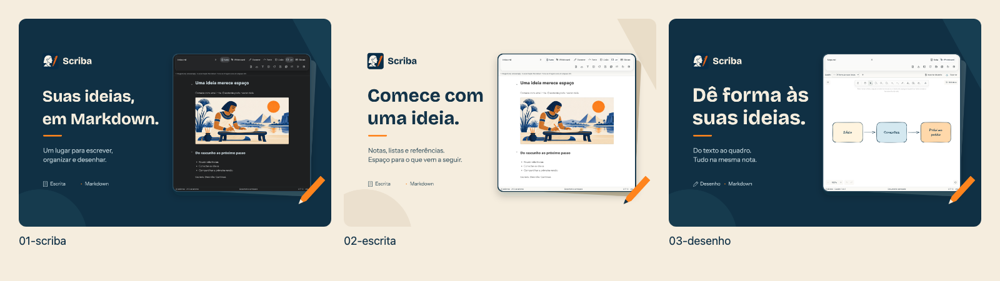

# Scriba — templates para a página da App Store

[Comparar os conceitos na galeria](index.html) · [Prévia rápida](PREVIEW.png) · [Manifesto visual](DIRECTION.md)



## O pacote

Três conceitos, em português, inglês, alemão e francês. Cada conceito foi exportado nos três tamanhos solicitados: **36 PNGs RGB opacos e 36 SVGs editáveis**. Os PNGs contêm a marca atual e capturas reais da interface responsiva do Scriba com conteúdo demonstrativo. As capturas foram feitas em navegador isolado: não contêm notas pessoais, contas ou dados de autenticação, e não são uma certificação de captura de dispositivo nativo.

| Conceito | Mensagem | Interface mostrada |
| --- | --- | --- |
| `01-scriba` | Suas ideias, em Markdown. | Nota no tema escuro, com a ilustração de boas-vindas atual |
| `02-escrita` | Comece com uma ideia. | A mesma nota no tema claro, com referências e lista |
| `03-desenho` | Dê forma às suas ideias. | Whiteboard real, com elementos conectados e conteúdo localizado |

## Qual tamanho usar

| Dimensões | Uso documentado pela Apple | Arquivo |
| --- | --- | --- |
| **5244 × 2950 px** | Imagem universal para cabeçalho da página e resultados de busca | PNG |
| **3840 × 2560 px** | Resultados de busca em 3:2, resolução máxima | PNG |
| **1920 × 1280 px** | Resultados de busca em 3:2, resolução mínima | PNG |

O formato 3:2 serve para busca; o cabeçalho usa a peça universal de 5244 × 2950. Estas são **creative assets**: não substituem as screenshots de iPhone/iPad ou os vídeos de app preview. Na página personalizada, escolha a peça adequada ao objetivo; não é preciso enviar as três alternativas como um conjunto único.

Conferido na documentação oficial em 22/10/2026:

- [Especificações de creative assets](https://developer.apple.com/help/app-store-connect/reference/app-information/creative-assets-specifications/).
- [Boas práticas e recursos para assets](https://developer.apple.com/app-store/asset-best-practices/).
- [Páginas de produto personalizadas](https://developer.apple.com/app-store/custom-product-pages/).

## Encontrar e editar

- `exports/pt-BR/`, `en-US/`, `de-DE/`, `fr-FR/`: PNGs para envio, nomeados por conceito e dimensões.
- `templates/<idioma>/`: SVGs autônomos, com captura e fontes incorporadas. Títulos e composição continuam editáveis; a interface permanece uma captura raster preservada. Abra em um editor vetorial compatível; instale as fontes incluídas se o editor solicitar substituição. Não são arquivos proprietários de Photoshop ou templates oficiais da Apple.
- `fonts/`: Bricolage Grotesque Bold e Instrument Sans Regular, acompanhadas das licenças SIL Open Font License.
- `sources/copy.json`: textos e conteúdo demonstrativo dos quatro idiomas.
- `captures/<idioma>/`: capturas de origem, sem alterações internas na interface.
- `manifest.json`: dimensões, origem da captura, SHA-256 e verificação de largura dos textos de cada exportação.
- `index.html`: galeria local, com seletor de idioma e links para PNG/SVG.

Os SVGs têm grupos identificados para fundo, marca, títulos, texto de apoio, rótulos, interface, acento e guias. A camada `guides` está oculta na exportação; remova `display="none"` para mostrá-la. São guias conservadoras próprias para preservar o conteúdo principal em recortes centrais 21:9 e 3:2, não uma reprodução do template oficial. Use o **Preview do App Store Connect** para conferir o enquadramento final em cada placement.

## Regenerar

Na raiz do projeto:

```sh
node scripts/capture-store-creative.mjs
node scripts/build-store-creative.mjs
node scripts/check-store-creative.mjs
```

A captura usa a implementação atual do produto, uma biblioteca privada descartável no navegador e notas fictícias. Nenhum simulador ou biblioteca do usuário é modificado. A renderização mantém as dimensões exatas, verifica limites dos textos e rejeita PNGs com canal alfa. Os scripts não enviam assets à Apple.

## Validação

Os 36 arquivos foram conferidos por dimensões, PNG RGB sem canal alfa e checksum. A revisão visual inclui os três conceitos e os quatro idiomas. Capturas, palavras e funcionalidades demonstradas permanecem separadas do estado de aprovação do aplicativo na App Store. Nenhuma peça usa preço, prêmio, selo de reconhecimento da Apple ou promessa de disponibilidade não verificada.
