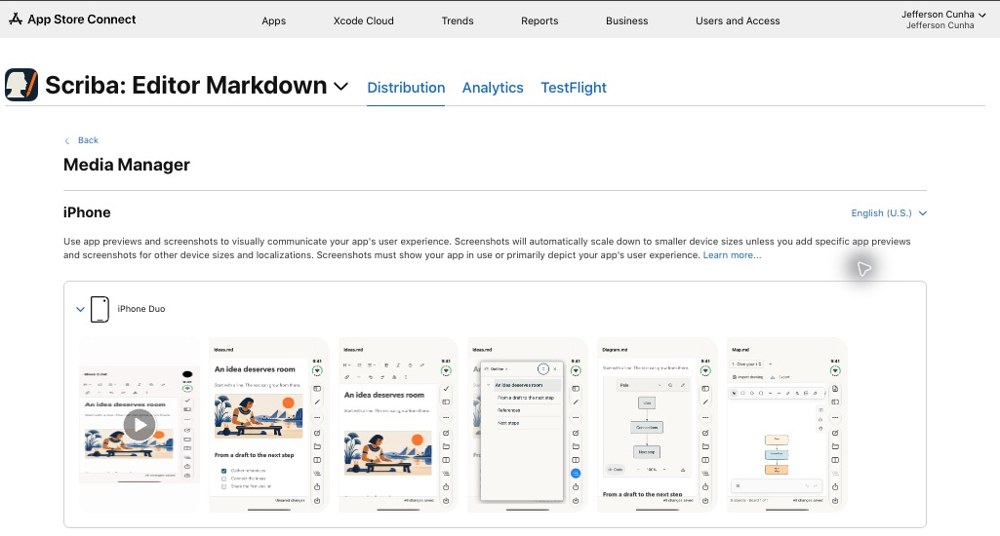
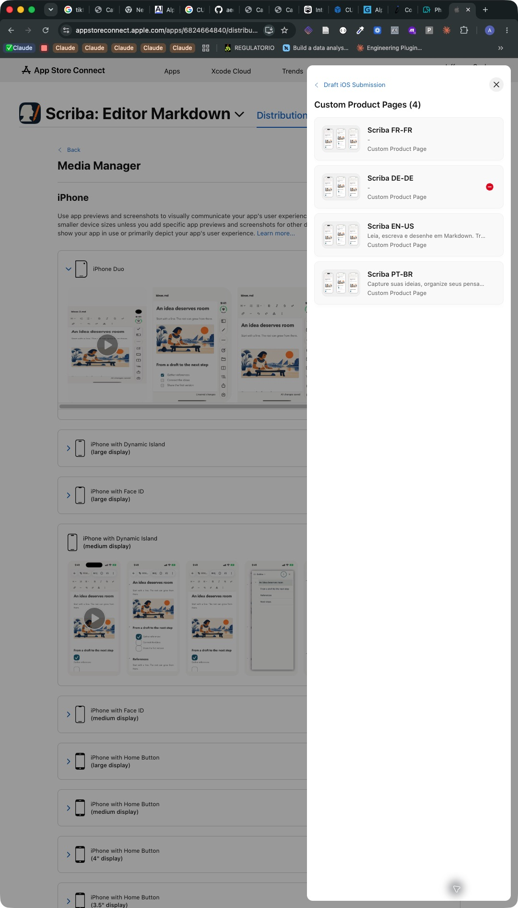

# Scriba 1.17.2 App Store submission

## Release binary

| Field | Verified value |
| --- | --- |
| App Store app | 6824664840 |
| Bundle | com.aeonbridge.scriba |
| Version and build | 1.17.2 (31) |
| Application source commit | 32209de1da517ea2578386f10f47bd19217fd2ba |
| Signing team | 8C6F4R5M4J |
| Toolchain | Xcode 27.1, iPhoneOS 27.1 SDK |
| Public release mode | Manual |

Xcode Organizer confirmed the upload of build 31. App Store Connect completed processing and the version's build selector was changed from 30 to 31. The pending developer release of 1.17.1 was cancelled to edit the version and submit the PDF correction as 1.17.2.

The archived application contains the PDF table correction. Later changes in this directory, the capture scripts and the native test target prepare store media and release evidence.

## Localized store media

The main product page has Portuguese (Brazil), English (U.S.), German and French localizations. Each locale has five screenshots and one App Preview for each device category. Filenames include their locale and device category to prevent accidental cross-language selection in App Store Connect.

| Device category | Native PNG dimensions | App Preview dimensions |
| --- | --- | --- |
| iPhone with Dynamic Island, medium | 1206 × 2622 | 886 × 1920 |
| iPhone Duo, outer display | 1398 × 2034 | 886 × 1920 |
| iPad 13-inch | 2064 × 2752 | 1200 × 1600 |

The selected scenes show reading, formatted writing, the heading outline, Mermaid diagrams and the Excalidraw whiteboard. The library scene was captured for QA and excluded from the store selection.

All screenshots and recordings come from the actual bundled application running on isolated iOS simulators with fictional translated notes. The images preserve the application pixels. PNG preparation removes an entirely opaque alpha channel. The videos preserve aspect ratio with padding, run for 20 seconds at 30 fps, use H.264 High profile level 4.0, and include silent stereo AAC audio. The final real frame is held to reach the duration required for an App Preview. Separate looping GIFs use the same workflow recording.

The initial phone video was rejected by Apple's upload validator because its decoded duration was below 15 seconds despite the simulator container reporting a longer duration. The final preparation script probes the encoded file and requires a duration of approximately 20 seconds.

### Files

- [Localized metadata](localizations.json)
- [Upload bundles](media/screenshots/), containing the PNGs and matching MP4 for each locale and device
- [App Preview masters](media/previews/)
- [Animated GIFs](media/gifs/)
- [Contact sheets](media/contact-sheets/)
- [Native PDF regression report](qa/pdf-table-regression.json)
- [Native PDF regression output](qa/pdf-table-regression.pdf)

The upload bundles and preview masters refer to the same generated video bytes. Store upload evidence and final review status are recorded separately below once verified in App Store Connect.

## Custom Product Pages

| Reference | Target locale | Product Page ID |
| --- | --- | --- |
| Scriba PT-BR | Portuguese (Brazil) | a22737b4-4f7a-46ff-abc0-db3e51c916b7 |
| Scriba EN-US | English (U.S.) | 748bce31-454a-4a02-af97-efc381e9f414 |
| Scriba DE-DE | German | 22e49a5b-f185-4986-aac1-c2ada5fd1a0f |
| Scriba FR-FR | French | 882d0664-73a7-4cec-9edf-8440270e0da2 |

The existing Portuguese draft was renamed and its owner-authored promotional text retained. The English, German and French pages have translated promotional text and explicit media for their target language. Portuguese remains the application's primary localization and is also populated on these pages. Header and search creative assets come from the existing localized creative package.

## Store upload verification

The initial presence audits in `evidence/*-audit.json` checked filenames and attachment counts. They did not establish upload completion. App Store Connect later blocked review with screenshots still uploading or processing. An incomplete slot could display the expected filename and count while lacking the completed asset's draggable control and removal action.

The Brazilian iPad set on the main version was replaced as a complete set. Its processed media were then reused from Asset Library for the primary localization of the German and French pages. The French Duo set was restored from processed localized assets. During an initial individual replacement attempt on the iPad, the following outline image was removed. Replacing the complete set restored all five scenes in order.

Legacy large-iPhone screenshot associations were removed from the main version and the affected custom pages so the new localized device media can be used consistently. All removed associations preserve their original files in Asset Library. No permanent asset deletion was performed.

App Store Connect subsequently validated the application version and all four Custom Product Pages as Ready for Review in the same five-item draft.

## Final submission

On November 7, 2026, App Store Connect confirmed **5 Items Submitted**. The draft explicitly identified iOS version **1.17.2 (31)** and the four Custom Product Pages. The configured public release mode is manual. The confirmation and item identifiers are recorded in [review-submission.json](review-submission.json). [Open the Apple review submission](https://appstoreconnect.apple.com/apps/6824664840/distribution/reviewsubmissions/details/525b3c94-9a54-4b88-b19b-a214bf897077).

The native store screenshots below document the prepared media and pages before the final submission action. The Duo image is cropped only to remove browser chrome and unrelated device rows. Its full native capture is retained alongside it.

### English Duo media in App Store Connect



### Four Custom Product Pages in the submission draft



### Animated examples

- [Brazilian Portuguese Duo workflow GIF](media/gifs/iphone-duo/pt-BR/scriba-workflow.gif)
- [English Duo workflow GIF](media/gifs/iphone-duo/en-US/scriba-workflow.gif)
- [English Duo screenshot contact sheet](media/contact-sheets/iphone-duo-en-US.jpg)

## Reproduce the media

Run the native capture orchestrator against a named disposable Scriba Store or Scriba PDF Review simulator. It rejects other simulator names. The device must have a compatible runtime installed.

```sh
SCRIBA_MEDIA_DERIVED=/absolute/path/to/derived-data \
SCRIBA_MEDIA_OUTPUT=/absolute/path/to/captures \
node scripts/capture-appstore-media.mjs DEVICE_UDID iphone-duo

uv run --script scripts/prepare-appstore-media.py iphone-duo \
  --source /absolute/path/to/captures \
  --output docs/app-store/submission-20261106/media \
  --ffmpeg /absolute/path/to/ffmpeg \
  --ffprobe /absolute/path/to/ffprobe
```

Use `iphone-medium` or `ipad-13` for the other categories. Captures run through the real import, editing and diagram entry points inside WKWebView. The orchestrator records the simulator display through `simctl` and saves a manifest after the native test completes successfully. No upload is performed by these scripts.

## Native PDF verification

The regression exercises the bundled export worker and the native share sheet. PDFKit verifies 120 table body cells, repeated headers, branding, and the page sequence portrait, landscape, landscape, portrait. The test output is retained under `qa/`.

An initial broad native run passed all ten hosted application tests and both Duo-specific UI tests. Four older web-toolbar UI scenarios produced six failed assertions on the native-toolbar Duo destination. The broad run was terminated after test completion while Xcode was collecting its results. A separately selected final run is recorded with its actual outcome in the release evidence.

The clean selected run on November 7 passed twelve tests with zero failures. It covered all ten hosted application tests and the two Duo UI scenarios for settings scrolling and native writing, saving and Files access. The manual media session was skipped because no capture catalog was supplied. The Xcode result summary is retained in [selected-native-tests.json](qa/selected-native-tests.json). The full JavaScript test run passed 101 tests with zero failures, as recorded in [unit-tests.txt](qa/unit-tests.txt).

## Apple references

- [Screenshot specifications](https://developer.apple.com/help/app-store-connect/reference/app-information/screenshot-specifications/)
- [App Preview specifications](https://developer.apple.com/help/app-store-connect/reference/app-information/app-preview-specifications/)
- [Submitting a Custom Product Page](https://developer.apple.com/help/app-store-connect/manage-submissions-to-app-review/submit-a-custom-product-page)
