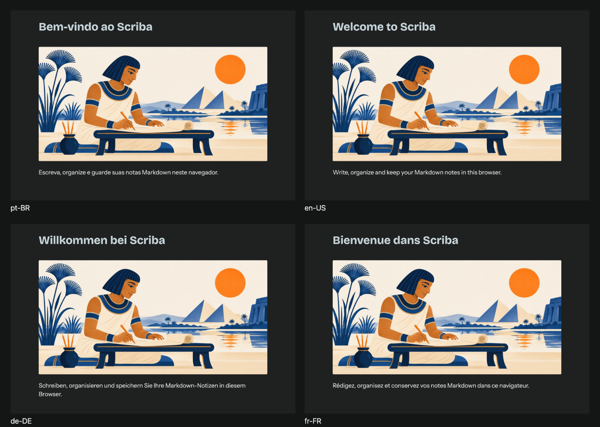

# Scriba — boas-vindas para a App Store

Composição equivalente à referência: fundo escuro, título, ilustração original completa e frase de apresentação. Sem o tooltip incidental da captura.

12 PNGs RGB opacos e 12 SVGs editáveis, em português (Brasil), inglês, alemão e francês. Cada idioma contém os três tamanhos solicitados:

- 5244 × 2950: formato universal para cabeçalho e busca.
- 3840 × 2560 e 1920 × 1280: formatos 3:2 para busca.

`exports/` contém os PNGs; `templates/`, os SVGs autossuficientes com fontes e imagem incorporadas. `sources/copy.json` contém os textos traduzidos e `sources/boas-vindas.jpg`, a ilustração original de 1200 × 600. A arte mantém essa proporção sem cortes; exportar em alta resolução não acrescenta detalhes à imagem original.

As fontes e suas licenças estão em `fonts/`. Para regenerar, execute `node scripts/build-welcome-assets.mjs` na raiz do projeto. O script verifica dimensões, formato RGB e limites dos textos; `manifest.json` registra os hashes dos PNGs. Confira o enquadramento na prévia do App Store Connect antes de publicar.

