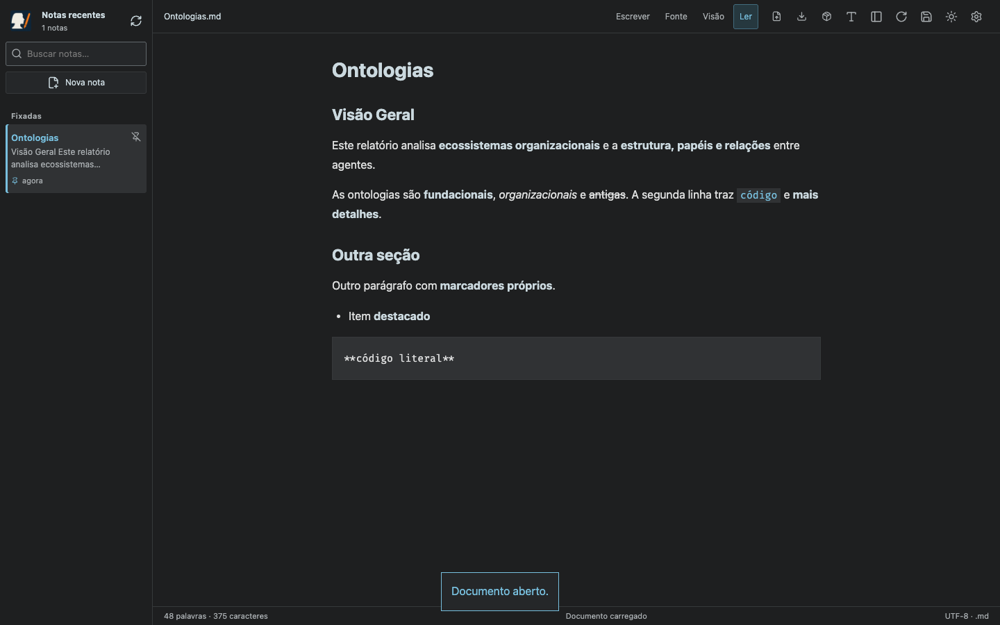
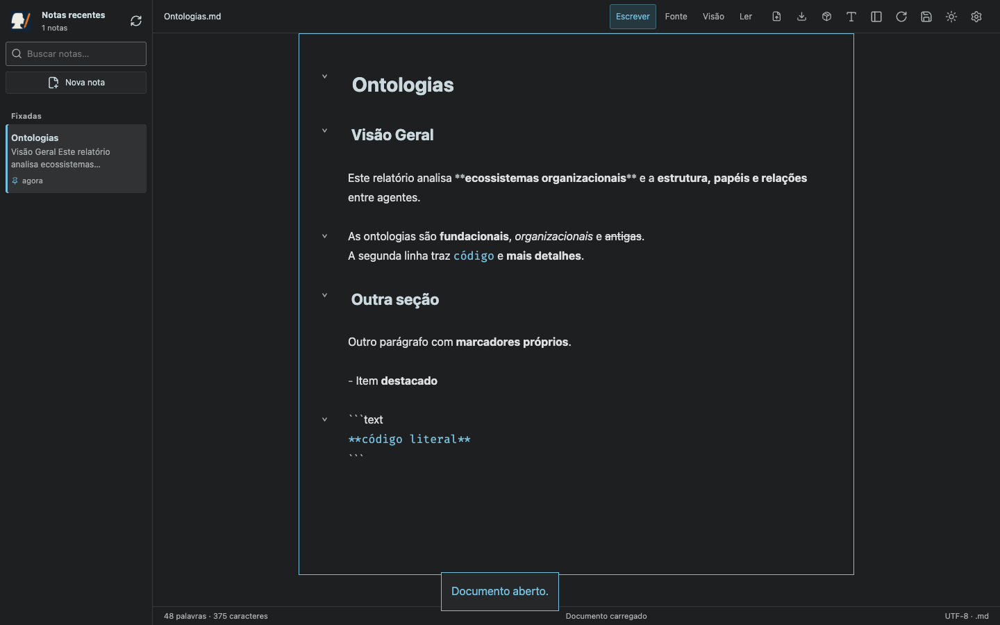
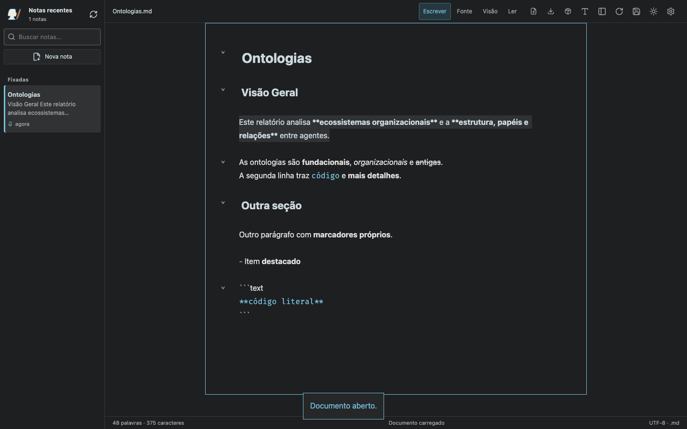
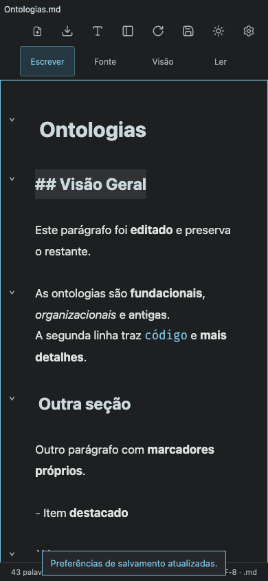
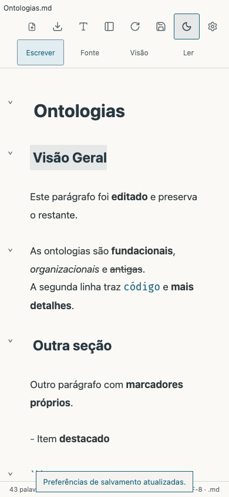

# Edição por bloco — Scriba 1.5.0

Testes de navegador sobre HTTP real, com checkouts Git e remotos bare temporários. Nenhuma nota pessoal foi usada.

- Chromium e WebKit: arquivos do repositório, importados e do Finder abrem em **Ler**; nova nota começa em **Escrever**.
- Duplo clique em título/parágrafo revela apenas o bloco selecionado. O primeiro clique num trecho formatado em Escrever revela só os seus delimitadores. Parágrafos com múltiplas linhas permanecem um único bloco.
- Escape, Enter, ⌘/Ctrl+Enter e controles de formatação; Escape também funciona após usar a barra de ferramentas. Desligar o gesto preserva as alternativas de teclado, e a preferência sobrevive ao reload.
- Edição, desfazer/refazer e commit/push conservam os demais blocos. A seleção temporária não grava texto. Offsets com emoji, CRLF e BOM apontam para o bloco correto; revelar o bloco sem editar mantém os bytes originais no download.
- Desktop 1440×900; celular 390×844 e 844×390; tablet 768×1024 e 1024×768. Capturas nos temas escuro e claro. Toque duplo também verificado com o touchscreen do Chromium.

Comandos: `npm test` (47 testes HTTP), `node tests/block-editing.smoke.mjs`, `MARKDOWN_BROWSER=webkit node tests/block-editing.smoke.mjs`, `node tests/document-reload.smoke.mjs`, `node tests/github-browser.smoke.mjs` e `node tests/browser-reload.smoke.mjs`.

Os testes públicos usam um gateway HTTP real com uma API GitHub de teste. Operações de pasta usam handles e streams reais do navegador, com o seletor do sistema simulado. Os perfis de viewport e WebKit não representam execução em um iPhone físico.

## Abertura em leitura

## Clique simples em um trecho

## Duplo clique no parágrafo

## Título no celular

