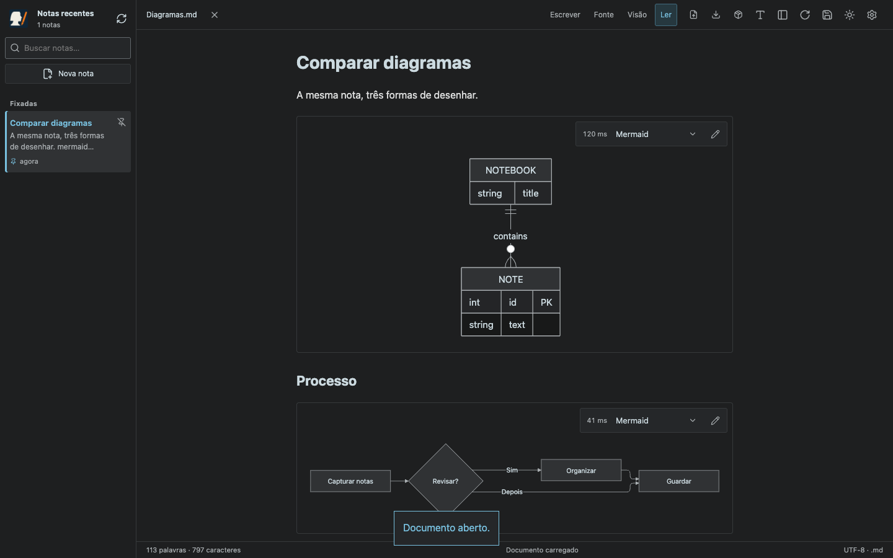
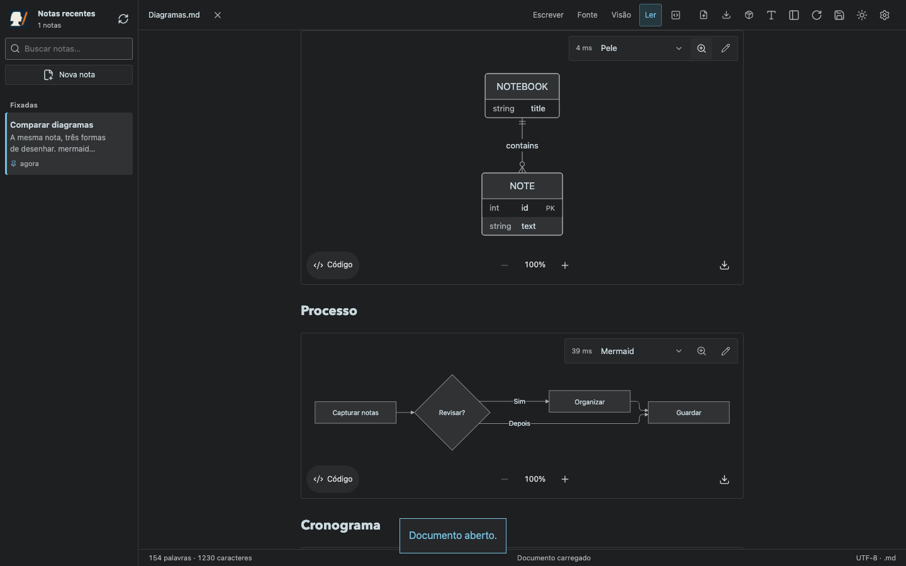
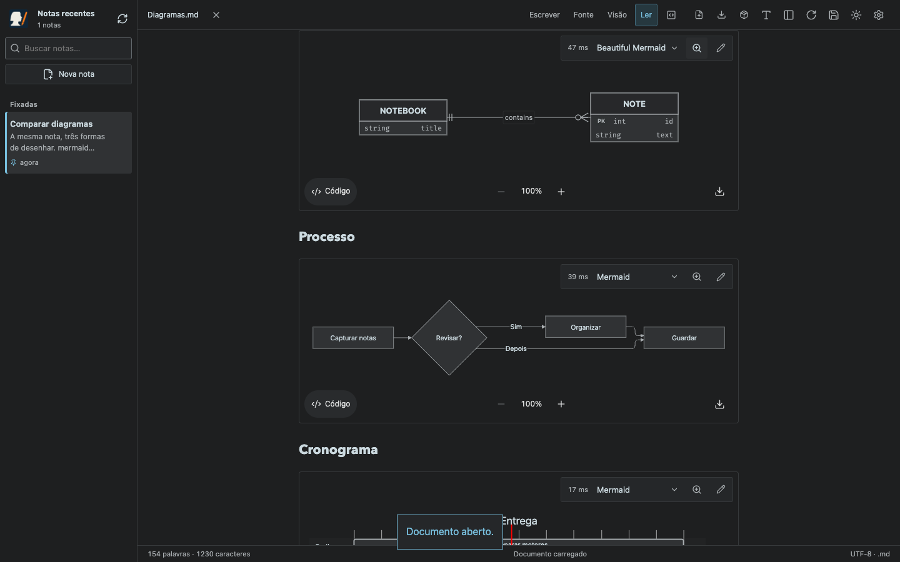
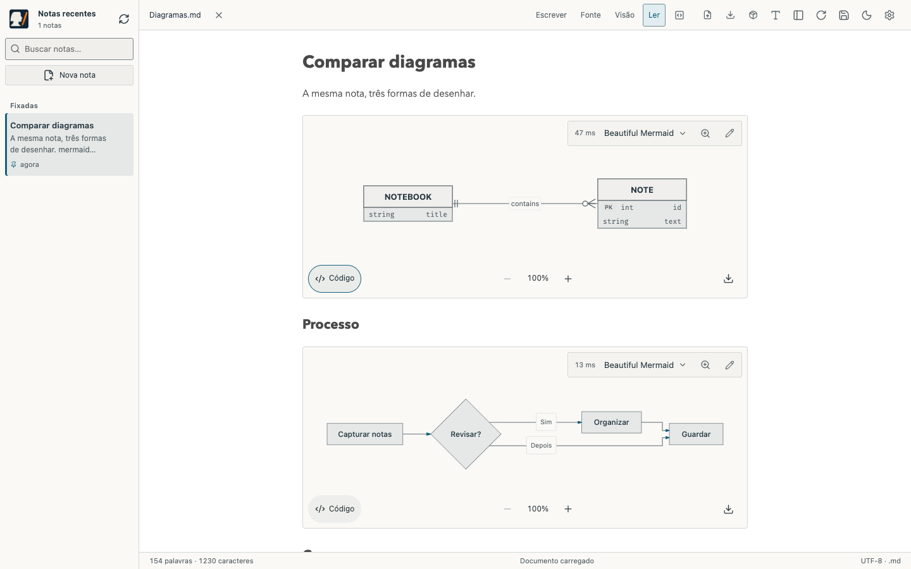
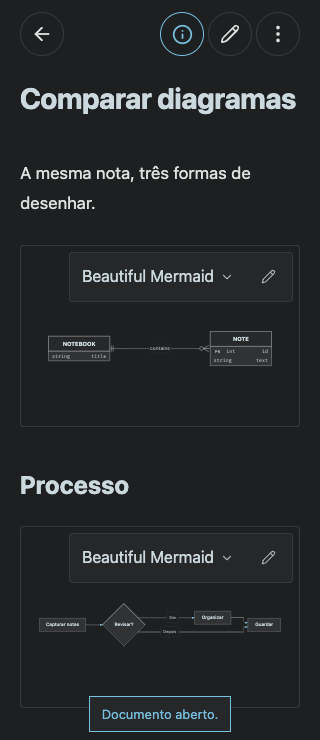
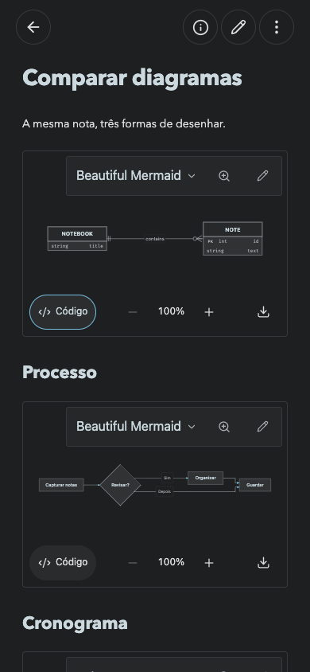
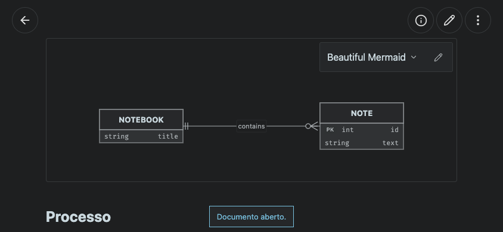
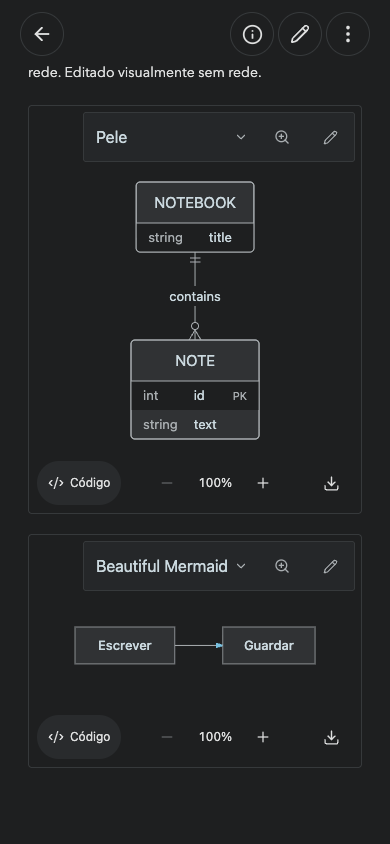
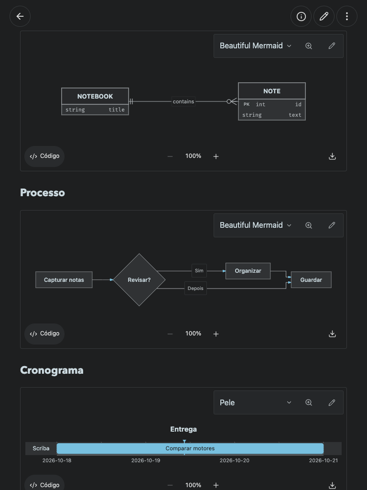
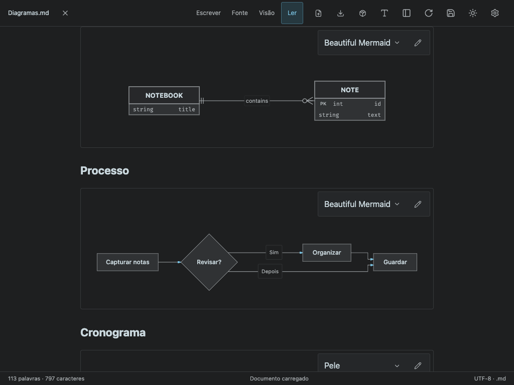

# Diagram comparison — Scriba 1.7.0

Three actual rendering engines share one source-backed Markdown integration: Mermaid 12.2.0, Pele 1.6.0, and Beautiful Mermaid 1.1.3. Every drawing has an overlaid selector and a source-edit button. The default is Mermaid. Selections are private browser presentation preferences, never serialized into notes or committed to Git.

Version 1.7.1 adds an optional [2× vector magnifier with mouse, touch, and keyboard controls](MAGNIFIER.md).

## Validation

- Local and browser-mode production builds: strict TypeScript, Vite, and versioned offline cache.
- `npm test`: 47 HTTP tests passed, with real temporary Git repositories/remotes.
- `node tests/block-editing.smoke.mjs`: existing reading, block editing, keyboard, undo, export, and save/commit/push regression passed.
- `node tests/diagrams.smoke.mjs` and `MARKDOWN_BROWSER=webkit node tests/diagrams.smoke.mjs`: Chromium and WebKit passed all three engines with ER and flowchart fixtures, per-block selection persistence, duplicate source/cache ID isolation, unsupported/invalid input recovery, read/live/source modes, unchanged Markdown export, and light/dark themes.
- Each engine was exercised at 320×740, 390×844, 844×390, 768×1024, and 1024×768. Checks require no page overflow and selector targets of at least 44 px on these sizes.
- `node tests/diagrams-browser.smoke.mjs`: the public PWA loads all three renderers for the first time **after going offline**, draws ER and flowchart blocks, imports CRLF and tilde fences, saves/reloads notes and choices, and isolates notes between browser profiles. Drawing assets require no local API or off-origin resources. The production run separately records the existing analytics beacon injected by Cloudflare.
- `SCRIBA_URL=https://scriba.aeonbridge.app node tests/diagrams-browser.smoke.mjs` and `node tests/public-production.smoke.mjs`: production HTTPS, drawing/offline behavior, private storage, and save/reload verification.

These are browser automation results on macOS, not physical iPhone/iPad certification or exhaustive Mermaid grammar coverage. The [observed times](diagrams-observed-times.json) are execution samples rather than a controlled performance ranking: internal lazy imports may affect first use. The UI labels cached results explicitly.

## Desktop — the same ER source, three engines

## Phone

## Tablet

