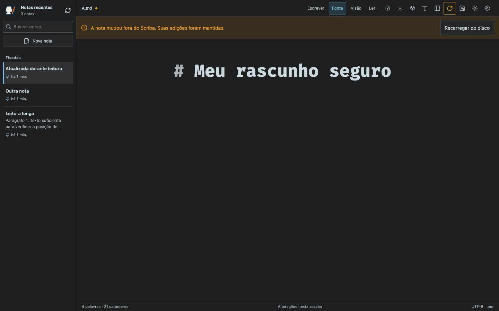
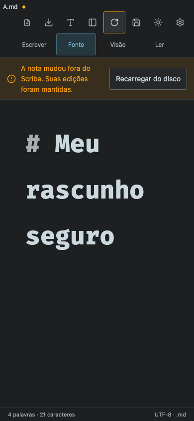
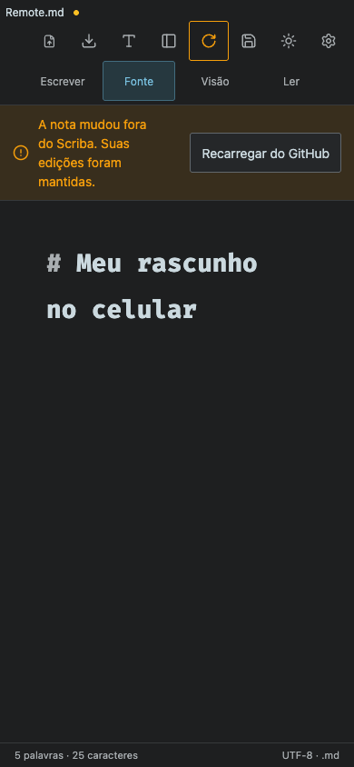

# Atualização externa da nota — Scriba 1.4.0

Validação com Chromium, servidores HTTP reais e repositórios Git temporários. Os cenários não usam notas pessoais. A API do GitHub é representada por fixtures; o gateway, as sessões e a navegação são reais. O seletor de pasta é simulado; os handles, o IndexedDB e as gravações em streams do navegador são reais.

- `npm test`: 47 testes HTTP; inclui revisão e exclusão de Markdown, recarga independente de arquivos do Finder e escopo de repositório no gateway.
- `node tests/document-reload.smoke.mjs`: atualiza automaticamente uma nota limpa, preserva o modo e a posição de leitura, mantém rascunhos, confirma/cancela descarte, pausa o automático, permite salvar depois de recarregar, mantém texto após exclusão, rejeita respostas de outra nota e edições que começaram durante uma resposta atrasada. Verifica celular 390×844 / 844×390 e tablet 768×1024 / 1024×768, alvos de 44 px e contraste do aviso nos dois temas.
- `node tests/github-browser.smoke.mjs`: login, seleção, commit, fila offline, recarga remota e proteção de rascunhos no celular.
- `node tests/browser-reload.smoke.mjs`: atualização entre abas e leitura de uma pasta autorizada, com confirmação, revisão consistente para o próximo salvamento e proteção após exclusão.
- Os testes de sincronização e troca de repositório continuam passando com o novo controle.

## Editor com edições pendentes — desktop

## Celular, tema escuro

A exportação fica em um único controle para manter a barra compacta.

## Celular, tema claro

## Alteração no GitHub

A verificação depende da execução da aba. iOS pode suspender o aplicativo em segundo plano. A validação automatizada em Chromium não representa execução em um iPhone físico.
