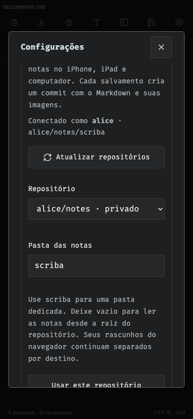
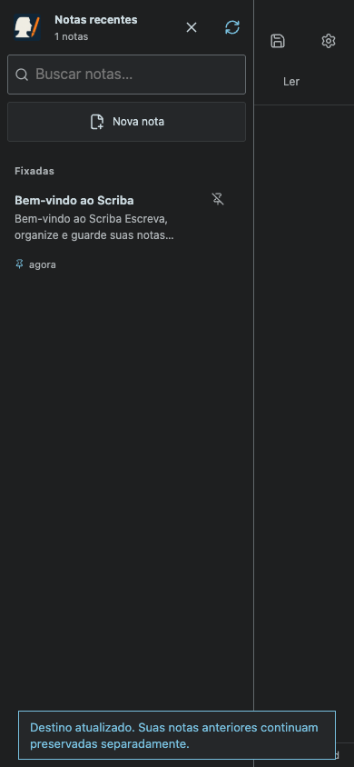
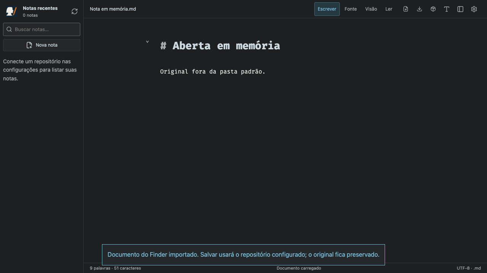

# GitHub integration evidence

These browser captures use a simulated GitHub account and API, with the real gateway and real HTTP browser navigation. No real user notes or tokens appear in the images.

`npm test` also verifies real Git commit trees and concurrent branch rejection through an HTTP fixture, plus OAuth state/PKCE and encrypted sessions. A real GitHub App authorization still requires the organization's one-time activation.

The native Mac application's recommended-handler registration was checked using `NSWorkspace.urlsForApplications(toOpen:)`, which included `/Applications/Scriba.app` for a Markdown fixture. The previously reported Finder URL was opened in a browser and verified to return 200 and load the selected document without an alert.

The native app signature also passes `codesign --verify --deep --strict`; Finder uses the bundle's `AppIcon.icns`, not a resource fork attached after signing.
