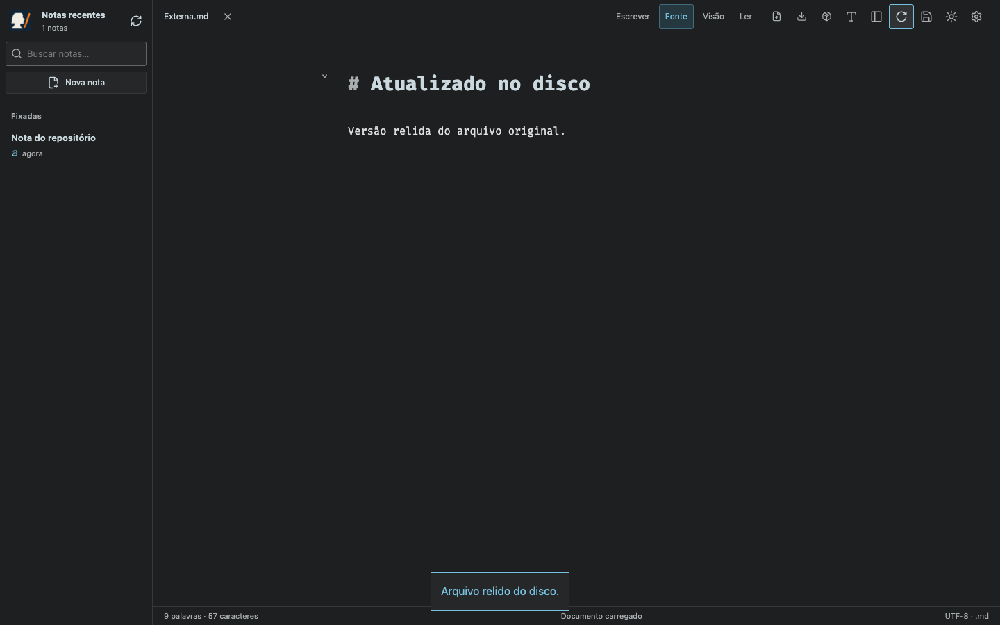
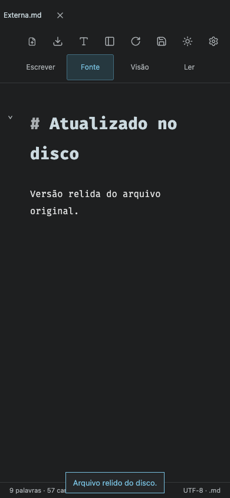

# Imported-file disk reload — 1.6.1

## Cause

The running PWA showed **Recarregar do disco** disabled for a Markdown imported through the browser file chooser. Imports retained the source hash, but no reusable original-file path; the button only supported repository files or private Finder source handles. The toolbar stylesheet assigned `cursor: wait` to every disabled button, producing a spinning blue cursor despite `aria-busy="false"`.

The regression test failed against 1.6.0 with the observed computed cursor `wait` before the fix.

## Fix

- Imported snapshots can use the reload button to select their original again; a different filename is rejected.
- Reload preserves the current presentation and protects unsaved edits with confirmation. Cancellation leaves the working copy intact.
- A successful read displays **Arquivo relido do disco** and performs no disk write, commit, or push. Saving later keeps the configured destination and preserves the external original.
- Repository files and Finder originals retain their direct reload path.
- Disabled controls use a normal cursor. The progress cursor only applies to an operation explicitly marked busy; unavailable reload actions explain the prerequisite in their title.

## Validation

`node tests/import-reload.smoke.mjs`, also with `MARKDOWN_BROWSER=webkit`: real temporary external file and Git fixtures; no-write disk reads; cancellation; wrong-filename rejection; dirty confirmation; presentation preservation; explicit save/commit/push into the chosen repository without changing the external original; direct reload after saving; phone/tablet layouts in both orientations.

`node tests/document-reload.smoke.mjs`: existing direct disk/Finder refresh, concurrent edits, stale responses, dirty confirmation, source deletion, scrolling and mobile/tablet behavior.

`npm test`: 47 HTTP tests passed. All writes use isolated fixtures; the original Lab is unchanged.

## Desktop — 1440 × 900

## Phone — 390 × 844

