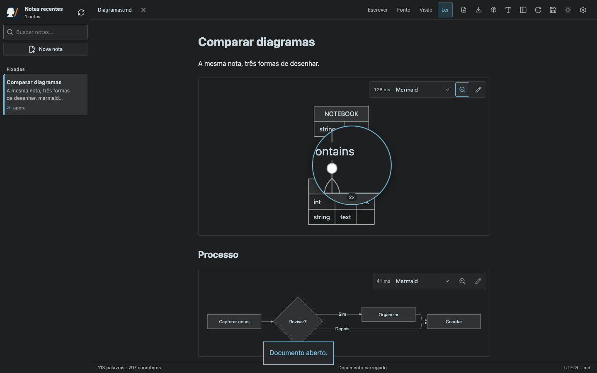
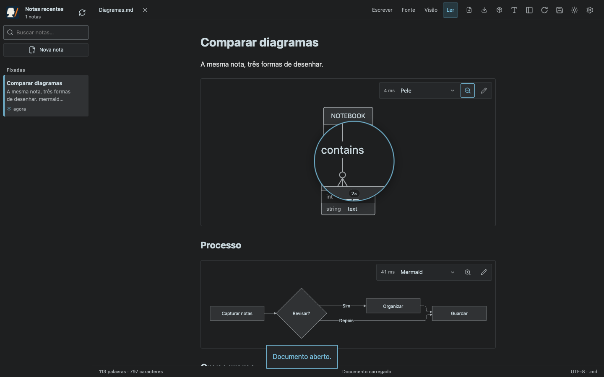
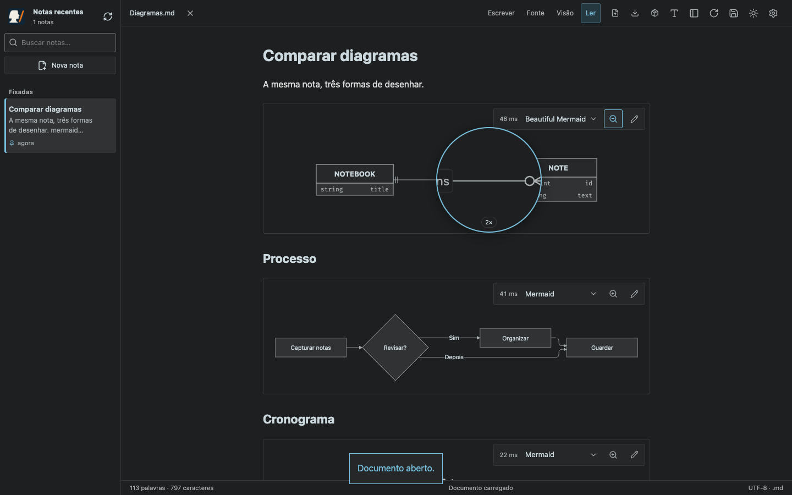
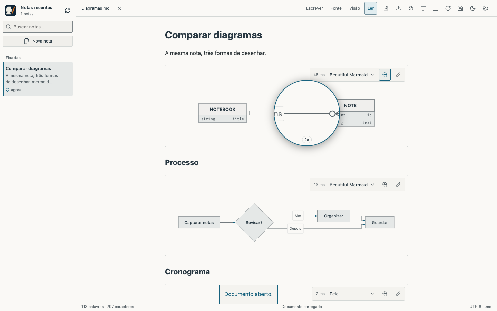
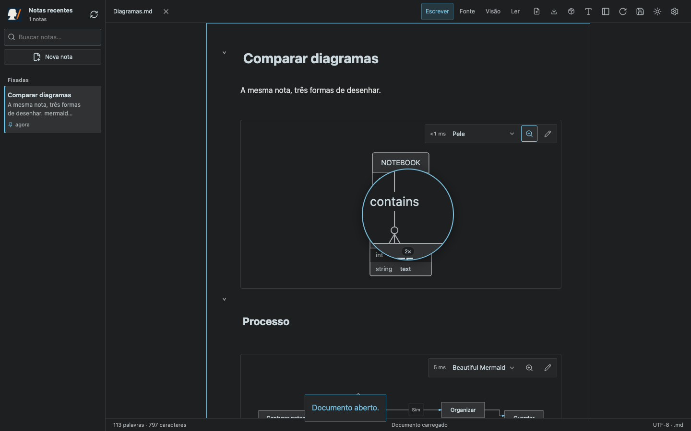
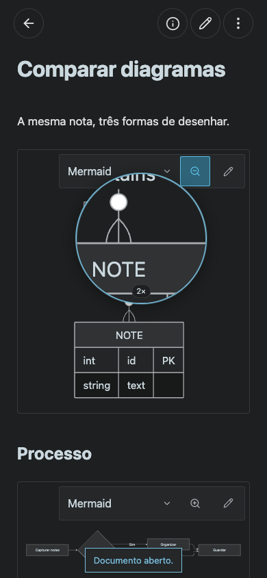

# Diagram magnifier — Scriba 1.7.1

The opt-in magnifier enlarges the existing SVG 2× under the mouse pointer. The same control supports touch dragging, keyboard arrows (Shift for larger steps), and Escape to exit. It works with Mermaid, Pele, and Beautiful Mermaid in reading, split preview, and live editing. The active button uses an icon, visible pressed state, and `aria-pressed`.

Pointer updates are coalesced with `requestAnimationFrame` and change only the lens geometry. The original SVG DOM and renderer timing stay unchanged. The vector copy has fresh SVG/style/marker IDs and is created only while enabled. The lens ignores hit testing, remains within the viewport, and is removed on mode change/unmount. Notes and presentation choices remain unchanged.

## Verification

- `npm run build`: strict TypeScript, Vite, and versioned PWA cache.
- `node tests/diagrams.smoke.mjs` and `MARKDOWN_BROWSER=webkit node tests/diagrams.smoke.mjs`: actual 2× SVG dimensions, mouse tracking, keyboard movement, Escape, button toggle, original DOM retention, unchanged renderer timing, duplicate-ID prevention, cleanup in source mode, double-click editing protection, and exact Markdown export. Existing renderer, error, theme, and responsive checks remain included.
- Chromium additionally uses actual CDP touch input in a mobile browser profile to test pointer capture, dragging, finger release, and the 44 px control. This is not physical iOS/iPadOS certification.
- `VITE_STORAGE_MODE=browser npm run build` followed by `node tests/diagrams-browser.smoke.mjs`: each renderer and magnifier is first used offline; private browser storage and source save/reload are checked.

## Desktop — three engines

## Light theme and live editor

## Mobile touch

