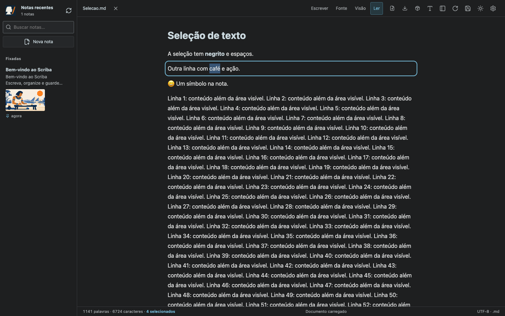
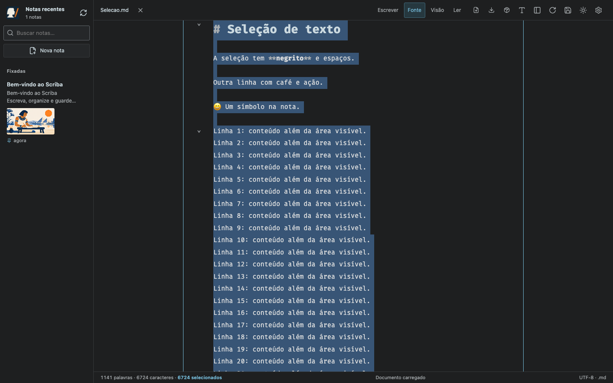
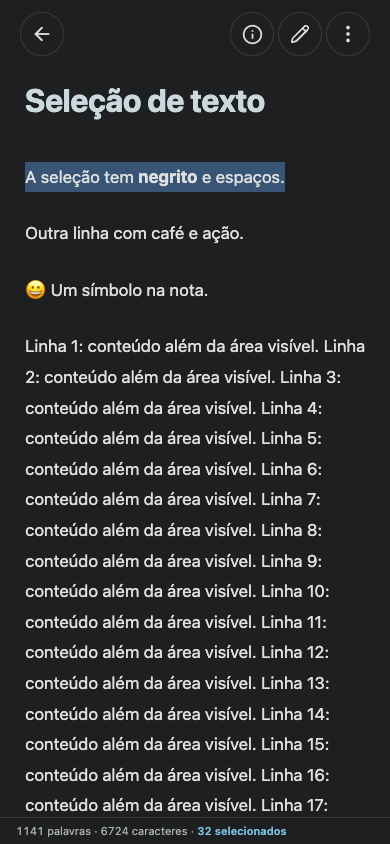
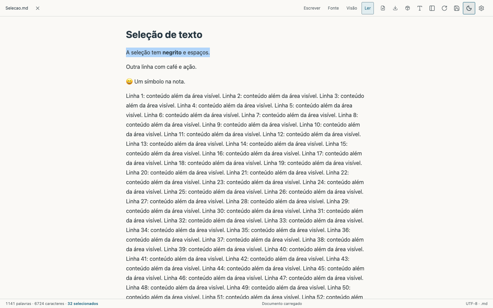

# Selected-character count — Scriba 1.7.2

The existing footer retains its word and source-character totals and adds **N selecionados** while text is selected. The count uses the same string-length convention as the existing totals, including spaces and line breaks. Reading selections count rendered text; editing selections count the underlying selected Markdown, including lines outside CodeMirror's visible viewport. Changing documents or presentation modes resets the transient count. Sidebar, toolbar, and settings text do not contribute.

Native reading selection updates are grouped with `requestAnimationFrame`. CodeMirror reports its full selection model. Only the statistics component updates, so dragging does not reparse or remount the document. No selected text is stored or transmitted, and selection never modifies the source or Git state.

On narrow reading layouts, the normally hidden footer appears while there is a selection and hides again when it is cleared. It uses the existing theme tokens and preserves page width.

## Verification

- `npm run build`: TypeScript, Vite, and versioned PWA cache.
- `node tests/selection-statistics.smoke.mjs`, also with `MARKDOWN_BROWSER=webkit`: native forward/reverse mouse drag, keyboard extension, plain-click deselection, headings and inline formatting, source/live selection of the full virtualized document, alternating split panes, document/mode reset, outside-scope selection, singular label, unchanged totals and exported source, no Git writes, and both themes.
- Phone/tablet sizes: 320×740, 390×844, 844×390, 768×1024, and 1024×768, with visible selection statistics, no horizontal overflow, and the footer within the viewport. These are browser layout checks, not physical iOS text-handle automation.
- `node tests/block-editing.smoke.mjs`: existing reading/block editing, keyboard, undo, source export, and save/commit/push regression.
- `VITE_STORAGE_MODE=browser npm run build` followed by `SCRIBA_EXPECT_BROWSER_STORAGE=1 node tests/selection-statistics.smoke.mjs`: browser-storage bundle, with the same interactions and zero local API calls.
- `SCRIBA_URL=https://scriba.aeonbridge.app node tests/selection-statistics.smoke.mjs`: the same browser interaction suite against the public build in a private context, without local filesystem API calls.

## Reading — desktop

## Full source selection

## Reading — mobile

## Light theme

