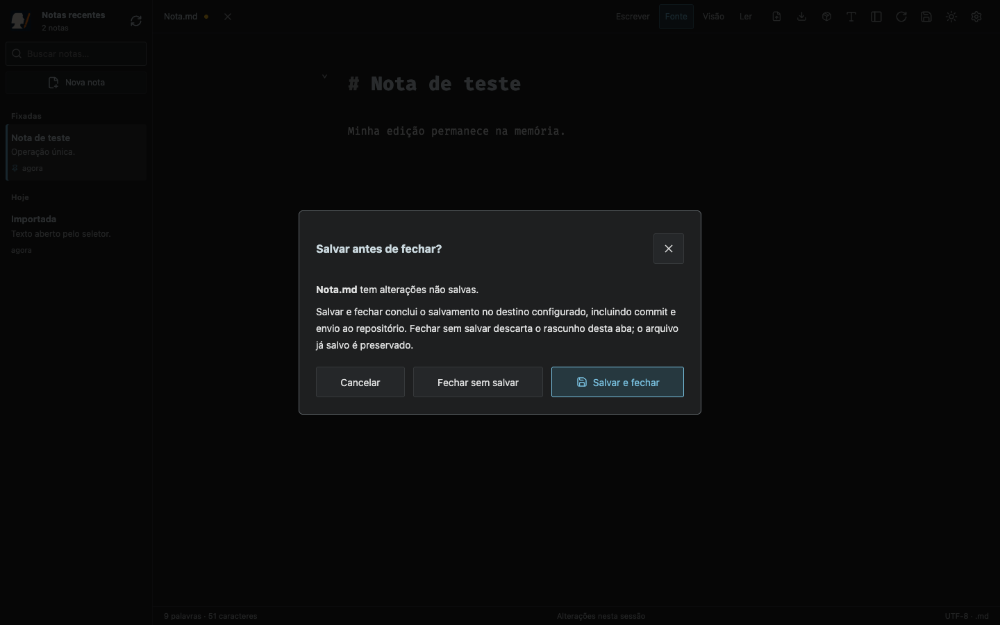
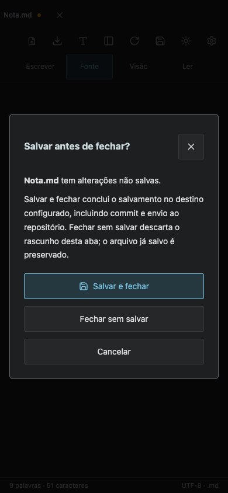
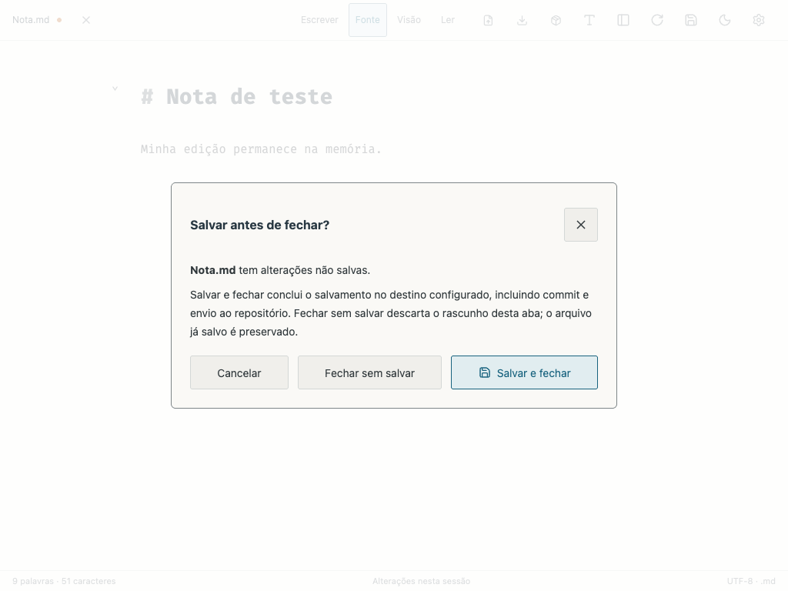

# File shortcuts and save-before-close — 1.6.0

The standalone Scriba editor adds ⌘O / Ctrl+O, keeps ⌘S / Ctrl+S on the existing save/commit/push flow, and handles ⌘W / Ctrl+W when delivered by the browser. The × beside the filename runs the same document-close command on every supported device.

The close confirmation offers save-and-close, discard, or cancel. A failed save, conflict, cancelled commit message, or pending push keeps the note open. Successful closure is persisted before the empty workspace appears, preventing an immediate reload from restoring a discarded document. Saved files are never deleted by closing their working copy.

## Browser limitation

Browsers can reserve ⌘W for closing their tab and never send the key event to the page. The physical browser shortcut is **not** proven by synthetic renderer key events. Native tab closing uses the browser's standard beforeunload warning for dirty/pending documents; custom asynchronous save choices are available through the note's × button and wherever the key event reaches Scriba. See [Chrome Keyboard Lock](https://developer.chrome.com/docs/capabilities/web-apis/keyboard-lock) and [MDN beforeunload](https://developer.mozilla.org/en-US/docs/Web/API/Window/beforeunload_event).

## Validation

- `npm test`: 47 HTTP tests passed.
- `node tests/shortcuts.smoke.mjs`, also with `MARKDOWN_BROWSER=webkit`: real native chooser, exact saved bytes and commits in an isolated checkout/bare remote; cancel/discard/save; commit-message cancellation without leaked close intent; failed push and retry without duplicate commit; duplicate command prevention during a held HTTP request; external conflict protection; immediate closed-state restoration; phone and tablet in both orientations.
- `node tests/shortcuts-browser.smoke.mjs`, also with `MARKDOWN_BROWSER=webkit`: production build with private IndexedDB; keyboard save/open/close; saved-file preservation; closed-state restoration; autosave paused during confirmation and resumed after cancellation.
- `node tests/block-editing.smoke.mjs`: existing reading/block-editing behavior remains functional.

All fixtures use temporary repositories and isolated browser contexts. No writes are made to user notes. The original Lab is unchanged.

## Desktop — 1440 × 900

## Phone — 390 × 844

## Light theme

