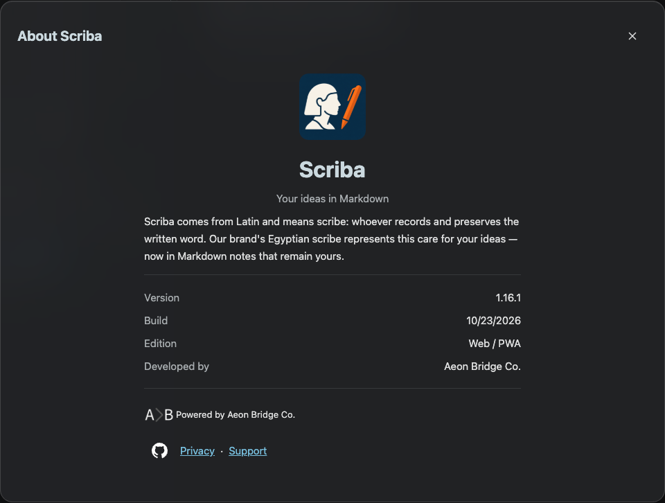
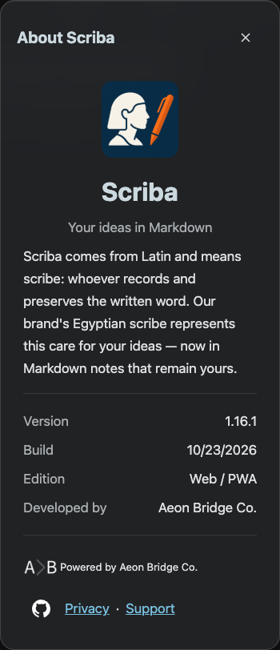

# About footer links

The existing GitHub source-code link was moved into the same flex row as Privacy and Support. Its destination, accessible name and external-link attributes were retained. The 44px icon hit area stays aligned with the text links.

Chromium verified all three link centers share one row at 1008px and 390px, without viewport overflow.

This update is independent of the pending clarification about mobile outline placement. No outline placement or material change is included here. No App Store Connect upload was performed.
