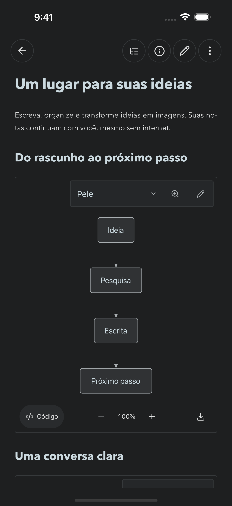
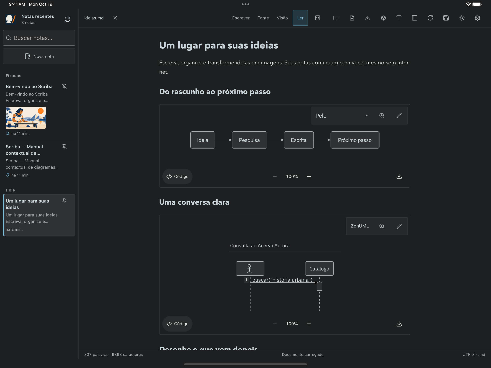

# Scriba 1.13 — native iOS and PWA release evidence

Verified on 19 October 2026 with Xcode 27, iOS 18.6 simulators, Chrome and WebKit. The native app bundles its editor, reference notes, renderers and fonts; it does not load the production website as its application shell.

## Results

- **54 HTTP/Git tests passed**, including native OAuth handoff, expiry, verifier/client binding, replay rejection, encrypted credentials and logout.
- **Five native tests passed on each device family**: four hosted bridge/integration cases and an actual device-rotation UI case. They exercised private persistence, native Files round trips, external-edit conflicts, reload, safe paths, the system directory/share sheets, Mermaid, ZenUML and Excalidraw.
- **Portrait and landscape passed** on iPhone 16 Pro Max and iPad Pro 13 M4. Captures use fictional content from the bundled test reference. Full-display capture normalizes UIKit's orientation metadata before writing PNGs.
- **Offline Chrome and WebKit passed** after service-worker installation: first drawing SDK/font/canvas load, image rendering, visual editing, private save/reload and self-contained SVG export. No external drawing resources or local filesystem API were requested.
- **ARM64 Release archive signed and App Store IPA exported**, version 1.13.0, build 1, identifier `com.aeonbridge.scriba`. The 26,517,862-byte IPA passed deep signature verification and checks for an App Store profile, the expected application identifier, debugging disabled and no device-limited provisioning. Generated archives, credentials and export artifacts are ignored by Git.
- **App Store Connect record created** as `6824664840`, with the Portuguese name and primary locale from the listing draft. Apple's creation request succeeded before the first immediate record lookup became consistent; the upload was resumed against the existing record.
- **Upload completed**: Xcode Organizer confirmed “App upload complete” and “App 1.13.0 (1) uploaded”. Apple's subsequent build processing has not yet been checked in the portal. This is not an App Review submission or a public release.
- The production web release is `/var/www/scriba/releases/20261019T202549Z-public-1.13.0`. The Mac installation was updated to 1.13.0 and its bundle signature verified. Existing notes and the bundled Node runtime signature were preserved.

The source [build and distribution guide](../../app-store/README.md) documents reproducible commands and native capabilities. [Machine-readable results](verification.json) record the release and checks without credentials or testers' addresses.

## Captures

| Device | Portrait | Landscape |
| --- | --- | --- |
| iPhone 6.9-inch | [1320 × 2868](../../app-store/screenshots/iphone-6.9-reading.png) | [2868 × 1320](../../app-store/screenshots/iphone-6.9-landscape.png) |
| iPad 13-inch | [2064 × 2752](../../app-store/screenshots/ipad-13-reading.png) | [2752 × 2064](../../app-store/screenshots/ipad-13-landscape.png) |

The public manifest also contains [desktop](../../../public/screenshots/editor-desktop.png) and [mobile](../../../public/screenshots/editor-mobile.png) screenshots captured from the browser build.

## Distribution still requires

The signing team was authorized by the owner, the app record is registered and the first build was uploaded. TestFlight invitations have not been sent. The store listing, privacy/age ratings and final review contact details still require completion in App Store Connect. Browser access to the owner's authenticated account is not connected to this automation session. Physical-device validation, including third-party Files providers/iCloud, remains pending; simulator success is not evidence of those provider-specific behaviors. Upload status is recorded separately in [verification.json](verification.json).
