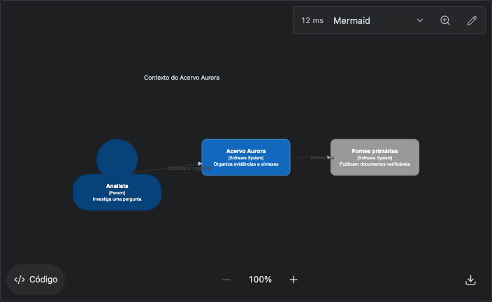
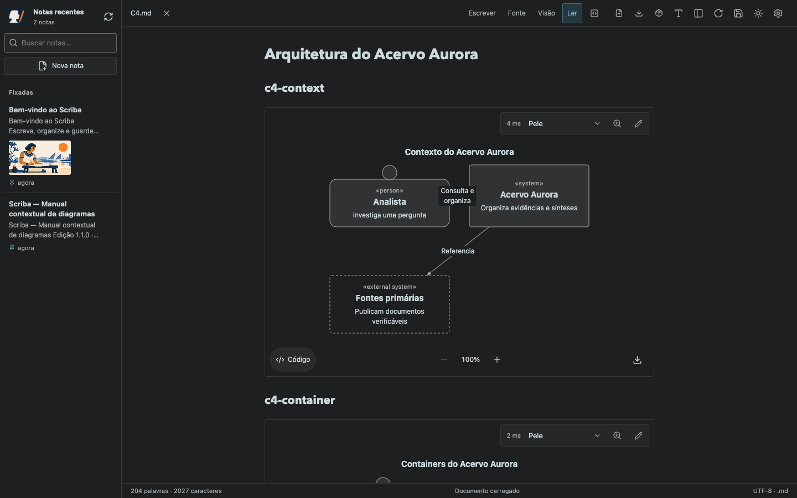
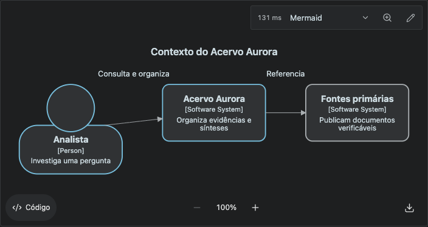
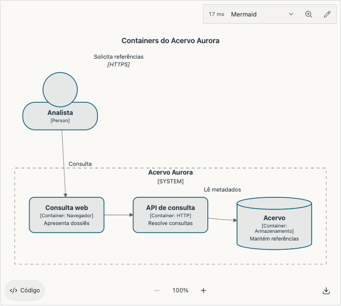
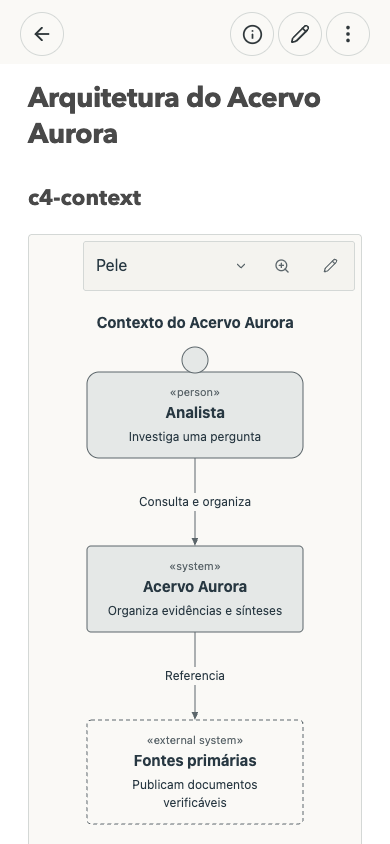
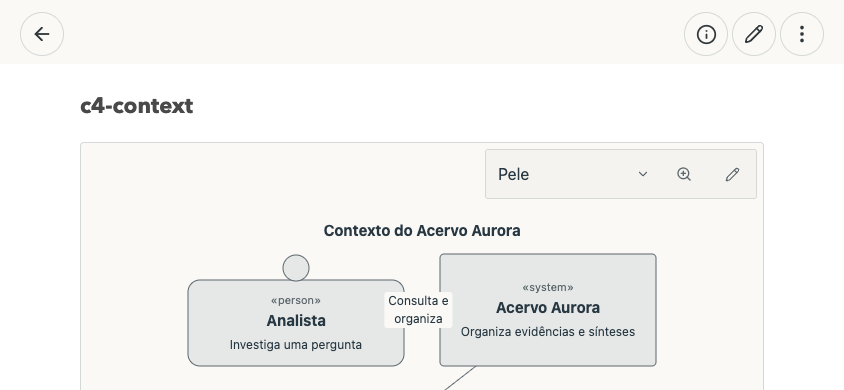
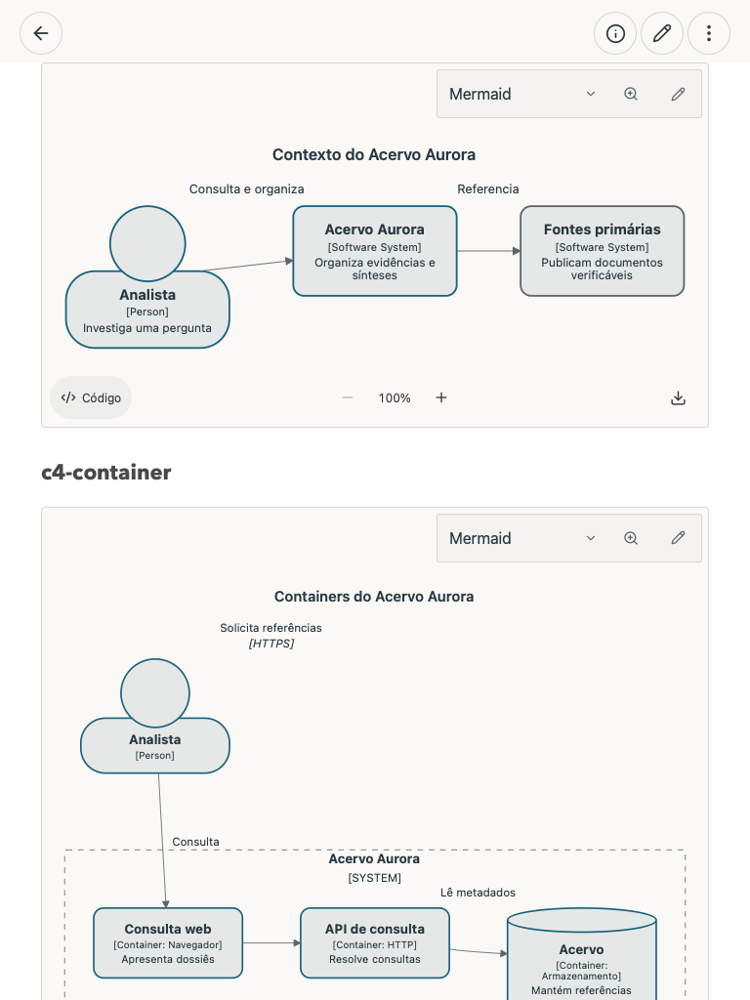
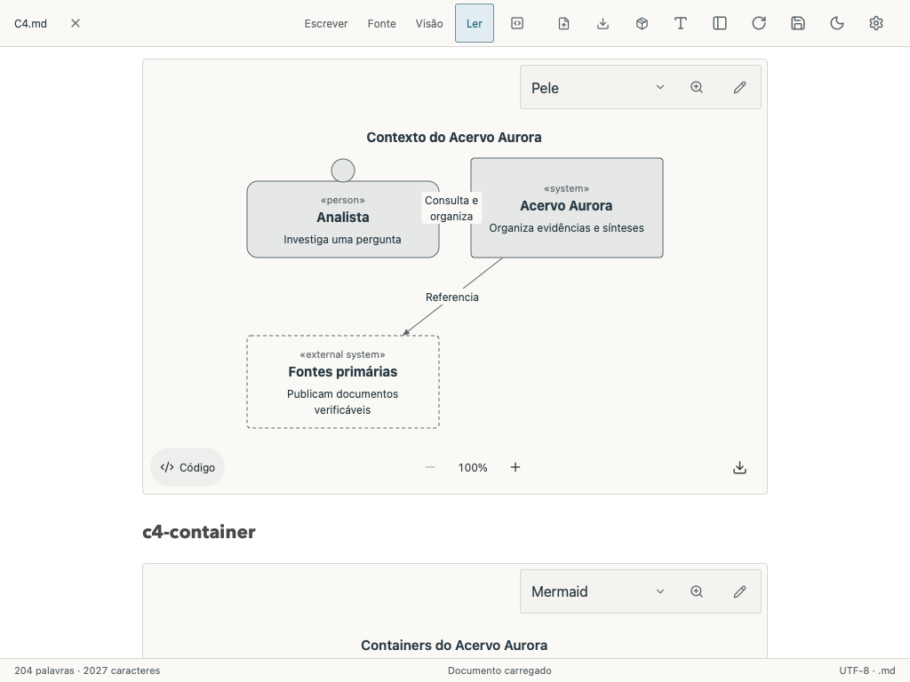

# C4 e Pele como padrão — Scriba 1.10.1

Pele abre todos os blocos Mermaid sem preferência salva. O seletor mantém, na mesma ordem, Mermaid, Pele e Beautiful Mermaid. Escolhas explícitas continuam privadas por documento/bloco; ZenUML mantém seu próprio motor. Os 58 exemplos do manual passaram com Pele e Mermaid; Beautiful continua com sua cobertura de 21 exemplos.

Os C4 receberam tipografia local maior, caixas neutras, bordas com contraste, conexões legíveis, rótulos separados do texto dos nós e enquadramento pelo conteúdo real. A correção do Mermaid trata os estilos próprios do C4, descritos na [documentação oficial](https://mermaid.js.org/syntax/c4.html). No celular, o desenho pode se reorganizar verticalmente ou permitir navegação horizontal quando precisar de mais largura. O Markdown das notas existentes é preservado.

## Antes e depois

Mermaid anterior: textos pequenos, conexões com pouco contraste e espaço vazio no enquadramento.



Pele, agora o padrão, em uma janela de 1440 × 900:



Mermaid permanece disponível com os ajustes de apresentação:





## Celular e tablet









## Cinco tipos, dois motores e dois temas

| Tipo | Pele escuro | Mermaid escuro | Pele claro | Mermaid claro |
| --- | --- | --- | --- | --- |
| Contexto | [Captura](c4-context-dark-pele-chrome.png) | [Captura](c4-context-dark-mermaid-chrome.png) | [Captura](c4-context-light-pele-chrome.png) | [Captura](c4-context-light-mermaid-chrome.png) |
| Containers | [Captura](c4-container-dark-pele-chrome.png) | [Captura](c4-container-dark-mermaid-chrome.png) | [Captura](c4-container-light-pele-chrome.png) | [Captura](c4-container-light-mermaid-chrome.png) |
| Componentes | [Captura](c4-component-dark-pele-chrome.png) | [Captura](c4-component-dark-mermaid-chrome.png) | [Captura](c4-component-light-pele-chrome.png) | [Captura](c4-component-light-mermaid-chrome.png) |
| Dinâmico | [Captura](c4-dynamic-dark-pele-chrome.png) | [Captura](c4-dynamic-dark-mermaid-chrome.png) | [Captura](c4-dynamic-light-pele-chrome.png) | [Captura](c4-dynamic-light-mermaid-chrome.png) |
| Implantação | [Captura](c4-deployment-dark-pele-chrome.png) | [Captura](c4-deployment-dark-mermaid-chrome.png) | [Captura](c4-deployment-light-pele-chrome.png) | [Captura](c4-deployment-light-mermaid-chrome.png) |

## Validação

- 20 combinações C4 no Chrome e 20 no WebKit: cinco tipos × dois temas × dois motores. Sem sobreposição entre rótulos de conexão e texto dos nós. Contraste mínimo de 4,77:1, conferido tanto no fundo do desenho quanto nas caixas.
- Fonte renderizada legível no celular, navegação horizontal quando há excedente e ausência de rolagem horizontal da página em 390 × 844, 844 × 390, 768 × 1024 e 1024 × 768.
- Padrão Pele em leitura e edição visual, seletor com as mesmas três opções, recuperação de tipo não suportado no Beautiful e preferência explícita preservada após reabrir.
- Zoom por roda/botão/teclado sem executar novamente o motor, código C4 destacado, cópia, SVG completo e PNG transparente.
- Cores e deslocamentos de conexão definidos pelo autor preservados; arquivo Markdown e Git temporário intactos após os testes.
- 52 testes HTTP/Git passaram. Regressão dos três motores e ZenUML: 25 exemplos e 513 ícones vetoriais passaram. Os três motores e ferramentas carregaram pela primeira vez offline na PWA.
- Chrome validou também o endereço publicado `https://scriba.aeonbridge.app`, em contexto privado de teste.

Relatórios: [Chrome na web publicada](verification-browser-chrome.json), [WebKit local](verification-native-webkit.json), [58 exemplos e os três motores](../diagram-reference/compatibility.json).

```sh
npm run build
npm test
node tests/c4-diagrams.smoke.mjs
MARKDOWN_BROWSER=webkit node tests/c4-diagrams.smoke.mjs
node tests/diagram-reference.smoke.mjs
node tests/diagrams.smoke.mjs
node tests/zenuml.smoke.mjs
VITE_STORAGE_MODE=browser npm run build
node tests/diagrams-browser.smoke.mjs
SCRIBA_URL=https://scriba.aeonbridge.app node tests/c4-diagrams.smoke.mjs
```

Os testes locais usam notas e repositórios temporários. O teste publicado usa um navegador isolado e não envia o conteúdo da nota ao servidor.
