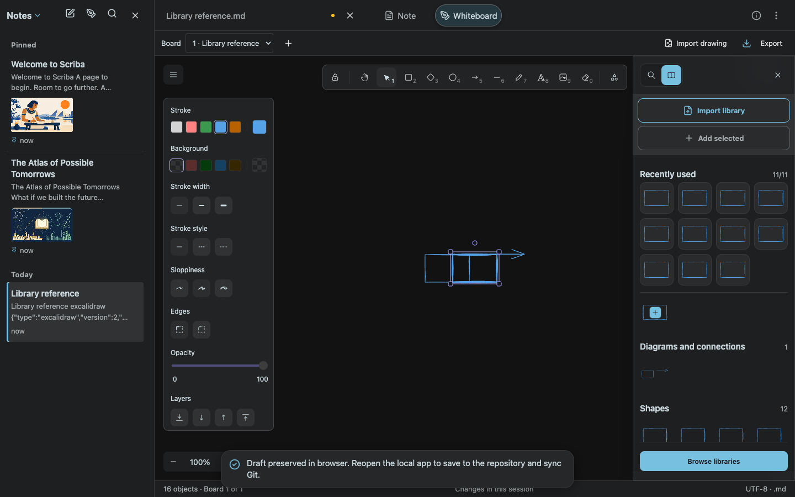
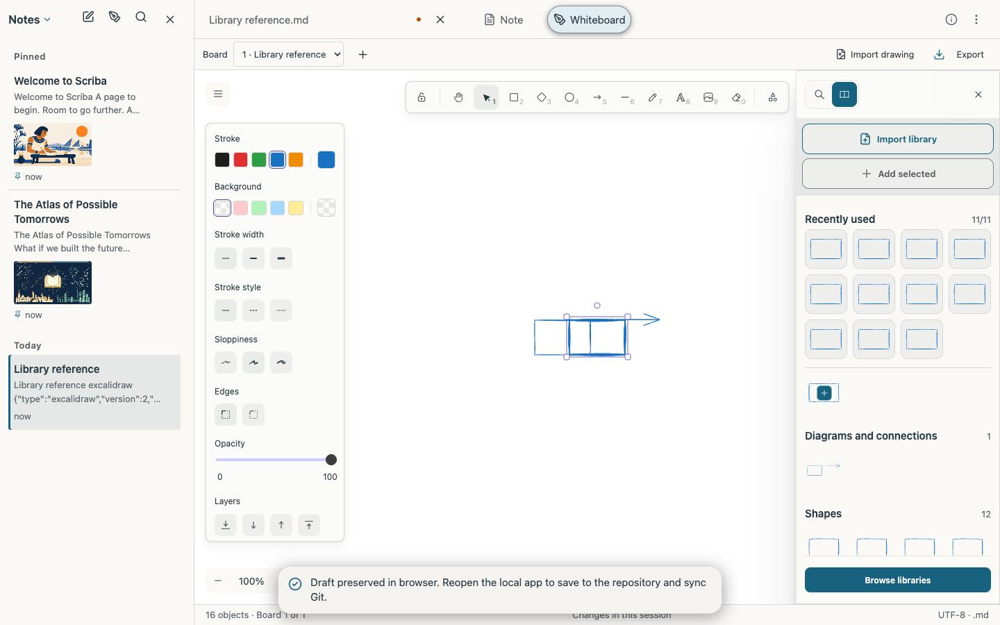
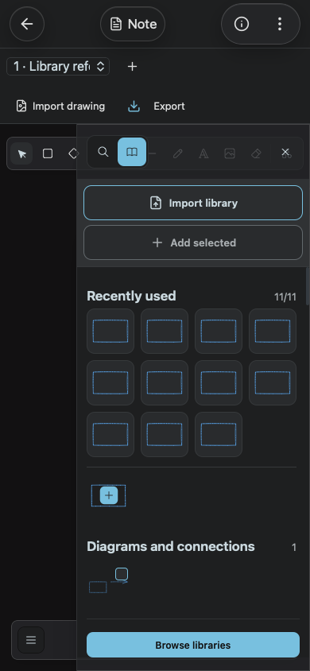
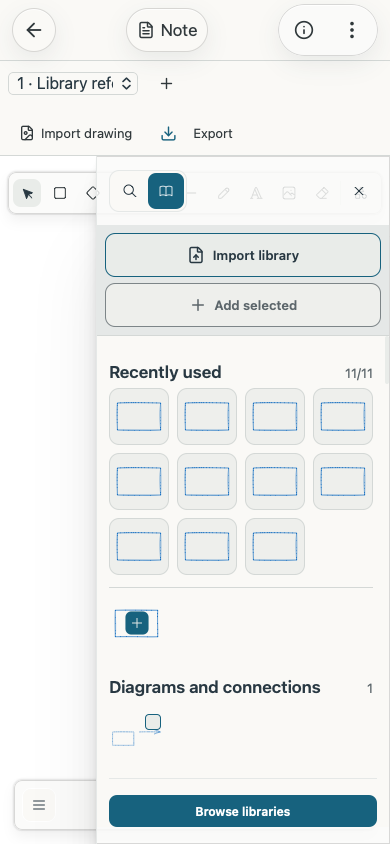
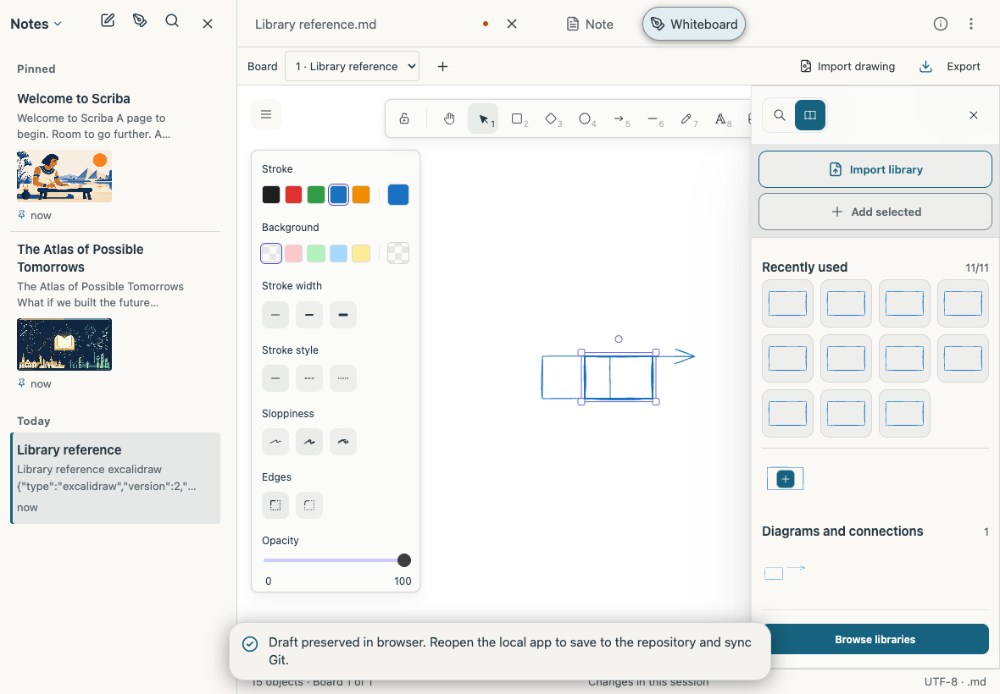

# Drawing library management

Scriba 1.17.6 adds an Import library button to the drawing library panel. It accepts .excalidrawlib files and valid JSON library files, including multiple files selected together. Imports merge with existing symbols. File-scoped SHA-256 identifiers make repeated imports of the same file idempotent. Hashing is loaded on demand and works without the WebCrypto capability.

The catalog groups the seven bundled collections by their known types. Imported and personal symbols are classified from their actual elements. Categories cover architecture, charts, algorithms, icons, notes, diagrams, images, text, freehand drawings and shapes. Group headings show item counts.

A Recently used section contains at most eleven distinct symbols, with the newest use first. These are shortcuts to the original symbols, which remain in their catalog groups. Click insertion, multi-selection insertion and canvas drops update usage. The history is stored privately in IndexedDB with an atomic read/write transaction. Deleted symbols are filtered from the recent section. Libraries and history belong to this browser or application installation.

## SDK integration

Both the full whiteboard and embedded drawing editor use the same canvas component. The presentation adapter targets the pinned Excalidraw 0.18.1 grid. It retains the SDK's own insertion, ID regeneration, binding, drag and selection handlers. The library list is stably sorted before display so shift-selection follows its displayed order. Group headings are portals into the existing grids. React retains ownership of the SDK units. An SDK upgrade must rerun the library browser journeys.

## Verification

- The full suite passed 126 tests with the verified Mac package and no skips. [Test output](unit-tests.txt).
- Chrome and WebKit passed the built application at desktop, phone and tablet portrait/landscape sizes. The journeys import actual library files, reject malformed data, retry the same file without duplicates, exercise all type groups, keep eleven distinct recent symbols in use order, insert through recent shortcuts and preserve history after reload. Desktop checks include native HTML drag/drop. The tests disable WebCrypto and compare the imported file fingerprint with Node SHA-256. [Browser results](browser-results.json).
- The actual packaged Mac runtime passed the desktop journey with an isolated Git checkout and bare remote. The saved drawing was committed and pushed. [Mac journey](mac-results.json), [Git results](mac-git-results.json).
- Both engines passed the existing mobile multi-selection insertion journey. [Selection results](selection-results.txt).
- Both engines preserved edits, removals and cleared libraries without reseeding defaults. Concurrent usage transactions retained both entries. [Storage results](storage-results.txt).
- Public, local and iOS bundles passed locale validation, strict TypeScript and production compilation. Four interface languages include the new controls and messages. Browser viewport checks do not exercise UIKit or the native file picker.

## Screenshots

The following screenshots use synthetic libraries and drawings in isolated contexts.

## Deployment

Version 1.17.6 is active at the public HTTPS origin and installed in `/Applications/Scriba.app`. All eight library journeys also passed on the published site. The installed package has a verified signature and a retained rollback copy. Activation used an atomic exchange, and the existing local backend continued serving the new distribution. [Published-site results](production-results.json), [release receipt](release.json).
