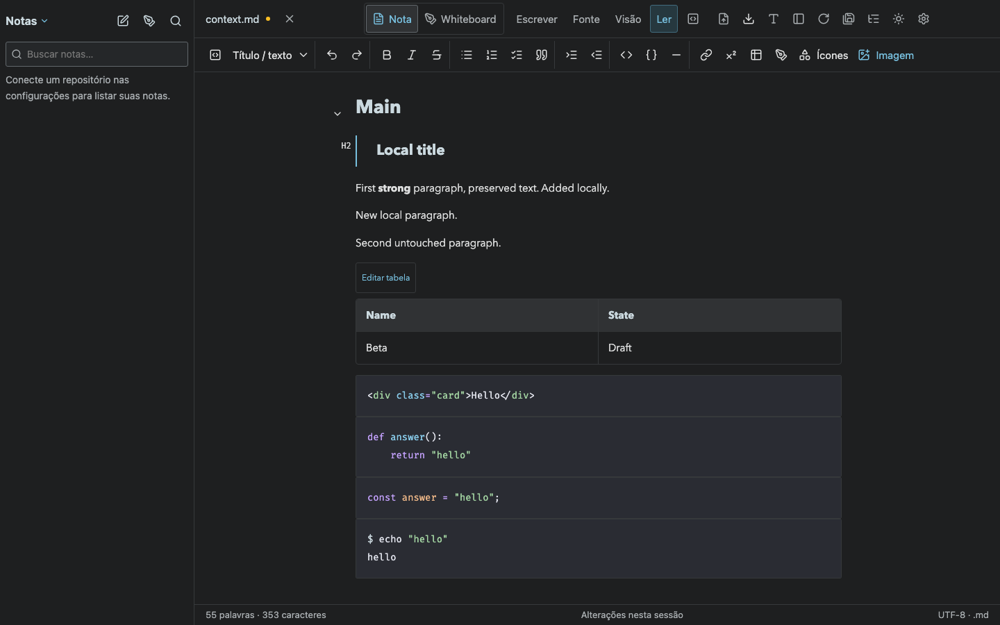
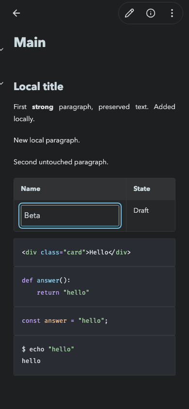
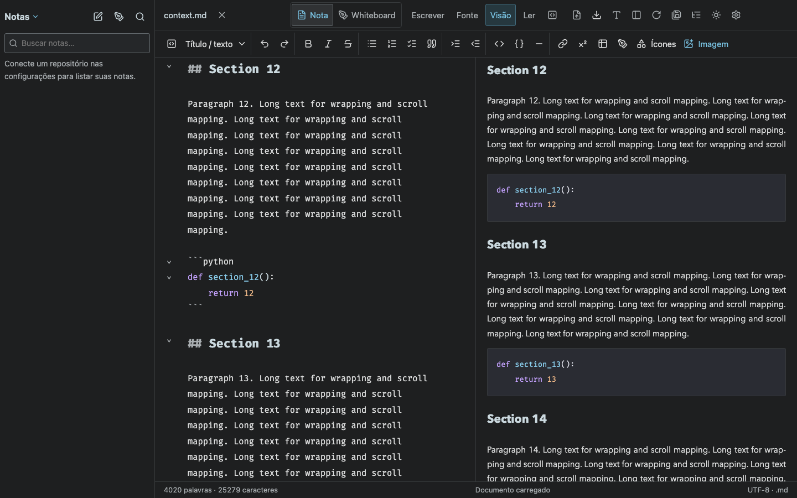

# Contextual editing, language colors and synchronized split view

`npm run build` passed. `npm test`: 63 passed.

`npx playwright test tests/contextual-editing.spec.ts` checks real browser interactions:

- HTML, Python, JavaScript and console fences receive syntax colors in reading. The local HTML editor also shows multiple token colors.
- A double click mounts exactly one paragraph or heading editor while the note remains in reading mode. Clicking outside or Escape returns to reading; headings show their level.
- A table double click opens the selected cell input; editing and leaving it updates the rendered table without exposing its Markdown source.
- Source scrolling drives the preview; operating the preview drives the source. Corresponding headings are checked against actual viewport geometry.
- Opening and closing a block leaves the source byte-identical. Editing one paragraph preserves the BOM, CRLF, comments, reference syntax and untouched neighboring content.

