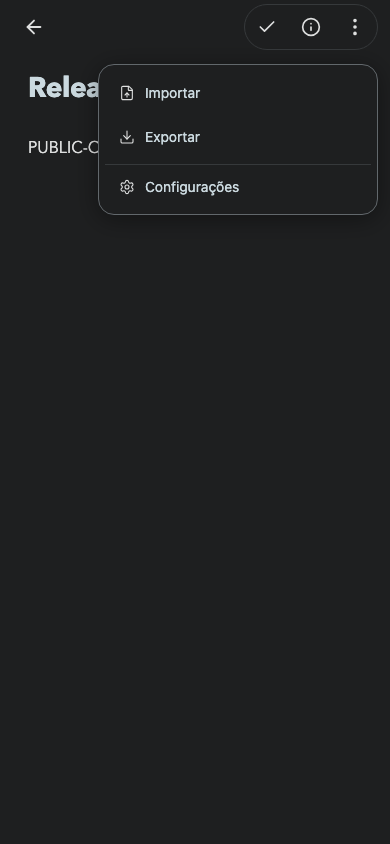

# Production — 22 October 2026

Source: `ce6b56f` (plus documentation/availability follow-ups), pushed to `ab-orbit/ab-markdow-editor` main.

Public URL: https://scriba.aeonbridge.app/. Public build uses `VITE_STORAGE_MODE=browser npm run build`. Active static release: `/var/www/scriba/releases/20261022T084400Z-public-1.16.1-build16`; previous releases retained. Live HTML SHA-256 matches the built artifact: `250f86820a645e1cd935583c5490301573604fdccb8bc9fc78c7edaf10a51734`.

GitHub gateway code updated at `/opt/scriba/github/service.mjs`, previous file retained as `service.mjs.before-build15`. Service restarted and public `/github/status` returns HTTP 200. Session database, encryption key and environment were preserved. No customer notes were uploaded or modified by deployment checks.

Changes: unified storage destination, silent successful autosave, nonrepeating error feedback, safe automatic Git integration, preserved concurrent note copies, desktop mode icons/labels, 18px desktop/16px mobile reading text, compact feedback surfaces, and mobile import that saves the active note, shows the new note and closes the sidebar. A new imported note receives a fresh autosave retry schedule.

Verification: 82 Node tests pass. [Actual HTTPS production smoke](production.txt) checks automatic save/reload, isolation, offline and mobile navigation. Actual HTTPS import journeys pass in [Chromium](import-chromium.txt) and [WebKit](import-webkit.txt), including saving the previous latest edits and promptly persisting the newly imported note. Isolated WebKit conflict tests preserve both concurrent notes without Git operations. These are browser tests, not physical-device QA.

Visual evidence: [storage](../storage-settings/README.md), [editing modes](../editing-modes/README.md), [error feedback](../feedback/README.md).

