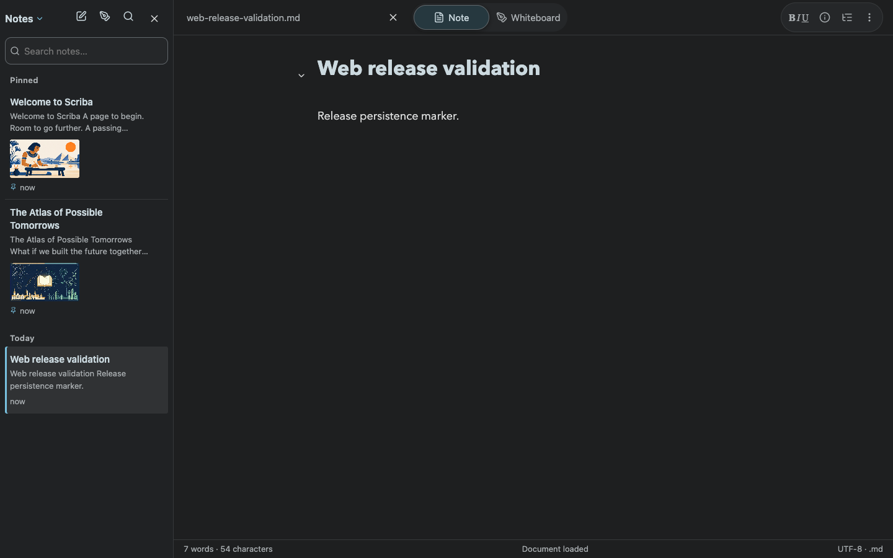

# Web deployment — 23 October 2026

Published source commit `e058557818886db0d775ff829a5894a35e12d880` to https://scriba.aeonbridge.app/ using `VITE_STORAGE_MODE=browser npm run build`.

Active release: `/var/www/scriba/releases/20261023-public-e058557`. Previous release retained: `/var/www/scriba/releases/20261022T145300Z-public-1.16.1-build27`. Nginx configuration validation and reload succeeded. Older hashed assets were retained for already-open tabs.

Both the built index and the actual public HTTPS index have SHA-256 `feb0783c2e27583b6e15c89bad584268b6db9760d20ccce45995b57ab396b90c`.

Production browser verification in isolated Chrome contexts:

- [Mobile recent notes](recent-notes-production.txt): open through More options twice, restore menu invoker focus, keep library visible, close, reopen via Back to notes, and dismiss on document interaction. [Mobile screenshot](../recent-notes-menu/production-mobile-library.png).
- [Persistence and isolation](persistence-production.txt): import a synthetic note, verify IndexedDB persistence, reload, verify isolation from a second browser context, and check page errors, local API traffic, and desktop overflow.

No App Store Connect upload, TestFlight distribution, or App Review submission was performed. The public native-update manifest was compared with the previous release and remains unchanged.
