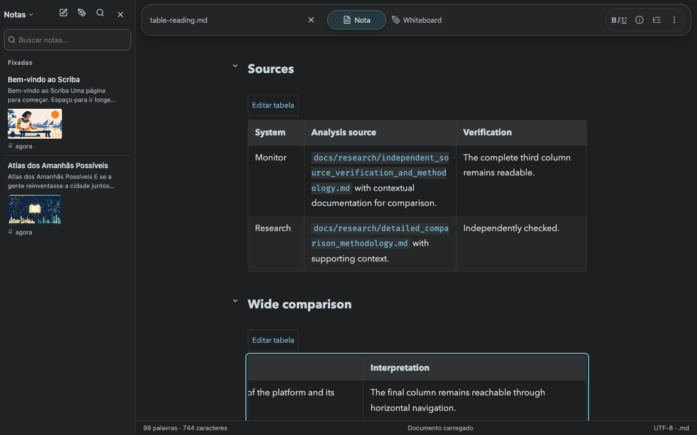
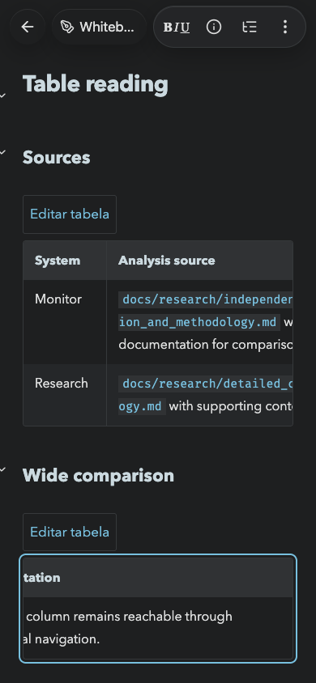

# Mac and web release — 6 November 2026

Scriba **1.17.2** is installed at `/Applications/Scriba.app` and published at https://scriba.aeonbridge.app/. The distribution bundles were built from source commit `288b594bd79913c555929b35c1fb11ff3ee1b966` on `codex/pdf-landscape-tables`.

## Table behavior

Wide PDF tables start on separate landscape A4 pages. Following prose resumes in portrait, table headers repeat, and table text uses 10 pt. The [PDF regression evidence](../pdf-tables-20261106/README.md) describes pagination, row continuation and the synthetic examples.

Desktop reading and visual editing now fit compact tables with up to four columns to the reading column. Tables with five or more columns retain horizontal navigation. Below 900 px, tables keep natural column widths and horizontal navigation, including long paths inside inline code.

## Production verification

- **101 unit tests passed**, together with strict TypeScript and separate browser-mode and local-mode production builds. [Unit output](unit-tests.txt).
- The public HTTPS export journey passed four synthetic cases in Chrome and WebKit. PDF geometry checks cover every cell, page margins, continuation headers and page orientation. [Public PDF results](production-pdf-validation.json).
- Reading and visual editing passed seven viewports in each browser at the public origin, including phone and tablet portrait and landscape. Checks cover three-column desktop fit, readable mobile columns, keyboard navigation to the final wide-table column and document bounds. [Chrome results](production-reading-chromium.json), [WebKit results](production-reading-webkit.json).
- Private browser persistence, reload, separation between browser contexts and offline save/reload passed using the installed service worker. The test recorded zero local filesystem API requests and zero page errors. [Persistence results](production-persistence.json).
- Cloudflare injects an edge statistics script into the production page. Export tests record that script separately and reject other external requests and save/sync writes during conversion. [Export journeys](production-export-journeys.json).

## Installed Mac verification

The local-mode distribution passed five export journeys through an isolated instance of the application server, including the owner-supplied report. All **101 cells** in that report were recovered across **8 pages**, with landscape tables and portrait text. [Mac PDF results](mac-pdf-validation.json).

The isolated local server also passed reading and visual editing at seven viewports. [Mac reading results](mac-reading-chromium.json).

The installed application received the new static bundle and version metadata. A verified complete backup of version 1.16.1 is stored under the local workspace's `artifacts/pdf-tables-20261106/backups/`. The running backend continued serving on the same process. Older hashed assets support already-open windows.

The application signature passed strict, deep verification. The served HTML matched the local distribution after removing the per-process session capability from the comparison. Applying the built-in update restored the open report with **1,938 words and 12,000 characters**. Visual inspection confirmed that its three-column table fits the reading column. [Installation checks](mac-install.json).

## Deployment receipt

The active public release is `/var/www/scriba/releases/20261106-public-1.17.2-288b594`. The previous release is retained at `/var/www/scriba/releases/20261023-public-e058557` for rollback. The symlink switch and nginx configuration validation/reload succeeded. HTTPS checks through both Cloudflare and the certificate-validated origin returned the built HTML digest.

Build modes, HTML digests, application-shell cache identifiers and the native-update manifest digest are recorded in the [release receipt](release.json).

## Screenshots

The following production screenshots contain synthetic notes.

