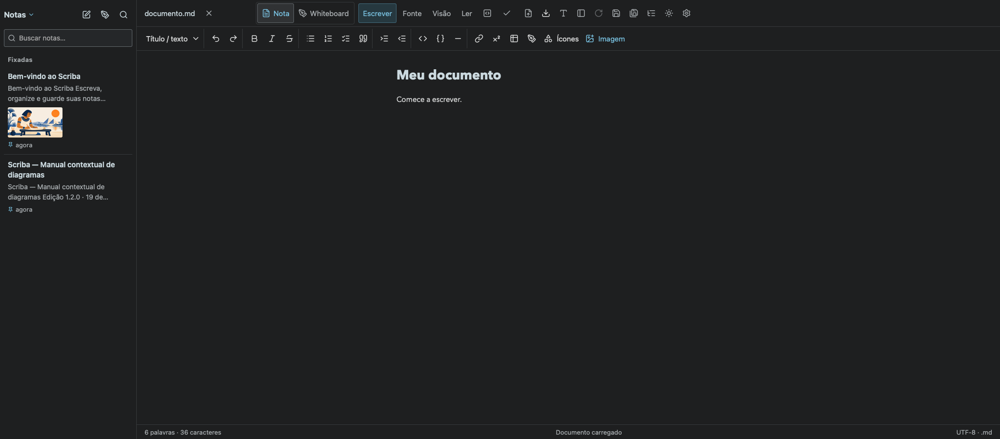
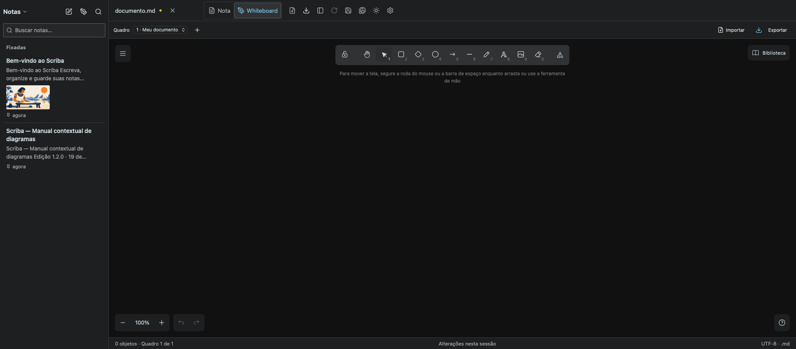
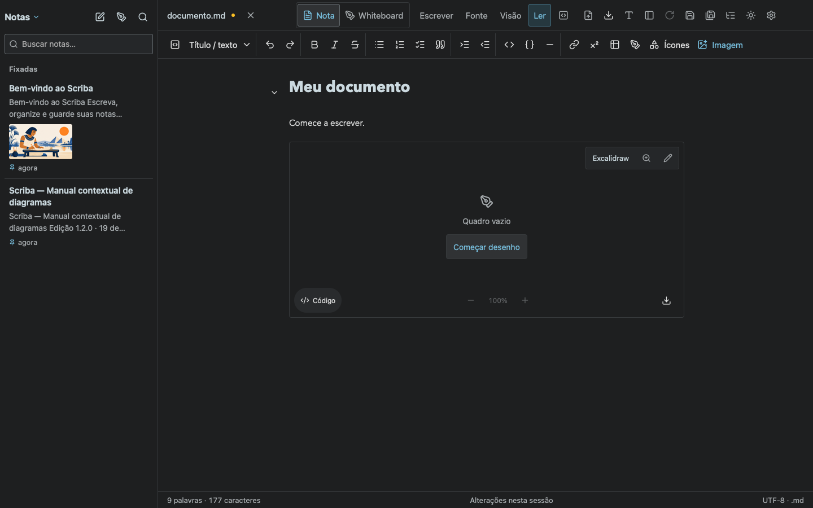
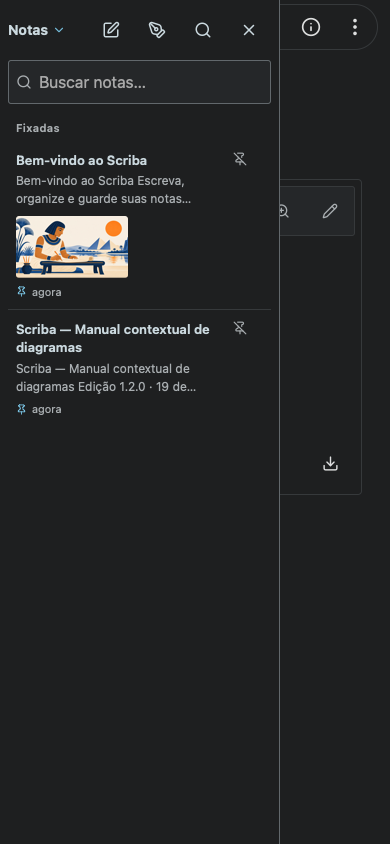

# Desktop interface readability

Desktop application controls use 15px text, with 13px metadata, a 280px notes sidebar and larger toolbar icons. Commands follow the document tab rather than stretching to the right edge. Sidebar header icons retain their hit areas and focus behavior with transparent borders instead of circular frames. Document typography is unchanged. Mobile formatting keeps its existing compact capsule and floating toolbar.

The real browser smoke checks sidebar typography and geometry, border transparency and command placement at 1440px and 2048px, and captures mobile at 390px. Chromium and WebKit passed.

