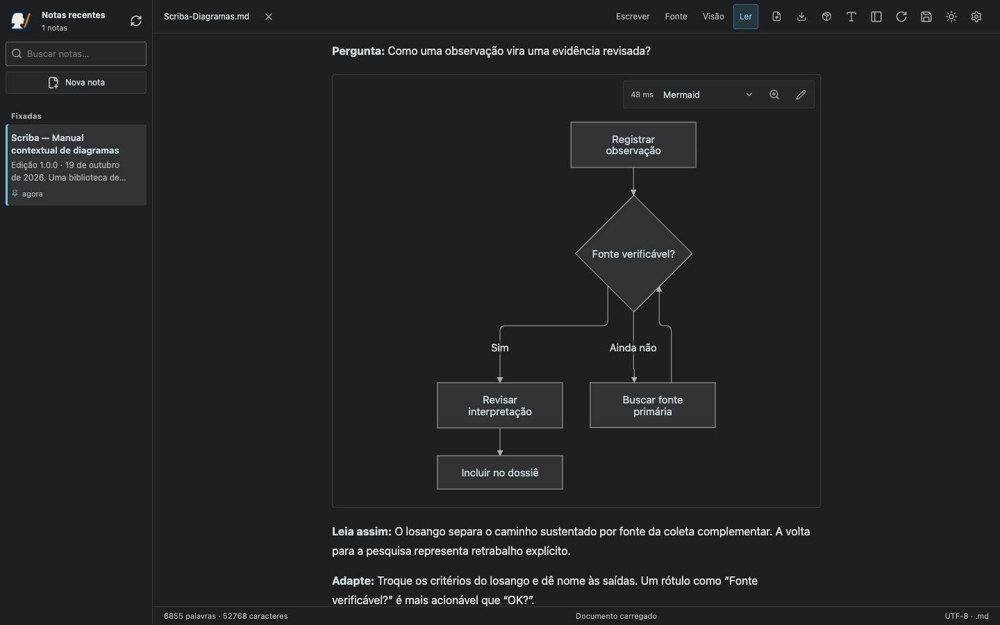
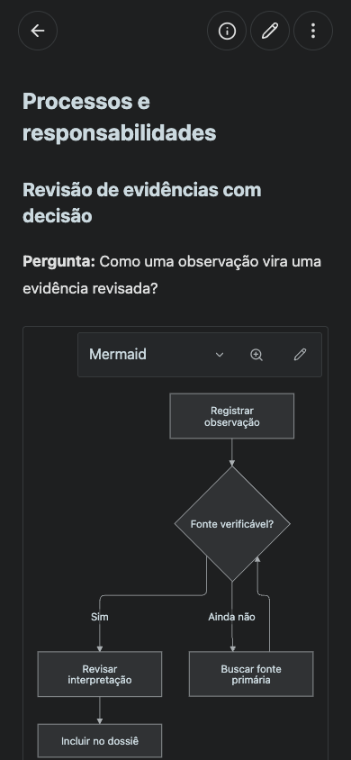
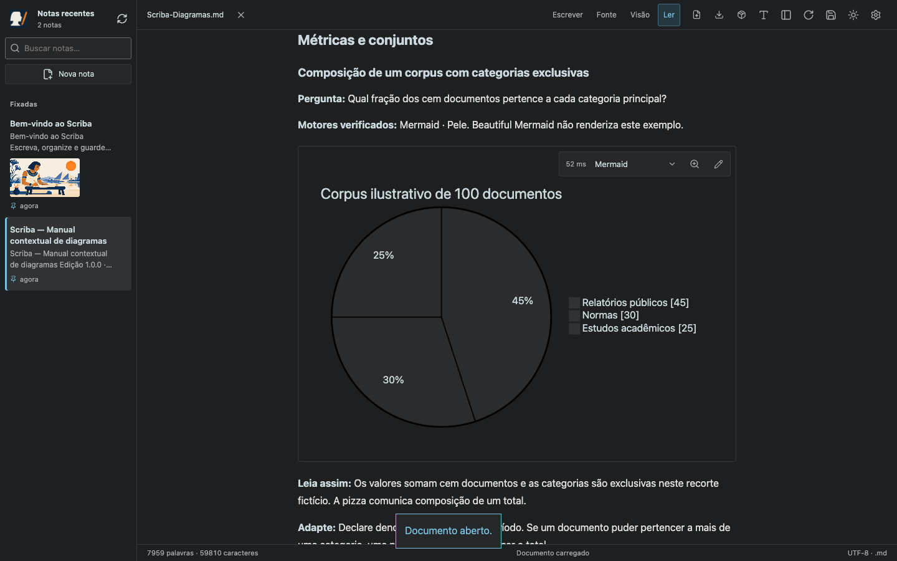
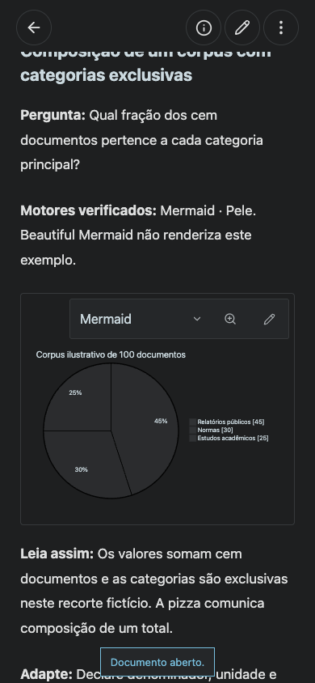
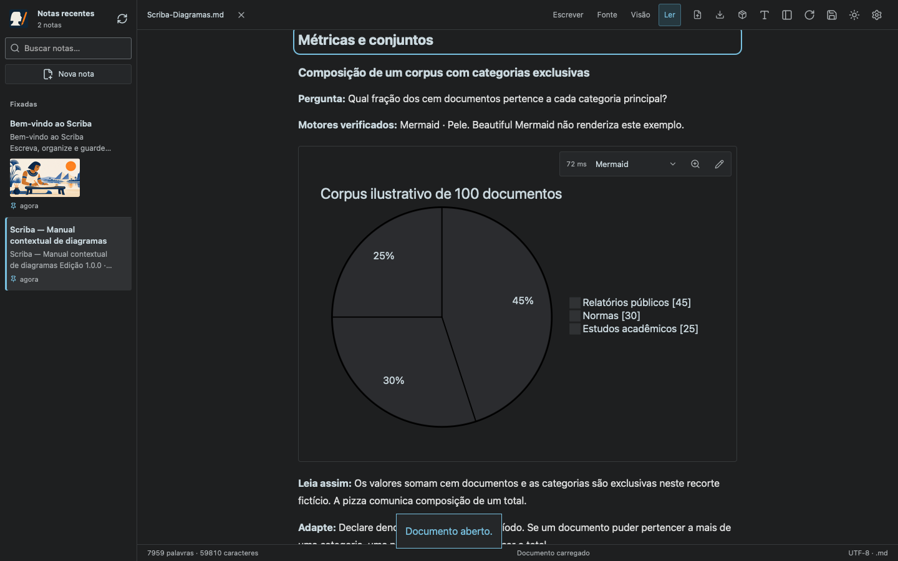
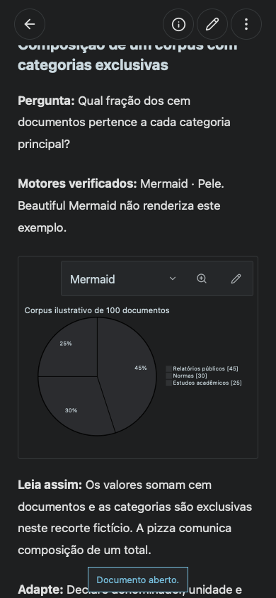

# Referência contextual de diagramas — Scriba 1.8.0

O [manual versionado](../../Scriba-Diagramas.md) contém 58 exemplos originais em 33 famílias, incluindo o diagnóstico `info`. Cada desenho responde a uma pergunta sobre processos, dados, arquitetura, planejamento, métricas ou análise e vem acompanhado de leitura e adaptação.

## Resultado do corpus

O teste `tests/diagram-reference.smoke.mjs` abriu o Markdown completo no aplicativo e passou pelo seletor de cada um dos 58 desenhos nos três motores. Verificou o estado de renderização e o SVG visível, preservação integral do arquivo, ausência de alterações no Git, índice Unicode e largura no celular. As 174 combinações estão no [relatório por exemplo](compatibility.json).

| Motor fixado no produto | Exemplos renderizados |
| --- | ---: |
| Mermaid 12.2.0 | 58/58 |
| Pele 1.6.0 | 58/58 |
| Beautiful Mermaid 1.1.3 | 21/58 |

Os 37 exemplos restantes mostram o erro de cobertura no Beautiful Mermaid e mantêm o seletor disponível. São resultados de renderização dos exemplos, não uma auditoria de fidelidade geométrica entre motores nem um benchmark. Não houve erro JavaScript de página nem requisição de recurso de desenho a outra origem.

## Conteúdo e persistência

A referência é uma nota editável, adicionada uma vez junto ao guia em bibliotecas novas e antigas. O teste HTTP cobre commit/push para um Git remoto real de teste, colisão de nomes, adoção de cópia existente, preservação de anotações, desafixação, remoção e falha de commit sem misturar alterações já preparadas do usuário. Uma troca de repositório revisada sem publicar continua sem commit/push automático.

`npm test`: 50 testes passaram. A validação específica de migração e gateway passou novamente depois dos ajustes finais. O gateway rejeita a criação da referência quando o destino informado pelo cliente não corresponde à seleção da sessão, antes de criar blobs.

**Chrome e WebKit passaram** no teste completo da referência, incluindo leitura offline e GitHub simulado. O [resumo de validação](validation.json) registra os tamanhos e comportamentos conferidos. O teste separado do gateway também passou pelo fluxo móvel real de HTTP com a API GitHub simulada.

Os testes de navegador usam perfis vazios, armazenamento isolado e destinos simulados de GitHub. Nenhuma nota pessoal, credencial ou repositório de usuário é usado como fixture.

## Capturas

### Processo — desktop e celular





### Métricas — desktop e celular





### WebKit — desktop e celular





## Reproduzir

```sh
npm test
npm run build
node tests/diagram-reference.smoke.mjs
node scripts/update-diagram-reference.mjs
VITE_STORAGE_MODE=browser npm run build
node tests/diagram-reference-browser.smoke.mjs
MARKDOWN_BROWSER=webkit node tests/diagram-reference-browser.smoke.mjs
node tests/github-browser.smoke.mjs
node tests/diagrams-browser.smoke.mjs
```

O teste público verifica nota fixada, fonte exata, índice interno, cinco tamanhos/orientações, edição, desafixação persistida, leitura offline, migração com arquivo homônimo e GitHub com criação, adoção, colisão e envio posterior de referência pendente. WebKit automatizado aproxima o motor do Safari; não representa um teste em iPhone físico.

O script de atualização altera somente os textos de compatibilidade e a matriz, e recusa resultados ausentes ou com fonte Mermaid diferente. Uma revisão que muda os exemplos exige executar o corpus completo novamente. A cópia do usuário não é substituída ao reabrir o aplicativo.
