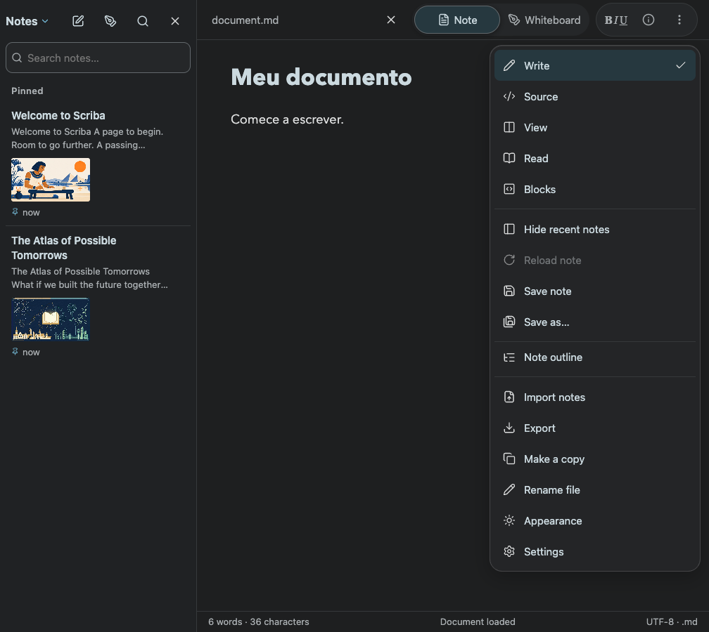
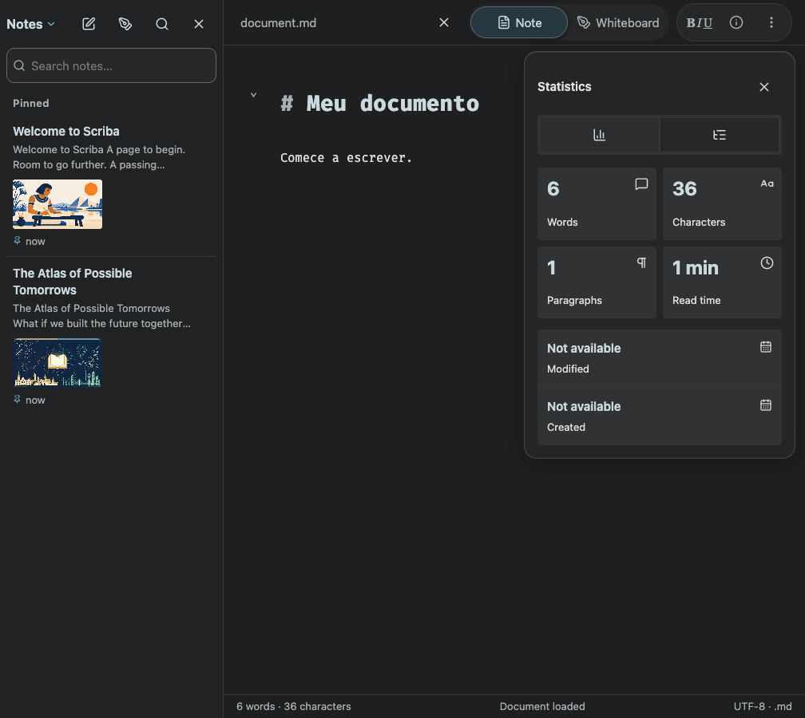
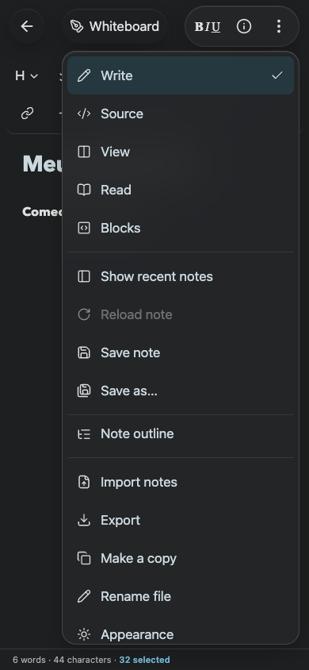
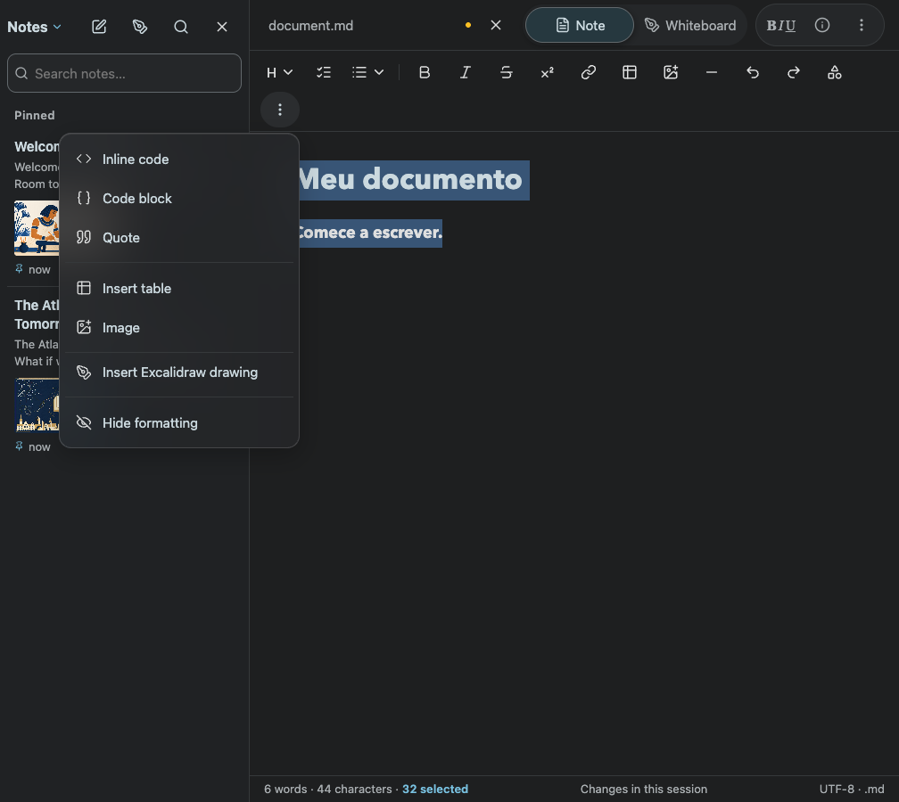
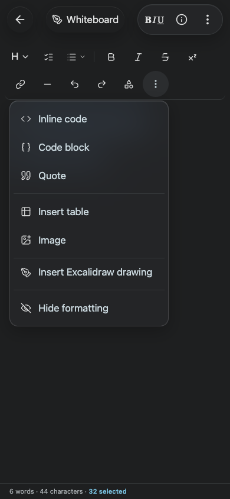

# Compact document actions

Desktop and mobile share a formatting / information / more-options group. Edit modes, import/export, save, save as, copy, rename, navigation, appearance and settings are available from the contextual menu. Injected application actions retain their existing callbacks and receive visible labels from their localized accessibility names. The format selector remains in the header.

Formatting is collapsed initially and opens with the B I U control. Information reuses the existing statistics, dates and outline inspector. Native dialog focus containment, Escape, arrow navigation and outside dismissal remain shared with other menus.

Validated with the actual component in Chromium on desktop and mobile: secondary actions absent from the compact header; mode selection changes to Source; information opens Statistics; formatting opens the editing toolbar. The header smoke also verifies long-name truncation and one-row Whiteboard layout.

No App Store Connect submission was performed.

## Formatting and dismissal refinement

The formatting strip now keeps paragraph style, tasks, lists, bold, italic and common insertion actions on one row. Additional commands and Hide formatting are in the anchored overflow menu. On narrow screens table/image insertion remains available in that menu. Portal geometry stays inside the viewport and mobile reading controls reserve a separate row while formatting is expanded.

Every application-owned X dismissal button uses the shared `data-ui="dismiss"` hook: no border, no shadow, transparent default background, circular keyboard focus and preserved hit area. The smoke verifies those computed styles across visible sidebar, note and information-panel close buttons; it also applies Bold to selected text, hides/reopens formatting, and opens the mobile overflow menu without wrapping the strip.

## Frequently used actions — 2026-10-23

Divider, Undo, Redo, Icon Gallery, Strikethrough and Insert reference are direct toolbar actions. Their duplicates were removed from More. Narrow screens wrap the direct controls rather than hiding these requested actions; the 390px smoke verifies all six are visible and the strip stays within two rows.
