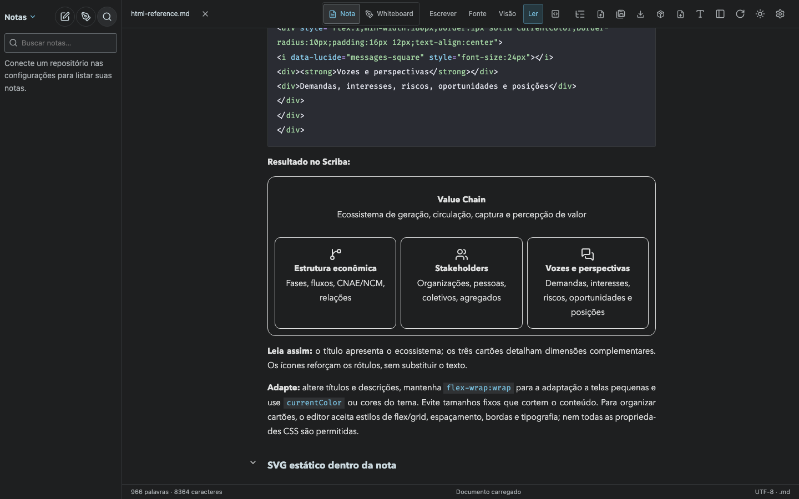
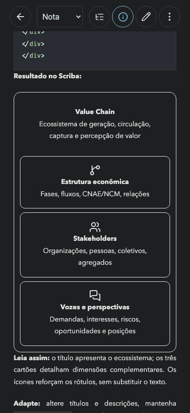

# Contextual manual: HTML, Lucide and SVG

`npx playwright test tests/document-html-reference.spec.ts` passed in Chromium. The test imports the exact reference section from the canonical manual and verifies six local Lucide icons, the three Value Chain cards and the inline SVG with two circles.

The section was appended to the canonical manual and the currently pinned `Scriba-Diagramas.md` in the user's notes repository, preserving the existing content. The bundled manual in the installed macOS app was updated as well.

