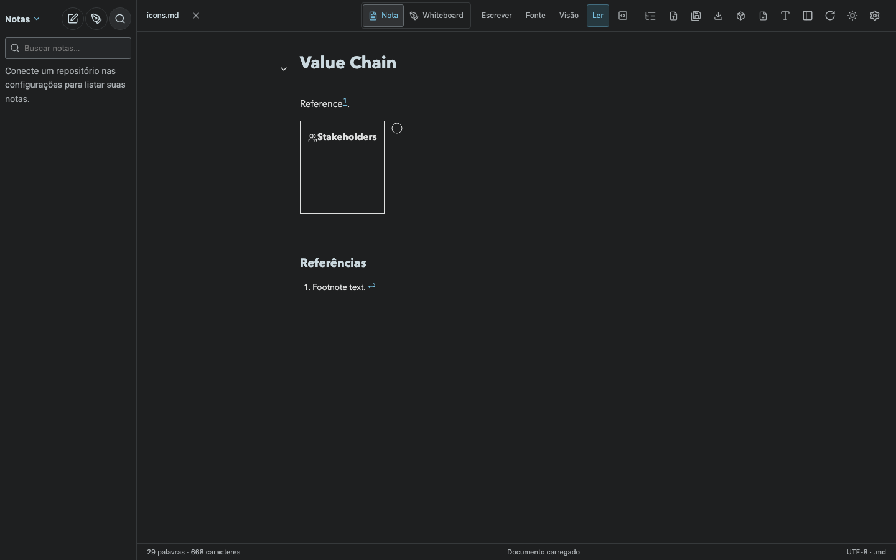
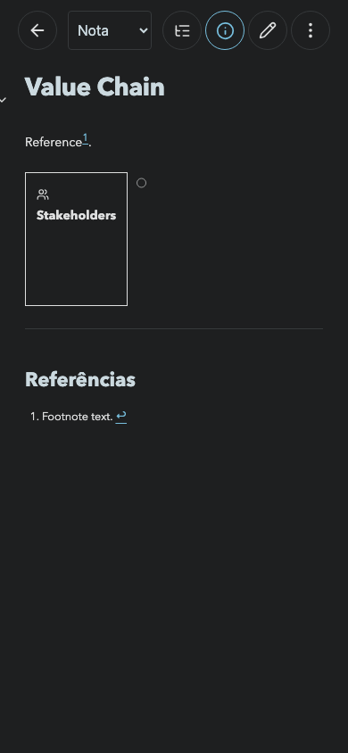

# HTML, Lucide and SVG evidence

Validated with `npx playwright test tests/document-html.spec.ts` in Chromium, using a temporary application state and an imported Markdown document. No user repository is modified.

- HTML flex layout and presentation styles render.
- The local Lucide `users` icon and an inline SVG circle render.
- Scripts, event handlers, iframes, SVG image references, foreignObject, resource URLs and fixed positioning are removed.
- Generated heading and footnote anchors remain connected.

`npm run build` passed. `npm test` passed: 62 tests.
