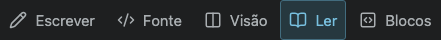

# Editing modes

All five desktop modes now have a vector icon and visible translated label. Blocks is the previously unlabeled rendered-block Markdown editor; Source is the complete Markdown code view. Visual editing and Blocks no longer show two pressed mode buttons at once. Reading ends desktop visual editing, so a redundant sixth completion control is omitted from the mode group; the mobile pencil/check flow remains unchanged.

`node tests/editing-modes.smoke.mjs` verifies five icon-and-label controls, Source/Blocks behavior and one pressed mode. TypeScript and all four locale catalogs validate.

