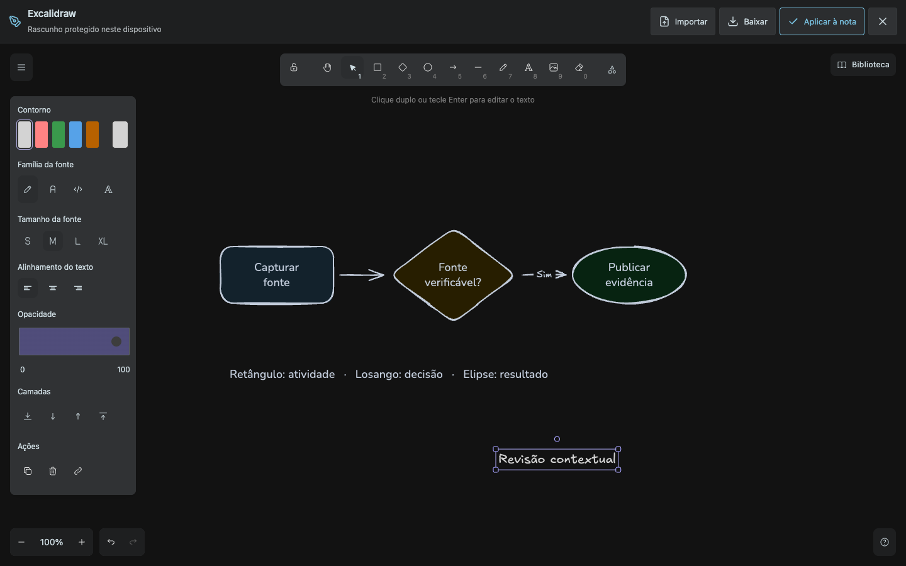
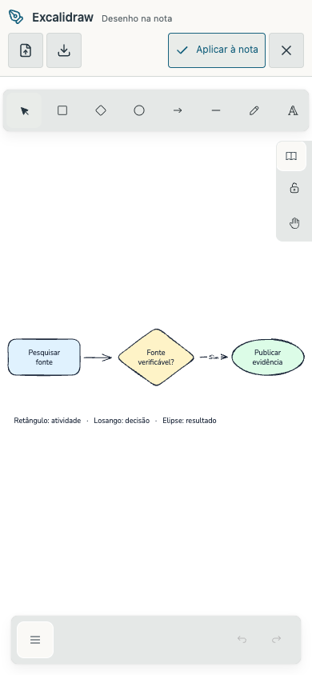
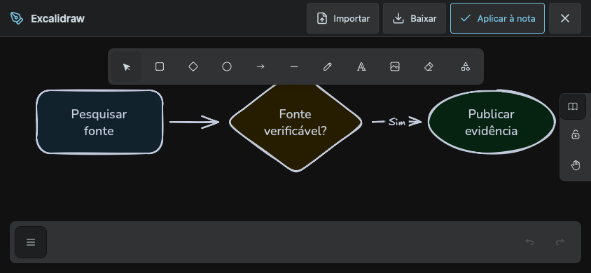
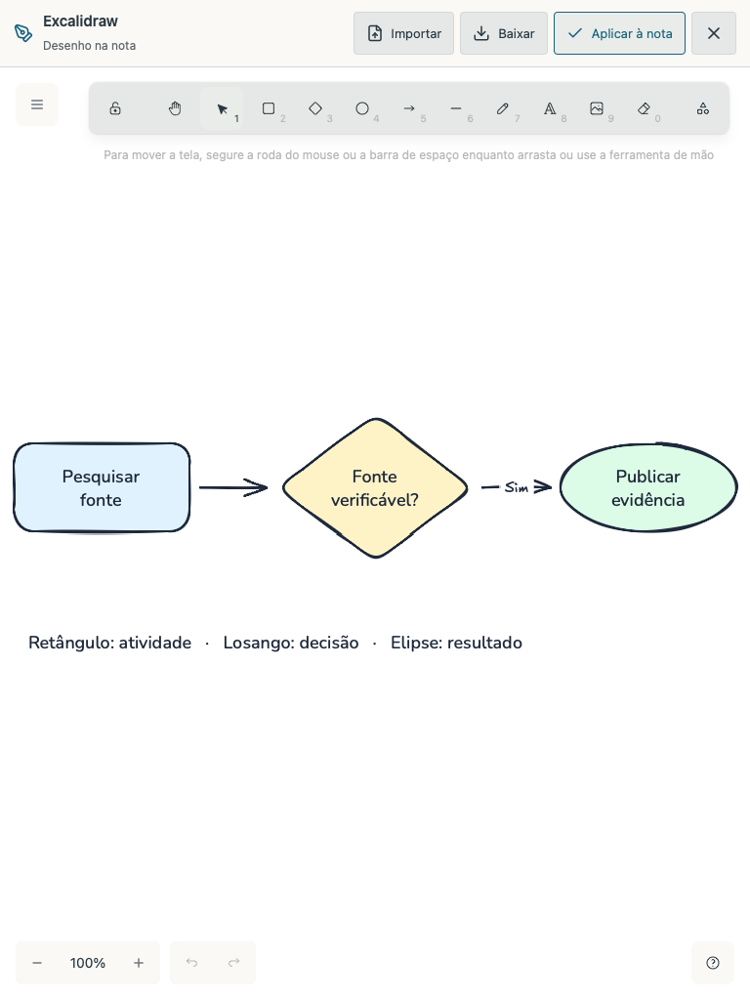
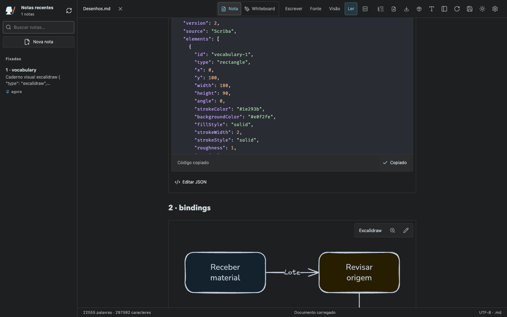
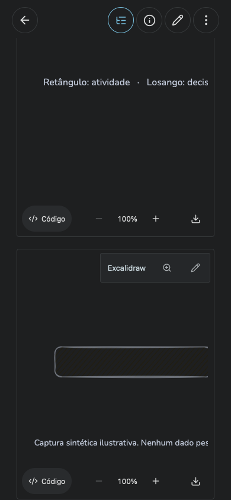

# Excalidraw — Scriba 1.12.0

29 cenas contextualizadas no mesmo manual fixado, com prancheta oficial Excalidraw 0.18.1, edição visual, importação, exportação, zoom e recuperação privada de rascunhos. O seletor Mermaid/Pele/Beautiful e o padrão Pele permanecem iguais.













Os testes no Chrome e WebKit renderizam todas as cenas e verificam edição, aplicar/cancelar, importação válida/inválida, recuperação após recarregar, criação de desenhos, salvamento e reabertura. Incluem modo Ler, edição natural e widgets CodeMirror; a edição natural mantém a posição de leitura ao aplicar, inclusive em WebKit. A prancheta bloqueia verificações de atualização do arquivo enquanto está aberta.

A preservação de fonte usa Markdown com BOM, CRLF, comentário e cerca com `~~~`. Abrir/aplicar sem alterações e exportar não reescrevem o documento; editar pela leitura ou edição natural mantém o restante dos bytes. Código-fonte no CodeMirror conserva a normalização de linha já existente.

São baixados arquivos reais: SVG com fontes incorporadas, PNG com canto transparente e JSON `.excalidraw` com elementos editáveis. As cenas incluem imagem raster local, texto com várias famílias, setas vinculadas, frames, camadas, grupos e bibliotecas. Não houve requisição a recursos externos de desenho ou violação da CSP nos testes locais. O beacon já existente do Cloudflare é registrado separadamente no smoke de produção.

Tamanhos nos dois temas: 1440 × 900, 390 × 844, 844 × 390, 768 × 1024 e 1024 × 768. O smoke offline inicia o SDK, as fontes e a prancheta pela primeira vez sem rede, edita/salva/reabre a nota e exporta SVG. Os 234 arquivos de fontes do SDK estão no cache; 230 faces/subsets compõem o manifesto de fontes de desenho.

Os 53 testes HTTP/Git passaram. A atualização da referência acrescenta a seção uma vez, preserva anotações/CRLF/desafixação, respeita exclusão e não restaura uma seção ZenUML anteriormente removida. O smoke do armazenamento público verifica também colisões, adoção de cópias existentes, criação no GitHub simulado e reenvio após indisponibilidade. As regressões de leitura/tabelas/edição natural e outline passaram.

```sh
npm run build
npm test
node tests/excalidraw.smoke.mjs
MARKDOWN_BROWSER=webkit node tests/excalidraw.smoke.mjs
node tests/reading-experience.smoke.mjs
node tests/outline.smoke.mjs
VITE_STORAGE_MODE=browser npm run build
node tests/excalidraw-offline.smoke.mjs
MARKDOWN_BROWSER=webkit node tests/excalidraw-offline.smoke.mjs
node tests/diagram-reference-browser.smoke.mjs
SCRIBA_URL=https://scriba.aeonbridge.app node tests/excalidraw.smoke.mjs
```

Builds nativo e público foram congelados separadamente para evitar alterar os arquivos servidos durante a execução dos testes. Perfis e repositórios são isolados; nenhum arquivo pessoal é usado como fixture.

Produção `https://scriba.aeonbridge.app/`: smoke completo aprovado na versão 1.12.0. [Verificação dos artefatos publicados](production-verification.json), com hashes do JavaScript, service worker e fonte local; o gateway GitHub respondeu HTTP 200. O aplicativo Mac instalado também foi verificado como 1.12.0, com assinatura válida.
