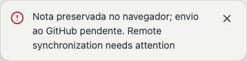

# Error feedback

Feedback now has a bounded width, rounded surface, semantic alert icon, readable body text and an integrated 44px dismiss action. Both themes use application tokens. Long messages scroll within the surface rather than expanding it across the entire window. Success messages do not overlap an active error.

The browser journey `tests/autosave-error-feedback.smoke.mjs` checks the first failure, dismissal across repeated automatic saves, continued persistence, throttled unchanged retries, explicit retry feedback and clearing the error after successful recovery. Both screenshots use synthetic fixture messages, not private notes.

