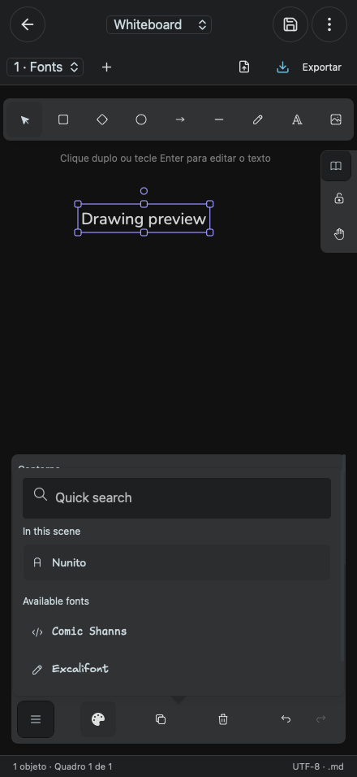
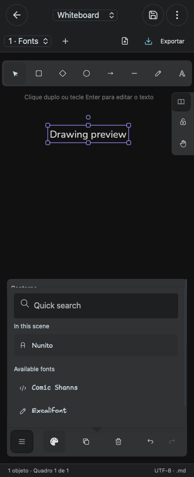

# Mobile drawing properties

The properties sheet is scrollable and limited to 35dvh / 280px. The complete font picker opens over the properties area, preserving the upper drawing area. The shared styling applies to whiteboards and embedded drawing editors.

The browser smoke uses the real Excalidraw SDK, creates and selects text, changes its font and opens the complete font list. It checks alignment, 44px touch targets, bounded sheet geometry and horizontal containment at 390/440px, and desktop behavior at 1440px, in Chromium and WebKit.

