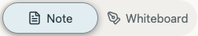

# Document format segmented control

The enclosing rectangular border depended on a Portuguese aria-label for its rounded override. A stable toolbar hook now applies across locales. The track and selected segment share pill geometry; segments have equal widths and reserve enough intrinsic width to prevent tablet label overlap.

Validated with Chromium at 1440 and 900 CSS pixels in English, both themes: no outer border, rounded track and no clipped segment content. TypeScript compilation passed. Native installed-app validation is pending the next binary.

