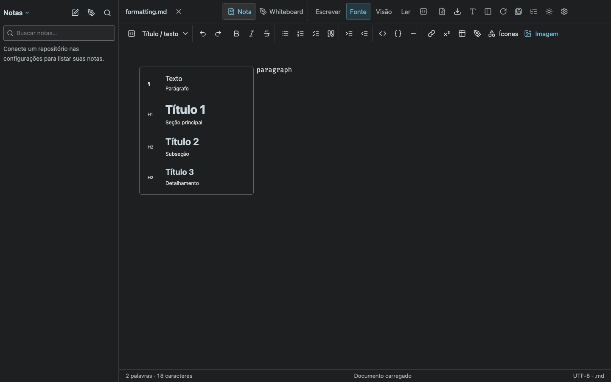
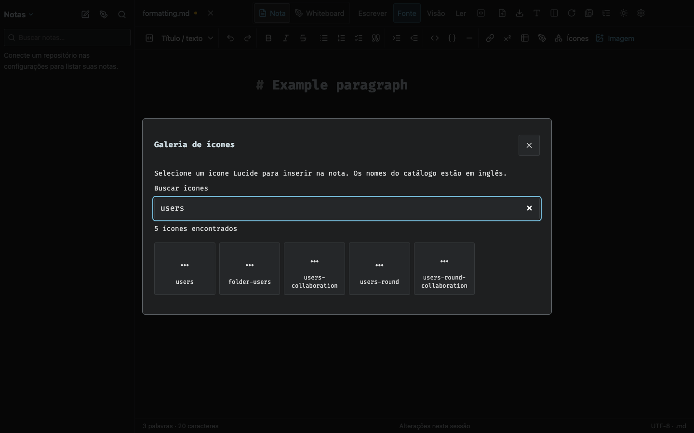
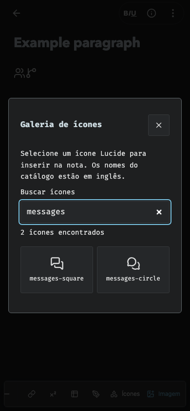

# Heading previews and Lucide gallery

`npm run build` and `npm test` passed (63 tests). `npx playwright test tests/formatting-icons.spec.ts` passed in Chromium.

The browser test verifies distinct H1/H2/H3 sizes, a fully visible heading menu, keyboard selection, gallery search, source insertion at the saved caret, inline icon insertion in the visual editor and preservation when returning to reading. The gallery is checked at desktop and mobile sizes.

