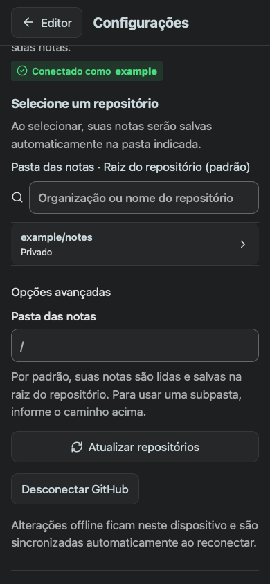
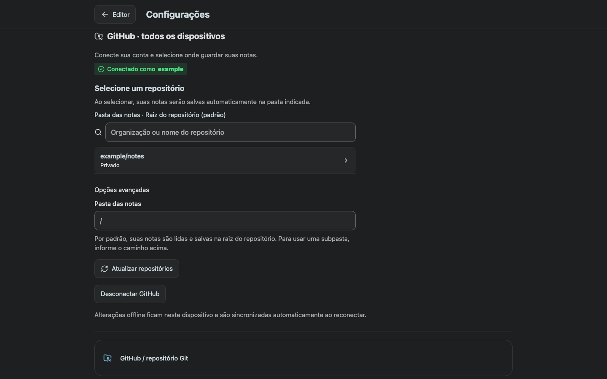
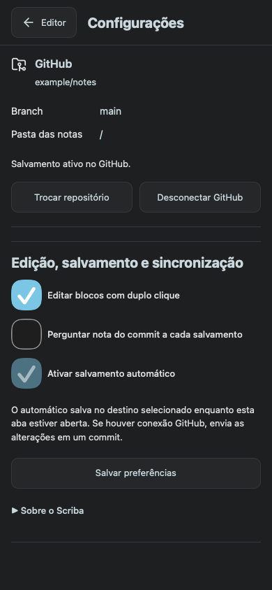
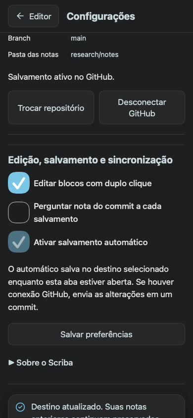

# GitHub repository root default

Scriba 1.17.8, verified on 9 November 2026.

New GitHub connections use the repository root. Choosing a repository again also starts with the root. The destination is visible above the repository list. A custom relative subfolder can be entered in Advanced options before selecting a repository.

For an existing GitHub connection, select the repository again with an empty notes-folder field to activate root storage.

## Verification

- The HTTP regression failed against the previous gateway because an omitted folder selected `scriba`. It now lists both root notes and nested notes, reads a root note and commits a new note at the root. Explicit subfolder selection is covered by the same real-Git HTTP suite.
- The UI regression failed against the previous interface because its notes-folder input contained `scriba`. Eight journeys now pass in Chromium and WebKit, across 390 × 844 and 1440 × 900, using both web transport and an isolated Capacitor bridge fixture.
- Each UI journey selects the default root, explicitly chooses `research/notes`, reloads the saved destination and selects the root again. The fixture uses fictional notes and intercepts GitHub requests.
- The complete JavaScript suite passed 126 tests with zero failures or skips, including the signed Mac application package checks. See [test output](unit-tests.txt) and [browser results](browser-results.json).
- Public web, local Mac and iOS web bundles compiled successfully. Xcode built the iOS Simulator application with marketing version 1.17.8 and build 31. Native runtime coverage here uses the browser bridge fixture. Apple distribution of this revision is pending.

```sh
node --test tests/github.test.mjs
MARKDOWN_BROWSER=webkit node tests/github-root-default.smoke.mjs
MARKDOWN_BROWSER=chromium node tests/github-root-default.smoke.mjs
SCRIBA_NATIVE_FIXTURE=1 MARKDOWN_BROWSER=webkit node tests/github-root-default.smoke.mjs
SCRIBA_NATIVE_FIXTURE=1 MARKDOWN_BROWSER=chromium node tests/github-root-default.smoke.mjs
SCRIBA_MAC_BUNDLE=/absolute/path/to/Scriba.app npm test
```

## Screenshots

The mobile picker displays the root default before connection and offers a custom subfolder.



The desktop picker uses the same destination and optional subfolder control.



The Capacitor bridge fixture confirms root selection in the actual editor interface.



A selected custom subfolder is displayed explicitly.


