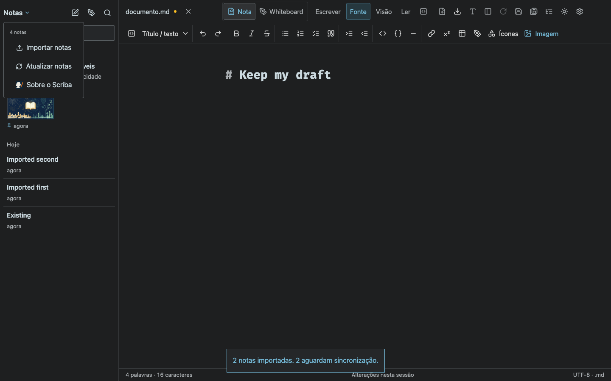
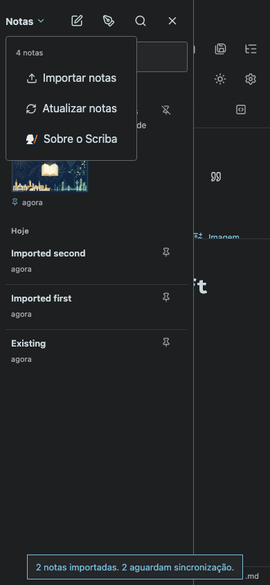

# Multiple note import

Browser tests: `npx playwright test tests/import-notes.spec.ts` — 2 passed.

The Notes menu opens a multiple-file Markdown picker. The tests import two notes, verify their contents on disk, preserve an existing note by naming the imported copy `first (2).md`, and verify that the open unsaved draft remains intact.

Desktop (1440 × 900): menu action and imported notes.

Mobile (390 × 844): menu action and imported notes.

