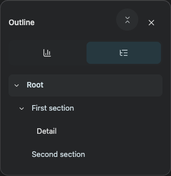
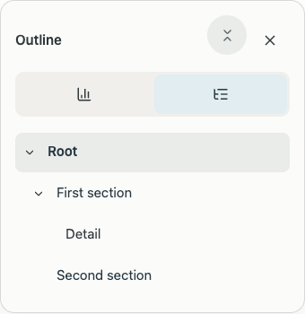
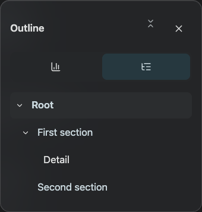
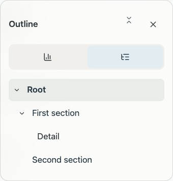
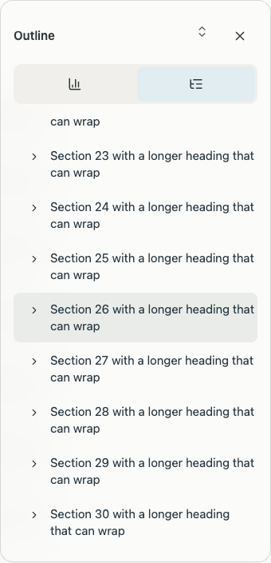

# Outline inspector, global folding and quick access

The form-dialog button selector also matched inspector dialogs. Its border/padding compressed 14px disclosure icons and framed the information tabs. It is now limited to form dialogs. The embedded outline uses continuous navigation rows, clear indentation, normal-size disclosure icons and unframed controls. Short outlines fit their content; long outlines retain a bounded scroll area. Header folding controls use circular focus/hover geometry.

Global folding is shared by both information and internal outlines. When the document has exactly one H1, that title remains expanded and every H2 stays in the visible hierarchy; lower sections fold. Multiple H1 documents retain the previous top-level folding behavior. Expand all clears the same shared state, including folded leaf-section bodies.

A direct outline shortcut is present between Information and More in the desktop and mobile quick-action groups. The menu entry is retained.

## Browser verification

- Information controls have no form borders; disclosure icons retain their visible size.
- Individual fold/unfold and heading navigation work.
- Collapse all retains the sole H1 and H2 entries, hides H3 descendants, and expands again in both outlines.
- Quick-action order and the retained menu entry are checked.
- Dark/light desktop and mobile layouts do not overflow.
- A 61-heading document remains scrollable; all 30 H2 sections remain in the globally collapsed hierarchy and the last section is reachable.

Local/simulator deployment only; no App Store Connect upload or review change.
