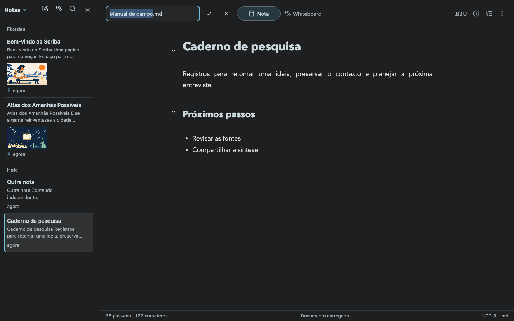
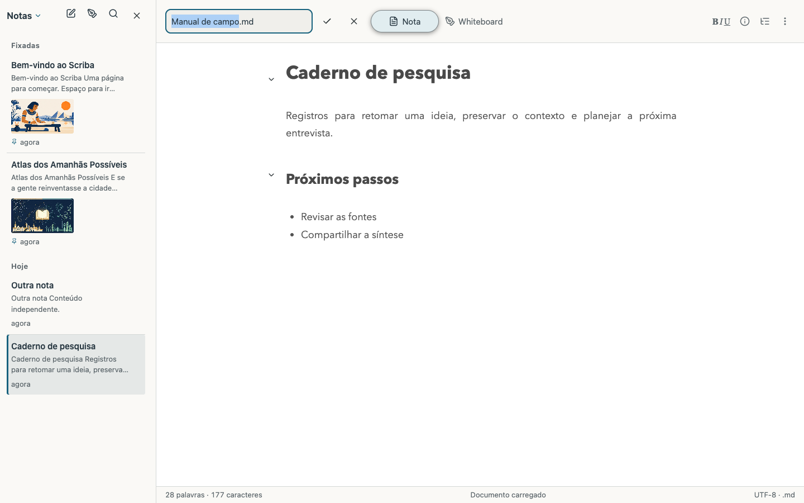
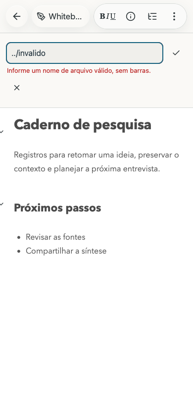
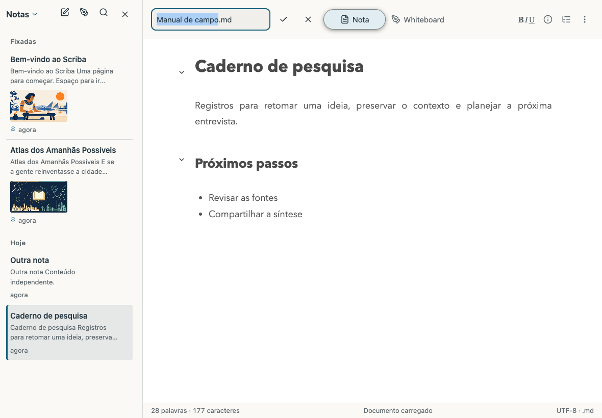

# Inline filename editing

Scriba 1.17.5 replaces the rename dialog with a text field in the document toolbar. Clicking the filename selects its stem, retaining the Markdown extension. Enter or the checkmark confirms the name. Escape or the cancel button dismisses the field. Compact layouts and the native command expose the same field in a row above the document.

Invalid names and occupied destinations display an error beside the field. The user can correct the name and retry. Pending operations retain the field, prevent duplicate submissions and defer document switching. Successful renames reuse the existing storage operation, including saving pending text and drawings before moving the note.

## Verification

- The full suite passed 122 tests with the verified Mac application package, without skips. [Test output](unit-tests.txt).
- Chrome and WebKit passed real file-import and rename journeys at 1440×900, 390×844, 820×1180 and 1180×820. The checks exercise keyboard selection, Enter, Escape, confirm/cancel buttons, validation, collision recovery, extension handling and persistence after reload. Screenshots cover both themes. [Browser results](browser-results.json).
- The packaged Mac runtime passed the desktop journey against an isolated Git checkout and local bare remote. A delayed rename checked that Escape and repeated Enter cannot interrupt or duplicate an active operation. The final file was committed and pushed, with the original content and the occupied destination preserved. [Mac journey](mac-results.json), [Git results](mac-git-results.json).
- Note and whiteboard rename journeys passed in both engines at phone and desktop widths, including writing after a drawing and reloading the renamed document. [Whiteboard results](whiteboard-results.txt).
- Browser tests exercise the native command event and native-layout CSS. These are browser assertions. UIKit and the software keyboard were not run in a simulator for this change.
- Public, local and iOS production bundles passed locale validation and strict TypeScript compilation.

## Screenshots

All screenshots use synthetic notes in isolated test contexts.

