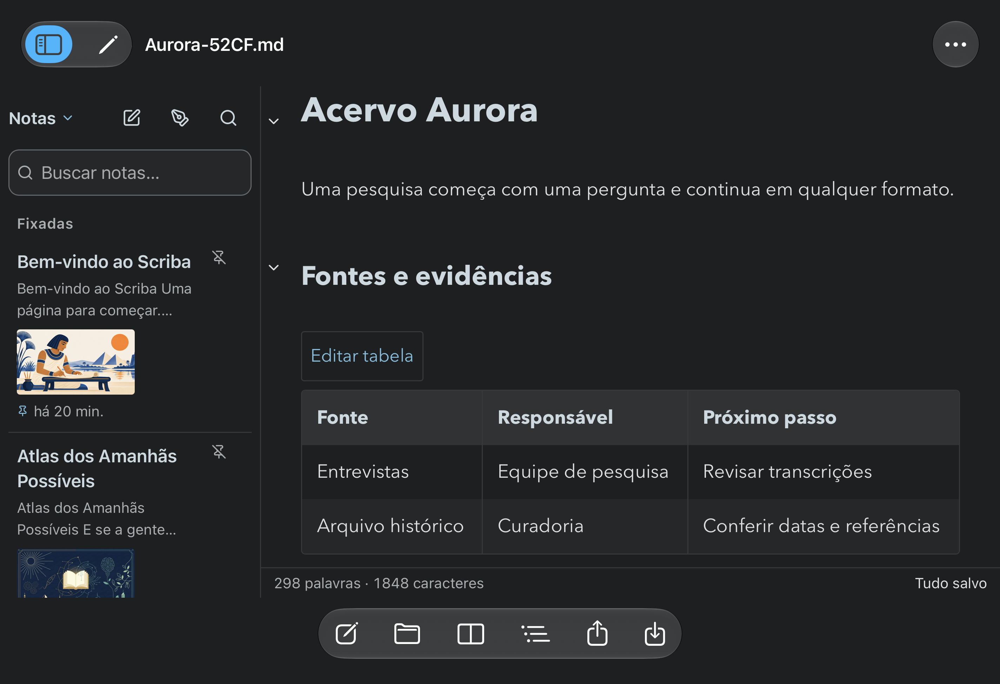
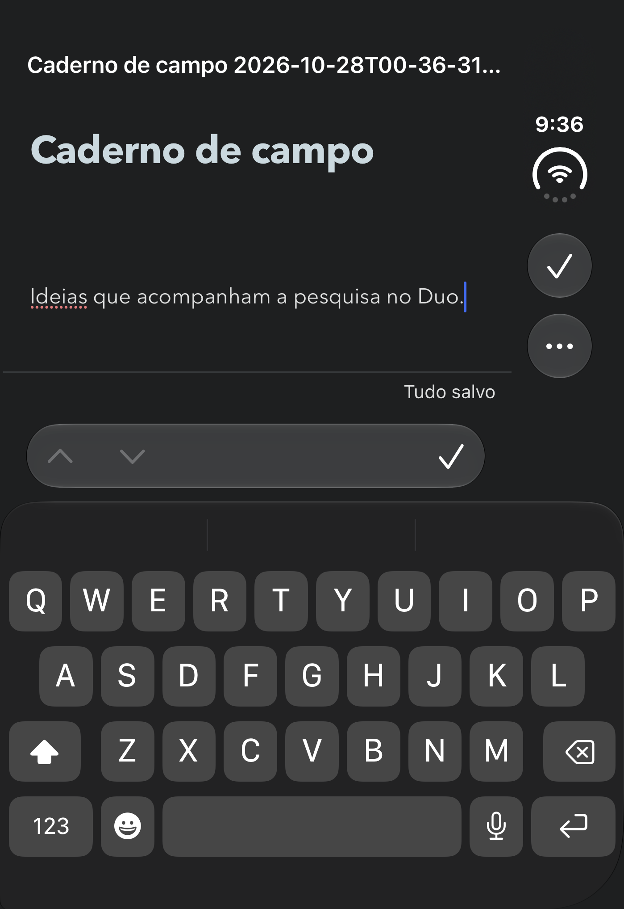
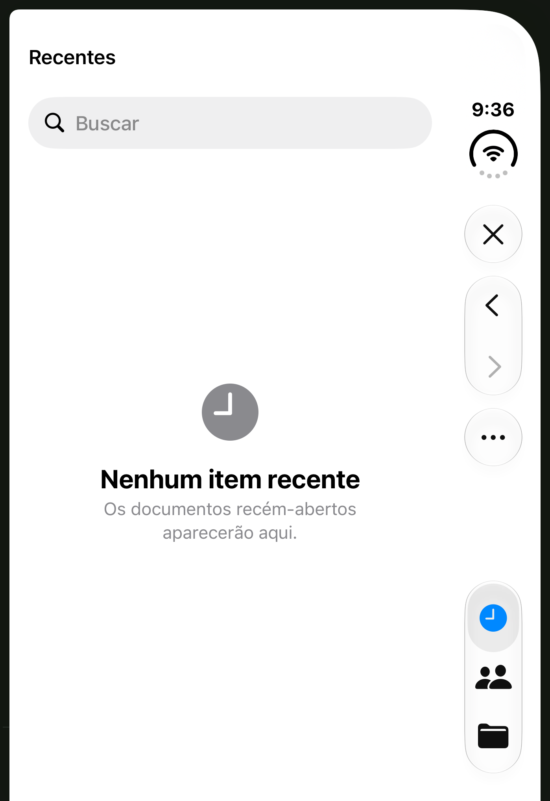

# Scriba 1.17.0 (29) — revisão para iPhone Duo

Esta é uma versão candidata local para avaliação do usuário. **Não autoriza envio, substituição de build ou nova submissão no App Store Connect.** A submissão 1.16.1 (27) permanece separada. O build 28 também não deve ser selecionado automaticamente.

## Direção e critérios

Scriba continua sendo uma biblioteca privada de notas, com leitura editorial, edição natural, Markdown, diagramas e whiteboard. A pergunta principal é: **“Como continuo trabalhando nesta mesma nota quando o espaço muda?”** O documento ocupa a área dominante; as ferramentas acompanham o sistema, e a biblioteca acrescenta contexto quando há espaço.

Inventário de produto:

- A pessoa lê, escreve e desenha em uma nota Markdown própria.
- O título identifica o arquivo, e o destino de salvamento continua independente da apresentação.
- A biblioteca mostra notas reais, pesquisa, fixação e miniaturas.
- Leitura, escrita, fonte, prévia e blocos são apresentações da mesma nota.
- O whiteboard permanece um desenho incorporado ao documento, com sua própria recuperação.
- O outline navega pelos títulos sem alterar o texto.
- Abrir um arquivo no Files preserva o diretório configurado.
- Salvar, Salvar como, exportar e recarregar mantêm seus guardas de conflito existentes.

As skills `design-taste-frontend`, `apple-design` e `frontend-design` orientam a revisão. A folha app sorteada foi **true-black-flat**, seed **1312350032**, preservando `palette,type`. Sua contribuição é a hierarquia discreta; a identidade continua no escriba, na tipografia de leitura e nas notas. O material das barras nativas segue o HIG e prevalece sobre a proibição genérica de glass da folha. Tabelas zebradas e parágrafos justificados foram pedidos expressos do usuário e são preservados.

## Adaptações implementadas

| Contexto | Comportamento |
|---|---|
| Barras no Duo/iOS 27.1 | UINavigationController e barras nativas; o sistema decide eixo, borda e overflow. Símbolos têm títulos e prioridades. |
| Área ampla | Biblioteca e nota lado a lado, conforme a largura útil e o tamanho de texto. |
| Área estreita | Uma nota por vez; biblioteca acessível pela navegação. Mesmas funções disponíveis. |
| Dobra vertical ativa | Biblioteca e documento usam regiões separadas; fonte/prévia podem ocupar os dois lados. |
| Dobra horizontal ativa | Leitura acima e biblioteca abaixo; com teclado, prioriza a região de leitura. Fonte/prévia seguem a divisão real. |
| Foco sem biblioteca | O documento usa uma região útil, sem atravessar uma dobra ativa. |
| Câmera/área reservada | Regiões de oclusão publicadas pelo UIKit reservam espaço no conteúdo. |
| Teclado | WKWebView continua ancorado ao keyboardLayoutGuide. Em pouca altura, formatação fica em uma linha rolável. |
| Continuidade | A mesma instância do editor permanece montada; âncoras de leitura acompanham o refluxo. |
| Texto acessível | Dynamic Type amplia texto e títulos; campos de edição preservam o piso de 16 pontos. |
| Whiteboard | Propriedades dimensionadas pelo próprio canvas; troca de modo exige commit/flush do desenho. |
| Configurações e avisos | Configurações, biblioteca sobreposta e avisos permanecem em uma região útil quando há uma divisão ativa. A página de configurações esconde de fato o editor, inclusive na grade ampla. |
| iOS anterior | Mantém a interface web existente e os mesmos recursos de arquivos. |

## Referências Apple e decisões

- [Prepare for iPhone Duo](https://developer.apple.com/iphone-duo/prepare/): usar a geometria atual da janela; evitar orientação, modelo e idiom como decisões de layout.
- [Designing for iPhone Duo](https://developer.apple.com/design/human-interface-guidelines/designing-for-iphone-duo), **Vertical controls**: “Follow the system’s vertical layout”. Por isso as barras são UIKit, com overflow nativo.
- Mesmo HIG, **Dynamic layouts / Reserved regions**: a dobra e a câmera vêm de `ReservedRegion`; a razão entre largura e altura não inventa uma postura.
- Mesmo HIG, **Best practices**: continuidade entre poses e acesso às mesmas funções.
- HIG **Layout / Adaptability** e **Typography / Supporting Dynamic Type**: painéis e títulos acompanham o espaço e o texto escolhido pela pessoa.
- HIG **Split views / Best practices**: seleção da biblioteca permanece visível no painel adjacente.
- HIG **Toolbars / Item groupings**: navegação, ação principal e ferramentas têm grupos reconhecíveis.
- HIG **Accessibility / Mobility** e **Color / Inclusive color**: alvos de toque, rótulos, foco e estados não dependem só de cor.

Os nomes e assinaturas de UIHingeInteraction, ReservedRegion, verticalBarEdge e prioridades foram conferidos no SDK instalado do Xcode 27.1. O skill oficial `app-resizability`, exportado pelo Xcode, confirmou as pré-condições: LaunchScreen existente, quatro orientações do iPad e ausência de UIRequiresFullScreen. Não foi habilitado múltiplo documento em várias cenas: isso exige isolamento adicional de rascunhos por janela.

## Evidências e validação

Geometria de scene redimensionada **não equivale** à simulação da dobradiça. Posturas reais precisam dos controles do Device Hub. O Mac permaneceu bloqueado durante a revisão; o controle interativo dessas posturas não ficou disponível. **A candidata está preparada para avaliação, mas a validação completa da dobradiça não está concluída.**

### Resultados confirmados

| Verificação | Resultado | Evidência |
|---|---|---|
| Node/HTTP, incluindo sincronização, conflitos e segurança de arquivos | **95 passaram, 0 falhas** | [Saída completa](node-http-tests.txt) |
| WKWebView real: abertura, persistência, restauração, arquivos, conflito, renomeação, diagramas, canvas e interfaces do sistema | **8 passaram, 0 falhas** no Duo/iOS 27.1 | [Resultado Xcode](native-hosted-result.json) |
| Janela nativa 480×700 → 950×650 → 650×940 → 480×700 | **Passou**: mesma instância WKWebView, mesmo documento e parágrafo de leitura preservado a menos de 32 pontos do topo; fonte/leitura mantêm o conteúdo | [Resultado Xcode](native-resize-result.json) · [Geometria recebida](duo-resize-results.json) |
| Interface nativa na tela externa | **Passou**: criar, digitar, manter o editor acima do teclado, concluir, salvar, abrir Files e cancelar preservando o texto | [Resultado Xcode](native-ui-result.json) |
| iPad Air 11 / iOS 18.6 | **Passou**: digitação e área de edição acima do teclado em retrato e paisagem | [Resultado Xcode](ipad-keyboard-result.json) |
| WebKit em 390×844, 844×390, 768×1024, 1024×768 e 1440×900 | **Passou**: ambos os temas, tabela com navegação horizontal, ausência de overflow da página, fonte/leitura/escrita, commit de texto ativo do whiteboard e proteção contra importação obsoleta | [Resultados](browser-regression.json) |
| Fixture de região reservada no CSS | **Passou**: configurações, biblioteca sobreposta e aviso ficam na área designada; editor oculto não reaparece como grade | [Captura da fixture](browser-reserved-region-css-fixture.png), **não é uma postura real do simulador** |
| TypeScript, idiomas e assinatura | TypeScript sem erros; **911 chaves** em en/de/fr com placeholders válidos; assinatura do archive verificada | [Archive candidato](archive-candidate.json) |

Não houve nova validação em aparelho físico. O teste de interface pediu mudança de orientação na tela externa; essa captura não é apresentada como uma tela interna em paisagem. O iPad tem a verificação própria de retrato/paisagem acima.

### Capturas da revisão







[Leitura após salvar](duo-native-reading-saved.png) · [Retorno à janela compacta no mesmo parágrafo](duo-resize-3.png) · [Teclado no iPad em paisagem](ipad-legacy-tablet-writing-landscape.png) · [Revisão visual, exceções do inspetor e correções](design-review.md).

### Antes


### Execução reproduzível

```sh
SCRIBA_IOS_BUILD_NUMBER=29 npm run ios:sync
node scripts/test-duo-resize.mjs <UDID-do-simulador-Scriba-Duo>
node --test tests/workspace-geometry.test.mjs
npm test
```

O orquestrador usa apenas um simulador Duo isolado, verifica seu nome/tipo, roda o WKWebView real e controla `devicectl device appResize`. Não apaga dados de usuários, não acessa produção e não altera App Store Connect.

Uma tentativa anterior de `appResize` pediu 480×620: o comando informou aceitação, mas a janela observada voltou a 465×667. Esse caso não foi contado como sucesso nem interpretado como postura da dobradiça. O ciclo confirmado retorna a 480×700 e verifica a continuidade de leitura. O primeiro teste de interface também encontrou “Concluir” no overflow com teclado; a ordem da ação foi corrigida e a execução seguinte passou. A coleta longa de diagnóstico desse primeiro teste foi interrompida depois de seu resultado de falha já estar registrado.

### Ainda depende de validação interativa

- Tela interna totalmente aberta, tela externa e dobra parcial real, incluindo continuidade entre elas.
- Split View à esquerda e à direita, com bordas do sistema e câmera ativa.
- Escrita com teclado, outline, diagramas e whiteboard em cada postura.
- Revisão visual final do usuário antes de qualquer nova submissão.
