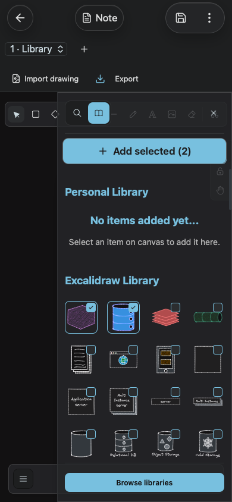
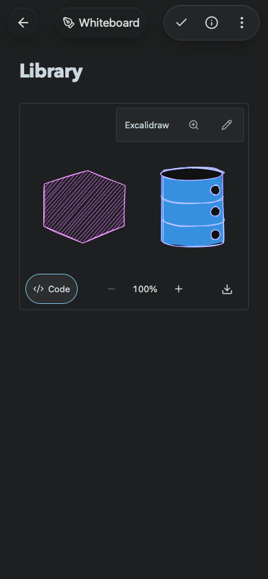

# Explicit library insertion on touch devices

The library includes an always visible **Add selected** action, disabled until symbols are checked. The action reuses Excalidraw 0.18's native insertion handler, preserving element duplication, bindings and grid distribution. The compact library closes after insertion so the inserted symbols are visible. Original library symbols remain available.

`node tests/library-insertion.smoke.mjs` passed in Chromium and WebKit at 390×844. It selects two different library items, inserts them, confirms the panel closes, returns to the note and inspects the drawing's JSON for actual elements. `node tests/mobile-appearance.smoke.mjs` also passed on both engines: Appearance is accessible from both mobile menus and settings, Light/Dark persist, Automatic follows live system changes and survives reload. `node tests/document-naming.smoke.mjs` confirms the return-to-note icon keeps its full 18px width beside its label.

Drawing import now has a distinct image-file icon and a visible Import drawing label, including phone layouts. The chooser accepts `.excalidraw`; invalid Markdown and invalid scenes show actionable errors without replacing the existing drawing. Both engines exercise rejected inputs followed by a valid import.

Make a copy saves the original before writing a uniquely timestamped sibling. The new document opens automatically. `node tests/duplicate-note.smoke.mjs` passed in both engines with unsaved prose, an attached PNG and a Mermaid diagram; original and copy contents and image bytes match, and the copy stays selected after reload.

Native iOS 18.6 hosted tests verified that automatic appearance releases UIKit’s forced style; the actual iPad keyboard/rotation UI test also passed with 18 document lines.
