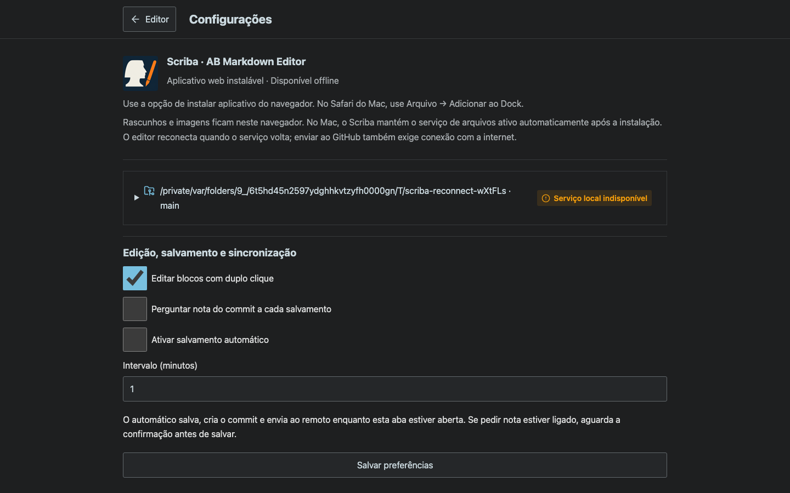
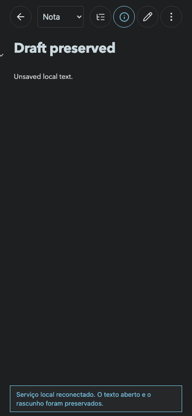

# Local service and automatic reconnection

- `npm run build`: passed.
- `npm test`: 63 passed.
- `npx playwright test tests/local-reconnection.spec.ts`: passed. Real HTTP/browser test with a temporary Git checkout: simulates loss of the health endpoint, restores access and verifies that the open draft remains unchanged.
- macOS installation: `/Applications/Scriba.app`; LaunchAgent starts on login and supervises the local server. The native launcher waits for the supervised server instead of starting a competing process.
- [Native recovery result](native-recovery.json): the supervised process was terminated; launchd started a new PID and the repository endpoint returned HTTP 200 for the existing checkout. No save, commit or push was performed during this check.

