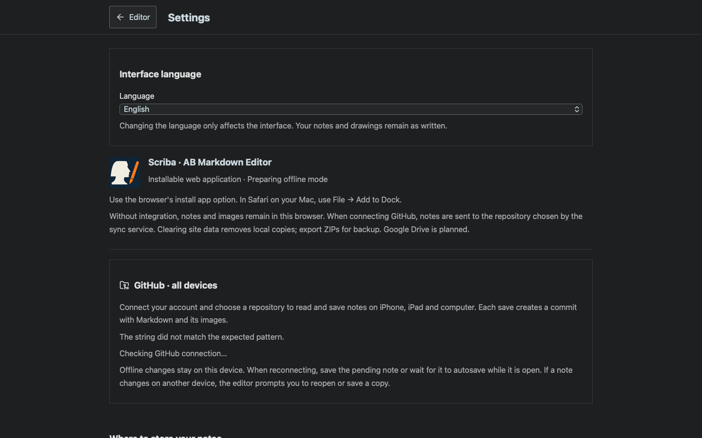
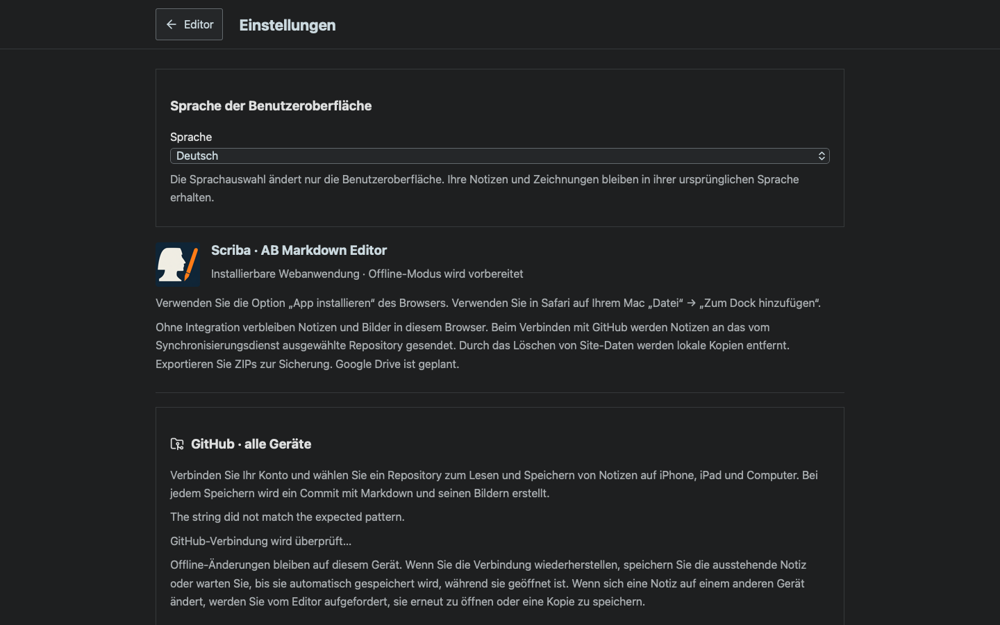
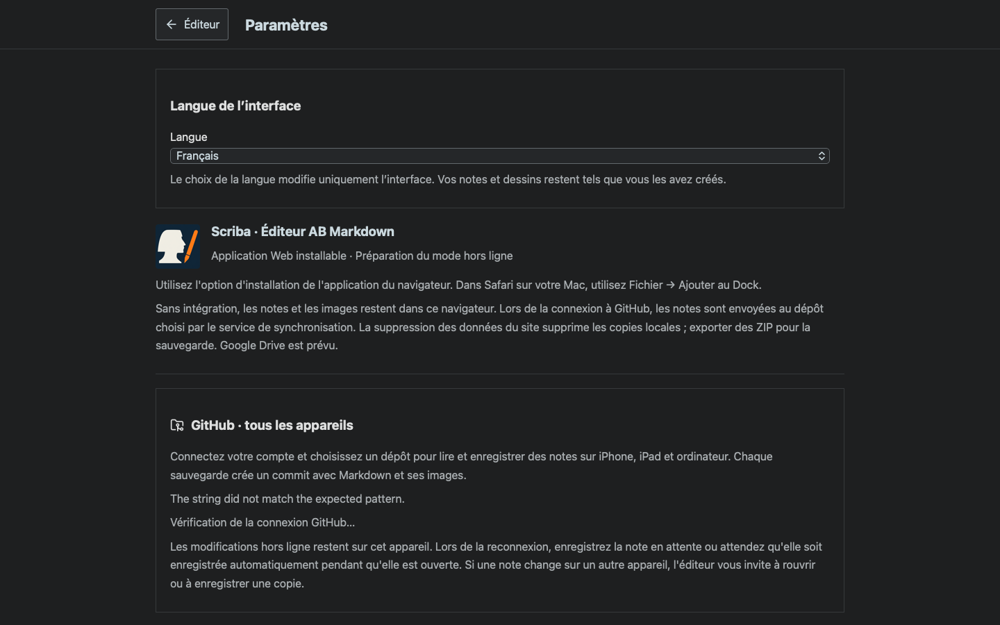
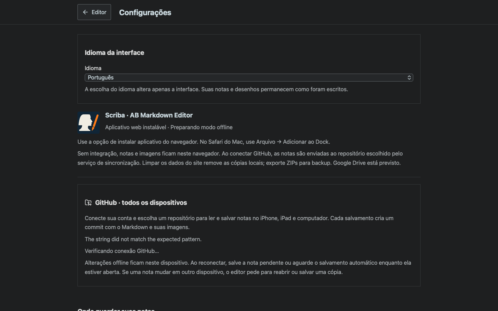
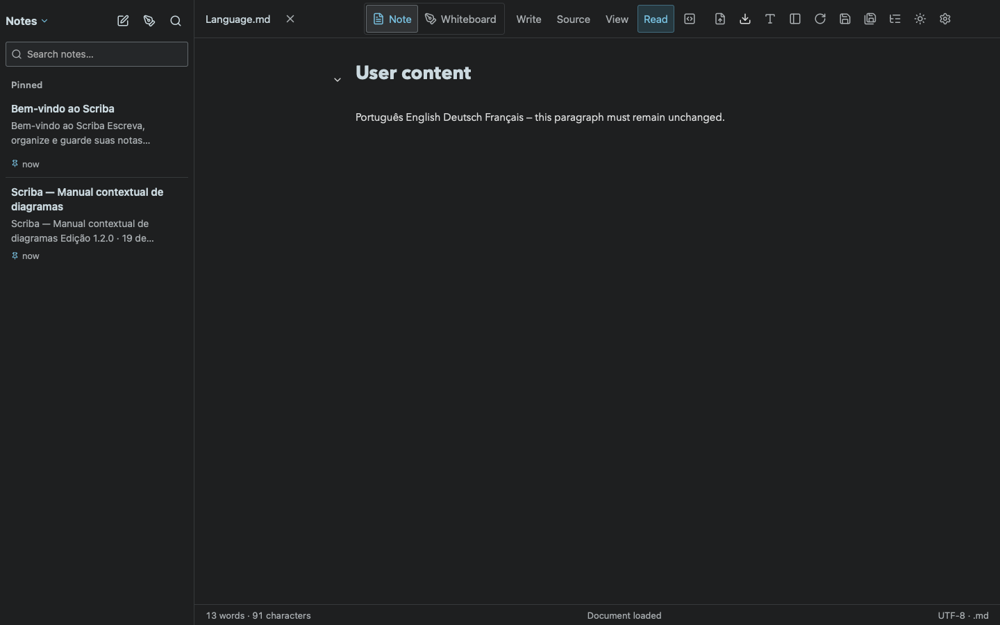

# Interface languages

Scriba supports Portuguese, English, German and French. Settings → Interface language offers Automatic and the four languages. The automatic setting uses the primary device/browser language (including regional variants); unsupported languages use English. A manual choice is persisted on that installation/browser. Returning to Automatic removes the override. Interface updates do not reload or rewrite the open note.

Translations are bundled JSON catalogs and work without a translation service at runtime. Excalidraw receives the selected locale; dates and relative note metadata follow it. The document language attribute follows the interface. User notes, imported Markdown, drawings and existing reference-note contents retain their original language. New default references are now independent owner-authored Portuguese, English, German and French files with a shared cover; see [localized reference evidence](../reference-texts/README.md).

`npm run check:locales` checks literal application message coverage and interpolation placeholders. The build and iOS sync run it automatically. New interface strings use `t()` and must have entries in `src/i18n/en.json`, `de.json` and `fr.json`; Portuguese source keys preserve the original Portuguese copy.

Browser coverage uses actual device locales pt-PT, en-GB, de-AT, fr-CA and unsupported ja-JP. It verifies live switching and persistence, return to automatic, preservation of imported content, PDF blob production, and Excalidraw controls in English, French and German. The PDF check observes the generated blob because headless WebKit may preview a PDF instead of emitting a download event. Native tests cover English interface launch, physical rotation simulation, keyboard editing, Files, persistence and bundled diagrams.

- [Catalog validation](catalog-check.log)
- [Chromium](chrome.log), [WebKit](webkit.log)
- [Nine regression scenarios](regression.log)
- [63 Node tests](unit-tests.log)

The final browser scenarios also verify the selected-character counter after switching languages and literal B/I/U formatting controls on a 390×844 mobile viewport. Both Chromium and WebKit ran against the final build 8 assets.
