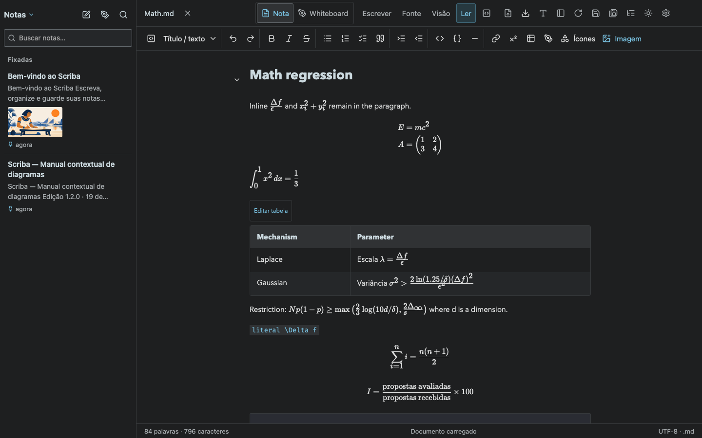
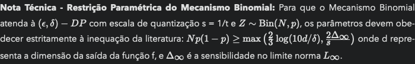
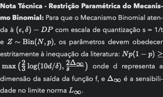

# Mathematical rendering

The editor uses bundled KaTeX and local fonts for reading, split preview, inline table previews and visual writing. It renders inline and display TeX, fractions, indices, powers, Greek symbols, sets, probability expressions, sums, integrals, matrices, aligned equations and cases. HTML is sanitized before KaTeX runs; TeX trust is disabled, expansion/size limits apply, and unsupported input remains visible.

Supported source notation: `$...$`, `$$...$$`, `\(...\)`, `\[...\]`, and fenced math/latex/tex. Imported un-delimited TeX with duplicated backslashes and Markdown-escaped indices is recognized conservatively. Plain prose, literal code, links, escaped currency and source-image reference labels are protected. Explicit delimiters are recommended for new documents. This supports KaTeX's mathematical TeX vocabulary, not arbitrary LaTeX documents or package execution. [KaTeX options](https://katex.org/docs/options.html).

Visual formula nodes preserve their exact raw tokens; reading and focusing them never serialize changes. A formula edit replaces only that token. Source block offsets remain in the original string for local editing and split synchronization.

The owner-selected differential-privacy guide is loaded from its local path at test time; the full private document is not copied into this repository. Its SHA-256 and its byte-identical Markdown download are checked after rendering, table-cell focus and visual writing. Captures below contain only the relevant mathematical passage. The original file is never written.

Validation:

- [69 Node tests](unit-tests.log), including TeX notation, imported fractions/constraints/cases, literal exclusions, HTML sanitation and source/error safety.
- [Chromium](chromium.log) and [WebKit](webkit.log): desktop/mobile rendering, accessible MathML, display markers, tables, exact source preservation, one-formula editing and the complete private reference document.
- [Existing editing and outline regressions](regressions.log).
- [Catalog validation](catalogs.log): formula controls translated into all four interface languages.

The custom PDF exporter is unchanged by this rendering feature and currently retains formula source as text. Markdown exports preserve the original mathematical notation.

## Wrapped LaTeX fence regression

A fenced `latex`/`tex`/`math` formula may also contain `\[...\]`, `\(...\)`, `$$...$$` or `$...$`. One complete outer delimiter pair is removed only from the rendering value. The original raw token remains unchanged in visual editing and Markdown exports. Partial or multiple expressions are never blindly stripped.

[Focused regression tests](latex-unit.log) cover all fifteen fence/delimiter combinations, including the owner-reported ratio of evaluated to received proposals. [Chromium](latex-chromium.log) and [WebKit](latex-webkit.log) verify the wrapped formula, display layout and exact source preservation through both viewing and editing.

