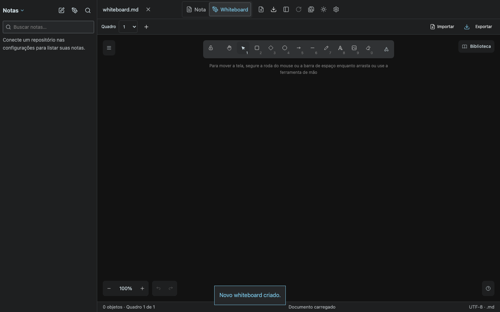
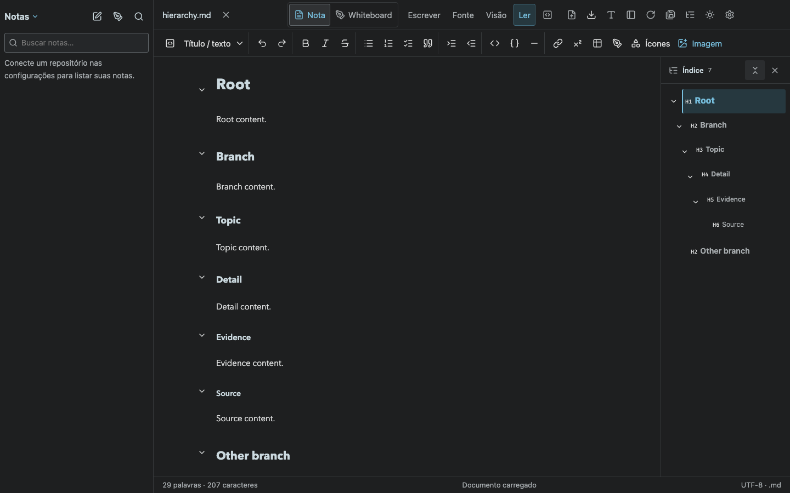
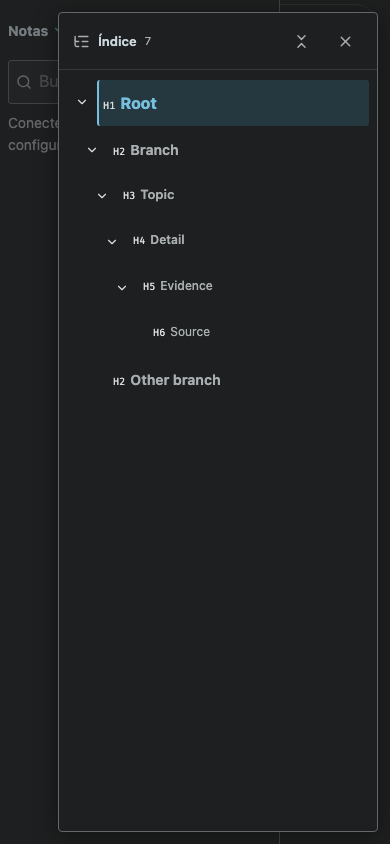

# Notes commands and six-level hierarchy

`npm run build` and `npm test` passed: 63 tests. The combined browser suite passed nine scenarios, including `tests/notes-hierarchy.spec.ts`.

- The Notes header contains new-note, new-whiteboard and search actions; refresh, counts and About remain available through its menu.
- Creating a whiteboard uses the existing save/discard/cancel flow. Cancel preserves the edited note; explicit replacement opens an editable blank Excalidraw canvas.
- H1–H6 have distinct hierarchy styling. Section controls in reading and outline controls share fold state. The outline shows arrows only for headings with nested items; a single icon beside Close toggles expand-all/collapse-all.
- Folding does not modify the exported Markdown. Desktop and mobile layouts are covered.

