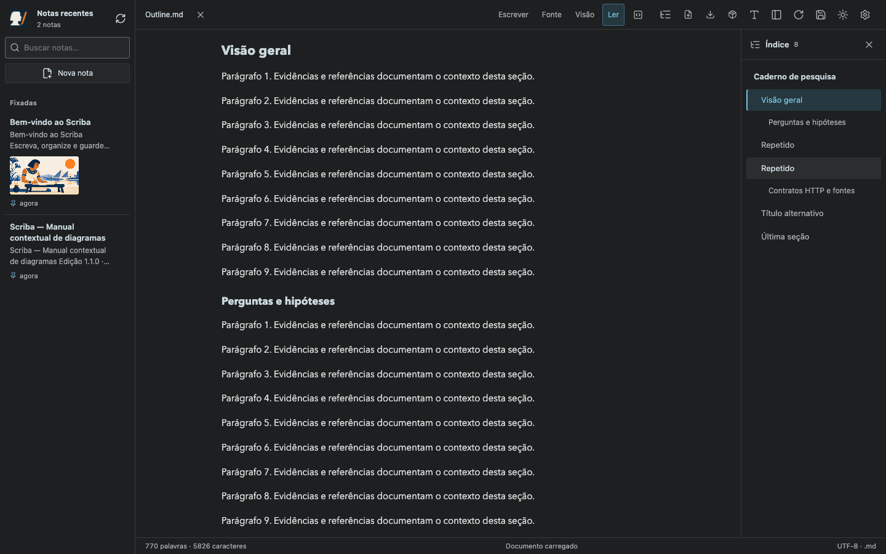
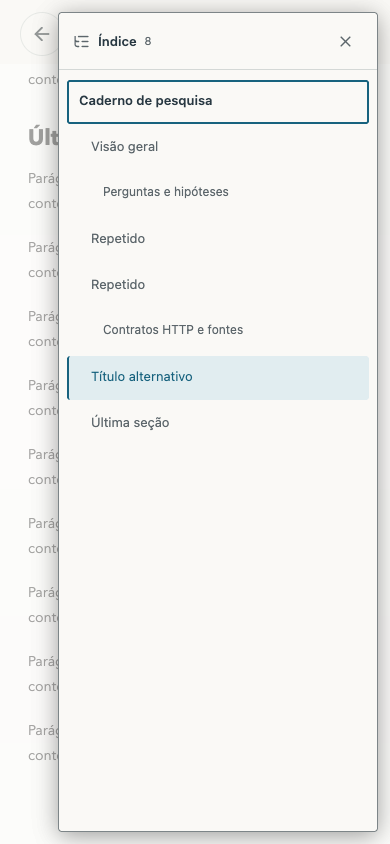
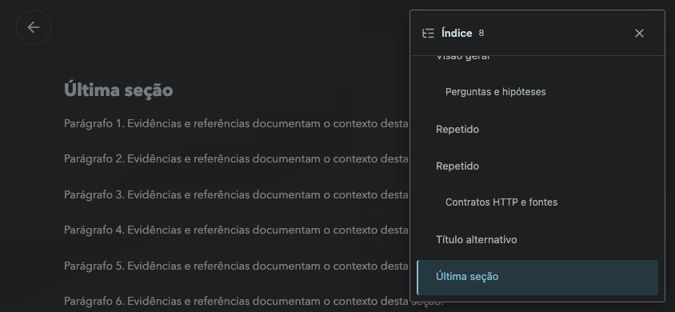
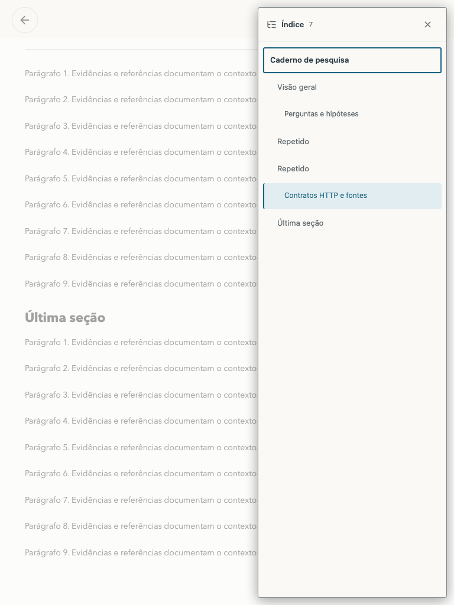
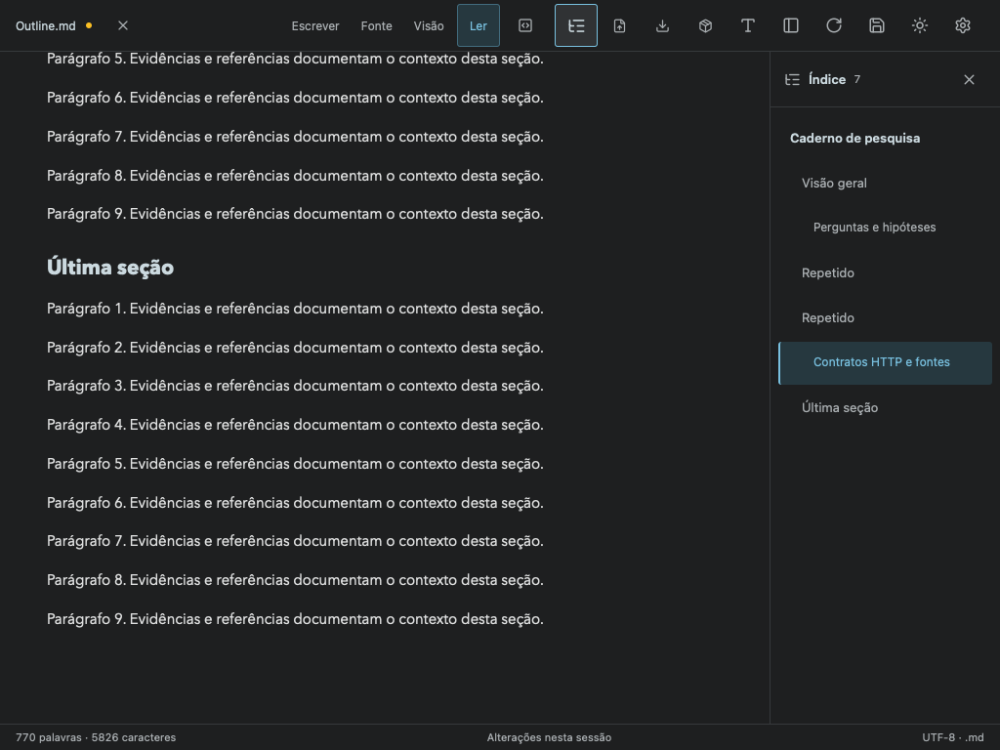

# Outline — Scriba 1.11.0

Índice opcional dos títulos H1, H2 e H3, com hierarquia visual, navegação, seção atual e atualização durante a edição. Usa a árvore Markdown e o mesmo gerador de âncoras da leitura, preservando títulos repetidos e Unicode. Código, comentários, hashes escapados e níveis 4–6 não viram entradas.











O teste funcional usa arquivo com BOM/CRLF, títulos duplicados, títulos formatados, Setext, falsos títulos em código/comentários e seções longas. Verifica navegação nos modos Ler, Fonte, Visão, blocos Markdown e edição visual, atualização após editar um título, foco/Escape, proteção de foco na folha móvel, estado sem títulos e preservação do arquivo/Git original. Tamanhos: 320 × 740, 390 × 844, 844 × 390, 768 × 1024 e 1024 × 768, nos dois temas.

```sh
npm run build
node tests/outline.smoke.mjs
MARKDOWN_BROWSER=webkit node tests/outline.smoke.mjs
node tests/reading-experience.smoke.mjs
VITE_STORAGE_MODE=browser npm run build
SCRIBA_URL=https://scriba.aeonbridge.app node tests/outline.smoke.mjs
```

Perfis de navegador e repositórios de teste são isolados. Nenhum arquivo pessoal é usado como fixture.
