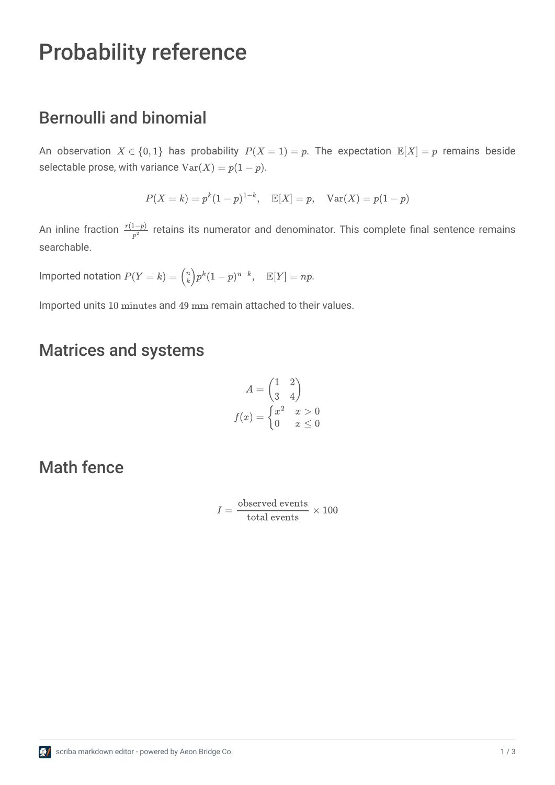
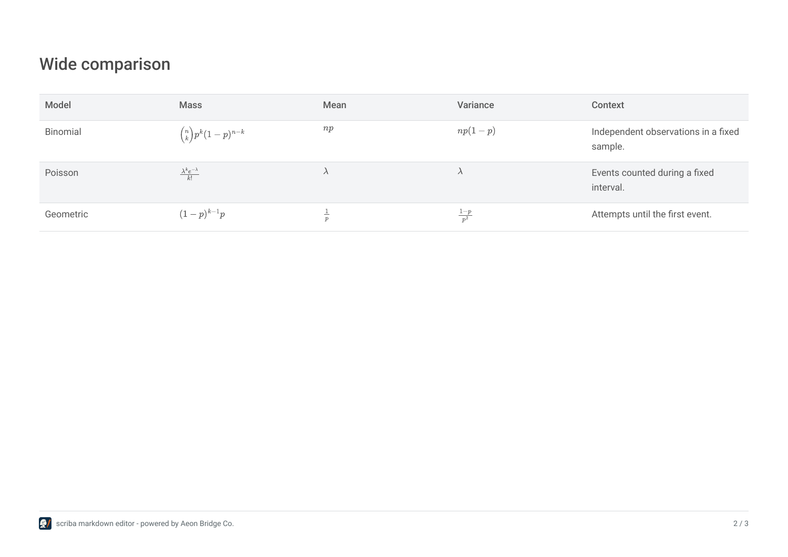
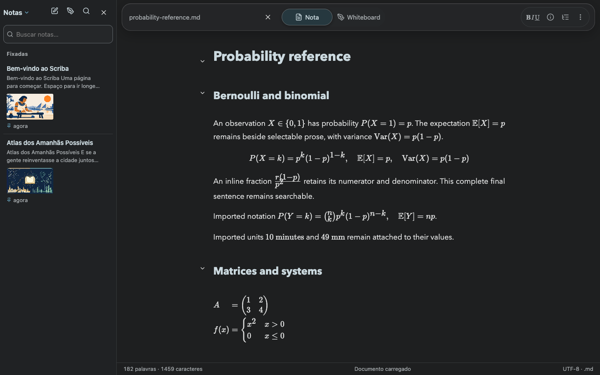
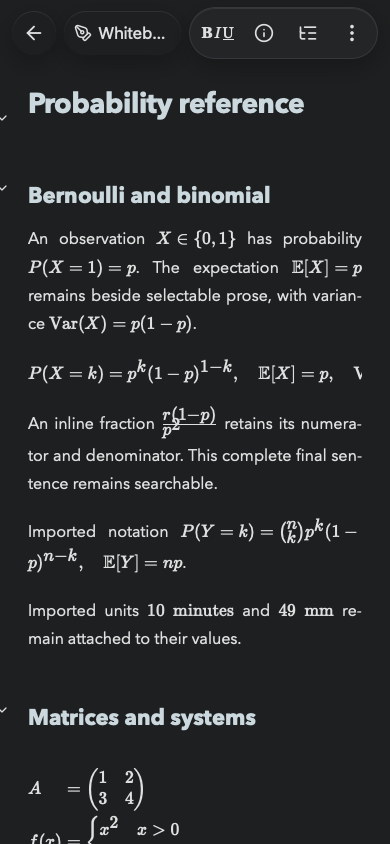

# PDF mathematics — 8 November 2026

Scriba 1.17.3 exports mathematical notation through its ordinary Markdown import and PDF menu. The PDF parser now runs `remark-math` and the existing compatible-math transform used by reading. Inline formulas, display equations, imported escaped TeX and `math`/`latex`/`tex` fences reach the PDF worker.

MathJax 4.1.3 produces self-contained SVG paths with bundled TeX font data. Its input packages are base, AMS and newcommand. Native PDF text retains prose, links and styling. Font metrics come from the same embedded fonts as final PDF layout. Formula baselines and line breaks use each paragraph's or table cell's available width after landscape table preparation. Individual lines can move across pages. Unsupported expressions retain their source as visible text.

The mathematical renderer loads when a document contains mathematical export annotations. Its module worker and resources are included in the offline shell and the native bundle. The worker uses micromark's pure JavaScript entity decoder because its default browser decoder requires a DOM.

## Regression coverage

`node --test tests/math.test.mjs tests/pdf-math.test.mjs tests/pdf-tables.test.mjs` passed 21 tests. Coverage includes baseline alignment, selectable prose/links, paragraph wrapping, immutable input, landscape cell widths, AMS matrices/cases/alignment, imported doubled escapes, numeric units and unsupported/active TeX fallback. Numeric units share the existing conservative import inference used by reading.

The complete suite passed 121 tests with the actual packaged Mac application supplied through `SCRIBA_MAC_BUNDLE`. No tests were skipped. It exercises package integrity, Finder associations and the existing save, Git, file-conflict and browser-storage contracts. [Complete test output](unit-tests.txt).

`tests/pdf-math.smoke.mjs` imports through the actual file input and exports through the current PDF menu in isolated browser contexts. It verifies source-preserving Markdown download, selectable surrounding prose, disappearance of raw formula commands from the synthetic mathematical PDF, literal code, branded footer and absence of export saves or unexpected external requests.

Chrome and WebKit passed the synthetic reference and the complete owner-provided course. The course exported to 27 pages. On the published HTTPS site, observed course export times were approximately 1.9 seconds in Chrome and 3.4 seconds in WebKit on the test Mac. These observations are descriptive. The Chrome PWA also passed a first mathematical PDF export after disconnecting the context, with the renderer loaded through the installed service-worker cache. [Local browser and Mac journeys](browser-results.json), [production journeys](production-results.json).

The existing non-mathematical table journey passed all four cases in both engines. Every cell was recovered, with continuation headers, page margins and portrait/landscape transitions checked. [Table geometry results](table-validation.json).

The bundled iOS application passed its actual export-to-share-sheet test on an isolated iPhone Duo simulator running iOS 27.1. PDFKit verified all 120 table cells, native selectable prose, disappearance of raw TeX commands and portrait/landscape transitions across four pages. [Xcode test summary](native-test.json), [native PDF checks](native-pdf-table-regression.json), [native synthetic PDF](native-pdf-table-regression.pdf).

Visible body glyphs and mathematical vector paths in the browser, Mac, course and native artifacts stayed inside the content margins. Whitespace advance boxes and the deliberately reserved footer band are excluded from body ink checks. [Geometry audit](geometry.json).

The owner's course and its complete generated PDFs remain local. Two TeX groups in its tables contained embedded generation markers, the start/end pairs for `span_144` and `span_145`. A separate Markdown copy removed those four markers for the delivered PDF. The original attached file retained its SHA-256. The synthetic reference below contains authored, non-private examples.

## Deployment

Version 1.17.3 is published at https://scriba.aeonbridge.app/ and installed at `/Applications/Scriba.app`. The public release uses browser storage mode, and its HTTPS HTML digest matches the built distribution. The local application was replaced through an atomic filesystem exchange after package verification. Its code signature and served HTML passed verification, with the existing backend process continuing to serve the editor. Previous complete releases and hashed assets provide rollback and support for already-open windows. [Release receipt](release.json).

## Evidence

[Synthetic reference PDF](probability-reference.pdf) demonstrates fractions, indices, binomial coefficients, matrices, aligned equations, cases and mathematics in landscape table cells.

