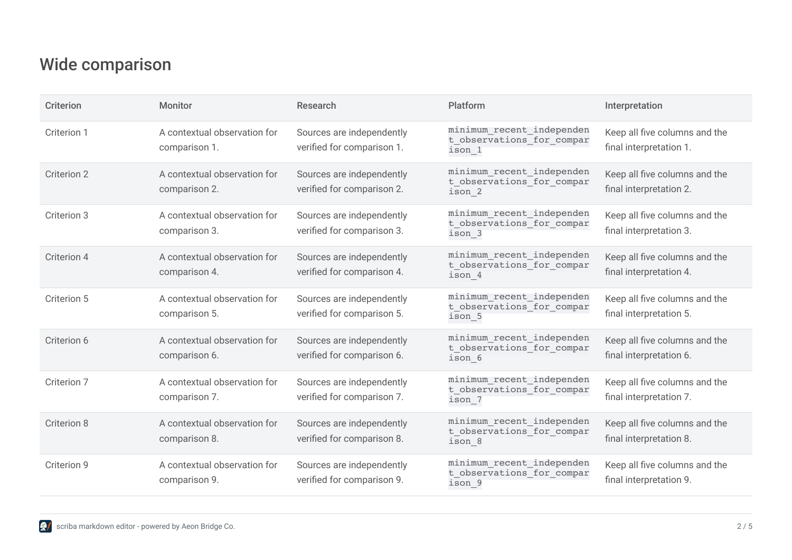
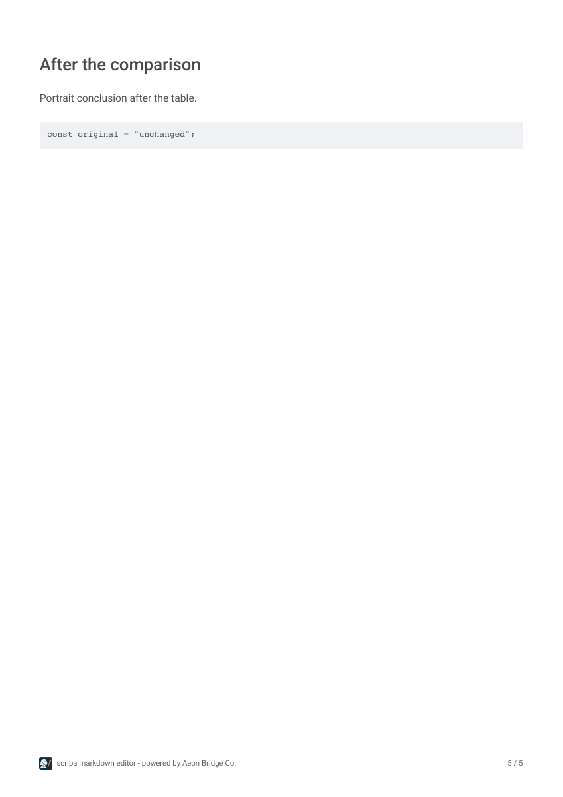

# PDF tables: landscape pages and complete columns

Validated on 6 November 2026 through the real file input, export menu, production PDF worker and downloaded PDF in Chrome and WebKit. The owner-supplied report remains outside this repository. The screenshots and example below contain synthetic data.

## Fix

Equal `*` widths made pdfmake apply the largest unbreakable cell's minimum width to every column. A long technical identifier could push whole columns beyond an A4 page while the export appeared successful.

The worker now uses bounded, content-weighted numeric widths. Top-level tables with at least five columns, or estimated readable widths exceeding portrait A4, start on separate **landscape A4** pages. An immediately preceding heading moves with its table. Following prose resumes in portrait. Consecutive wide tables start separately; a table-only note has no blank leading or trailing page.

Table text stays **10 pt**, including tables previously reduced to 8.5 pt. Alignment, inline formatting and zebra fills remain. Headers repeat across pages. Ordinary rows stay together; an oversized row can continue rather than losing its content. The branded footer follows each page's actual width.

Tables nested in lists or blockquotes retain their containing flow and receive container-bounded widths. Code panels are not treated as Markdown tables. The patch changes neither the Markdown source nor the browser reading layout.

## Results

- **6 unit regressions**, strict TypeScript and a production build passed.
- **5 real export cases per browser passed**: the owner report, mixed orientations, consecutive table-only sections, a record containing 800 words, and a long unbroken identifier. Source exports remain byte-identical, with no save/sync writes during export or external requests.
- PDF geometry checks passed on **all 10 exports**: complete cell text, no body glyph beyond page margins, expected orientations, repeated headers, readable table text, and no blank/footer-only pages.
- The owner report has **101 complete cells** and **8 pages**: portrait, portrait, landscape, landscape, portrait, portrait, portrait, portrait. The original Markdown and PDF were preserved. No private report content is included in these evidence assets.
- All four synthetic cases also passed through an isolated local HTTP server with the unchanged application CSP. No `unsafe-eval` or Blob worker allowance was introduced.
- Poppler page renders were inspected, including continuation headers, all columns, the footer and the return to portrait prose.

[Unit results](unit-tests.txt) · [PDF validation](pdf-validation.json) · [Synthetic PDF](mixed-example.pdf).





## Repeat

Build and serve a public-mode bundle locally, then run:

```sh
node --test tests/pdf-tables.test.mjs
SCRIBA_PDF_OUTPUT=/tmp/scriba-pdf-check node tests/pdf-tables.smoke.mjs
MARKDOWN_BROWSER=webkit SCRIBA_PDF_OUTPUT=/tmp/scriba-pdf-check node tests/pdf-tables.smoke.mjs
python3 tests/check-pdf-tables.py /tmp/scriba-pdf-check
```

Use `SCRIBA_URL` for a different origin and `SCRIBA_PDF_SOURCE` to test a private Markdown path without committing it. Python needs `pdfplumber`; visual inspection uses Poppler. These are automated browser tests, not physical iPhone validation. The existing App Store submission is unchanged.

Primary references: [pdfmake page orientation](https://pdfmake.github.io/docs/0.3/document-definition-object/page/), [tables and repeated headers](https://pdfmake.github.io/docs/0.3/document-definition-object/tables/), and the installed pdfmake 0.3.12 column calculator and fixed-width line wrapping.
