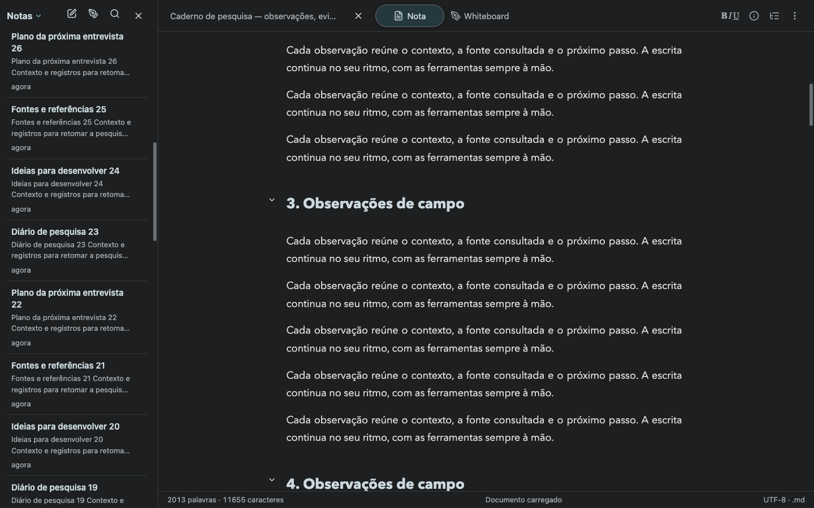
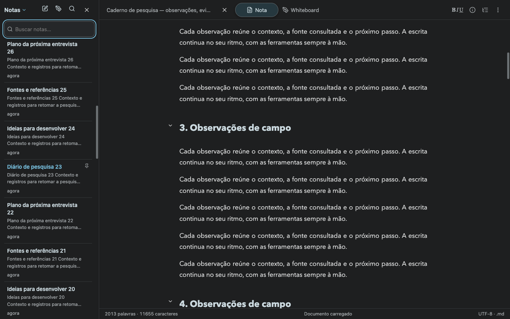
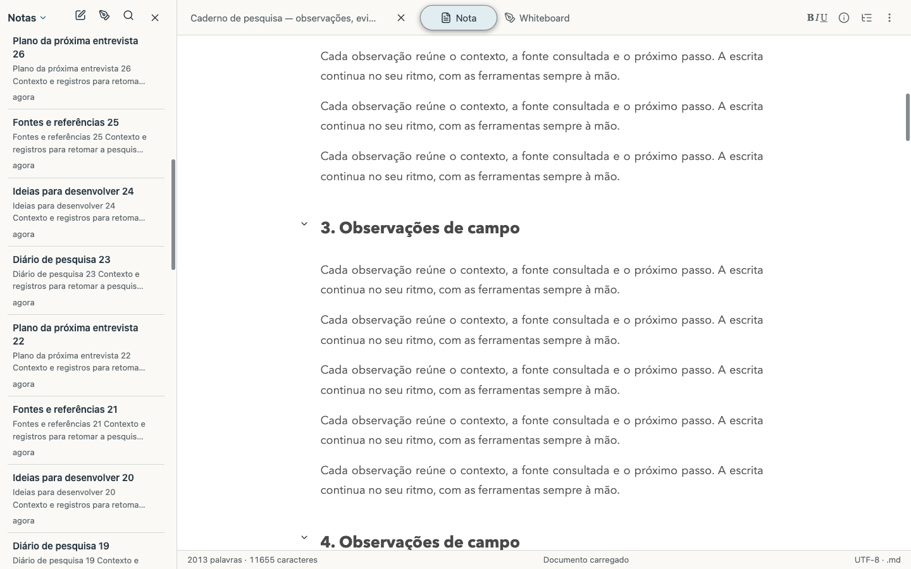
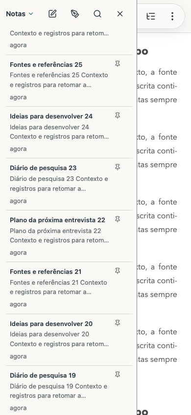
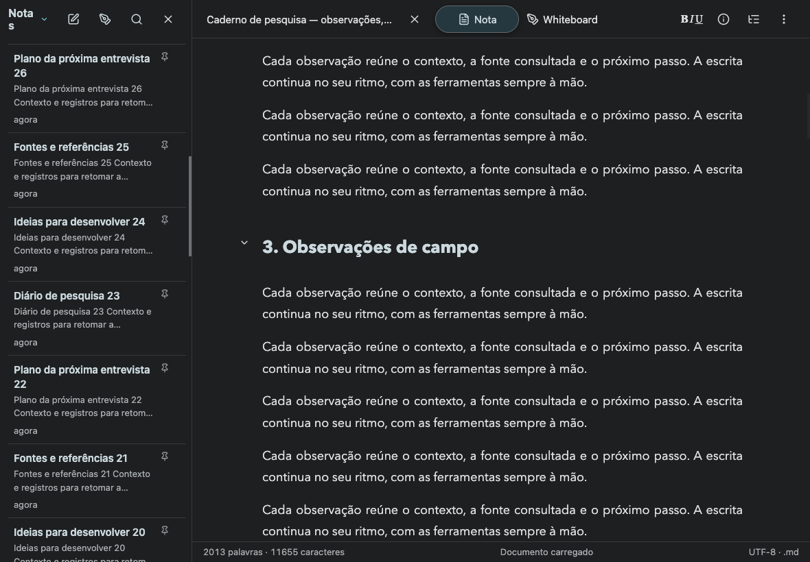

# Fixed tools and scrollbars

Scriba 1.17.4 gives the note list its own scroll container. The library commands and optional search field stay above it. The document toolbar occupies a fixed row at the top of the editing pane, with a 1px separator and a 56px minimum height on desktop. The mobile reading controls occupy their own row above the document.

The library and document use thin rounded scroll indicators with transparent tracks. Theme tokens define the thumb colors and increase their contrast when requested by the system. Browser checks calculate at least 3:1 contrast against the actual sidebar surface in both themes. The notes panel has an opaque surface, including its overlay presentation.

Search starts collapsed. Clicking the magnifier opens and focuses the field. Clicking it again closes the field and clears the filter. The browser journey checks the full list returns, and a subsequent opening starts with an empty field.

## Verification

- The complete suite passed 122 tests with the validated Mac package, including its signature, document associations and bundled runtime. [Test output](unit-tests.txt).
- Actual Markdown file imports create a synthetic library and a long document. Chrome and WebKit check independent pane scrolling, stationary commands, the search toggle and both themes at desktop, phone and tablet portrait/landscape sizes. [Built application](browser-results.json), [published HTTPS application](production-results.json).
- Chromium and desktop WebKit exercise mouse-wheel scrolling. The desktop checks also exercise PageDown. Playwright mobile WebKit uses DOM scrolling for layout assertions. Those cases verify geometry and controls, with the input method recorded per result.
- The real packaged Mac server passed the same desktop journey against an isolated Git repository and local bare remote. [Mac journey](mac-results.json).
- Table reading, horizontal keyboard navigation and visual table editing passed seven viewports in each engine at the public origin. [Table results](table-results.json).
- The reading-continuity regression preserved its focused outline heading through four WebKit reflows. [Continuity result](reading-continuity.txt).
- Public, local and iOS bundles passed locale validation, strict TypeScript and production compilation.

## Deployment

The browser-mode release is published at https://scriba.aeonbridge.app/. The installed Mac package is `/Applications/Scriba.app`. Its complete previous package is retained for rollback. Activation used an atomic package exchange, and the running local server continued serving the new distribution. The release receipt records source, build modes, application-shell caches and verified served HTML fingerprints. [Release receipt](release.json).

## Screenshots

The following screenshots contain synthetic notes imported in isolated test contexts.

