# Scriba 1.9.0 — leitura, edição visual e diagramas

Validação em 19/10/2026 com navegadores reais Chrome e WebKit via Playwright. Os testes usam perfis, notas e repositórios Git temporários; nenhum arquivo pessoal é alterado.

## Leitura e tabelas

Tipografia Avenir Next quando disponível, com alternativas locais do sistema; parágrafos justificados, entrelinha de 1,75, corpo de 14 px em telas estreitas e 15 px no desktop. Títulos, listas e células mantêm seus alinhamentos. Tabelas preservam a largura útil e permitem rolagem horizontal sem barra visível, com linhas alternadas discretas.

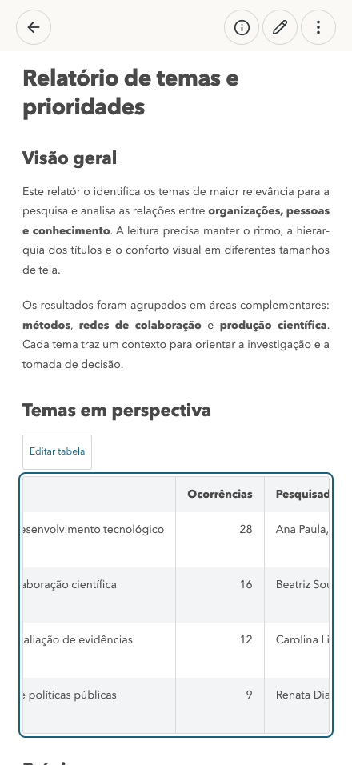

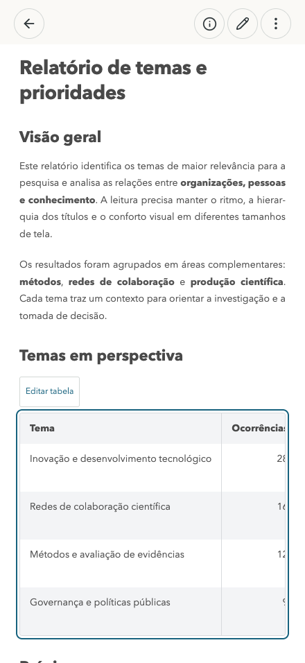

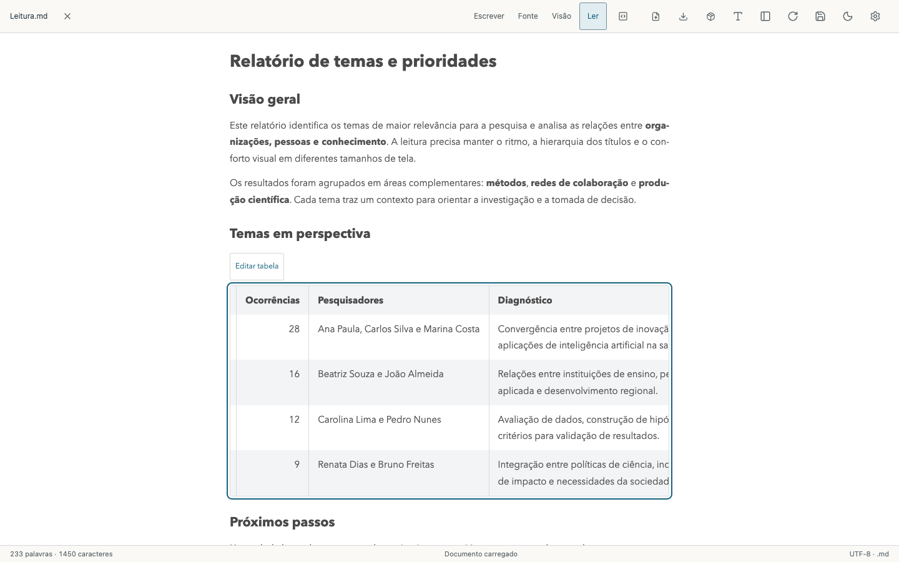

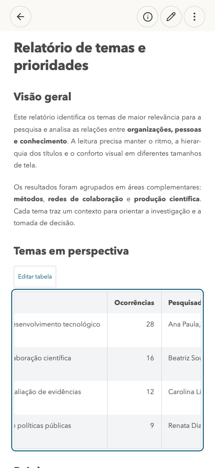

## Edição visual

Editar nota/Escrever mantém o documento formatado. Testados: texto e células diretamente, novo parágrafo, negrito, desfazer/refazer e ⌘S com o editor visual ativo, incluindo commit e push para um remoto Git temporário. Os testes verificam comentários, referências, imagens externas não carregadas, cercas Mermaid e BOM/CRLF preservados nos trechos não alterados. Entrar/sair sem digitar não regrava a nota.

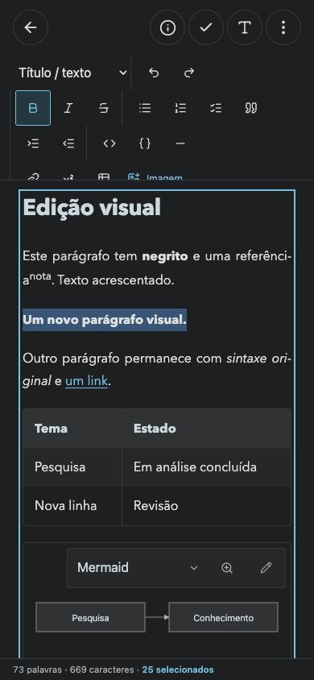

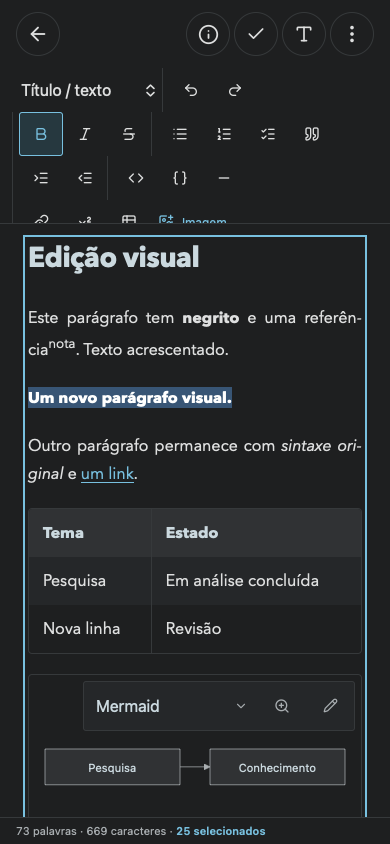

## Diagramas

Zoom de 100% a 600% pela roda ou botões, sem remontar o SVG nem executar o motor. Painel de código Mermaid com cores de sintaxe e fundo distinto, cópia pelo clipboard e exportação integral em SVG ou PNG transparente. Exportações verificadas nos três motores; os testes leem o SVG baixado e contam pixels com/sem alfa no PNG. Também verificam a lupa, interação por teclado/toque e isolamento de IDs.

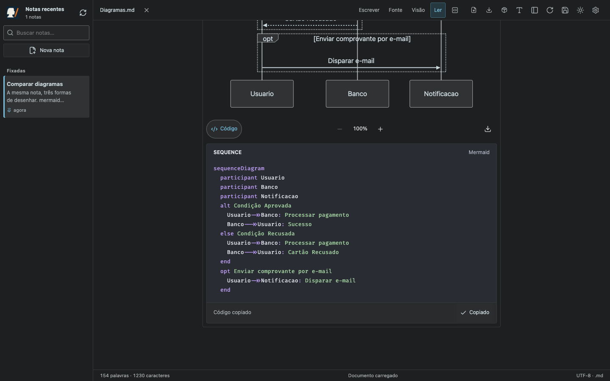

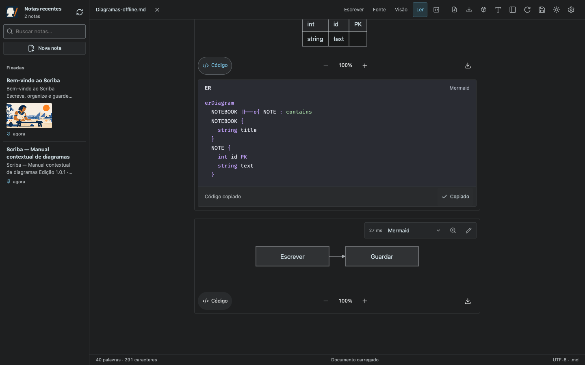

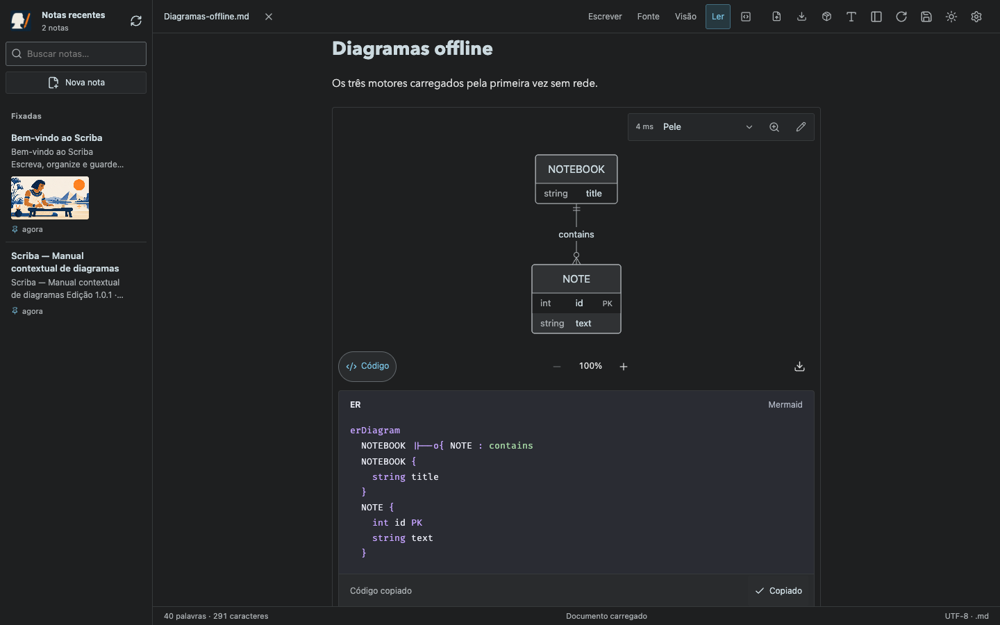

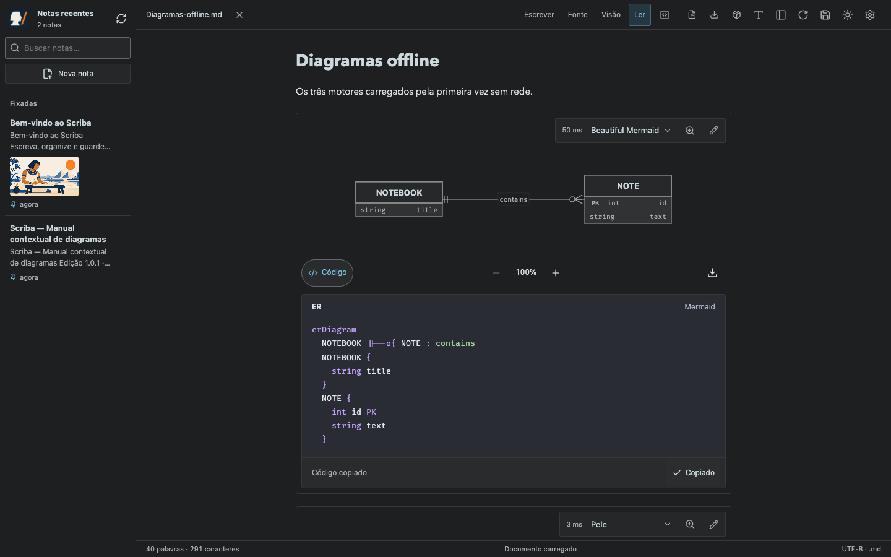

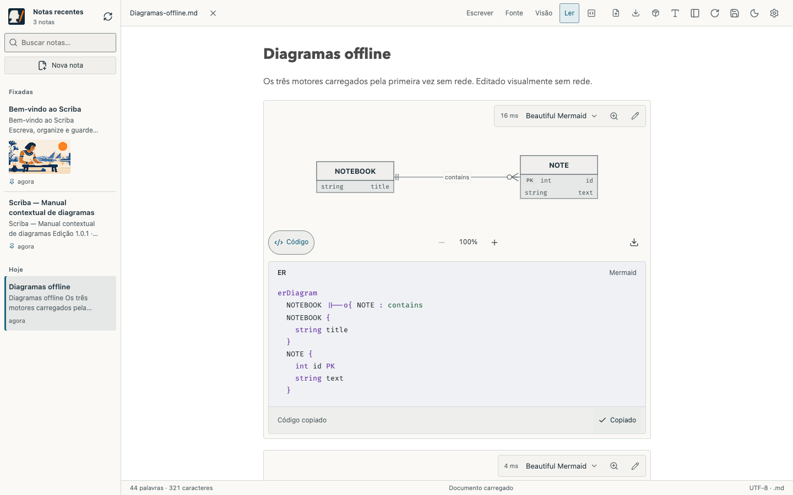

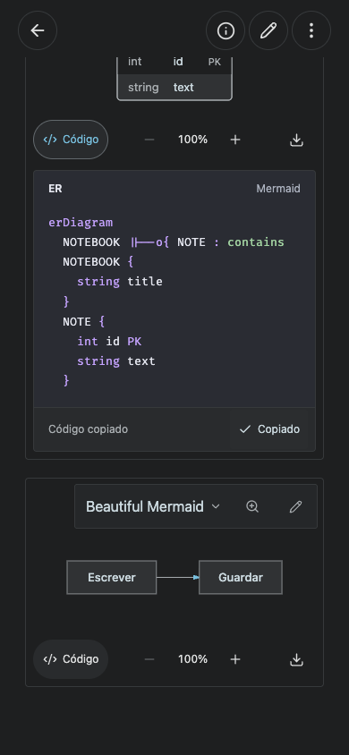

## Reproduzir

```sh
npm ci
npm run build
npm test
node tests/reading-experience.smoke.mjs
MARKDOWN_BROWSER=webkit node tests/reading-experience.smoke.mjs
node tests/diagrams.smoke.mjs
MARKDOWN_BROWSER=webkit node tests/diagrams.smoke.mjs
node tests/block-editing.smoke.mjs
node tests/selection-statistics.smoke.mjs
VITE_STORAGE_MODE=browser npm run build
node tests/diagrams-browser.smoke.mjs
node tests/diagram-reference-browser.smoke.mjs
```

Layout verificado em 320/390/440 px, celular nas duas orientações, tablets nas duas orientações e desktop 1440×900, nos temas claro/escuro. Testes de WebKit e eventos de toque simulam o comportamento do navegador; não equivalem a uma validação física em todos os modelos de iPhone/iPad.
