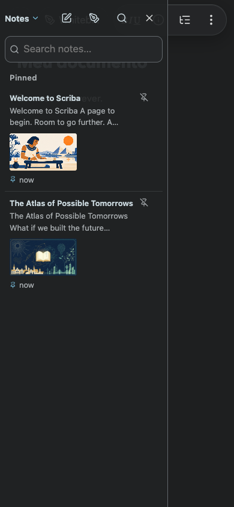

# Recent notes from the mobile menu

The recent-notes command opens the library without having it dismissed by focus restoration to the menu invoker. The compact-layout focus listener now ignores toolbar focus; document interaction still closes the overlay.

Validation: `node tests/recent-notes-menu.smoke.mjs` using installed Chrome with a 390×844 touch viewport. The test opens the menu command twice, explicitly restores invoker focus after each command (the delayed native-dialog ordering), checks that the library remains open, closes it, reopens it with Back to notes, and dismisses it by interacting with the document. The delayed-focus assertion failed before the fix and passed afterward.

Local Mac and simulator builds only. No App Store Connect or review submission changes.
