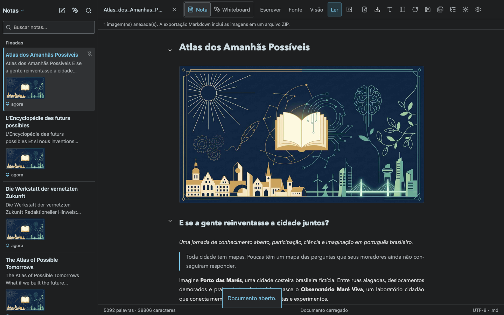
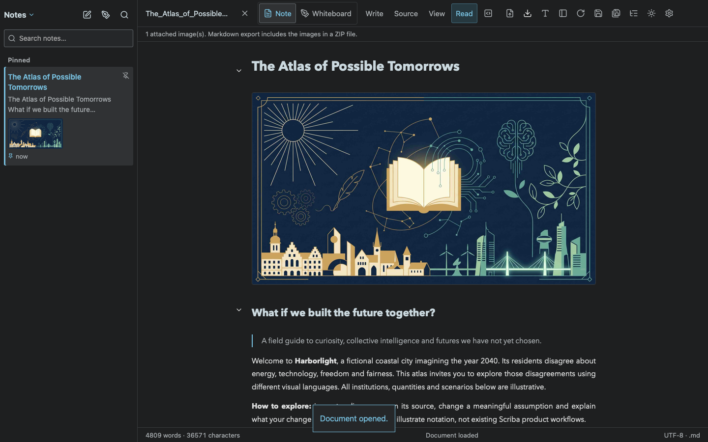
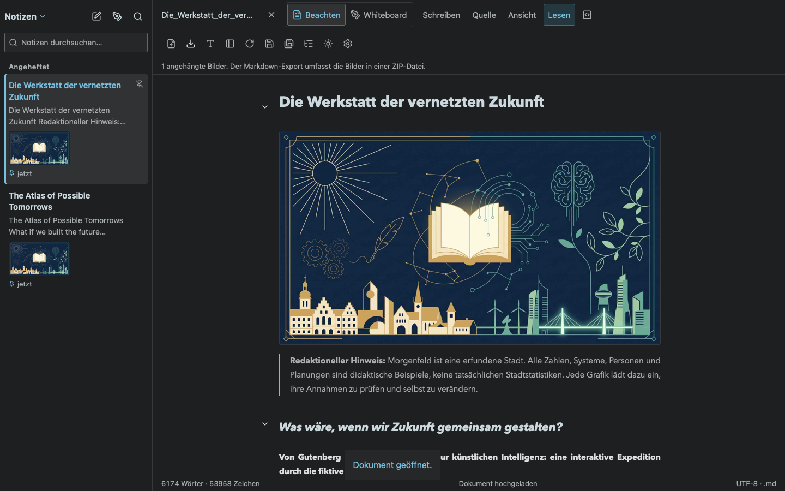
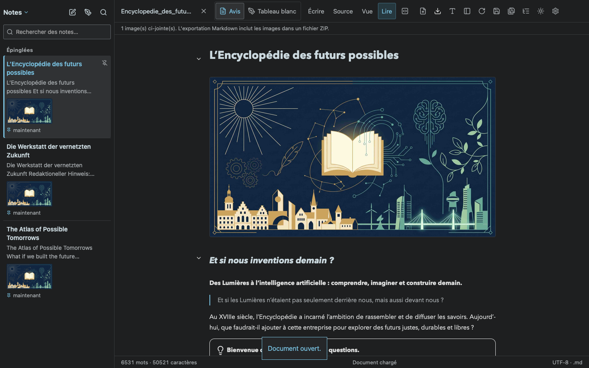

# Independent reference texts

Four owner-provided Markdown documents are bundled unchanged apart from the requested shared cover link. Each original file in Downloads and its bundled copy uses ``. The German document, which lacked a cover, receives it after the title. Existing unused asset files are preserved. The common bundled JPEG is byte-identical to the supplied `assets/cover.jpg`.

The selected interface language chooses which independent reference to initialize. Unsupported device languages resolve to English through the existing locale setting. Language changes refresh the available references without replacing the open note. Locale seed metadata preserves edits, deletion and unpinning, and travels with explicitly transferred repository files. The application never translates the owner's documents at runtime.

New clients do not seed the obsolete common starter files. Existing user libraries, notes and legacy manuals remain intact. Older clients that omit a locale continue using the backward-compatible initialization endpoint. Name collisions select a numbered filename; an unrelated repository cover causes references to be placed in a separate directory, retaining the relative `assets/cover.jpg` link.

Browser draft ownership now stores a canonical library scope, independent of translated labels. Legacy private-library labels remain readable across languages, while a genuinely different scope still blocks restoration.

Validation:

- [72 Node tests](unit-tests.log), plus [focused HTTP/reference assertions](reference-tests.log): all four authored sources, cover equality, filename/cover collision protection, edits, unpinning and deleted references.
- [Chromium](chromium.log) and [WebKit](webkit.log): live selection of all four files, cover loading, exact source preservation, reload after language changes, and foreign-scope draft protection.
- [Nine editing and outline regressions](regressions.log).
- Local Mac assets, server and reference files updated; signature verified and loopback service restarted successfully. Existing editor windows were not closed.

