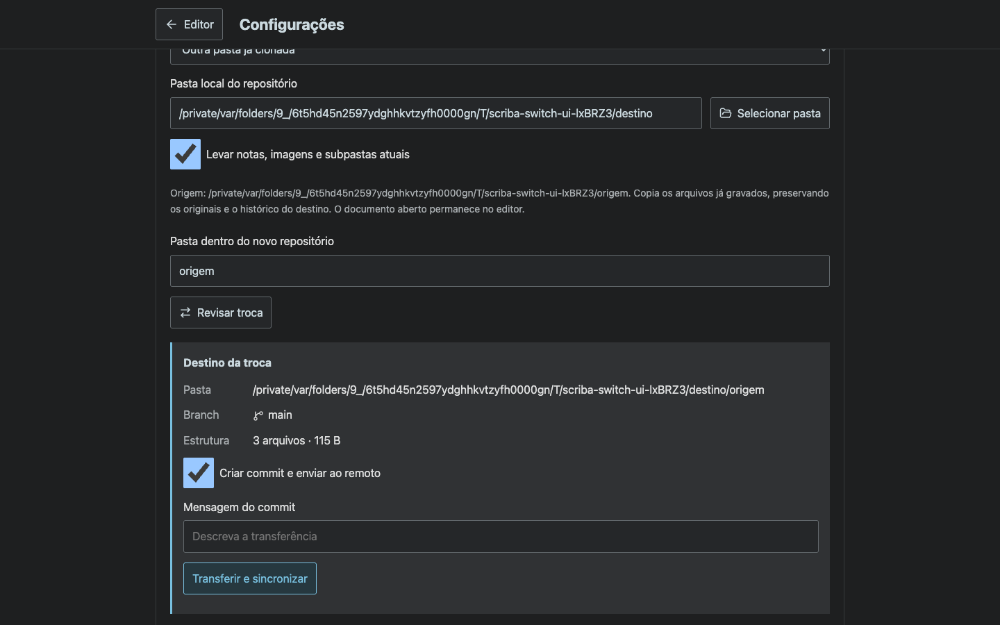
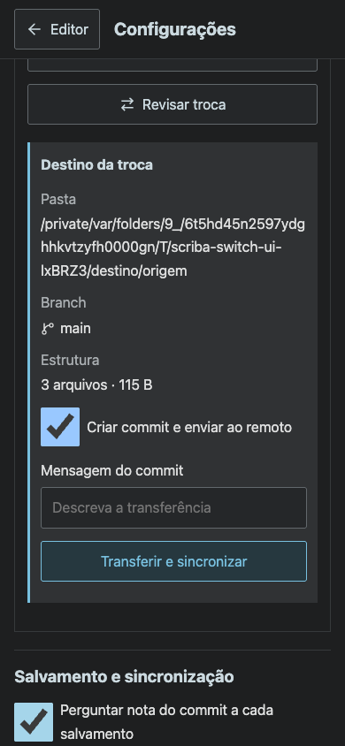

# Repository connection and transfer

Generated fixtures only. The browser uses the real local HTTP API and real Git checkouts/bare remotes. The OS folder picker result is simulated; copying and commit/push operations run on actual temporary files.

`node tests/repository-switch.smoke.mjs` verifies disconnect/reload, retained drafts, cancellation, picker selection, collision resolution through an import subfolder, image paths, commit/push, saving the retained draft under its new path, and automatic-save suspension when switching without copying. `npm test` passes 45 HTTP integration tests, including nine focused repository-switch tests.

## Reviewed transfer on desktop

## Reviewed transfer on mobile

