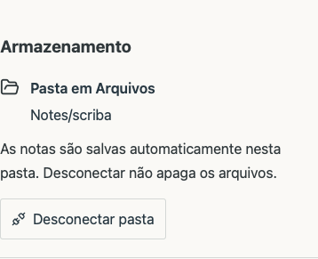
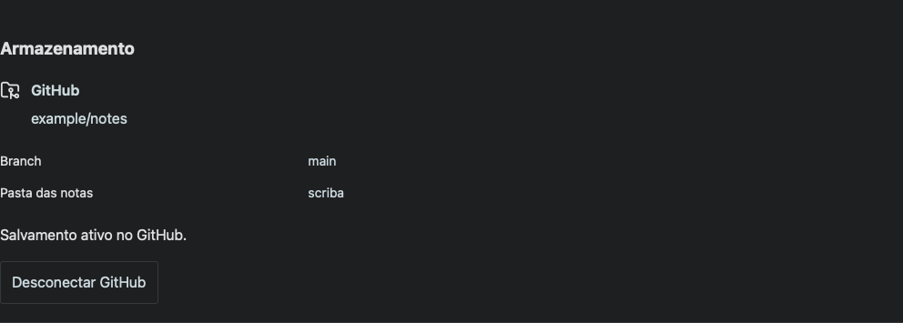

# Unified storage settings

The editor now presents one active destination under Storage. Without an external destination, a short private-storage status precedes Choose folder and Connect GitHub. GitHub setup is revealed on request. An active folder shows its path and Disconnect folder; an active GitHub repository shows its repository, branch and repository-relative folder with Disconnect GitHub. Alternative destinations are hidden while a destination is active. Disconnecting a folder no longer clears the GitHub selection. A stale folder association is cleared when the GitHub destination is changed, without deleting external files.

The app retains its existing typography, theme tokens, visible keyboard focus and 44-pixel action targets. All new strings are translated into English, German and French. Native filesystem authorization is unchanged.

`node tests/storage-settings.smoke.mjs` and `MARKDOWN_BROWSER=webkit node tests/storage-settings.smoke.mjs` pass the local/folder/GitHub states, both disconnect flows, a stale-folder association with GitHub active, and responsive width checks at 390×844 and 1440×900. Tests use isolated browser data and a fixture GitHub account; no real repository or credentials are accessed. TypeScript and locale checks pass. These are browser tests, not physical-device QA.

| State | Light mobile | Dark desktop |
| --- | --- | --- |
| Private storage | [Mobile](light-390-local.png) | [Desktop](dark-1440-local.png) |
| Folder | [Mobile](light-390-folder.png) | [Desktop](dark-1440-folder.png) |
| GitHub | [Mobile](light-390-github.png) | [Desktop](dark-1440-github.png) |

